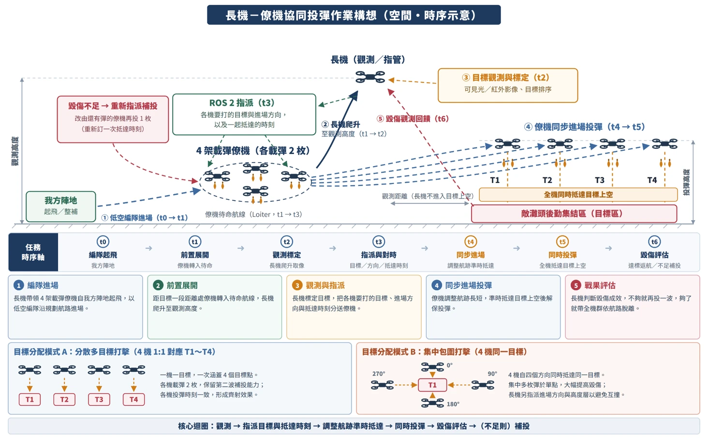

# 僚機自主進場 × 協同投彈作業構想 交接說明（2026-09-21）

> **給下一個對話。**
> 專案 repo：`C:\Users\joy46\Documents\Projects\aeroplan-studio`，分支 `quad_swarm`，HEAD `3442fcb`（working tree dirty 224 項，**與本工作無關**）。
> **本工作的程式不在這個 repo**：在 WSL `~/swarm_ws`（自己的 git，HEAD `73bddef`，**28 項未提交**，見 §5.4）。
> **備份包**：WSL `~/swarm/handoff_0921/`（E 定案版、V7 線上快照、啟動與分析工具、harness、報告）。內容與用法見該目錄 `README.md`。
> **紀律**：每個數字後面有出處。標記：`[實測]` 我跑出來的、`[讀碼]` 讀原始碼、`[報告值]` 子 agent 回報而我沒重跑、`[推論]` 沒有直接驗證。
> 被自己的量測推翻的結論**留著並標明推翻**（§7）——那是最貴的資訊。

---

## 0. 三十秒摘要

| | |
|---|---|
| 主線 | 讓三台多旋翼僚機**不靠長機**、自己規劃路徑、**平滑準時**抵達目標上空（Gazebo 驗收）。 |
| ⭐ 2026-09-21 新增的硬性要求 | 使用者貼了「長機－僚機協同投彈作業構想」圖，說**「整場要符合此架構」**。圖見 §2，逐項對照見 §3。 |
| 做完的 | 7 趟 Gazebo 無長機自主實飛（§4）。第七趟（配速爬升估計器 **E**）三台 A1「無掉速」首次全過、W2 jerk 4.71/4.28/4.14 → 3.59/3.82/3.67。 |
| ⚠ 最重要的一句話 | **七趟實飛只覆蓋圖上 t4→t5 的一小段，而且全是「無長機」。** 整場（長機觀測→指派目標與抵達時刻→同時投彈→毀傷評估→補投／脫離，加 4 架僚機）**沒有任何一趟飛過**；而且據 `~/swarm/drive_gz/` 的檔案時間，**最後一次有長機節點的 Gazebo 航次是 09-10**（`leader1.log` 20:26；`runs/` 底下 7 趟都沒有 `leader1.log`）。 |
| 被擋住、等使用者決定 | **E 沒有移植進 swarm_ws**：自動權限分類器擋下 `port_E.sh apply`（「修改共用資源」）。第七趟是從 E 副本以 `PYTHONPATH` 載入飛的。 |
| ⚠ 風險 | swarm_ws 的僚機自主工作**全部沒 commit**（`reftraj.py`、`toa.py` 等核心新檔都是 untracked）。已做備份（§5.4），但**還沒有 commit**——這要使用者同意。 |

---

## 1. 使用者的要求（原話與時間，不要改寫）

| 日期 | 原話／決定 | 意義 |
|---|---|---|
| 09-14 | 「我是希望僚機是有自主飛行的能力 不用依靠長機 所以我想看僚機是否可以平滑順利抵達目標上空」 | 驗收看的是 **Gazebo 飛出來的樣子**（速度剖面不可一頓一頓），不是規劃器輸出。 |
| 09-14 | 「我們現在專注在僚機的自主性 所以僚機的路徑生成要做好」 | |
| 09-15 | 配速過衝選**「估計隊友抵達」**，不要懸停等待（C2 不採用） | E 就是這個方向。 |
| 09-21 | 貼構想圖：「**整場要符合此架構**」 | 見 §2、§3。 |
| 長期 | 一律**繁體中文**；每個階段/版本留 **GIF＋截圖**並用 `SendUserFile` 送給使用者（進度報告用）；不可靜默吃舊參數（effective-value 契約） | memory：`user-writes-traditional-chinese`、`progress-artifacts-required`、`effective-value-contract` |

**我對兩個要求怎麼並存的理解（`[推論]`，請向使用者確認，見 Q1）**：
圖上長機負責 t2 觀測、t3 指派、t6 評估；**僚機負責 t4 自己規劃航跡並準時抵達**。
這與「僚機自主」相容——長機下指令，僚機自己走；**長機不在時退化成僚機自己協調**（`SWARM_AUTONOMOUS=1` 已經是這個行為）。
⚠ 使用者 09-14 定調過：解除長機依賴要做成**開關**，不可刪掉「長機核准」那條路（`edge-plan-leader-approve`）；兩者衝突時**先問**。

---

## 2. 作業構想圖（轉錄；原圖 `docs/images/sortie_concept_2026-09-21.png`）



**標題**：長機－僚機協同投彈作業構想（空間・時序示意）

**角色與地點**：長機（觀測／指管，在觀測高度）；**4 架載彈僚機（各載彈 2 枚）**；我方陣地（起飛／整補）；敵灘頭後勤集結區（目標區）。長機**不進入目標上空**（觀測距離）。

**時序軸**

| t0 | t1 | t2 | t3 | t4 | t5 | t6 |
|---|---|---|---|---|---|---|
| 編隊起飛（我方陣地） | 前置展開（僚機轉入待命） | 觀測標定（長機爬升取像） | 指派與對時（目標／方向／抵達時刻） | 同步進場（調整航跡準時抵達） | 同時投彈（全機抵達目標上空） | 毀傷評估（達標返航／不足補投） |

**五個步驟**

1. **編隊進場**（t0→t1）：長機帶領 4 架載彈僚機自我方陣地起飛，以低空編隊沿規劃航路進場。
2. **前置展開**（t1）：距目標一段距離處，僚機轉入**待命航線（Loiter）**，長機爬升至觀測高度（t1→t2）。
3. **觀測與指派**（t2→t3）：長機標定目標（可見光／紅外影像、目標排序），**用 ROS 2 把「各機要打的目標、進場方向、一起抵達的時刻」分送僚機**。
4. **同步進場投彈**（t4→t5）：僚機**調整航跡長短**，準時抵達目標上空後解保投彈；全機同時抵達。
5. **戰果評估**（t6）：長機判斷毀傷成效；**不夠就再投一波**（改由還有彈的僚機再投 1 枚，**重新訂一次抵達時刻**）；夠了就帶全機群依航路脫離。

**目標分配**

* **模式 A：分散多目標打擊**（4 機 1:1 對應 T1～T4）。每機載彈 2 枚，保留第二波補投能力；各機投彈時刻一致，形成齊射效果。
* **模式 B：集中包圍打擊**（4 機同一目標）。4 機從四個方向（0°／90°／180°／270°）同時抵達同一目標，集中多枚彈於單點；長機另指派進場方向與**高度層**以避免互撞。

**核心迴圈**：觀測 → 指派目標與抵達時刻 → 調整航跡準時抵達 → 同時投彈 → 毀傷評估 →（不足則）補投。

---

## 3. 圖 vs 程式現況（**本文最重要的一節**）

圖例：✅ 有，且實飛過｜🟡 有但只在舊碼／離線／以人代替，或做法不同｜❌ 沒有。

| # | 圖上環節 | 程式現況 | 出處 | 狀態 |
|---|---|---|---|---|
| 1 | t0 編隊起飛＋低空編隊進場 | `run_drive_gazebo.sh`（09-10）：長機＋3 僚機起飛、編隊 TRANSIT 到觀測點 | `[讀碼]` `leader_control/sortie.py:56,211-224`；memory `gazebo-backend-facts`（09-09 完整飛過兩段式） | 🟡 **舊碼**實飛過（僚機當時是 carrot、核准模式）。V4–V7／posvel／E 之後**沒有**在有長機下飛過 |
| 2 | t1 僚機轉入待命航線（Loiter） | 長機端 `S_HOLD` 在觀測點待命；**僚機端沒有 LOITER 相位**，相位只有 FORMATION／CLIMB／RUN_IN／ON_TARGET（待命＝FORMATION 跟隨，無長機時 `_auto_hold` 原地懸停） | `[讀碼]` `sortie.py:57`、`follower_control.py` 的 `self.phase =` | 🟡 多旋翼以懸停代替繞圈。**要不要繞圈？**（Q5） |
| 3 | ② 長機爬升至觀測高度（t1→t2） | 在 `leader_control.py`／`sortie.py` grep `obs_alt`／`爬升`／`climb` **無命中**；`_at_observation()` 只判水平 | `[讀碼]` `leader_control.py:450` | ❌（grep 無命中，**未逐行確認**） |
| 4 | t2 觀測標定（可見光／紅外、排序） | 以**人**下目標取代（GCS 訊息 `observe`／`target`；`fly_auto.py` 扮演操作員） | `[讀碼]` `leader_control.py:189-201` | 🟡 模擬中以人代替可接受 |
| 5 | 觀測距離：長機不進入目標上空 | 長機留在觀測點，出擊的是僚機 | `[讀碼]` `sortie.py:10` | ✅ 舊碼實飛 |
| 6 | t3 ROS 2 指派：**目標＋進場方向＋抵達時刻** | 派遣訊息 `Mission{ string id; string mission; NavSatFix data }`（`/drone/swarm1/cmd/dispatch`）——**只有一個目標座標**；沒有方向、沒有時刻 | `[讀碼]` `drone_interfaces/msg/Mission.msg`、`leader_control.py:27` | ❌ 只有目標點 |
| 7 | t3 對時：一起抵達的**時刻** | **沒有長機下達的時刻。** 共同抵達由僚機互相估 τ 的「剩餘時間比」配速決定（決定者飛 9 m/s，其他人配速）；E 讓它在隊友還在爬升時就能估 | `[讀碼]` `toa.py` `ratio_speed`；§4 第七趟 | 🟡 有共識、無指派 |
| 8 | t4 同步進場（調整航跡準時抵達） | posvel 前饋循跡＋配速；第 5–7 趟三台**同一秒** ON_TARGET；第七趟 A1 ✓✓✓ | `[實測]` §4 | ✅（**無長機**） |
| 9 | t5 **同時**投彈 | 三台到位後停 30 s，操作員**依序**發 `fire`：第七趟 20:20:27／:28／:30，**相隔約 3 s**。每機第 1 發 ch9、第 2 發 ch10（`release_count` 交替） | `[實測]` `fly7.log`；`[讀碼]` `follower_control.py:861` | 🟡 **不是「同時」** |
| 10 | t6 毀傷評估 → 不足補投／足夠脫離 | `sortie.py` 在投彈後**固定 N 秒就召回**（`投彈後 %.0f s,召回全部僚機`）；沒有評估、沒有剩彈回報、沒有「同目標再派」；`dispatched` 集合「每個目標只派一次」，新觀測點才 `reset()` | `[讀碼]` `sortie.py:262-269`、`leader_control.py:120,196` | ❌ |
| 11 | 模式 B 集中包圍（**四方向** 0/90/180/270＋高度層） | 有均分方位的槽位環＋高度層 30/40/50。但**進場路徑都從家的同一側來**（俯視圖三條軌跡都由西南往東北），只有「終點槽位」散在環上——不是從四個方向來 | `[實測]` `reports/auto7_paths.png`；`[讀碼]` `identity.py:155-172` | 🟡 槽位有、**進場方向沒被指派** |
| 12 | 模式 A 分散多目標（1:1） | 僚機端 `strike_target` 本來就是每機一份，但長機把**同一目標**派給整份名單；**E 的 `_peer_slot` 明文假設「長機把同一個目標派給全隊」**，目標不同時鄰機航程會算錯 | `[讀碼]` E 副本 `follower_control.py:1874`（`_peer_slot` docstring）；`leader_control.py:120` | ❌（含 E 的假設要改） |
| 13 | **4 架**載彈僚機 | 目前 3 台（長機＋3 的四機世界 `swarm3.sdf`）。`strike_ring(fleet_n=3)` 與 `strike_ring_for(idx, fleet_n=3)` **預設 3**，`dispatch_cb` 呼叫 `identity.strike_ring()` **不帶參數** ⇒ 4 台時第 4 台方位 `(4−1)×120° = 0°` **與第 1 台同方位**（只差高度層）——正是 `strike_ring` 註解警告的「垂直縱列」 | `[讀碼]` 線上 `identity.py:155`（`strike_ring`）；E 副本 `identity.py:182`（`strike_ring_for`，E 新增）；`follower_control.py:657` 附近（`dispatch_cb`） | ❌ 要貫通 `fleet_n` ＋ 5 機世界 |

**一句話**：圖上 t4（同步進場）已經有了，而且很好；**t3（指派目標／方向／時刻）、t5（同時）、t6（評估／補投）、4 機、模式 A、以及「有長機」整合**都還沒做或沒飛過。

---

## 4. 已完成與證據（Gazebo，無長機、3 僚機、目標 150 m／60°、層 30/40/50 m、巡航上限 9 m/s）

驗收項（`analyze_auto.py`）：A1 1 s 平滑速度無 ≥1.5 m/s 掉落且最低 ≥3 m/s；A2 加速度頂限比例 ≤5%；**A3 飛控參考 jerk p95 ≤ 2.5**；A4 航跡比 ≤1.02；A6 待命偏離中位 ≤0.5 m／最大 ≤1.0 m；A7 GUIP Type3 ≥95% 且間隔 ≤1 s；A8 前饋掉落 0。

| 趟 | RUN_ID（`~/swarm/drive_gz/runs/`） | 程式 | 結果 |
|---|---|---|---|
| 1 | `auto09141207` | posvel 初版 | 在操作員那步中止：沒長機節點 ⇒ 長機 MAVROS 收不到 global_position；自主懸停點在 GPS 定位前被釘成 (0,0) |
| 2 | `auto09141214` | posvel | 流程全通；前饋每次重規劃就一步掉（8.56→3.01 m/s） |
| 3 | `auto09141229` `[推論]` | +連續性 | 前饋掉落 9/7/11（只修連續性沒用） |
| 4 | `auto09141245` | +審查修正 | 前饋掉落 0/0/0、頂限 0%、散布 1.1 s、待命 7–14 mm；A3 仍 5.00 |
| 5 | `auto09141807` | V3（jerk 受限） | 三台同秒 ON_TARGET、散布 0.20 s；A1 ✗✗✓；W2 jerk 3.85/3.43/2.89 |
| 6 | `auto6v7_09151530` | **V7**（線上版） | 散布 0.001 s；A1 ✗✗✓（**先衝到 9 再煞到 5**）；W2 4.71/4.28/4.14 |
| 7 | `auto7E_09152014` | **E**（副本載入） | **A1 ✓✓✓**；dips 0/0/0；頂限 0%；W2 **3.59/3.82/3.67**；散布 0.20 s；三台同秒 ON_TARGET |

`[實測]` 第 5–7 趟數字來自 `reports/final6.txt`、`reports/final7.txt`、`reports/wf6_report.md`（W2 ＝ 去掉起步轉巡航段的 jerk 視窗，`jerk_windows.py`）。
**A3 ≤ 2.5 從來沒有任何一趟過**；W2 只是把起步段拿掉後的比較用視窗。單趟不能當定論（§6）。

**E 做了什麼**（`code/E_final_pkg.tgz`，改 `toa.py`／`follower_control.py`／`identity.py`／`pathshare.py`，加 2 個測試檔）：
決定者還在爬升或剛轉 RUN_IN、只發單點 hold 時，其他僚機從它的 hold（高度、時戳）估它還要多久到位：**剩餘爬升＋停留倒數＋規劃延遲**（牆鐘）× **線上 RTF**（用自己 EKF 位移對速度積分，**不讀 `SWARM_TIME_SCALE`**）＋**從靜止起步的剖面落後**（名目秒 3.13 s）。
這樣僚機一進場第一拍就能配速，不必先用 9 m/s 盲飛。

* `[實測]` 第七趟：三台開機行都印出「配速爬升估計 SWARM_PACE_CLIMB_EST=True…」；線上 RTF 0.547–0.552；三台都過衝 +1.0～1.3 m 重啟停留一次並被正確追蹤；無放棄估計、無無解／煞停。
* `[報告值]` harness（爬升回放 f5/f6 真實高度剖面）：f1 指令掉速 4.26 → 0.37 m/s、f1/f2 dips 70/70 → 0、多飛距離 16–20 → 0–0.5 m；卡住的爬升機與現行版逐位元相同；840 passed／1 skipped／2 style（與 base 同）；還原突變 41/47。
* 消融：不用線上 RTF ⇒ 掉速約 3 倍；沒有起步落後 ⇒ dips 回來。兩個元件都需要。

---

## 5. 程式與版本狀態

### 5.1 線上（`~/swarm_ws/src/follower_control/`）`[實測 2026-09-21]`

* 檔案雜湊**逐檔等於 V7**（`code/V7_live_md5_0921.txt`）：`follower_control.py 1ea26def`、`toa.py 262b4ff5`、`identity.py c5d6510c`、`pathshare.py 642b7356`、`planner.py 8bf45293`、`reftraj.py 303078c7`。
* 測試：32 個檔；V7 全套 **777 passed／1 skipped／2 failed**——2 個 failed 是 `test_flake8`（293 項）與 `test_pep257`，**既有、與本工作無關**。
* `install` 是 egg-link → `build/follower_control` → symlink 到 `src`，所以**改 `.py` 不需要 `colcon build`**（09-15 讀出來）。若之後改 `drone_interfaces` 的 `.msg`，**就一定要 build**。
* 沒有殘留的 gz／arducopter／mavros／節點行程。

### 5.2 E 定案版

`~/swarm/handoff_0921/code/E_final_pkg.tgz`（解開後 `E/follower_control`＋`E/test`），雜湊 `code/E_final_md5.txt`：
`follower_control.py 60dbe2a2`、`identity.py 3fa98f89`、`pathshare.py 251f7902`、`toa.py 9d4d0a76`、新測試 `test_pacing_climb_est.py f94da186`、`test_pacing_climb_est_fix.py 8395503e`。
**與第七趟實飛載入的四個檔雜湊逐個吻合**（`runs/auto7E_09152014/code_md5.txt`）。

### 5.3 要不要移植（**等使用者決定**）

`port_E.sh` 預設是 check 模式（唯讀）；apply 會：飄移檢查（對 base 逐檔 `cmp`＋對開工時 md5 清單）→ 備份 → 複製 → 逐檔 md5 驗證。
09-15 check：`drift=0`，只會改 4 個模組、新增 2 個測試檔。今天線上 md5 仍 = V7，所以 drift=0 應仍成立 `[推論]`——**apply 前先重跑 check**。
⚠ 兩個已知小毛病：`port_E.sh` 第一道逐檔比對依賴 cwd（不在套件根目錄執行就是空轉，第二道 md5 清單仍擋得住）；腳本註解說 apply 後要 `colcon build`，對純 `.py` 應是多餘的（§5.1 的 symlink 結構）`[推論]`；保險起見 apply 後跑一次全套測試並看啟動器的開機行。

自動權限分類器擋下了 apply。使用者自己跑：

```bash
wsl.exe -- bash -c "cd /home/windows-wsl/swarm_ws/src/follower_control && bash ~/swarm/handoff_0921/code/port_E.sh check"
```

確認輸出後，把最後的 `check` 改成 `apply`（腳本內的 `W7=` 指向 Temp；Temp 不在的話先照備份包 `README.md` 改路徑）。或在設定裡加 Bash 規則讓 Claude 代跑。

### 5.4 ⚠ swarm_ws 全部沒 commit

`git -C ~/swarm_ws status`：28 項。已修改：`__init__.py`、`follower_control.py`、`identity.py`、`pathshare.py`、`planner.py`、`test_follower_logic.py`、`test_release_channel.py`。**Untracked**：`carrot.py`、`reftraj.py`、`toa.py` 與 17 個測試檔。最後一次 commit 是 09-10 之前的 `73bddef`（兩段式任務時序）。
任何 `git stash`／`git clean`／checkout 都會**抹掉**這些工作。備份：`code/V7_live_snapshot_0921.tgz`（284 KB，已用解開＋md5 驗過 0 項不符）。
**我沒有 commit**（使用者沒要求）。建議下個 session 開頭就問使用者要不要 commit。

---

## 6. 已知缺陷與殘留

**E（`[報告值]`，來自 wf7 審查＋獨立複驗，沒有 major，剩 5 minor＋3 nit；失效方向都退回現行版行為）**

| 編號 | 內容 |
|---|---|
| RV1 | 「逾時」放棄規則只用最近兩筆 hold 的差分率：整機停頓切進 hold 間隔會**永久放棄估計**。⚠ **修好前不要把 `SWARM_TIME_SCALE` 校準成真實 RTF**（暴露會從約 0 升到 13–64/200）。建議修法：條件連續 3 筆成立。 |
| RV2 | 決定者在 RUN_IN 途中因規劃無解發出單點 hold，E 把它當新爬升柱估（再加停留與起步落後）⇒ 隊友指令 5.58→4.01 並保持。 |
| RV3 | 放棄估計的鄰機之後若發單點 hold，release 讓我立刻全速——**本輪新引入**的失效方向，與 base 不同。 |
| RV4 | 「卡住／過衝」規則用平均 RTF 換算，整機停頓 ≥3.2 s 就判卡住。 |
| RV5 | `port_E.sh` cwd 依賴（§5.3）。 |
| 另 | 6 個還原突變存活（測試缺口：卡住規則物理秒換算、TS 縮放過衝界、RTF 時鐘倒退重置、開機行印無效設定、取樣節流）。 |

**E 對這份構想圖的兩個結構性限制（`[讀碼]`，§3 #12、#13）**：鄰機槽位假設同一目標＋`fleet_n=3` 預設。

**其他**

* **A3 ≤ 2.5 從沒過**。最強候選來源（未查）：飛控位置目標 TPN 落後 GUIP 目標——第五趟約 0.1 m、第六趟約 0.35 m（三台一致）；疑 DDS／MAVROS 時序（同一記錄器收到 `/cmd/plans` 40 則 vs 200 則）。`[報告值]`
* **預設（長機核准）模式自 posvel／jerk 執行層導入（09-14）起沒有實飛過**。V4–V7 的 `stale_version`、`_reanchor_pending` 等都在自主模式下被略過。而圖上有長機——整場必經此路，或改用「自主＋長機同場」（WP1）。
* **harness 沒有垂直通道**：爬升完成是腳本化（`_start_climb_to_runin` 直接寫 `_climb_ok_since`），鄰機 hold 高度永遠＝層高，**爬升／停留重啟／剩餘爬升這些路徑在裡面一次都不會被執行**。要驗這類東西要加 `--hook` 注入高度剖面（`harness/hooks/climbhook.py`，是事後重建的，見 §9）。
* 第一版 E 的「卡住」規則在 f6 真實 hold 串流上一律誤判（起飛前在 0 m 等約 11 筆）⇒ 已改 3 m 以下判「不知道」但不放棄。harness 模板從起飛就在爬，**測不到**——**要用實飛串流回放驗**。
* 起飛前量到的 RTF（launcher `gz stats`）**不是進場 RTF**：第七趟 launcher 量 0.322，線上估 0.55（第五、六趟 launcher 0.370／0.356，GUIP 推 0.53–0.54）。`SWARM_TIME_SCALE`（＝1.5／launcher RTF）因此比「用進場 RTF 算」偏大約 1.4–1.7 倍（第五／六／七趟 4.05／4.21／4.65 對 2.8／2.8／2.7）`[推論：由上列數字算]`。
* 兩個 Traceback（`rclpy.shutdown` 被叫兩次）在落地之後，不影響飛行，舊問題。

---

## 7. 被推翻／被修正的結論（先讀這節）

1. **「V7 造成 jerk 退化」——不成立，也沒被證偽。** 同輸入下 V3／V7 產生的指令**逐位元相同**（harness 36/36；RTF 0.53 下 39/40）；V7 改動的條件分支在兩趟實飛中一次都沒觸發。上升在**指令平穩段**（整體分布上移），不在轉角。結論＝「無法判定」。W2 p95 只由最高 5–9 個樣本決定、切點落在振鈴暫態裡；**以 follower3 為例，原視窗 W 是第五趟 5.00 > 第六趟 4.15，W2 卻是 2.89 < 4.14，排名相反**。（`reports/wf6_report.md`）
2. **舊結論「84–93% 的飽和發生在指令轉角後」不適用第六趟**——第六趟的指令反而更平順（最大階躍 0.38→0.23 m/s）。
3. **launcher 的 RTF 不是進場 RTF**（§6）。
4. **「決定者起步落後只有 0.30／0.39 s」被推翻**（混用 0 m 與 1 m 容差）；統一 1 m 後是 1.89／1.98 s。**但 E 的實作者又指出 1.89／1.98 不能直接比**（混入巡航超速與終端效應），名目秒下起步落後是 3.13 s（實測 3.00–3.06）。兩個數字都留著，別拿其中一個去當另一個的驗證。
5. **「只有 follower3 會過衝重啟停留」被推翻**：三台都過衝 +1.33 m、停留各重啟一次。
6. **「A0/A1 估計路線不夠」不成立**：它們失敗是**實作錯誤**（停留項沒換算 RTF、τ 不倒數、起步落後 2.92 s 高估、寫死 3 機 120° 幾何），不是路線錯。E 證明估計路線可行。
7. **「停太久由否決狀態機 FAILSAFE 逾時收掉」是假的**（09-14 訂正）：無解分支在閘門前就 `return`，守衛不存在——`planner-time-was-inert`。
8. **「jerk p95=5.00 是因為剖面沒限 jerk」被推翻**：真兇是配速 retime／重規劃從「只帶速度」重建剖面（加速度歸零）與 v0 取 max 造成的上跳——`wingman-posvel-executor`。

---

## 8. 下一步

### 8.1 先問使用者（會改變工作量的定義，我**沒有**問，因為這次只被要求寫交接）

| # | 問題 | 我的建議 |
|---|---|---|
| Q1 | 圖上「抵達時刻」是**長機下達的絕對時刻**，還是僚機互估的共識？ | 長機可下 T；僚機取 `max(共識 τ, T−now)`（**只會變慢**，維持既有不變式）；無長機／沒給 T ⇒ 退化成共識。 |
| Q2 | 模式 A、B 都要？順序？ | 先 B（已有槽位環，4 機、四方向），再 A（要改 E 的同目標假設）。 |
| Q3 | 4 架僚機＝要 **5 機** Gazebo 世界（長機＋4）。RTF 4 機已只有 0.23–0.35，會更低。 | 先用 3 台把整場飛通（WP1），確認邏輯後再擴 4（WP2）。 |
| Q4 | 毀傷評估在模擬裡怎麼給？ | 操作員下「足夠／不足」指令（與現在人下目標一致）。 |
| Q5 | 「待命航線 Loiter」對多旋翼：空中懸停待命，還是繞圈？ | 懸停（現況 FORMATION 懸停）；除非使用者要繞圈。 |
| Q6 | E 現在要不要移植 swarm_ws？swarm_ws 要不要 commit？ | 兩個都建議做，但都要使用者點頭（§5.3、§5.4）。 |

### 8.2 工作包（依價值排序；**每個都要獨立驗證**——本專案每一輪修正都又抓到新 major，見 §9）

| WP | 內容 | 完成標準 |
|---|---|---|
| **0** | 核對現況（§9 第一小時）；決定 E 移植與 commit | 線上雜湊＝V7 或 E（依決定）；全套測試 777（或 840）passed；swarm_ws 有 commit（若使用者同意） |
| **1 整場基線** | 有長機節點、`SWARM_AUTONOMOUS=1`、E 碼，飛 t0→t3＋t4/t5＋召回歸航，**3 僚機**。需要**隔離啟動器**（以 `run_drive_gazebo.sh` 為底、套 `drive_gz_auto.sh` 的隔離規則） | 一趟不中止；每個 t 階段日誌有時間戳；進場段 A1–A8 不退化；長機不進目標上空；無飛行中 Traceback。⚠ 這是 09-10 後第一次有長機同場、也是**預設核准模式**第一次被實飛——預期會出整合 bug |
| **2 貫通 N=4** | `dispatch_cb`、`identity.strike_ring*`、E 的 `_peer_slot`、`strike_ring_chord` 測試都改成吃名冊大小；建 5 機世界（fdm 埠 9002…9042） | `strike_ring_chord(4)` 不變式測試；4 台方位相異（90° 間隔）；世界檔埠檢查通過；第一趟 4 僚機實飛 A1–A8 |
| **3 派遣訊息擴充** | 進場方位／高度層／抵達時刻／每機目標。選項：(a) 改 `Mission.msg` 加欄位（**要 colcon build 全部相依套件**）；(b) 編進 `mission` 字串（免 build，但要嚴格解析＋未知欄位不可靜默吞，effective-value 契約）；(c) 新訊息 | 選定後有單元測試（含「未知欄位會大聲報錯」對照臂）；舊版訊息行為不變 |
| **4 同時投彈** | 以指派時刻 T_release 觸發，或全員 ON_TARGET 後同時發令，取代操作員依序 fire | 三台 ch9 脈衝時刻散布 < 0.5 s（**先跟使用者確認門檻**；量法：BIN 的 `MAVC` Cmd 183、P2=1900，`jerk_windows.py` 已有取法） |
| **5 t6 評估／補投／脫離** | 僚機回報剩彈（`release_count`）；長機 FSM 加 ASSESS→（REASSIGN｜EXIT）；同目標再派（`dispatched` 要能重派、`_clear_strike` 後要能再進 CLIMB/RUN_IN）；補投重新訂抵達時刻；脫離依航路 | **兩趟都要飛**：(i) 第一波不足 → 補投第 2 枚 → 判足夠 → 脫離；(ii) 第一波足夠 → 直接脫離、第 2 枚**不投** |
| **6 模式 B → A** | B：四方向進場（0/90/180/270）＋高度層，**進場路徑真的從該方位來**；A：每機不同目標，E 的鄰機槽位改用「鄰機自己的目標」（要鄰機公布目標，或長機廣播目標表） | B：4 條軌跡的最終進場方位相異；A：目標相距 100 m 級時 E 的 τ 估計不失準（用鄰機實際 ON_TARGET 時刻對照） |

**建議的執行方式**：WP1 之前先用 swarm_ws 提交歷史裡的**運動學蜂群模擬器**（commit `d858ccd`「多台一起跑,有運動學,不要飛控」，位置未逐一確認）把整場邏輯（WP3–5）在離線跑通，再上 Gazebo——一趟 Gazebo 約 8–10 分鐘牆鐘。

---

## 9. 操作手冊與陷阱

### 9.1 接手第一小時（唯讀核對；核對完再決定要不要動）

```bash
wsl.exe -- bash -c "cd ~/swarm_ws/src/follower_control && md5sum follower_control/*.py | head -20"
```
對照 `~/swarm/handoff_0921/code/V7_live_md5_0921.txt`（V7）或 `E_final_md5.txt`（E）。

```bash
wsl.exe -- bash -c "git -C ~/swarm_ws status --short | wc -l; ps -eo pid,etime,args | grep -E 'gz sim|arducopter|mavros_node|follower_control' | grep -v grep"
```
預期 28 項、無殘留行程。**共用機器：先確認沒有別的 session 的模擬在跑**（隔離啟動器遇到就會拒絕啟動）。

### 9.2 飛一趟（第七趟的做法；腳本在備份包 `tools/`，**路徑寫死 Temp，先照 `README.md` 檢查**）

* `tools/fly7.sh`（→ `drive_gz_auto_E.sh`）：僚機從 E 副本以 `PYTHONPATH` 載入；**三台沒印出「配速爬升估計」開機行就中止**（不讓這趟靜默飛成 V7）。約 8–10 分鐘牆鐘，產物在 `~/swarm/drive_gz/runs/<RUN_ID>/`。
* 收尾：`tools/run_final7.sh <RUN_ID>`（對照上一趟的 A1–A8、W2 jerk、前饋對照圖）；`tools/make_gif6.py <frames> <outdir> <tag>` 做 GIF＋40/55/70% 截圖。**產物立刻做**（航次資料會被覆寫）並用 `SendUserFile` 送使用者。
* 情境環境變數：`AUTO_TGT_RANGE`／`AUTO_TGT_BRG`／`AUTO_HOLD_S`（`fly_auto.py`）。

### 9.3 陷阱（每條都咬過人）

* **`run_drive_gazebo.sh`（整場兩段式腳本，`~/run_drive_gazebo.sh`）第 0 步會 `kill -9` 整台機器上所有 arducopter／mavros／gz sim／follower_control**（別的 session 的也殺）。隔離啟動器 `drive_gz_auto.sh` 的做法：預檢遇到已有模擬行程就**拒絕啟動**、不清場；`swarm3.sdf` 只讀＋驗埠號；`RUN_ID`＋`ROS_DOMAIN_ID=37`；只收帶本趟 `SWARM_RUN_ID` 的行程並排除自己的祖先。整場基線（WP1）要沿用這套。
* `run_drive_gazebo.sh` **沒設 `SWARM_AUTONOMOUS`**（預設要長機核准）；`SWARM_RUNIN_EXEC` 沒設所以是預設 posvel。也就是說它跑出來是「核准模式＋posvel」——**這個組合沒有實飛過**。
* **`swarm3.sdf` 與另一個專案共用**——只讀，不要重寫。5 機世界請另存新檔。
* **`~/ardupilot` 是別人的活樹**（memory `cube-black-f4-flown-copter`）：我們用 `--no-rebuild`，不要在裡面 build 或改檔。
* `wsl.exe -- bash -c '…$VAR…'` 會被登入 shell 再展開一次 ⇒ `$` 在 source ROS 之前就變空。**有變數一律寫成 `.sh` 檔再跑**，並先 `tr -d '\r'` 去 CRLF。
* `PYTHONDONTWRITEBYTECODE=1`、`pytest -p no:cacheprovider`：在共用樹與副本上都不要留 `__pycache__`（啟動器見到 E 副本有就拒絕）。
* **不要 `pkill`**；停止只用啟動器的 `stop_run`（只收帶自己 `SWARM_RUN_ID` 的行程）。
* **自動權限模式會擋修改 swarm_ws**（§5.3）。這不是 bug，是這台機器的規則；需要使用者自己跑或加規則。
* **平行 agent 不可共用同一個輸出路徑**：wf7 兩個 agent 都寫 `wf7/hooks/climbhook.py`，後寫的蓋掉先寫的（事後重建，8 個條件 7 個逐位元相同、第 8 個差一個後加欄位）。平行 agent 各用自己的目錄，共用產物只准在 barrier 之後寫。
* **修正輪必須獨立驗證**：本專案 V3→V7、E 每一輪修正都又抓到新的 major／minor。
* **單趟不是證據**：一趟 Gazebo 的 jerk 不能判退化或改善（§7 #1）。要比較就交錯多趟，並補記三個牆鐘時刻（GPS 到達、ref timer 觸發、GUIP 送出）。
* 生效值契約：任何新開關要在開機行印出**實際生效值**；認不得的值要大聲報，不可靜默轉預設（E 已照做，`identity.pace_climb_est_invalid()`）。

### 9.4 環境

WSL Ubuntu 22.04、ROS 2 Humble、gz sim 8.14（Harmonic）、ArduCopter SITL（`--model JSON`）、20 核／62 GB。Gazebo 4 機帶畫面 RTF 約 0.32–0.55（起飛前量約 0.32–0.37、進場中約 0.53）。世界檔 `~/swarm/gazebo/swarm3.sdf`（長機＋3 僚機，fdm 埠 9002／9012／9022／9032）。

---

## 10. 產物索引

**永久（WSL `~/swarm/handoff_0921/`，`FILES.txt` 列全部 73 個檔，約 3 MB；`HANDOFF.md` 是本文複本）**

| 路徑 | 內容 |
|---|---|
| `README.md` | 備份包索引、路徑寫死的說明、還原方法 |
| `code/E_final_pkg.tgz` | E 定案版（312 KB） |
| `code/V7_live_snapshot_0921.tgz` | 線上 swarm_ws `src/follower_control` 快照（284 KB） |
| `code/port_E.sh`、`E_final_vs_base.diff`、`*_md5*.txt` | 移植腳本、完整 diff（148 KB）、雜湊清單 |
| `tools/` | 啟動器（`drive_gz_auto.sh`、`drive_gz_auto_E.sh`、`fly6/7.sh`）、操作員（`fly_auto.py`）、分析（`analyze_auto.py`、`jerk_windows.py`、`compare_ff.py`、`where_drop.py`、`run_final6/7.sh`）、錄影（`swarmrec.py`、`pathviz.py`、`spawn_scenery.py`）、`make_gif6.py`、`guid_timeout.parm` |
| `harness/` | 離線閉迴路 harness ＋ `hooks/`（climbhook 等） |
| `reports/` | `wf6_report.md`（jerk 歸因）、`wf7_report.md`（E 複驗）、`final6/7.txt`、第六／七趟速度圖／航跡圖／前饋對照圖 |
| `images/sortie_concept_2026-09-21.png` | 作業構想圖 |

**Gazebo 航次（`~/swarm/drive_gz/runs/<RUN_ID>/`，含 `frames/`、`auto_gz.mp4`、BIN、節點 log、`events.json`、`analysis/`）**：第七趟 `auto7E_09152014`、第六趟 `auto6v7_09151530`、第五趟 `auto09141807`。

**易失（Temp\claude\…，不要當唯一來源）**：`…\40dd529d-…\scratchpad\wf7\`（E 原始工作目錄、審查與突變產物）、`wf6\`；上一個 session 的 `…--claude-worktrees-quizzical-euler-7de8ae\a3558d22-…\scratchpad\`（`jerk2/v1…v7`、舊工具）。**子 agent 完整回報**：`C:\Users\joy46\.claude\projects\C--Users-joy46-Documents-Projects-aeroplan-studio\40dd529d-…\subagents\workflows\wf_b45e5757-693`（歸因）與 `wf_02337a27-48c`（E），各有 `journal.jsonl`。

---

## 11. 記憶檔（`C:\Users\joy46\.claude\projects\C--Users-joy46-Documents-Projects-aeroplan-studio\memory\`）

* ⭐ `wingman-autonomy-direction`（驗收定義）、`wingman-posvel-executor`（**本工作的完整流水帳**，含 7 趟與 E 的所有細節）、`planner-time-was-inert`、`planner-zero-margin-and-disc-deadlock`、`edge-plan-leader-approve`（僚機規劃／長機核准架構）、`copter-guided-vs-auto-facts`、`sortie-returns-home`（兩段式任務）、`drive-ws-is-the-mainline`。
* 通則：`user-writes-traditional-chinese`、`effective-value-contract`、`progress-artifacts-required`、`shared-machine-test-hazards`、`worktree-cannot-edit-main-checkout`。
* 新增：`sortie-concept-diagram-is-the-spec`（本次使用者要求與差距摘要，指向本文）。

---

## 12. 本 session 沒做的事（避免下個人以為做了）

* **沒有**移植 E 進 swarm_ws（被擋；§5.3）。
* **沒有** commit 任何東西（swarm_ws 與 aeroplan-studio 都沒有）。
* **沒有**改 swarm_ws、`~/ardupilot`、`swarm3.sdf` 的任何檔。
* **沒有**開始做圖上任何一項缺口（§3）——本次只被要求寫交接。
* **沒有**重跑 E 的 840 個測試與突變測試（`[報告值]`）；只驗了 E 壓縮檔與線上快照的雜湊。
* 我在 `docs/images/` 新增了 `sortie_concept_2026-09-21.png`、在 `docs/` 新增了本文；**兩者都是 untracked、沒有 commit**。
