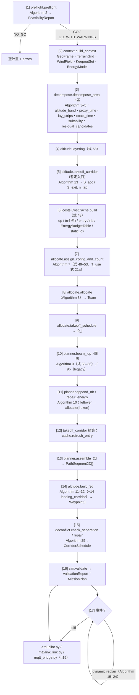
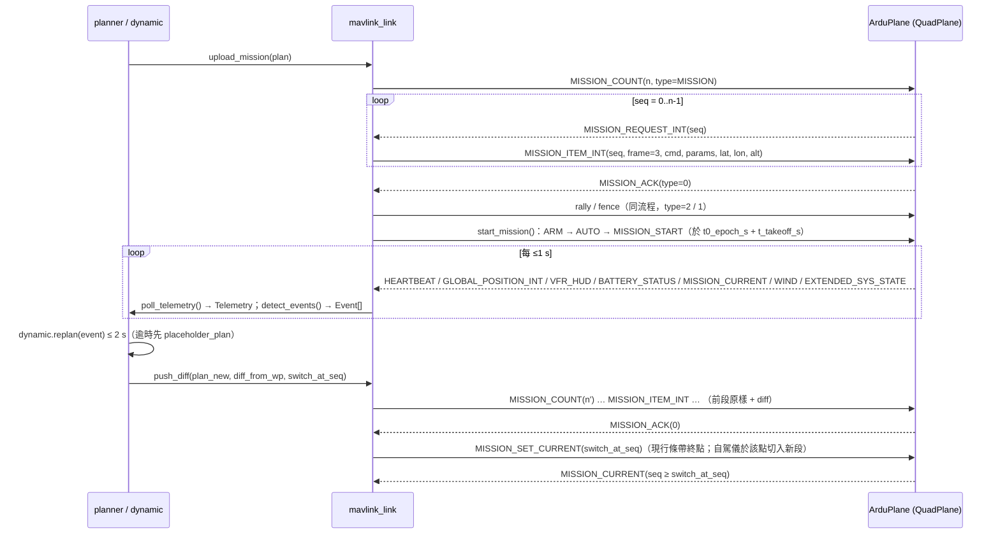

# HV-DCCPP 設計文件：兩構型 VTOL（Pioneer PNP／HERO PNP）群飛偵查覆蓋路徑規劃

**Heterogeneous-VTOL Dynamic Complete Coverage Path Planning（HV-DCCPP）設計文件 v1.2**（2026-09-05）

基礎文獻：Wang M., Zhang D., Li C., Zhang Z., "Multiple fixed-wing UAVs collaborative coverage 3D path planning method for complex areas", *Defence Technology* 47 (2025) 197–215（本文簡稱「論文」）。
權威來源：`docs/reference/HV-DCCPP_規格書_v1.1.md`（規格書）、`docs/reference/模組契約_v1.1.md`（契約）、`docs/平台參數表.md`（使用者提供之表 1／表 2，數值不得更改）；實作與契約之差異以 `hv_dccpp/CONTRACT_DEVIATIONS.md` 為準（摘錄於 §14.6）。

v1.2 修訂摘要（依審查意見）：(1) 補定義 $T^{use}_c$（式 21a）、$t_{in}/t_{RTB}$（式 52）、Algorithm 1 輔助量、式 (35)(55) 各項、$R_{orb}$ 與盤旋搜尋；(2) 承諾點符號拆為 $P^{TO}_{tc}$／$P^{LDG}_{tc}$，降落點改記 $H_a$，多義符號改名並加符號衝突表（§2 末）；(3) 單位修正（式 17、19、22）；(4) HERO 驗證後 CLIMB／DESCENT 走廊 480 m 更正為 724 m；(5) 新增圖 F1–F8、事件總表（§11.0）、風限總表（§5.1）、複雜度表（§9.7）、原因碼目錄（§14.7）、契約偏差摘錄（§14.6）、整合者最小知識包（§15.0）、pymavlink 介面表（§15.5.1–15.5.2）、adapter 建構規則（§15.6.1）、MQTT 綱要（§15.7）；(6) §14.4 改為表 2 逐列完整範例；(7) 舊版／反例移至附錄 D。

---

## 0 摘要與閱讀指南

### 0.1 問題

給定一支由兩種構型組成的複合翼 VTOL（lift-and-cruise 4+1）機隊——構型 A = Pioneer PNP（5 kg LiDAR）、構型 B = HERO PNP（0.6 kg 測繪相機）——與多個複雜（可凹、可含洞）任務區域，在真實地形（DEM/DSM）、障礙物、風層、C2 鏈路範圍、空域限制、氣象門檻與有限電量之下，為每架機產生一條**完整架次航跡**（垂直起飛 → 轉換 → 進入 → 作業／轉移 → 返航 → 轉換 → 垂直降落），使全部區域依各自的感測需求被完全覆蓋，並最小化 **含返航之落地時刻最大值（makespan）**；任務中對 UAV 退出、新區域、能量偏差、失鏈、風場更新、目標線索、優先度變更與氣象中止等事件即時重規劃。

### 0.2 兩構型

| | 構型 A：Pioneer PNP | 構型 B：HERO PNP |
|---|---|---|
| 酬載（基準） | 5 kg LiDAR，`reference_auw_kg`=24.6 | 0.6 kg 測繪相機，`reference_auw_kg`=6.65 |
| 巡航空速 $V_{a,c}$ | 21.5 m/s | 19.0 m/s |
| 規劃轉彎半徑 $R_{plan}$（理論 $R_{theo}$） | 200 m（130 m） | 120 m（75 m） |
| 規劃爬升／下降角 $\gamma_c/\gamma_d$ | 3°／4° | 3°／4° |
| 最低固定翼作業高度 $h_{\min fw}$ | 120 m AGL | 100 m AGL |
| 基準續航／總航程 | 176 min／242 km | 136 min／144 km |
| 保留電量 $r$、對稱任務半徑 $\rho^{sym}$ | 0.30、66–72 km | 0.30、39–43 km |
| 設計角色（由 §8 適配度自動導出，非固定） | 第一層：遠距、大面積、寬條帶、LiDAR 需求、長時間佇留 | 第二層：近距、小面積／狹窄／凹角胞、RGB／GSD 需求、目標再確認（cue-and-confirm） |

### 0.3 與論文的關係

本文沿用論文的骨架——三類路徑（作業／進入／轉移）＋二元方向成本矩陣（Eq.10–14）→ 貪婪配置（Algorithm 1，Eq.30–31）→ 改良動態規劃 IDP（Algorithm 2，Eq.32–34）→ 高度規劃（Algorithm 3，Eq.35–39）→ 動態事件——並在每一層做異構 VTOL 擴展：成本由距離改為**含風的時間**、加入**第四類路徑（返航）**、轉移擴為**四型（含同向 racetrack，D34）**、IDP 改為**事件驅動 Beam 搜尋（D33）**、高度改為**坡度受限雙向包絡（D2）**、新增能量／鏈路／空域／氣象硬限制與起降走廊。所有擴展在 `legacy_mode=True` 下一鍵退化為論文方法（D32，§16.1 第 7 項、附錄 B）。

### 0.4 文件與程式的對應方式

- **公式**：本文以 (1)…(72) 連續編號；v1.2 新增之公式以字母尾碼編號（例：(21a)），不更動既有編號；論文公式一律寫作「論文 Eq.(k)」；附錄 B 給對照表。
- **裁決**：規格書裁決紀錄以 **D1–D43** 引用；本文在採用某裁決處直接標示（例：「（D1）」），附錄 A 為精簡版。設計理由與反例（舊版做法為何被否決）集中於附錄 D，正文只以「（理由見 D.x）」引用。
- **演算法**：本文 Algorithm 1–26 連續編號（v1.2 新增 Algorithm 9b），每段虛擬碼標題後括注對應 Python 函式（`模組.函式`），§13 給總流程、§14 給逐公式／逐演算法對照表。
- **圖**：F1–F8。F1（起降走廊側視、§3.4）、F2（條帶四端點狀態與四型轉移、§7.2）、F3（迴轉圖樣幾何、§7.3）、F4（掃描座標與帶序列、§6.4）、F5（高度包絡、§10.2）、F7（走廊預約甘特圖與 4D 分離、§12）為 `docs/figures/F*.png`，由 `docs/figures/make_doc_figures.py` 以 `hv_dccpp.dubins` 產生（迴轉圖樣長度與式 (40) 閉式核對）；F6（主流程、§13）、F8（資料流、§1.4）與 §3.4 狀態圖以 mermaid 內嵌。
- **參數**：所有出現的常數皆在 §17 參數表列出（含預設值、來源、`provisional` 標記）；表 1 數值以 `docs/平台參數表.md` 為準。
- **座標與單位**：內部一律本地 ENU（原點 = 主起降點 $H$，$x$=East、$y$=North、$z$=Up）、公尺、秒、Wh；對外 WGS84（lat, lon）與 MSL（D42）。方位 $\theta$ 自北順時針（rad）。
- **讀者路線**：整合者 → §0、§1.4、§13、§14、§15（先讀 §15.0「整合者最小知識包」，其餘章節只在 §15.0 指引時回查）；演算法設計者 → §3–§12；驗證者 → §16–§17。
- **用語表**（全文統一；英文為論文或 ArduPilot 用語）：

| 本文用語 | 英文 | 說明（不得混用之舊寫法） |
|---|---|---|
| 作業路徑 | operation path | 感測器開機之直線條帶段 |
| 進入路徑 | entry path | 自 $S_{acc}$（或盤旋出口）至第一條作業路徑端點 |
| 轉移路徑（四型：反向 2 型、同向 2 型） | transfer path | 論文 Eq.(12)；舊寫法「轉場」「轉移矩陣」一律改為「轉移路徑」「轉移矩陣」 |
| 迴轉圖樣（Ω／燈泡、U 型、環型、跑道形 racetrack） | turn-around pattern | 轉移路徑的幾何形狀；閉式見式 (40) |
| 返航路徑 | return-to-base (RTB) path | 第四類路徑，至 $S^{app}$ |
| 轉換段 | transition (TRANSITION_OUT/IN) | VTOL↔固定翼之旋翼輔助段，與「轉移路徑」無關 |
| 起降走廊 | takeoff / landing corridor | 「走廊」一詞只用於此 |
| 取樣帶 | terrain sampling band | 沿航跡橫向 $\pm b$ 取地形 max/min 之範圍（舊寫法「走廊地形」「條帶走廊」） |
| 風層 | wind layer | 高度分層之風（舊寫法「分層風場」）；「高度分層」保留給 A／B 作業層分離 |
| 主起降點 $H$（home） | home site | 舊寫法「起飛點」「基地」 |
| 掃描方位 $\alpha_q$ | scan direction of a cell | 胞的條帶走向候選 |
| 掃向 $dir\in\{-1,+1\}$ | sweep direction of a strip | 條帶自身的掃描方向（$idx=(dir+1)/2$） |
| 高度帶 | altitude band | 式 (16) |

---

## 1 緒論與問題定義

### 1.1 任務情境與兩層偵查概念

任務情境為山區／沿海之大面積偵查（reconnaissance）與測繪，區域數 $n_Z\approx1$–5、機隊 $n_U\approx2$–8、單區面積 1–30 km²、距主起降點 4–40 km。兩層偵查概念：

1. **第一層（A, Pioneer）**：以 LiDAR 寬足跡（$h=150$ m AGL 時 210 m）與長續航（可用時間 $\approx0.53\times176$ min）承擔遠距、大面積、地形複雜之區域，並作為目標線索（cue）的來源。
2. **第二層（B, HERO）**：以小轉彎半徑（120 m）與相機（GSD 2.4–5 cm）承擔近距、窄小、凹角之胞與 RGB 需求，並對第一層回報之目標線索做近距確認（TARGET_CUE，§11.8）。

**問題敘述**：給定機隊 $\mathcal U=\mathcal U_A\cup\mathcal U_B$（每架 $U_i$ 有構型 $c(i)\in\{A,B\}$、當架次 AUW $m_i$、可用電量 $E^{avail}_i$、感測器規格）、任務區域 $\mathcal Z=\{Z_k\}$（簡單多邊形，可凹、可含洞；附感測需求 $\sigma_k$、優先度 $val_k$、時間窗、酬載需求）、環境（DEM/DSM、障礙物、風層、C2 鏈路覆蓋、空域、氣象門檻與觀測）、主起降點 $H$（home）與備降點集合 $\mathcal A$（$|\mathcal A|\ge1$；降落點通稱 $H_a$，$a\in\mathcal A\cup\{H\}$），求每架機一條完整架次航跡 $\Gamma_i$ = 起飛走廊 → 進入路徑 → (作業路徑, 轉移路徑)* → 返航路徑 → 降落走廊（三維、時間參數化、附能量與模式旗標），使

$$\min\ C_{\max}=\max_i C_i,\qquad C_i=t^{TO}_i+T^{in}_i+\sum T^{oper}_i+\sum T^{trans}_i+T^{RTB}_i+T^{LDG}_i\tag{1}$$

（min-max 落地時刻，含返航；次要目標 $\sum_iC_i$ 作 tie-break），受限於：

- (C1) 覆蓋：每區依 $\sigma_k$ 被對應構型足跡完全覆蓋，每條作業路徑恰被一機掃過一次（論文 Eq.19–21）。
- (C2) 運動學：地面曲率半徑 $\ge R_{eff}$；地面坡度 $\in[-\tan\gamma^g_d,\tan\gamma^g_c]$；空速 $\in[V_{a,\min},V_{a,c}]$。
- (C3) 高度：$z\in[z_{lo},z_{hi}]$（地形＋淨空、障礙頂＋垂直緩衝、最低固定翼高度、感測器上限、空域上限）。
- (C4) 能量：至承諾點 $P^{LDG}_{tc}$（降落側轉換起點，commit point）為止任一航點 $E^{rem}\ge rE_{nom}+\min_ae^{alt}$；$E(P^{LDG}_{tc})\ge rE_{nom}+e_{MA}$；落地餘量 $\ge rE_{nom}$。
- (C5) 鏈路／半徑：所有航點在 C2 覆蓋內且距主起降點 $H$ $\le\rho^{sym}_c$（下緣）。
- (C6) 空域：禁區、時間窗。
- (C7) 去衝突：高度分層或 4D 分離；起降走廊互斥。
- (C8) 氣象：放飛門檻與任務中止條件。

論文的關鍵尺度為 $R=4000$ m、$w=2200$ m（$R\ll$ 條帶長）；本案 $R\in[120,200]$ m 與條帶間距 $s\in[100,170]$ m 同量級，**$s<2R$ 為常態**，因此「Ω（燈泡）迴轉圖樣 vs. skip-$k$ 交錯順序」成為主要效率來源，是論文未遇到的情境（§7.3、圖 F3）。

### 1.2 與論文 DCCPP 的關係與差異表

| 面向 | 論文 DCCPP | 本文 HV-DCCPP | 本文章節 |
|---|---|---|---|
| 機隊 | 同構固定翼 | 兩構型複合翼 VTOL；構型參數相同時退化 | §3、§18 |
| 運動學 | 定速 $V$、$R_{\min}$、單一 $\gamma$（Eq.1） | 風三角地速、$R_{eff}(W)$（D1）、$\gamma_c\ne\gamma_d$、AUW 修正（D21） | §3.2–3.3 |
| 起降 | 起始於區外、無起降模型 | 垂直起降 + 旋翼輔助轉換段（D37）+ 加減速段 + 爬升盤旋 | §3.4、§10.5–10.6 |
| 感測器 | 前視梯形 FOV（Eq.2–3），常數 $h$ | LiDAR 扇形／相機矩形足跡；寬度以條帶保守最小 AGL 計（D3）；GSD／點密度限制速度；梯形保留為選項 | §3.5 |
| 地形 | DEM 雙線性（Eq.4）、$h\in[h_{\min},h_{\max}]$ | 同 Eq.4 + 取樣帶 max/min + 障礙燒入（D24）+ keep-out | §5、§10.1 |
| 區域 | DP 簡化並整體凸化 | 只外擴 DP（D31）+ 凸分割（不整體凸化）+ 合併 + 禁區扣除（D41） | §6.1–6.2 |
| 掃描方向 | 最小寬度方向 | 候選集合（含順逆風、等高線）+ 含風／迴轉圖樣／坡度之代理時間評分（D15） | §6.3 |
| 條帶 | 等寬（Eq.6–9） | 逐條變寬（保守 AGL）、置中平移、端點外延、殘帶指派（D17） | §6.4–6.5 |
| 成本 | 距離（Eq.10–12） | 時間（含風、弧段積分 D14）；四型轉移路徑（D34）；第四類返航路徑 | §7 |
| 配置 | $J_k$（Eq.30）四項、$\lambda_k$（Eq.31） | 六項時間版 $J^c_q$、每構型獨立 $\lambda$（D16）、能量下限、拍賣、多架次 | §8 |
| IDP | 鎖步（每階段每機各取一條）全排列（Eq.33–34） | 事件驅動 Beam-IDP（D33、D28）、逐機能量剪枝、逐機 RTB | §9 |
| 高度 | 單向高度下降（Eq.36）+ GDA（Eq.37–38）+ 刪點（Eq.39） | 雙向坡度受限包絡（D2）+ 投影 GDA + 刪點；寬度不變量（D36） | §10 |
| 能量／安全 | 無 | Wh 能量模型（D6/D39）、30% 保留、逐航點備降可達、氣象門檻（D7） | §4–5 |
| 動態事件 | UAV 退出、新區域 | 九類事件 | §11 |
| 防撞 | 無 | 高度分層 + 空間互斥 + 4D 分離 + 走廊排程 | §12 |

### 1.3 假設

| # | 假設 | 說明 |
|---|---|---|
| A1 | 兩構型；參數相同且關閉新限制時退化為論文 | §18 同構退化條件 |
| A2 | 起始狀態 = 轉換完成後加速段末 $S_{acc}$（或爬升盤旋出口）；空速固定 $V_{a,c}$，作業段可降至 $V_{a,\min}$；地速由風三角決定 | 取代論文「起始於區外、定速」 |
| A3 | LiDAR 扇形／相機矩形足跡；寬度以條帶保守最小 AGL 計算 | 梯形 FOV 保留為 `fov_model="trapezoid"` |
| A4 | 升降時**空速**不變（$\dot z=V_a\sin\gamma$ 與風無關）；能量另計爬升功率 | 取代論文「升降時地速不變」 |
| A5 | 一機可依序覆蓋多個凸胞；IDP 在團隊條帶聯集上執行 | 取代論文「一機一區」 |
| A6 | 風層在規劃週期內準靜態；能量為硬限制（含 RTB）；點／線／面 keep-out | — |
| A7 | **懸停只用於垂直起降、轉換與緊急；任務中所有轉彎皆為固定翼 Dubins（$R_{eff}\ge R_{plan}$），不存在懸停定點轉向** | `Waypoint` 不變量由 `sim.check_kinematics` 驗證 |
| A8 | 感測器只在作業路徑上開機；進入／轉移／返航段不計覆蓋 | — |
| A9 | 幾何在本地 ENU 計算；ENU 之 $z$ 已含地球曲率（50 km 處 196 m），論文 Eq.35 不需另作補償 | §10.2 |

### 1.4 輸入／輸出總覽（表 2 每列 → JSON 鍵 → 內部表示 → 檢查 → 消費函式 → 輸出）

表 2 的每一列在本文以列號 T2-1 … T2-11 引用；§14.4 的 JSON 範例在每個鍵旁標註同一列號，兩表互為索引（雙向可追溯）。型別欄之「或」表示二擇一欄位；單位以 `[]` 註記。

| 表 2 列 | JSON 鍵（§14.4） | dataclass 欄位（`mission.py`；單位） | PRECHECK 步驟／NO-GO 編號（§5.3–5.4） | 消費函式（模組.函式） | 輸出欄位 |
|---|---|---|---|---|---|
| T2-1 起飛點與備降點 | `home`、`alternates[]`、`recovery_site_id` | `Site(site_id, lat_deg [°], lon_deg [°], alt_msl_m 或 alt_agl_m [m]（皆 None → DEM）, kind, clear_radius_m [m], approach_heading_deg [°])`；WGS84→ENU | 步 1（N3）、步 3（N8）、步 5（N6） | `context.build_context`、`altitude.site_check`、`altitude.takeoff_corridor`／`landing_corridor`、`costs.EnergyBudgetTable`、`planner.append_rtb` | `UAVPlan.landing_site`、`Waypoint.nearest_alternate`／`alt_reachable`、rally 點（§15.4） |
| T2-2 任務區域 | `areas[]`：`area_id`、`polygon_wgs84`、`holes_wgs84`、`sensor_req`、`priority`、`time_window_s`、`payload_req_id` | `AreaSpec(...)`；頂點 (lat, lon)；GeoJSON 自動交換 (lon,lat)、MultiPolygon 拆為多個 `AreaSpec` | 步 3（N8）、步 7（裁切）、步 8–9（N10）、步 10（N9） | `decompose.decompose_area`（Algorithm 3–5）、`allocate.allocate`、`preflight.preflight` | `MissionPlan.cells`／`strips`／`uncovered`、`Waypoint.strip_id`／`cell_id`、fence inclusion（§15.4） |
| T2-3 地形模型 | `dem` | `DemGrid(lat0_deg, lon0_deg, dlat_deg, dlon_deg, z_msl [m MSL, float32], is_dsm, vertical_datum, geoid_undulation_m [m], sigma_z_m [m])` → `TerrainGrid`（ENU、`dem_step_m`=10、雙線性） | 步 3（N8：區域須在 DEM 內）、步 4（$h_{clr}\ge3\sigma_z+30$） | `geo.TerrainGrid.from_dem`／`corridor_max`／`corridor_min`、`altitude.sample_bounds`／`envelope`／`local_envelope`（經 `geometry.lay_strips` 閉包）、`decompose.altitude_band` | `Waypoint.z_m`／`alt_msl_m`／`agl_m`、`FeasibilityReport.derived[cls].h_op` |
| T2-4 障礙物 | `obstacles[]` | `Obstacle(obs_id, geom_type, coords_wgs84 [(lat,lon)…], top_msl_m 或 height_agl_m [m], category, keepout_buffer_m [m]（None → `cfg.b_h_m`）)` | 步 4（燒入 D24）、步 5（N6 站點淨空） | `routing.KeepoutSet.build`、`context.burn_obstacles`、`routing.avoid`（Algorithm 6）、`altitude.sample_bounds`（$z_{obs}$，式 58） | 轉移／進入／返航繞行、OPER 段抬高（式 59）、`UAVPlan.distance_m` |
| T2-5 風場 | `wind[]` | `WindLayer(z_bottom_m, z_top_m [m], speed_mps [m/s], dir_from_deg [°], gust_mps [m/s], z_ref∈{msl, agl})` → `WindField`（層界轉 ENU $z$） | 步 2（N5，與 `weather_obs` 合併判定）、步 5（站點風、N6） | `wind.ground_speed`、`wind.r_eff_wind_speed`、`dubins.path_time`、`costs.op_cost`／`transfer_cost`／`rtb_cost`、`altitude.takeoff_corridor`（$\theta_{tr}$）、`dynamic.handle_wind_update` | `Waypoint.ground_speed_mps`／`heading_deg`／`t_s`、`derived[cls].R_eff`、`CostCache.W_R` |
| T2-6 當架次 AUW | `fleet[].sortie.auw_kg`、`fleet[].sortie.payload_kg` | `SortieEnergy.auw_kg [kg]`、`payload_kg [kg]`（None → 推估，warning `payload_estimated`） | 步 6（N7：mtow、酬載、失速裕度） | `platform.EnergyModel`（$P(m)$）、`PlatformSpec.gamma_c_auw`／`stall_margin_ok`、`altitude.orbit_gain` | `derived[uav].P_c`、`Waypoint.energy_remaining_wh` |
| T2-7 可用電量 | `fleet[].sortie.available_wh` 或 `available_mah`+`pack_voltage_nom_v` 或 `soc_fraction`；`pack_nominal_wh`；`battery_temp_c` | `SortieEnergy(... [Wh, mAh, V, —, Wh, °C])`；解析順序見 §4.6 | 步 1（N4）、步 6（N7：$E^{use}_i\le0$） | `EnergyModel.e_usable_wh`／`segment_wh`、`costs.EnergyBudgetTable`、`planner.energy_prune`、`sim.check_energy`（Algorithm 1） | `UAVPlan.energy_used_wh`／`energy_margin_wh`／`cruise_equiv_km`、`Waypoint.energy_remaining_wh` |
| T2-8 酬載任務需求 | `fleet[].sensors[]`（硬體）、`payload_reqs{}`（需求）、`areas[].payload_req_id` | `LidarHardware`／`CameraHardware`／`TrapezoidFovSpec`（焦距 [mm]、感光元件 [mm]、像元 [µm]、FOV [°]、點率 [Hz]、測距 [m]、快門上限 [Hz]）；`PayloadRequirement(req_id, kind, gsd_required_m [m], density_pt_m2 [pt/m²], side_overlap, forward_overlap, shutter_rate_hz [Hz], h_target_agl_m [m])`；`sensor_model(hw, req)` | 步 8（GSD 可達性）、步 9（N10）、步 12（`sensor_spec_default_example`） | `platform.sensor_model`、`decompose.altitude_band`（式 15–16）、`geometry.lay_strips`（式 33–34）、`costs.op_cost`（式 13）、`Sensor.end_extension_m`（式 14） | `derived[cls].w`／`s`／`V_g_cap`／`h_op`、`Strip.width_m`／`h_min_m`、`Waypoint.sensor_on`／`airspeed_mps`、DO_SET_CAM_TRIGG_DIST 參數（§15.1） |
| T2-9 C2 資料鏈路覆蓋 | `c2`：`range_km`、`coverage_polygon_wgs84`、`ground_station`、`lost_link_policy`、`t_ll_s` | `C2Link(range_km: float 或 {A: float, B: float} [km], coverage_polygon_wgs84, ground_station: Site, lost_link_policy: {uav_id: RTB 或 CONTINUE_THEN_RTB 或 NEAREST_ALT}, t_ll_s [s])`；逐構型 $\mathcal P_{link,c}$ | 步 1（N1）、步 5（站點在鏈路內）、步 7（裁切，UNCOVERABLE(link)） | `context.link_polygon`、`allocate.hard_feasible`（H2）、`altitude.build_3d`（逐點 `lost_link_action`／`nearest_alternate`）、`sim.check_link_airspace`、`dynamic.handle_link_loss`／`ghost_track` | `Waypoint.lost_link_action`／`nearest_alternate`、`MissionPlan.uncovered`、FS_* 參數建議（§15.2） |
| T2-10 空域與法規限制 | `airspace`：`max_agl_m`、`waiver_max_agl_m`、`max_msl_m`、`no_fly[]`、`time_window_s`、`terrain_clearance_m` | `Airspace(max_agl_m [m AGL], waiver_max_agl_m [m AGL], max_msl_m [m MSL], no_fly: [NoFlyZone(zone_id, polygon_wgs84, z_floor_msl_m, z_ceiling_msl_m, active_window_s)], time_window_s [s], terrain_clearance_m [m])` | 步 1（N2）、步 7（禁區扣除）、步 8（高度帶、`A_needs_waiver`）、步 10（N9） | `context.resolve_ceiling`／`resolve_terrain_clearance`、`decompose.altitude_band`、`routing.KeepoutSet.build`（禁區）、`altitude.sample_bounds`（式 59–60）、`allocate.hard_feasible`（H3、H6） | `derived[cls].h_ceil_source`、fence exclusion／`FENCE_ALT_MAX`（§15.4）、`Cell.feasible[cls]` |
| T2-11 作業氣象門檻 | `weather_thresholds`、`weather_obs` | `WeatherThresholds(go_mean_wind_mps, go_gust_mps, go_visibility_m, go_precip_mmh, go_temp_range_c, abort_*)`；`WeatherObs(mean_wind_mps, gust_mps, wind_dir_from_deg, visibility_m, precip_mmh, temp_c, t_s)` | 步 2（N5）；`gust > BEAUFORT_UPPER_MPS` 警告 | `preflight.preflight`（步 2）、`mission.resolve_weather_go`、`dynamic.handle_wind_update`（$W>W_{abort}$ → WeatherAbort）、`dynamic.handle_weather_abort`（Algorithm 24）、`EnergyModel.eta_T`（`temp_c` 為 `battery_temp_c` 之備援） | `FeasibilityReport.status`／`errors`、`WeatherAbort` 事件、`UAVPlan.warnings`（`landing_over_limit`） |

**輸出**：`MissionPlan(plans: {uav_id: UAVPlan}, makespan_s, cells, strips, uncovered, feasibility, timing_ms, cache_keys: (geometry_key, wind_key, state_key), diff_from)`（`cache_keys` 為契約必填欄位，供重規劃比對 `CostCache` 版本；`diff_from` 為重規劃前版 id，初始規劃為 None）；每架 `UAVPlan.waypoints: list[Waypoint]`（欄位見 §14.5），另可輸出 QGC WPL 110 `.waypoints`、rally、fence、`.param`（§15）。

**圖 F8 資料流**（表 2 → `MissionInputs` → `MissionContext` → `MissionPlan` → QGC／MQTT）：

```mermaid
flowchart LR
  T2["表 2 十一列<br/>JSON（§14.4）"] -->|"mission.load_mission"| MI["MissionInputs<br/>（純資料，frozen）"]
  MI -->|"preflight.preflight（Algorithm 2）"| FR["FeasibilityReport<br/>GO / GO_WITH_WARNINGS / NO_GO"]
  MI -->|"context.build_context"| MC["MissionContext<br/>GeoFrame・TerrainGrid・WindField・KeepoutSet・EnergyModel[uav]・Sensor[(cls,req)]"]
  MC --> DEC["decompose（Algorithm 3–5）<br/>Cell / Strip"]
  DEC --> CC["costs.CostCache（式 48）<br/>op / tr / entry / rtb / budget"]
  CC --> AL["allocate（Algorithm 7–8）→ Team"]
  AL --> IDP["planner.beam_idp（Algorithm 9）<br/>append_rtb（10）"]
  IDP --> B3D["altitude.build_3d（Algorithm 11–14）<br/>Waypoint 列表"]
  B3D --> DC["deconflict（Algorithm 25）"]
  DC --> MP["MissionPlan<br/>plans / makespan_s / uncovered / cache_keys"]
  MP -->|"ardupilot.py"| QGC["QGC WPL 110 / rally / fence / .param / seqmap.json"]
  MP -->|"mqtt_bridge.py"| MQ["drone/&lt;id&gt;/mission・status"]
  QGC -->|"mavlink_link.upload_mission"| AP["ArduPlane QuadPlane"]
  AP -->|"遙測 → dynamic.Telemetry"| EV["dynamic.replan（Algorithm 15–24）"]
  EV -->|"ReplanResult.diff"| QGC
```



---

## 2 符號表

單位：長度 m、時間 s、速度 m/s、能量 Wh、功率 W、質量 kg、角度 rad（介面欄位以 `_deg` 結尾者為度）。**能量欄位一律 Wh、時間一律 s；公式中出現 min 者（式 17、21a）已在式內標示換算。** 「程式欄位」欄給契約中的對應名稱。

| 符號 | 意義 | 單位 | 程式欄位（契約） |
|---|---|---|---|
| $c\in\{A,B\}$ | 構型（A=Pioneer PNP、B=HERO PNP） | — | `cls` |
| $V_{a,c},V_{a,\min,c},V_{tr,c},V_{s,c}$ | 巡航／任務下限／轉換／失速空速（A 21.5/18.0/16.0/14.0；B 19.0/16.0/14.0/12.0） | m/s | `cruise_airspeed_mps`, `v_min_mission()`, `transition_airspeed_mps`, `stall_airspeed_mps` |
| $V_a^*$ | 航段實際空速 | m/s | `Waypoint.airspeed_mps` |
| $\theta$ | 航跡方位（自北順時針）；$\hat t=(\sin\theta,\cos\theta)$、右法向 $\hat n=(\cos\theta,-\sin\theta)$ | rad | `theta_rad`, `track_deg` |
| $\psi_{hdg}$ | 機頭航向 | rad | `heading_deg` |
| $\beta,W,\vec w$ | 風來向、風速、風向量 $\vec w=-W(\sin\beta,\cos\beta)$ | rad, m/s | `dir_from_deg`, `speed_mps`, `WindField.wind_vec` |
| $W_\parallel,W_\perp$ | $\vec w\cdot\hat t$、$\vec w\cdot\hat n$ | m/s | — |
| $V_g(\theta)$ | 地速 | m/s | `wind.ground_speed`, `Waypoint.ground_speed_mps` |
| $R_{plan},R_{theo},R_{eff}$ | 規劃／理論／風修正有效轉彎半徑 | m | `turn_radius_planning_m`, `turn_radius_theoretical_m`, `PlatformSpec.r_eff(W)` |
| $W^*_c$ | $R_{plan}$ 內建裕度可吸收之風速 | m/s | `w_star()` |
| $\phi_{\max}$ | 最大傾角（20°/25°） | rad | `max_bank_angle_deg` |
| $\gamma_c,\gamma_d$ | 規劃爬升／下降空氣坡度（3°/4°） | rad | `planning_climb_angle_deg`, `planning_descent_angle_deg` |
| $\gamma^g_c(\theta),\gamma^g_d(\theta)$ | 對應地面坡度 | rad | `tan_gamma_ground()` |
| $\gamma_{tr,\max}$ | 旋翼輔助轉換段坡度上限（8°，provisional） | rad | `gamma_tr_max_deg` |
| $m_i,m_{ref,c}$ | 當架次 AUW、基準 AUW（24.6/6.65） | kg | `SortieEnergy.auw_kg`, `reference_auw_kg` |
| $H_{ts},H_{tc}$ | 轉換起始／完成 AGL（60；80–100 ／ 50；70–90） | m | `transition_start_agl_m`, `transition_complete_agl_m` |
| $H_{tc,cmd},H_{tc,hi},H_{tc,lo}$ | 指令／能量／淨空用轉換完成高度（D29） | m | `TransitionCmd.h_tc_cmd_m/h_tc_energy_m/h_tc_clear_m` |
| $d_{tr},d_{acc},t_{acc}$ | 轉換水平距離、加減速段長、時間 | m, m, s | `TransitionCmd.d_tr_m/d_acc_m/t_acc_s` |
| $P^{TO}_{tc}$ | 起飛側轉換完成點（固定翼坡度限制起點、高度釘住點） | — | `takeoff_corridor` seg2 終點 |
| $P^{LDG}_{tc}$ | 降落側轉換起點＝承諾點（commit point）：備降可達性檢查止於此、missed approach 自此起算 | — | `landing_corridor` seg_tr 起點；`UAVPlan.t_arr_ptc_s` |
| $S_{acc},S^{app}$ | 加速段末狀態（進入路徑起點、IDP 之 $S_i$）；減速段起點狀態（返航路徑終點） | — | `CorridorResult.exit_state`, `app_state` |
| $H_a$ | 降落點，$a\in\mathcal A\cup\{H\}$（$H_H=H$ 為主起降點；備降點 $H_a$，$a\in\mathcal A$） | — | `Site.site_id`, `UAVPlan.landing_site` |
| $R_{orb}$ | 爬升／下降／等待盤旋半徑 $=r_{orb}R_{eff}$（$r_{orb}=1.0$） | m | `cfg.r_orb_factor`, `CorridorResult.orbit_center` |
| $h_{\min fw,c}$ | 最低固定翼作業 AGL（120/100） | m | `min_fw_operation_agl_m` |
| $h_{clr}$ | 地形淨空（任務必填，D11） | m | `Airspace.terrain_clearance_m` |
| $h_{ceil,c}$ | 空域 AGL 上限（含豁免） | m | `PlatformSpec.h_ceil()` |
| $h_{op,c},h^{target}_c$ | 目標作業 AGL；需求目標高 | m | `Cell.h_op_m`, `PayloadRequirement.h_target_agl_m` |
| $h_{\min,l},AGL_{\max,l}$ | 條帶 $l$ 的保守最小 AGL、最大 AGL | m | `Strip.h_min_m`, `Strip.agl_max_m` |
| $h_{\max,c}$ | 感測器高度上限（測距／GSD） | m | `Sensor.agl_window()[1]` |
| $\Delta h_{band}$ | 高度帶寬 | m | `AltitudeBand.dh_band_m` |
| $w_c(h),s_c(h),l_c(h)$ | 足跡寬（swath）、條帶間距、前向足跡長 | m | `Sensor.swath_m/strip_spacing_m/footprint_len_m` |
| $o_{side},o_{fwd}$ | 側向／前向重疊率 | — | `side_overlap`, `forward_overlap` |
| $V_g^{cap}$ | 感測器地速上限 | m/s | `Sensor.max_ground_speed_mps()` |
| $e_{ext,c}$ | 條帶端點外延 | m | `Sensor.end_extension_m()` |
| $\delta_{edge},b_{trk},b_h,b_v$ | 邊界外擴、航跡半寬、keep-out 水平／垂直緩衝 | m | `delta_edge_m`, `b_trk_m`, `b_h_m`, `b_v_m` |
| $Z_k,Q_{k,q}$ | 區域、凸胞 | — | `AreaSpec`, `Cell` |
| $\sigma_k,val_k$ | 感測需求、優先度 | — | `sensor_req`, `priority` |
| $\alpha_q$ | 胞掃描方位 | rad | `Cell.alpha_rad[cls]` |
| $u,v$ | 掃描座標（沿 $\hat t$、沿 $\hat n$），原點 `sweep_origin` | m | `to_sweep_coords` |
| $L_{q,l},p^L,p^R$ | 作業路徑、左右端點 | — | `Strip`, `Strip.pL/pR` |
| $\theta_{LR},\theta_{RL}$ | 自 $p^L$ 指向 $p^R$ 之方位、反向 | rad | `Strip.theta_LR_rad` |
| $S^L_l,S^{LR}_l,S^R_l,S^{RL}_l$ | 條帶四個端點狀態（§7.2） | — | `Strip.pose(kind)` |
| $dir,idx,k$ | 掃向 $\in\{-1,+1\}$、索引 $(dir+1)/2$、轉移型 $2idx_l+idx_{l'}$ | — | `dir`, `idx`, `k` |
| $S=(x,y,\theta,R)$ | Dubins 狀態；$D(S_m\to S_n)$ Dubins 曲線 | — | `dubins.Pose`, `DubinsPath` |
| $\vec t^{oper},\vec t^{in},\vec t^{trans},t^{RTB}$ | 作業／進入／轉移／返航時間 | s | `CostCache.op/entry/tr/rtb` |
| $\mathbf T_i,\mathbf E_i$ | 時間矩陣（論文 $D_{i,k}$）、決策矩陣 | s, {−1,0,1} | `T_row0`, `T_transfer`, `UAVSequence.decisions` |
| $d_{turn,c}$ | 迴轉帶端線方向外延（含 Ω 超出量，D38） | m | `Cell.d_turn_m[cls]` |
| $E_{nom},E^{avail},E^{use},E^{rem}$ | 標稱／可用／可規劃／剩餘能量 | Wh | `nominal_wh`, `available_wh`, `e_usable_wh()`, `e_rem_wh` |
| $T^{use}_c$ | 每構型可規劃作業時間（式 21a；以 `models_rep[cls]` 之 $E^{use}$ 化為巡航秒數） | s | `T_use_s[cls]`（`assign_config_and_count` 參數） |
| $t_{hov,res}$ | 懸停保留時間（15 s，式 20、47） | s | `t_hover_reserve_s` |
| $V_{g,\max}$ | 作業層最大地速 $=V_{a,c}+W_{\max}$（式 14） | m/s | `wind.max_speed_between` |
| $\hat t^{RTB}_j$ | 返航時間下界（式 55a） | s | `planner.stage_cost` |
| $o_i$ | 起飛順位（§8.7；舊記號 $k_i$ 與轉移型 $k$ 衝突） | — | `takeoff_schedule` |
| $j_c,j_d$ | CLIMB 段止／DESCENT 段起之樣本索引（§10.1） | — | `phase_boundaries` |
| $E_{ref},f_{dep}$ | 基準測試電池容量（D39）、放電深度 | Wh, — | `reference_battery_wh`, `reference_test_depth_of_discharge` |
| $P_c,P_h,P_{tr},P_{acc},P_\uparrow,P_\downarrow$ | 巡航／懸停／轉換／加速／爬升／下降功率 | W | `EnergyModel.p_*` |
| $r$ | reserve_fraction = 0.30 | — | `reserve_fraction` |
| $k_{unc}=k_{bm}k_{as}$ | 未驗證保守係數（1.15×1.05） | — | `EnergyModel.k_unc` |
| $\eta_T$ | 溫度容量係數 | — | `EnergyModel.eta_T` |
| $e^{TO},e^{LDG},e^{alt},e_{MA}$ | 起飛／降落固定成本、備降能量、missed-approach 能量 | Wh | `e_takeoff_wh()`, `e_landing_wh()`, `budget.point_wh()` |
| $D^{plan},D^{use},\rho^{sym}$ | 計畫巡航等效距離、可用距離上限、對稱任務半徑 | km | `cruise_equiv_km`, `usable_distance_cap_km()`, `rho_sym_m` |
| $\kappa(\sigma,c)$ | 感測相容指示 | — | `sensor_compatible` |
| $\kappa_\phi$ | 弧段爬升折減 $=\cos\phi_{\max}$（直線 1；式 6） | — | `tan_gamma_ground(arc=True)` |
| $\hat\kappa_i$ | 能量線上修正係數（式 69） | — | `EnergyModel.correction` |
| $\delta_E$ | 能量偏差 $(E_{pred}-E_{tel})/E_{pred}$（式 69） | — | `handle_energy_update` |
| $B_q(\theta)$ | 胞垂直於 $\theta$ 之投影寬（式 29） | m | `geometry.projection_width` |
| $\mathcal W$ | IDP 階段成本（式 55；beam 排序鍵） | s | `IDPNode.W` |
| $S^c_q,J^c_q,\lambda^c_q$ | 適配度、配置指標、指派架數 | — | `Cell.fit`, `config_index_J`, `CountResult.by_cell` |
| $T^c_q$ | 胞單機作業時間（`exact_time`） | s | `Cell.T_single_s[cls]` |
| $C_i,C_{\max}$ | 完工（落地）時刻、makespan | s | `UAVPlan.t_land_s`, `MissionPlan.makespan_s` |
| $K,B,\epsilon,\mu,\tau_0$ | k-nearest 數、beam 寬、總和權重、論文相對項權重、防除零 | — | `K`, `B`, `eps_sum`, `mu_paper`, `tau0_s` |
| $z_g,z_g^{\max},z_g^{\min},z_g^0$ | 地表高（ENU）、取樣帶內最高／最低、正下方 | m | `TerrainGrid.z_at/corridor_max/corridor_min` |
| $z_{lo},z_{hi},z_{des},z^*,\bar z$ | 高度下界、上界、目標、最低可行剖面、上界剖面（$\bar z$；契約欄位 `u`，虛擬碼中變數名 `u`） | m | `sample_bounds`, `EnvelopeResult.z_star/u` |
| $d_d,ds_j$ | 取樣間距（25 m）、逐段弧長 | m | `d_d_m`, `Sample2D.ds_m` |
| $\Delta h_{sep},\delta_{prof},d_{sep},d_{sep,lat}$ | 垂直分層、剖面容差、水平分離、側向分離 | m | `dh_sep_m`, `delta_prof_m`, `d_sep_m`, `d_sep_lat_m` |
| $T_{lap},\Delta h_{lap},n_{lap}$ | 盤旋一圈時間、每圈高度增益、圈數 | s, m, — | `orbit_gain()`, `CorridorResult.n_laps` |
| $\sigma_t,k_t$ | 時間不確定度、增長率 | s, — | `k_t` |
| $t_{ll}$ | 失鏈策略時間（60 s；CONTINUE_THEN_RTB 之續飛上限，超過視同退出） | s | `C2Link.t_ll_s` |
| $t_{hb}$ | 心跳逾時（5 s；`link_ok` 判定，§15.5.2） | s | `cfg.hb_timeout_s` |

**符號衝突表**（同一字母的多重用法；v1.2 已改名者以粗體標示新記號）：

| 字母 | 用法 1 | 用法 2 | 用法 3 | 用法 4 |
|---|---|---|---|---|
| $W$ | 風速（§3.2） | 投影寬 → **$B_q(\theta)$**（§6.3） | 胞寬 $W_q$（§6.4，保留） | 階段成本 → **$\mathcal W$**（§9.2） |
| $\kappa$ | 感測相容 $\kappa(\sigma,c)$（§5.3） | 弧段折減 → **$\kappa_\phi$**（式 6） | 能量修正 → **$\hat\kappa_i$**（式 69） | 負載係數 $\kappa_{load}$（式 52，保留） |
| $u$ | 掃描座標（§6.4，保留） | 上界剖面 → **$\bar z$**（§10.2；程式欄位仍為 `u`） | — | — |
| $s$ | 條帶間距 $s_c$（§3.5，保留） | 弧長變數 $ds_j$（§10.1） | 論文 skip-$s$（僅引用論文時） | — |
| $k$ | 轉移型 $k=2idx_l+idx_{l'}$（§7.2，保留） | skip-$k$（式 41） | 係數 $k_{unc},k_h,k_\gamma,k_s,k_t,k_{GSD}$（下標區分） | 起飛順位 → **$o_i$**（§8.7） |
| $B$ | beam 寬（§9，保留） | 帶 $B_{prev}$（§6.4，保留，恆帶下標） | — | — |
| $S$ | Dubins 狀態 $S,S^L,S^{LR},\dots$（§7，保留） | 適配度 $S^c_q$（§6.6，恆帶上下標） | — | — |
| $T$ | 時間 $T_i,T_{lap},T^{use}$（保留） | 降落點 → **$H_a$**（§10.6） | 溫度 $T_{bat},T_0$（式 19，保留） | — |
| $\delta$ | 能量偏差 → **$\delta_E$**（式 69） | $\delta_{edge},\delta_{prof},\delta_w$（下標區分） | $\delta_1,\delta_2$ 門檻（§11.4） | — |
| $P_{tc}$ | → **$P^{TO}_{tc}$**（起飛側） | → **$P^{LDG}_{tc}$**（降落側、承諾點） | — | — |

---

## 3 平台與感測器模型

### 3.1 表 1 全部鍵及用途（值不得更改）

| 鍵 | Pioneer PNP (A) | HERO PNP (B) | 模型用途 |
|---|---|---|---|
| platform_type | lift_and_cruise_vtol_4plus1 | 同 | 狀態機 §3.4；禁止懸停轉向（A7） |
| wingspan_m | 3.20 | 2.18 | 站點檢查 $r_{site}\ge$ 翼展/2＋2 m（A 3.6≤8 ✓、B 3.1≤6 ✓） |
| fuselage_length_m | 1.68 | 1.14 | 僅報告 |
| wing_area_m2 | 1.00 | 0.53 | 翼載 $mg/S$ 僅報告 |
| mtow_kg | 24.9 | 7.0 | 硬檢查 $m_i\le$ mtow |
| reference_auw_kg | 24.6 | 6.65 | $m_{ref}$（功率、爬升角、失速修正基準） |
| reference_payload_kg | 5.0 | 0.6 | 空重推估 $m_{empty}=m_{ref}-m_{payload,ref}$ |
| payload_max_kg | 5.0 | 1.0 以下（provisional 改寫為 1.0） | 酬載檢查：A $\le5.0$；B $<1.0$，超過 NO_GO |
| cruise_airspeed_mps | 21.5 | 19.0 | $V_{a,c}$ |
| cruise_airspeed_kmh | 77.4 | 68.4 | 顯示；建構期驗證 $=3.6V_a$（±0.1；失敗丟 `PlatformSpecError`，見本節末） |
| min_mission_airspeed_mps | 18.0 | 15.0–16.0 → 規劃 16.0 | $V_{a,\min}$（D9；15.0 僅遙測絕對下限） |
| transition_airspeed_mps | 16.0 | 14.0 | 轉換指令（未驗證 +2.0，D8）、$d_{tr}$ 推估 |
| stall_airspeed_mps | 14.0 | 12.0 | 失速裕度（D9、D21） |
| max_airspeed_mps | 35.0 | None（待實機確認） | 僅 $V_a^*$ 上限檢查（D10） |
| max_climb_angle_deg | 3.5 | 3.5 | 驗證上限（`sim`），不規劃 |
| planning_climb_angle_deg | 3.0 | 3.0 | $\gamma_c$ |
| max_descent_angle_deg | 5.0 | 5.0 | 驗證上限 |
| planning_descent_angle_deg | 4.0 | 4.0 | $\gamma_d$ |
| max_fw_climb_rate_mps | 1.13 | 1.00 | 建構期驗證 $V_a\sin3°$（1.125/0.994，±5%） |
| max_fw_descent_rate_mps | 1.50 | 1.33 | 建構期驗證 $V_a\sin4°$（1.500/1.325） |
| max_bank_angle_deg | 20 | 25 | 建構期驗證 $V_a^2/(g\tan\phi)\approx R_{theo}$（±10%）；弧段爬升折減 $\kappa_\phi=\cos\phi_{\max}$ |
| turn_radius_theoretical_m | 130 | 75 | $R_{eff}$ 風放大基準 |
| turn_radius_planning_m | 200 | 120 | $R_{plan}$ |
| vtol_site_clear_radius_m | 8 | 6 | 站點檢查（provisional） |
| obstacle_horizontal_buffer_m | 30 | 25 | 只用於站點檢查（provisional；D13） |
| transition_start_agl_m | 60 | 50 | $H_{ts}$（provisional） |
| transition_complete_agl_m | 80–100 | 70–90 | $H_{tc}$ 區間（provisional；D29） |
| min_fw_operation_agl_m | 120 | 100 | $h_{\min fw}$；D12；任務層只允許調高 |
| wind_resistance_public | Beaufort 5 | 5 | 僅警告門檻（上緣 10.7 m/s），不作放行門檻（D7） |
| reference_endurance_min | 176 | 136 | $T_{ref}$ → $P_c^{ref}$（D39） |
| reference_total_range_km | 242 | 144 | 距離自洽檢查（偏差 >10% 警告 `endurance_range_inconsistent`） |
| reserve_fraction | 0.30 | 0.30 | $r$ |
| usable_range_fraction | 0.55–0.60 | 同 | 建構期驗證 `usable_distance_km ≈ fraction × range`（±1 km） |
| usable_distance_km | 133–145 | 79–86 | 獨立上限 $D^{use}$（未驗證取下緣） |
| symmetric_mission_radius_km | 66–72 | 39–43 | H2 半徑（取下緣） |
| airspeed_sensor_validated | false | false | D8：$k_{as}=1.05$、$V_{tr}+2$、$H_{tc,cmd}$ 取上緣 |
| battery_monitor_validated | false | false | $k_{bm}=1.15$、$D^{use}$ 下緣、遙測 SoC 只作趨勢 |
| c2_link_range_km | 待填入 | 待填入 | 必填任務輸入（D11），逐構型；缺 → NO_GO |
| terrain_clearance_m | 待任務定義 | 同 | 必填任務輸入（D11）；建議 $\ge3\sigma_{DEM}+30$ m |
| alternate_landing_sites_required | true | true | 無備降點 → NO_GO |

`provisional` 集合 = {vtol_site_clear_radius_m, obstacle_horizontal_buffer_m, transition_start_agl_m, transition_complete_agl_m, c2_link_range_km, terrain_clearance_m}（B 另含 max_airspeed_mps、payload_max_kg）；補充參數（§3.4、§17）構成 `provisional_supplementary`。任務層可經 `MissionInputs.platform_overrides` 覆寫 `provisional ∪ provisional_supplementary` 與 `min_fw_operation_agl_m`（只允許調高），其餘鍵拒絕並丟 `MissionInputError`。

**建構期驗證**（`PlatformSpec.__post_init__`；實作以顯式檢查丟 `PlatformSpecError(ValueError)`，訊息列出全部失敗項，`python -O` 下亦生效，見 §14.6）：契約列出的 7 項（kmh＝3.6·mps、$V_a\sin3°$≈climb rate、$V_a\sin4°$≈descent rate、$V_a^2/(g\tan\phi)$≈$R_{theo}$、$R_{plan}\ge R_{theo}$、`usable_distance_km`≈fraction×range、`symmetric_mission_radius_km`≈`usable_distance_km`/2）另加：Range 之 lo≤hi、速度序 stall ≤ transition ≤ min_mission ≤ cruise ≤ max、reference_auw ≤ mtow、reference_payload ≤ reference_auw、reserve ∈ [0,1)。

### 3.2 運動學與風三角、$R_{eff}$（D1）

論文 Eq.(1) 為定速、無風之運動學；本文以地速與航跡方位改寫：

$$\dot x=V_g\sin\theta,\qquad \dot y=V_g\cos\theta,\qquad \dot z=V_a\sin\gamma,\qquad |\dot\theta|\le V_g/R_{eff}\tag{2}$$

風三角（$W_\parallel=\vec w\cdot\hat t$、$W_\perp=\vec w\cdot\hat n$）：

$$V_g(\theta,V_a)=\sqrt{V_a^2-W_\perp^2}+W_\parallel,\qquad \psi_{hdg}=\theta-\arcsin\frac{W_\perp}{V_a}\tag{3}$$

可行條件 $|W_\perp|<V_a$ 且 $V_g\ge V_{g,\min}$（`v_g_min_mps`=3 m/s）；逆風航向 $\theta=\beta$ 時 $W_\parallel=-W$。契約 `wind.ground_speed(theta, v_air, wind_xy)` 支援 `(2,)` 廣播與 `(N,2)` 逐點。

理論轉彎半徑與風修正有效半徑：

$$R_{theo,c}=\frac{V_{a,c}^2}{g\tan\phi_{\max,c}}\quad(\text{A }129.5\approx130,\ \text{B }78.9\approx75)\tag{4}$$

$$R_{eff,c}(W)=\max\Big\{R_{plan,c},\ R_{theo,c}\big(1+W/V_{a,c}\big)^2\Big\},\qquad W^*_c=V_{a,c}\Big(\sqrt{R_{plan,c}/R_{theo,c}}-1\Big)\tag{5}$$

空氣座標的圓在風中的地面軌跡為擺線（trochoid），順風相位的曲率半徑最大為 $R(1+W/V_a)^2$；以地面半徑 $\ge R_{eff}$ 生成的航跡在任何相位需求傾角 $\le\phi_{\max}$（D1）。$W^*$ 為 $R_{plan}$ 內建裕度可吸收的風速：A 5.17 m/s、B 5.03 m/s；$W=8$ m/s 時 $R_{eff}$ = A 245 m、B 152 m。**Dubins 直接在地面座標以 $R_{eff}$ 生成**；規格書否決「$R_{plan}(1+W/V_a)^2$」（過度保守）與「空速座標系生成再轉換」（端點固定於地面時為移動目標問題）（D.18）。

風層下 $R_{eff}$ 所用風速 $W_{R,c}$：`r_eff_wind_policy="max_layer"`（預設）取 $\max\{W(z):z\in[z_{site}+H_{tc},\max(z_{op,c},z_{transit,c})]\}$；`"op_layer"` 取各胞作業層風速。`CostCache.W_R[c]` 記錄所用值，供 §11.7「$R_{eff}$ 變化 >5% 才重算幾何層」比較。

### 3.3 爬升／下降與地面坡度

空氣坡度 $\gamma_c=3°$、$\gamma_d=4°$ 為規劃值；地面坡度隨地速變化：

$$\tan\gamma^g_c(\theta)=\frac{V_a\sin\gamma_c\,\kappa_\phi}{V_g(\theta)},\qquad \tan\gamma^g_d(\theta)=\frac{V_a\sin\gamma_d}{V_g(\theta)},\qquad \kappa_\phi=\begin{cases}\cos\phi_{\max}&\text{弧段}\\1&\text{直線}\end{cases}\tag{6}$$

保守方向：爬升距離與下降距離皆以**順風最大 $V_g$** 計（實際逆風時可更陡，不利用）。例：A、$W=8$ 順風 $\tan\gamma^g_c=0.0381$（2.18°）。3° 是極強的限制：$\Delta h/\tan3°\approx19\Delta h$，$\Delta h=100$ m 需 1.9 km 水平距離，空間不足時以爬升盤旋補足（§10.5）。

當架次 AUW 對爬升與失速的修正（D21）：

$$\tan\gamma_c(m)=\tan\gamma_c^{plan}\cdot\mathrm{clip}\big(1-k_\gamma(m/m_{ref}-1),\,0.6,\,1\big),\ k_\gamma=2.0;\qquad V_s(m)=V_s\sqrt{m/m_{ref}};\qquad V_{a,\min}\ge1.2V_s(m)\tag{7}$$

下降角不隨 AUW 改變；轉彎半徑不隨 AUW 改變（固定傾角），但 $V_a^*$ 下限隨 $V_s(m)$。A @ MTOW 24.9 kg：$\gamma_c=2.93°$、$1.2V_s=16.9\le18$ ✓；B @ 7.0 kg：$2.68°$、$14.8\le16$ ✓；$m>m_{ref}$ 時輸出 warning。契約：`PlatformSpec.gamma_c_auw(auw)`、`stall_margin_ok(auw)`、`tan_gamma_ground(which, v_g, auw, arc)`、`climb_dist_m(dh_m=…, v_g_max_mps=…, auw_kg=…)`（一律關鍵字呼叫）。

### 3.4 飛行模式狀態機與轉換段（D37）

```
HOVER_CLIMB(v_z_up=2.0 m/s, P_h)
  → TRANSITION_OUT(逆風 θ_tr=β；H_ts→H_tc 旋翼輔助；P_tr=P_h+P_c；t_tr_out=20 s)
  → FW_ACCEL(V_tr,cmd→V_a,c，等高 H_tc_cmd，直線 d_acc，P_acc=1.2 P_c)
  → FW_CLIMB(γ≤γ_c(m)；必要時 FW_ORBIT R_orb≥R_eff)
  → FW_CRUISE / FW_OPER(V_a*) ⇄ FW_TRANSFER
  → FW_RTB → FW_DESCENT(γ≤γ_d)
  → FW_DECEL(V_a,c→V_tr,cmd，等高 H_tc，直線 d_acc)
  → TRANSITION_IN(H_tc→H_ts 旋翼輔助並減速至懸停；P_tr；t_tr_in=25 s)
  → HOVER_DESCENT(v_z_dn=1.0 m/s，最後 10 m 0.5 m/s；P_h)
  任一 FW 態可 → FW_ORBIT(hold) / MISSED_APPROACH
```

**圖 F1a 狀態圖**（契約 `Phase`／`Mode`；括號為 §15.1 之 MAV_CMD）：

```mermaid
stateDiagram-v2
  direction LR
  [*] --> TAKEOFF : ARM／MISSION_START
  TAKEOFF : HOVER · NAV_VTOL_TAKEOFF 84
  TRANS_OUT : TRANSITION · 逆風 θ_tr, H_ts→H_tc, P_tr
  ACCEL : CRUISE · 等高 H_tc,cmd, d_acc
  CLIMB : CRUISE · γ≤γ_c(m), z_lo 不含 h_minfw
  ORBIT : CRUISE · NAV_LOITER_TO_ALT 31
  ENTRY : CRUISE
  OPERATE : CRUISE · sensor_on, V_a*
  TRANSFER : CRUISE · 四型轉移路徑
  RTB : CRUISE · DO_LAND_START 189 之後
  DESCENT : CRUISE · γ≤γ_d
  DECEL : CRUISE · 等高 H_tc, d_acc
  TRANS_IN : TRANSITION · H_tc→H_ts, 減速至懸停
  LAND : HOVER · NAV_VTOL_LAND 85
  HOLD : CRUISE · NAV_LOITER_TURNS 18
  TAKEOFF --> TRANS_OUT : z ≥ H_ts
  TRANS_OUT --> ACCEL : P_tc^TO, V ≥ V_tr,cmd
  ACCEL --> CLIMB : S_acc（IDP S_i）
  CLIMB --> ORBIT : Δh_req > 0
  ORBIT --> ENTRY : n_lap 圈後 S_exit(ϑ*)
  CLIMB --> ENTRY : j_c
  ENTRY --> OPERATE
  OPERATE --> TRANSFER
  TRANSFER --> OPERATE
  OPERATE --> RTB : 序列末
  RTB --> DESCENT : j_d
  DESCENT --> DECEL : S^app
  DECEL --> TRANS_IN : P_tc^LDG（承諾點）
  TRANS_IN --> LAND : H_ts
  LAND --> [*]
  ENTRY --> HOLD : 去衝突延遲／等待
  RTB --> HOLD
  HOLD --> ENTRY
  HOLD --> RTB
  DECEL --> RTB : missed approach（爬至 z_tc+50）
```




*圖 F1b：起飛走廊（左）與降落走廊（右）側視，標出 $H_{ts}$、$H_{tc,cmd}$、$d_{tr}$、$d_{acc}$、$P^{TO}_{tc}$、$S_{acc}$、CLIMB 471 m、$h_{\min fw}$ 線、淨空線（$H_{tc,lo}$）、$S^{app}$、$P^{LDG}_{tc}$、$H_a$；A、未驗證航電、順風 5 m/s。*

契約 `Phase` 列舉：TAKEOFF, TRANS_OUT, ACCEL, CLIMB, ORBIT, ENTRY, OPERATE, TRANSFER, RTB, DESCENT, DECEL, TRANS_IN, LAND, HOLD；`FW_PHASES` = {ACCEL, CLIMB, ORBIT, ENTRY, OPERATE, TRANSFER, RTB, DESCENT, DECEL, HOLD}；`Mode` 列舉：HOVER, TRANSITION, CRUISE。不變量（`sim.check_kinematics` 驗證）：
- `mode==HOVER ⇒ phase∈{TAKEOFF,LAND}`；
- `phase∈FW_PHASES ⇒ mode==CRUISE`（含 ACCEL、DECEL）；
- `phase∈FW_PHASES∖{ACCEL,DECEL} ⇒ airspeed_mps ≥ v_min_mission`；`phase∈{ACCEL,DECEL} ⇒ airspeed_mps ≥ min(v_min_mission, V_tr,cmd)`（加減速段空速在 $[V_{tr,cmd},V_{a,c}]$ 內：未驗證 A 18→21.5、B 16→19 恰滿足 $\ge V_{a,\min}$；驗證後 16／14 $<V_{a,\min}$，故須此例外，契約 `check_kinematics` 註明）；
- `phase∈{TRANS_OUT,TRANS_IN} ⇒ mode==TRANSITION`。

**轉換段幾何（D37、D8、D29）**：轉換水平距離由公式決定，`transition_ground_run_m` 為可選覆寫（None → 公式）：

$$d_{tr}=\frac{V_{tr,cmd}^2}{2a_{tr}}+V_{tr,cmd}\,t_{hold},\qquad V_{tr,cmd}=V_{tr}+\Delta V_{tr}\cdot\mathbb 1[\neg\text{airspeed\_validated}],\qquad \text{slope}_{tr}=\arctan\frac{H_{tc,hi}-H_{ts}}{d_{tr}}\le\gamma_{tr,\max}\tag{8}$$

$a_{tr}=0.5$ m/s²、$t_{hold}=8$ s、$\Delta V_{tr}=2.0$ m/s、$\gamma_{tr,\max}=8°$（皆 provisional）。未驗證：$V_{tr,cmd}$=18/16 m/s → $d_{tr}$=**468/384 m**；驗證後 16/14 → 384/308 m。轉換段為**旋翼輔助飛行**（升力旋翼持續運轉，$P_{tr}=P_h+P_c$），$H_{ts}\to H_{tc}$ 的高度變化由旋翼承擔，坡度（A 4.9°、B 5.9°）**不受固定翼 3°/4° 限制**但須 $\le\gamma_{tr,\max}$；固定翼坡度限制自 $P^{TO}_{tc}$ 起（起飛）／至 $P^{LDG}_{tc}$ 止（降落）。若 `transition_profile="fw_slope"`（旋翼不輔助），$d_{tr}\leftarrow\max(d_{tr},(H_{tc,hi}-H_{ts})/\tan\gamma_{plan})$（A 爬升 763 m、下降 572 m）並標 provisional。

$H_{tc}$ 區間取用（D29）：指令值驗證後取下緣、未驗證取上緣；爬升距離依指令值；能量一律用上緣；走廊淨空一律用下緣。

**加減速段**：

$$d_{acc}=\frac{V_{a,c}^2-V_{tr,cmd}^2}{2a_{tr}},\qquad t_{acc}=\frac{V_{a,c}-V_{tr,cmd}}{a_{tr}}\qquad(\text{A }138\text{ m}/7\text{ s},\ \text{B }105\text{ m}/6\text{ s})\tag{9}$$

FW_ACCEL 自 $P^{TO}_{tc}$ 沿 $\theta_{tr}$ 直線，終點 $S_{acc}=(P^{TO}_{tc}+d_{acc}\hat t(\theta_{tr}),\theta_{tr},R_{eff})$ 為進入路徑起始狀態（IDP 之 $S_i$）；FW_DECEL 對稱，起點 $S^{app}=(P^{LDG}_{tc}-d_{acc}\hat t(\theta_{app}),\theta_{app},R_{eff})$ 為返航路徑目標狀態。

轉換段限制（D7/D8；風限總表見 §5.1）：站點平均風 $\le W_{go}$、陣風 $\le G_{site}$（未驗證 8、驗證 10 m/s）、側風 $|W\sin(\beta-\theta_{tr})|\le X_{\max,c}$（未驗證 A 6／B 5，驗證 8／6 m/s）；轉換航向一律逆風 $\theta_{tr}=\beta$（$W<2$ m/s 時取障礙最少方位）。契約：`PlatformSpec.transition_cmd(*, transition_profile="rotor_assisted") -> TransitionCmd`（`transition_profile` 為實作新增之關鍵字參數，`"fw_slope"` 時 $d_{tr}\leftarrow\max(d_{tr},(H_{tc,hi}-H_{ts})/\tan\gamma_c)$；`slope_tr ≤ gamma_tr_max` 之檢查由 `preflight`／`site_check` 執行，本函式不丟例外；§14.6）。

### 3.5 LiDAR／相機覆蓋幾何、GSD、地速上限、保守 AGL

感測器分兩層（D43）：`SensorHardware`（機上硬體：焦距、像元、FOV、點率、測距、快門上限）與 `PayloadRequirement`（區域需求：GSD／點密度／重疊率／快門率／目標高），`sensor_model(hw, req) -> Sensor`，區域需求覆寫硬體預設。本節硬體數值（70°、600 kHz、450 m；16 mm、23.5×15.6 mm、3.9 µm、1 Hz）**皆為示例值（表 1／表 2 未提供）**，`is_default_example=True`，使用時 PRECHECK 警告 `sensor_spec_default_example(cls)`。

**LiDAR（A）**：可用掃描角 $\theta_{use}$（70°）、點率 $f_p$、有效回波比 $\eta_{ret}$、需求點密度 $\rho_{req}$、最大測距 $r_{\max}$、測距裕度 $k_{rng}=0.9$：

$$w_A(h)=2h\tan\tfrac{\theta_{use}}{2},\qquad s_A=w_A(h_{\min,l})(1-o_{side,A}),\qquad V_g^{cap,A}=\frac{f_p\eta_{ret}}{w_A(h)\rho_{req}},\qquad h_{\max,A}=k_{rng}\,r_{\max}\cos\tfrac{\theta_{use}}{2}\tag{10}$$

例：$h=150$：$w_A=210.1$、$s_A=157.5$ m；$h=160$：$w_A=224.1$、$s_A=168.0$ m；$f_p=600$ kHz、$\eta_{ret}=0.5$、$\rho_{req}=20$ pt/m²：$V^{cap}=71$ m/s（不綁）；$r_{\max}=450$：$h_{\max,A}=332$ m。

**相機（B）**：焦距 $f$、感光元件 $S_w\times S_h$、像元 $p$、快門率 $f_s$、需求 $GSD_{req}$：

$$w_B(h)=h\frac{S_w}{f},\quad l_B(h)=h\frac{S_h}{f},\quad GSD(h)=h\frac{p}{f},\quad h_{\max,B}=\frac{GSD_{req}f}{p},\quad s_B=w_B(h_{\min,l})(1-o_{side,B}),\quad V_g^{cap,B}=l_B(h)(1-o_{fwd})f_s\tag{11}$$

例：$GSD_{req}=5$ cm → $h_{\max,B}=205$ m；$h=100$：$w_B=146.9$、$s_B=102.8$、$l_B=97.5$ m、GSD 2.44 cm、$V^{cap}=29.3$ m/s。**GSD 可達性**：需 $h_{\max,B}(GSD_{req})\ge h_{\min fw,B}+\Delta h_{band,\min}$（示例硬體 $GSD_{req}\ge2.93$ cm），否則該 (區, B) 標 `infeasible(sensor: gsd_unattainable)`，不得靜默 clip 到 $h_{\min fw}$。

**論文梯形 FOV（選項 `fov_model="trapezoid"`）**：論文 Eq.(2)(3) 抽字後分數線遺失，只有**除以** $\sin$ 的斜距投影形式能重現論文數值：

$$w_b=\frac{2h\tan(\alpha_h/2)}{\sin(\alpha_m-\gamma+\alpha_v/2)},\quad w_f=\frac{2h\tan(\alpha_h/2)}{\sin(\alpha_m-\gamma-\alpha_v/2)},\quad l_f=\frac{h}{\tan(\alpha_m-\gamma-\alpha_v/2)}-\frac{h}{\tan(\alpha_m-\gamma+\alpha_v/2)},\quad w=\frac{w_b+w_f}{2},\ l=d_f+\frac{l_f}{2}\tag{12}$$

（$d_f$ 為兩項 $0.5h/\tan(\cdot)$ 之和）。測試值 $h=1200,\alpha_m=72.7°,\alpha_v=45°,\alpha_h=76.98°$ → $w=2200.1$、$l=999.8$ m（論文 2200／1000 m）。

**速度選擇（每航段）**：

$$V_a^*(\theta)=\max\big\{V_a\in[V_{a,\min}(m),V_{a,c}]:\ V_g(\theta,V_a)\le V_g^{cap}\big\}\quad(\text{作業段})\tag{13}$$

若 $V_g(\theta,V_{a,\min})>V_g^{cap}$ → 該方向不可行（$\vec t^{oper}$ 該分量 $=\infty$）。**單向可行的胞仍可覆蓋（D34）**：IDP 以同向轉移（racetrack 迴轉圖樣）串接。兩向皆不可行 → 提高 $h_{op}$（若 GSD 允許）或降低 $o_{fwd}$ 或改方向；仍不可行 → H5 失敗。轉移／進入／返航段用 $V_{a,c}$；`max_airspeed_mps` 只檢查 $V_a^*\le$ 上限（D10）。

**保守 AGL 與端點外延**：足跡寬永遠以 $h_{\min,l}$（該條帶取樣帶內最高地形之上的最小 AGL，§6.4、§10.3）代入 $w_c(\cdot)$；$w_c$ 對 $h$ 單調遞增 ⇒ 沿線任一點實際足跡 $\ge w_c(h_{\min,l})$。相機另檢查 $AGL_{\max,l}\le h_{\max,B}k_{GSD}$（$k_{GSD}=1.0$，§10.4 可放寬至 1.2 並記錄）。

$$e_{ext,c}=\max\big(V_{g,\max}\,t_{settle},\ l_B(1-o_{fwd})\big),\qquad V_{g,\max}=V_{a,c}+W_{\max},\qquad t_{settle}=2\text{ s}\tag{14}$$

（$V_{g,\max}$ = 作業層最大地速，$W_{\max}$ 為 `wind.max_speed_between(z_site+H_tc, z_op,max)`；滾轉安定；相機第一張影像之前向重疊。例：$W=5$：A $26.5\times2=53$ m、B $\max(24\times2,\,97.5\times0.3)=48$ m。）契約：`Sensor.end_extension_m(v_g_max_mps, t_settle_s, h_agl_m=None)`——第三參數為實作新增（§14.6）：None → `req.h_target_agl_m` → `agl_window()[1]`（取大者保守）；LiDAR 為線掃描，$l_B$ 項為 0。

### 3.6 高度帶政策（D12）

每胞、每構型的作業高度與空域上限：

$$h_{op,c}=\mathrm{clip}\big(h^{target}_c,\ h_{\min fw,c},\ \min(h_{\max,c},h_{ceil,c})\big),\qquad h_{ceil,c}=\texttt{waiver\_max\_agl\_m}\ \text{若給定，否則}\ \texttt{max\_agl\_m}\tag{15}$$

高度帶寬在**胞多邊形層級**定義（避免「條帶寬依賴 $h_{op}$、$h_{op}$ 依賴條帶取樣帶」的循環）：以 $\Omega_q$ = 胞多邊形 $\oplus$ 迴轉帶（D38）為範圍，

$$\Delta h_{band}=\Big(\min_{\Omega_q}z_g+h_{ceil}\Big)-\Big(\max_{\Omega_q}z_g+\max(h_{\min fw},h_{clr})\Big)\ \ge\ \Delta h_{band,\min}=20\text{ m}\tag{16}$$

Pioneer 於 $h_{ceil}=120$ m（多數法域預設）且無豁免 → $\Delta h_{band}\le0$ → 該胞對 A 不可行（PRECHECK warning `A_needs_waiver`），改由 B 或要求 `waiver_max_agl_m`。規格書否決「僅允許 120 AGL 可飛」。目標高預設：LiDAR $h^{target}_A=150$ m；相機 $h^{target}_B=\min\big(h_{\max,B}/k_{GSD,relax},\ h_{\max,B}-\Delta h_{band,\min}\big)$（示例硬體 $\approx171$ m）——不取 $h_{\max,B}$ 本身，否則 $z_{des}$ 在任何橫向起伏下都貼著上界、微小地形即觸發 INFEASIBLE(OPER)。契約：`decompose.altitude_band(cell_poly, cls, req_id, ctx) -> AltitudeBand`。

---

## 4 能量模型與安全

### 4.1 功率（由表 1 建立；D6、D20、D39）

$$P_c^{ref}\,[\mathrm W]=\frac{f_{dep}E_{ref,c}\,[\mathrm{Wh}]}{T_{ref,c}\,[\mathrm{min}]/60},\quad P_c(m)=P_c^{ref}\Big(\frac{m}{m_{ref}}\Big)^{1.5},\quad P_h(m)=k_hP_c(m),\quad P_{tr}=P_h+P_c,\quad P_{acc}=p_{accel}P_c\tag{17}$$

$$P_\uparrow(m)=P_c(m)+\frac{mgV_a\sin\gamma}{\eta_p},\qquad P_\downarrow(m)=\max\Big(\eta_{idle}P_c(m),\ P_c(m)-\frac{mgV_a\sin|\gamma|}{\eta_p}\Big)\tag{18}$$

$E_{ref,c}$=`reference_battery_wh`——**執行 176/136 min 基準測試那顆電池**的容量（D39；缺省 = 當架次標稱並警告 `reference_battery_assumed`；以標稱容量計之代價見 D.17）。$f_{dep}=1.0$（provisional）、$k_h=4.0$、$\eta_p=0.6$、$\eta_{idle}=0.3$、$p_{accel}=1.2$。例（$E_{ref,A}=1500$ Wh）：$P_c^{ref}=511$ W、$P_h=2045$ W、A 爬升額外 453 W；B（420 Wh）：185 W、741 W、108 W。自洽：$R_{ref}/T_{ref}$=22.9（A）／17.6（B）m/s，對 $V_a$ 偏差 +6%／−7%，$|偏差|>10\%$ 時警告。單元測試 `pack_size_invariant_power`：換電池組容量不改變 $P_c^{ref}$。

### 4.2 段能量、不確定性係數、溫度

$$e_{seg}\,[\mathrm{Wh}]=\frac{P_{mode}(m)\,[\mathrm W]\ t_{seg}\,[\mathrm s]\ k_{unc}}{3600},\qquad k_{unc}=k_{bm}k_{as}=1.15\times1.05=1.2075,\qquad \eta_T=\max\big(1-c_T\max(0,T_0-T_{bat}),\ 0.8\big)\tag{19}$$

（契約 `EnergyModel.segment_wh(mode, duration_s, gamma_rad)` 即含 $/3600$；全文凡寫 $P\,t\,k_{unc}$ 而未標單位者，皆指此式。）

$k_{bm}$=1.15 當 `battery_monitor_validated=false`、$k_{as}$=1.05 當 `airspeed_sensor_validated=false`，驗證後對應係數為 1.0；$c_T=0.01$/°C、$T_0=10$ °C；$T_{bat}$=`SortieEnergy.battery_temp_c`（None → 取 `WeatherObs.temp_c` 並警告 `battery_temp_assumed`）。規格書否決「分率模型＋保留雙重扣除」與「加扣 10% $E_{nom}$」（D6）。

### 4.3 起降固定成本與可規劃能量（保留只扣一次）

$$e^{TO}=k_{unc}\Big[P_h\frac{H_{ts}}{v_{z,up}}+P_{tr}t^{out}_{tr}+P_{acc}t_{acc}\Big],\qquad e^{LDG}=k_{unc}\Big[P_{acc}t_{acc}+P_{tr}t^{in}_{tr}+P_h\,t_{dn}+P_ht_{hov,res}\Big],\qquad t_{dn}=\frac{H_{ts}-10}{v_{z,dn}}+\frac{10}{0.5}\tag{20}$$

$$E^{use}_i=\eta_TE^{avail}_i-rE_{nom,c}-e^{TO}-e^{LDG}\tag{21}$$

式 (20) 中 $t_{hov,res}$ = 懸停保留時間 15 s（`t_hover_reserve_s`，降落末段之懸停餘裕，亦計入式 47 之 $t^{RTB}$）；$t_{dn}$ 含「最後 10 m 以 0.5 m/s」（A 70 s、B 60 s），與 §10.6 共用 `hover_descent_time_s()`。保留 $rE_{nom}$ 以**當架次標稱容量**計、任務結束後仍持有；只在此扣一次，IDP 與逐點檢查皆以 $E^{rem}$ 對 $rE_{nom}+e^{alt}$ 比較。例 A（可用 1350 Wh）：$e^{TO}=39.2$、$e^{LDG}=81.2$、$E^{use}=779.6$ Wh ≈ 75.8 巡航分鐘；B（380/420 Wh）：12.9、26.9、$E^{use}=214.3$ Wh ≈ 57.5 min。

**每構型可規劃作業時間 $T^{use}_c$**（供式 (35) $s^{endur}$、式 (52)(53)、§8.6 `split_for_sorties` 預算與 `assign_config_and_count(..., T_use_s)` 使用）：以該構型之代表能量模型 `models_rep[cls]`（機隊中最大 AUW、最小 $E^{avail}$，保守）將 $E^{use}$ 化為巡航秒數：

$$T^{use}_c\,[\mathrm s]=\frac{3600\,E^{use}_{c,rep}\,[\mathrm{Wh}]}{P_c(m_{rep,c})\,[\mathrm W]\ k_{unc}}\qquad(\text{A }=\tfrac{3600\times779.6}{511.4\times1.2075}=4545\text{ s}\approx75.8\text{ min},\ \text{B }=\tfrac{3600\times214.3}{185.3\times1.2075}=3448\text{ s}\approx57.5\text{ min})\tag{21a}$$

（`T_use_s[cls] = 3600 * models_rep[cls].e_usable_wh() / (models_rep[cls].p_cruise_w() * k_unc)`，由 `planner.plan_mission` 於 `CostCache.build` 後計算並傳入 Algorithm 7；不以個別機之 $E^{use}_i$ 計，避免配置階段依賴尚未指派之機。）

### 4.4 可用距離交叉檢查（`usable_distance_km`、`symmetric_mission_radius_km`）

$$D^{plan}_i\,[\mathrm{km}]=\sum_{seg}\frac{e_{seg}\,[\mathrm{Wh}]}{P_c(m_i)\,[\mathrm W]\ k_{unc}}\cdot3.6\,V_{a,c}\,[\mathrm{m/s}]\ \le\ D^{use}_c\qquad(\text{未驗證取下緣 }133/79,\ \text{驗證取 }145/86\text{ km})\tag{22}$$

（$e/(P_ck_{unc})$ 為小時，乘 $V_{a,c}$ [m/s] 再乘 3.6 得 km；契約註解「$\cdot V_a/1000$」缺 3600，實作 `EnergyModel.cruise_equiv_km` 已依本式修正，§14.6。例：389.6 Wh → 48.8 km。）

模型自洽：驗證後 A $(1-0.30-0.061)\times176$ min $\times21.5$ m/s = 145 km（表上緣 ✓）；未驗證 A ≈120 km（≤133，較表保守）、B ≈81 km（∈[79,86] ✓）；驗證後 B 模型值 97 km 超過表上緣 86 km（B 基準測試平均地速 17.6 < 19 m/s）→ 由 $D^{use}$ 截止。結論：能量模型為主、$D^{use}$ 為獨立硬上限，兩者取嚴；任一航點距主起降點 $H$ 之投影距離 $\le\rho^{sym}_c$（下緣）為第二交叉檢查（H2）。

### 4.5 備降能量與逐航點檢查（C4）

$$e^{alt}(x,a)=\frac{k_{unc}}{3600}\Big[P_c\frac{|D_{avoid}(x\to S^{app}_a)|}{V_g^{worst}}+P_\downarrow t_\downarrow\Big]+e^{LDG},\qquad V_g^{worst}=\max\big(V_{g,\min},V_a-W_{\max}(z)\big)\tag{23}$$

**EnergyBudgetTable（真實值，非直線估計）**：建表時對每個（條帶端點 × 兩個終端狀態、Ω/U 迴轉圖樣最外點）× 每個降落點以 AVOID（§7.6）＋無釘住 ENVELOPE（§10.2）算真實時間與能量（含 $P_\uparrow$、$P_\downarrow$、$k_{unc}$、逆風）並快取（$2n\times|\mathcal A\cup\{H\}|$ 次，一次性，向量化）。任意點 $x$ 的上界化：

$$\texttt{point\_wh}(x,a)=e^{alt}(p^*,a)+k_{unc}P_c\frac{\|x-p^*\|}{3600\,V_g^{worst}}+k_{unc}(P_\uparrow-P_c)\frac{\max\big(0,z_{ridge}(x\to p^*)+h_{clr}-z_x\big)}{3600\,V_a\sin\gamma_c}\tag{24}$$

- $p^*$：距 $x$ 最近的條帶端點（`EnergyBudgetTable` 表列點）；
- $z_{ridge}(x\to p^*)=\max_j \texttt{corridor\_max}(x_j,\theta,b_{trk})$，沿直線 $x\to p^*$ 以 $d_d=25$ m 取樣、半寬 $b_{trk}$ 之取樣帶最高地形（燒入後，含障礙頂）；
- 契約簽章 `EnergyBudgetTable.point_wh(cls, xy, z_m, site_id)`（`xy` 為 ENU (2,)、`z_m` 為 ENU $z$）；Algorithm 1 之 `budget.point_wh(x_j, a)` 為其縮寫。
- 備降點須在鏈路覆蓋內且通過站點檢查（§10.7）。（直線估計為何不可用之數值反例見 D.1。）

**Algorithm 1 ENERGY_SAFE_CHECK**（`sim.check_energy`／`planner.append_rtb` 內部；止於承諾點 $P^{LDG}_{tc}$）

輔助量定義（皆以式 (19) 之 Wh 計）：
- `seg.energy_wh()` $=\sum_{m\in seg}P_{mode}(m)\,dt_m\,k_{unc}/3600$（逐樣本，含爬升／下降／加速功率）；
- `e_seg_from(x_j, seg.end)` $=\sum_{m\ge j}P_{mode}(m)\,dt_m\,k_{unc}/3600$（自樣本 $j$ 至段末尚未耗掉的段內能量）；
- `e_LDG_remaining` $=e^{LDG}-k_{unc}P_{acc}t_{acc}/3600$（$P^{LDG}_{tc}$ 之後的 TRANSITION_IN＋HOVER_DESCENT＋懸停保留；減速段能量已於 DECEL 段逐樣本計入）；
- `budget.point_wh(x_j, a)` ≡ `budget.point_wh(cls, (x_j, y_j), z_j, a)`（式 24）；$E(P^{LDG}_{tc})$ = 抵達承諾點時之 $E$。

```
ENERGY_SAFE_CHECK(route_i, E_avail_i):
  E = η_T·E_avail_i − e_TO                                     # S_acc（加速段末）的剩餘能量
  for seg in route_i.segments 直到並含 DECEL（止於承諾點 P_tc^LDG = FW_DECEL 終點）:
      e_seg = seg.energy_wh()
      E_end = E − e_seg
      for x_j in seg.samples():                                # 每 d_d = 25 m 一樣本（弧段 min(d_d, RΔψ)）
          E_j = E_end + e_seg_from(x_j, seg.end)
          e_alt = min_{a ∈ ALT ∪ {H}} budget.point_wh(x_j, a)   # 式 (24)
          if E_j < r·E_nom + e_alt:
              return INFEASIBLE(seg, x_j, deficit = r·E_nom + e_alt − E_j)
      E = E_end
  # P_tc^LDG 之後（TRANSITION_IN、HOVER_DESCENT）只要求 E ≥ r·E_nom：備降可達性止於承諾點
  E_land = E − e_LDG_remaining；require E_land ≥ r·E_nom
  require E(P_tc^LDG) ≥ r·E_nom + e_MA   # missed approach，e_MA 見式 (67)
  return FEASIBLE, E_land
```

（檢查為何止於承諾點而非觸地：理由見 D.2。）

### 4.6 遙測策略與基準分鐘模式

- `battery_monitor_validated=false`：遙測 SoC 僅作**趨勢**（§11.4 的 $\delta_E$ 比對），不得直接作為 $E^{rem}$；驗證後可以遙測值覆寫 $E^{rem}$（限幅 ±10%）。遙測 → `e_tel_wh` 之換算見 §15.5.2。
- `SortieEnergy` 解析順序：`available_wh` → `available_mah × pack_voltage_nom_v / 1000` → `soc_fraction × nominal`；$E_{nom}$ 取 `pack_nominal_wh` → `spec.battery_nominal_wh`。給了 Wh／mAh 而兩個 nominal 皆 None → PRECHECK **NO_GO** 並列鍵名（不給靜默預設）。
- **基準分鐘模式**（只允許 `soc_fraction`）：`reference_battery_wh` 與 nominal 皆 None 時能量單位改為「基準巡航分鐘」（1 unit $=P_c^{ref}\cdot60$ s），$E^{avail}$ = SoC × $T_{ref}$；其餘公式不變，輸出報告標示單位。

---

## 5 任務輸入與前置檢查

### 5.1 氣象 go／no-go 門檻（D7）與風限總表

| 項目 | 放飛（go） | 中止（abort） |
|---|---|---|
| 平均風 | $W\le W_{go,c}=\min(8.0,\,0.45V_{a,c})$（A 8.0、B 8.0 m/s；取機隊最小） | $>10$ m/s |
| 陣風 | $\le12$ m/s | $>14$ m/s |
| 能見度 | $\ge3$ km | $<1.5$ km |
| 降雨 | $\le0.5$ mm/h | $>2$ mm/h |
| 溫度 | $-10…40$ °C | 超出 $-15…45$ °C |

Beaufort 5（8.0–10.7 m/s）為平台能力宣稱，不作放行門檻；PRECHECK 對 `gust_mps > BEAUFORT_UPPER_MPS[5]=10.7` 警告。規格書否決「$W\le0.5(V_{tr}-V_s)=1$ m/s」。

**風限總表**（三種「陣風門檻」並存，作用範圍不同，全文以此表為準）：

| 項目 | 放飛（PRECHECK 步 2；`WeatherObs` 地面觀測；一次性、全任務） | 任務中止（Algorithm 24；任一風層 $W$ 或觀測；`WeatherThresholds.abort_*`） | 站點轉換限（起降走廊；站點 $H_{tc}$ 高度之風；PRECHECK 步 5、Algorithm 13／14、§11.10 落點選擇） |
|---|---|---|---|
| 平均風 $W$ | $\le\min_c W_{go,c}$ = 8.0 m/s | $>10$ m/s | $\le W_{go}$ |
| 陣風 $G$ | $\le12$ m/s（另：$>10.7$ 警告 Beaufort 5 上緣） | $>14$ m/s | $\le G_{site}$：未驗證 8、驗證 10 m/s（`gust_site_max_mps`） |
| 側風分量 $\lvert W\sin(\beta-\theta_{tr})\rvert$ | — | — | $\le X_{\max,c}$：A 未驗證 6／驗證 8；B 5／6 m/s（`crosswind_site_max_mps`） |
| 適用旗標 | `airspeed_sensor_validated` 不影響 | 不影響 | 未驗證／驗證依 `airspeed_sensor_validated`（D8） |
| 觸發之動作 | NO_GO（N5） | WEATHER_ABORT（scope 依超限層／區域） | 該站點不可用：改 $\theta_{tr}$（若側風允許）／改站點／延後降落（上風側盤旋）／`landing_over_limit` |

$R_{eff}$ 所用風速 $W_{R,c}$（§3.2）與陣風 $R_{eff}(W+G)$ 掃掠檢查（§7.8）不屬門檻，另列。

### 5.2 鏈路、空域、站點檢查

- **鏈路**：逐構型 $\mathcal P_{link,c}$（`C2Link.range_km` 單值或 `{A,B}`，或 `coverage_polygon`）；解析順序 mission 值 → spec 覆寫槽 → 皆 None 則 NO_GO。
- **空域**：`max_agl_m` 與 `max_msl_m` 皆 None → 採 120 m AGL 並警告 `airspace_ceiling_defaulted_120`；禁區 `NoFlyZone(poly, z_floor, z_ceil, active_window)` 以 $\oplus b_{trk}$ 扣除（D41）；三種時間窗（D22）：區域窗（H3）、空域全域窗（所有起降在窗內）、禁區窗（與任務窗重疊即視為有效）。
- **站點**（$H$ 與每個備降點）：DEM 坡度 $<5°$、$r_{site,c}$ 內無障礙、$b_{obs,c}$ 內無高於 $z_{site}+H_{ts}$ 之障礙、轉換走廊與 CLIMB／DESCENT 走廊淨空（§10.7）、在鏈路內、站點風在轉換限內。

### 5.3 Algorithm 2 PRECHECK（`preflight.preflight(inputs, cfg) -> FeasibilityReport`）

```
PRECHECK(inputs):
  1 必填：每構型 P_link_c；terrain_clearance_m（Airspace → spec 槽）；alternates 非空（若 required）；
    E_nom 可解析（§4.6）；缺 → NO_GO 並列鍵名（D11）
  2 氣象放飛：obs.mean_wind ≤ min_c W_go,c；gust ≤ 12；vis ≥ 3000；precip ≤ 0.5；T ∈ [−10,40] → 否則 NO_GO
    警告：gust > BEAUFORT_UPPER_MPS[wind_resistance_public]
  3 座標：GeoFrame(H)；所有輸入 → ENU（MSL 高度 → ENU z，D42）；多邊形 make_valid、面積 > 0；區域須在 DEM 範圍內
  4 地形：TerrainGrid（dem_step_m = 10，雙線性 = 論文 Eq.4）；障礙燒入（D24：is_dsm 時 tree/building 不燒入）；
    h_clr ≥ 3σ_z + 30 若 σ_z 已知，否則以輸入值並警告
  5 站點：§5.2；轉換走廊淨空（含 P_tc^TO 後 (h_minfw − H_tc,lo)/tan γ_c^g 之 CLIMB 走廊與 P_tc^LDG 前之 DESCENT 走廊；
    淨空一律以下緣 H_tc,lo 計得較長走廊（保守）：A 942 m、B 724 m（順風 5 m/s；無風 A 763／B 573 m），§10.7）
  6 機體：m_i ≤ mtow；payload_kg ≤ payload_max（A ≤ 5.0；B < 1.0；缺省推估並警告 payload_estimated）；
    E_use_i > 0；stall_margin_ok(m_i)；V_a,min(m) ≤ V_a,c
  7 鏈路／半徑裁切：Z_k ← Z_k ∩ (P_link_c ⊖ d_turn,c) ∩ Disc(H, ρ_sym_c − d_turn,c) \ ∪(NoFly_active ⊕ b_trk)
    （每構型；先內縮迴轉帶 D38 再裁；裁掉部分記 UNCOVERABLE(reason)）
  8 高度帶（式 (16)，胞層級）：Δh_band < 20 m → 該 (區, 構型) 不可行（A 於 h_ceil=120 無豁免 → warning A_needs_waiver）；
    相機另檢查 h_max,B(GSD_req) ≥ h_minfw,B + 20（否則 infeasible(sensor: gsd_unattainable)）
  9 感測可行：對每 (k, c)：κ(σ_k, c) = 1 且高度帶可行且 ∃θ 使 V_a* 存在；每區至少一構型可行，否則 UNCOVERABLE(sensor)
 10 時間窗：空域窗可容納粗估 makespan；區域窗與空域窗交集非空
 11 未驗證航電：V_tr += 2.0；H_tc_cmd = hi；k_as = 1.05；k_bm = 1.15；D_use 取下緣
 12 警告彙整：provisional_params、reference_battery_assumed、battery_nominal_example、sensor_spec_default_example(cls)、
    airspace_ceiling_defaulted_120、endurance_range_inconsistent、overridden(key, old→new)
 13 return FeasibilityReport(status ∈ {GO, GO_WITH_WARNINGS, NO_GO}, errors[], warnings[], per_area{}, per_uav{},
                             derived{R_eff, V_g_cap, h_op, w, s, P_c_ref, h_ceil_source})
```

感測相容 $\kappa(\sigma,c)$ 以機上 `available_kinds`（由 `UAVInstance.sensors` 推導）判定：lidar → 需 `lidar`；rgb → 需 `rgb`（B 原生；A 掛 RGB 時亦可）；both → 需 A 與 B 各一套，或同一架 A 同時掛 LiDAR 與 RGB 時可獨立完成（兩套條帶各用對應 `Sensor` 寬度，或取較窄者鋪一套）；any → 皆可。

### 5.4 NO-GO 條件清單

| # | 條件 | 來源 |
|---|---|---|
| N1 | 任一構型 `c2_link_range_km` 與 `coverage_polygon` 皆缺 | D11 |
| N2 | `terrain_clearance_m` 兩層（Airspace、spec 槽）皆缺 | D11 |
| N3 | `alternate_landing_sites_required=true` 且 `alternates==()` | 表 1 |
| N4 | 給了 Wh／mAh 但 `pack_nominal_wh` 與 `spec.battery_nominal_wh` 皆缺 | §4.6 |
| N5 | 氣象觀測超出放飛門檻（§5.1 任一項） | D7 |
| N6 | 站點檢查失敗（坡度、淨空、走廊、鏈路、站點風） | §5.2、§10.7 |
| N7 | $m_i>$ mtow；酬載超限；$E^{use}_i\le0$；失速裕度不足 | §5.3 步 6 |
| N8 | 區域不在 DEM 範圍內、多邊形無效、面積為 0 | §5.3 步 3 |
| N9 | 空域時間窗無法容納粗估 makespan；區域窗與空域窗交集為空 | D22 |
| N10 | 某區對所有構型皆不可行（感測／高度帶／速度）→ 整區 UNCOVERABLE（非整體 NO_GO，但報告） | §5.3 步 9 |

---

## 6 區域分解

### 6.1 總流程（Algorithm 3）

**Algorithm 3 DECOMPOSE**（`decompose.decompose_area(area, ctx, fleet_classes) -> list[Cell]`）

```
DECOMPOSE(Z_k, σ_k, req_k, params) -> cells:
  P_area = simplify_outward(Z_k, δ_edge, ε_dp)               # §6.2、D31：Z_k ⊆ P_area
  F      = P_area \ ∪(NoFly_active ⊕ disc(b_trk))            # D41：禁區先 ⊕ 追蹤半寬再扣除；障礙物不扣（作業段以高度飛越）
  for P in components(F):                                     # 差集可能為 MultiPolygon：逐一處理
    Q = CONVEX_PARTITION(P, τ_merge)                          # Algorithm 4，含洞
    for Q_q in Q:
      Q_q ← (Q_q ⊕ disc(δ_edge)) ∩ F                         # 胞只在區域內部邊界互疊 2δ_edge；禁區邊界不外擴（D41）
      for c in feasible_types(σ_k, Q_q):                      # §3.6 高度帶（胞層級）、§5.3 感測；sensor = sensors[(c, req_k)]
          C = direction_candidates(Q_q, c)                    # §6.3（含 β、β+π）
          for θ in C:  T_proxy[c,θ] = proxy_time(Q_q, θ, c)   # 式 (28)；含迴轉帶 D38 禁區檢查
          for θ in top3(T_proxy[c,·]):                         # 精算前三名
              strips[c,θ] = LAY_STRIPS(Q_q, θ, c)             # Algorithm 5（含局部包絡回饋）
              drop strips whose (p^L↔p^R ⊕ b_trk) ∩ NoFly_active ≠ ∅ → 該方向不可行（D41，含 e_ext）
              T[c,θ]      = exact_time(strips[c,θ], θ, c)
          θ*_c = argmin_θ T[c,θ]；cell.strips[c] = strips[c,θ*_c]；cell.alt_dirs[c] = 前 3 名（配置階段可換向）
      cell.fit[c] = suitability(Q_q, c)                        # 式 (35)
  residual_candidates(cells)                                   # §6.5（僅 σ=any）：產生 (A 子胞, B 殘帶) 候選對，k_A 由 §8.5 拍賣決定
  return cells
```

`exact_time` 明定為：$\sum_l(t_{LR}+t_{RL})/2$ ＋ 沿固定 skip-$k$ 序列 $(1,1+k,\dots,2,2+k,\dots)$ 相鄰對之反向轉移 $t(D)$，於左、右兩端各算一次取平均；此值存為 `Cell.T_single_s[cls]`，是 §8 能量下限與 makespan 估計的唯一依據。

### 6.2 只外擴簡化（D31）與凸分割

論文以 Douglas–Peucker（DP）簡化並整體凸化；本文只外擴、不整體凸化：

$$P=\mathrm{simplify}\big(Z\oplus\mathrm{disc}(\delta_{edge}),\ \varepsilon\big),\qquad \varepsilon=0.1\min_c s_c<\delta_{edge}\ \Rightarrow\ Z\subseteq P\tag{25}$$

DP 保證原邊界每點距簡化邊界 $\le\varepsilon<\delta_{edge}$，故外擴後再簡化仍包含原區域。洞：洞邊界向內縮（$\ominus\delta_{edge}$）後同樣簡化。外擴量：

$$\delta_{edge}=k_\sigma\sigma_{xy}+e_{xt}+\delta_w/2,\qquad \delta_w=w\,\sigma_h/h\qquad(\text{預設 }15\text{ m}：k_\sigma=2,\ \sigma_{xy}=3,\ e_{xt}=5)\tag{26}$$

（$\sigma_{xy}$ 定位誤差、$e_{xt}$ 追蹤誤差、$\delta_w$ DEM 高程誤差引起的足跡寬誤差。）

**Algorithm 4 CONVEX_PARTITION**（`geometry.convex_partition(poly, s_ref, tau_merge, lambda_cut, lambda_n, tol_deg, a_min)`；反射頂點切割，論文引 [42] 思路；不整體凸化）

```
CONVEX_PARTITION(P, τ_merge, A_min = s_ref²):
  if P is MultiPolygon: return ∪ CONVEX_PARTITION(p) for p in P.geoms
  if no holes and (is_convex(P.exterior, tol=2°) or concavity(P) ≤ τ_merge): return [P]   # 近凸即接受
  V_r = reflex_vertices(P) ∪ all hole vertices                # 洞頂點一律視為反射
  best = None
  for v in V_r:
    for line in {extend(prev_edge(v)), extend(next_edge(v)), bisector(v)} ∪ {v→u : u ∈ vertices visible from v}:
      parts = split(P, line);  if any(area(p) < A_min): continue
      score = Σ_p n_strips_est(p) + λ_cut·len(line ∩ P) + λ_n·(len(parts) − 1)     # 式 (27)
      best = argmin score
  if best is None:
      if A_min > 0: return CONVEX_PARTITION(P, τ_merge, A_min = 0)   # 小凹口：允許碎片，交由 MERGE 吸收
      else: return [P] with flag near_convex_forced                  # 保證有回傳
  cells = ∪_p CONVEX_PARTITION(p, τ_merge, A_min) for p in best.parts
  MERGE: 相鄰 (Qa, Qb) 若 concavity(Qa ∪ Qb) ≤ τ_merge = 0.5·min_c w_c 且合併不增加最佳方向條帶數 → 合併
  return cells
```

$$\text{score}(\text{cut})=\sum_p\Big\lceil\frac{w_{\min}(p)}{s_{ref}}\Big\rceil+\lambda_{cut}\,\mathrm{len}(\text{line}\cap P)+\lambda_n(|\text{parts}|-1),\qquad \lambda_{cut}=10^{-3},\ \lambda_n=30\tag{27}$$

深度小於半個足跡的凹口由論文 Eq.(8)(9) 的「帶內頂點延伸端點」自然覆蓋，故 MERGE 採 Lien–Amato 準則（凹度 $\le\tau_{merge}$）；第一行「近凸即接受」與「$A_{\min}\to0$ 退階」保證總有回傳（理由與反例見 D.3）。備選：Hertel–Mehlhorn（耳切三角化＋去除非必要對角線，洞先橋接）＋同一 MERGE。近凸胞下 §6.4 端點取「帶內裁剪子多邊形之 $u$ 極值」，與凸性無關，仍正確。實作之 `concavity` 依契約定義（凸包 Hausdorff 深度）對 20×20 m 凹口計得 $20/\sqrt2\approx14.1$ m，仍 $\le\tau_{merge}$，行為一致（§14.6）。

### 6.3 候選掃描方向與風／地形感知評分（D15）

論文取最小寬度方向 $\alpha_k$（對每邊求最遠頂點距離，$w_{k,\min}=\min_m\max_u dis_{k,mu}$）。本文候選集合：

$$C_q=\{\text{各邊方位}\}\cup\{\theta_{minw}\}\cup\{\beta,\beta+\pi\}\cup\{\beta\pm90°\}\cup\{\text{等高線主方向}=\text{DEM 梯度主軸}\perp\}$$

（順逆風方向成本極低，明列以免窄長胞長軸與風向一致時只評到側風候選。）代理時間：

$$T_{proxy}(\theta,c)=\sum_l\frac{\lvert L_l\rvert}{2}\Big(\frac{1}{V_g^*(\theta)}+\frac{1}{V_g^*(\theta+\pi)}\Big)+(n_l-1)\,t_{turn}(s_c,R_{eff,c})+\text{pen}_{slope}+\text{pen}_{\Delta z}+\text{pen}_{keepout}\tag{28}$$

$$n_l=\Big\lceil\frac{B_q(\theta)-(w_c-s_c)}{s_c}\Big\rceil,\qquad t_{turn}=\min\{L_\Omega(s),\,L_U(ks)\}\cdot\frac{1+(W/V_a)^2}{V_a},\qquad k=\lceil2R_{eff}/s\rceil\tag{29}$$

式 (28) 中 $V_g^*(\theta)$ 為已套用式 (13) 速度選擇後之地速（$V_g(\theta,V_a^*(\theta))$；該向不可行時 $=0$，即該項 $\infty$）；$B_q(\theta)$ 為胞垂直於 $\theta$ 的投影寬（`geometry.projection_width`；$W$ 只表風速）；$L_\Omega$、$L_U$ 見式 (40)；$(1+(W/V_a)^2)/V_a$ 為 D14 快速代理（修正草案 $\pi R/V_a$ 低估 2 倍）。

$$\text{pen}_{slope}=k_s\sum_l\max\Big(0,\ \overline{|\partial_sz_g|}_l-\tan\gamma^g_c\Big)\frac{\lvert L_l\rvert}{V_g},\qquad k_s=20\ (\text{有限；取代 }\infty)\tag{30}$$

$$\text{pen}_{\Delta z}=\sum_{\text{transfer}}\Big\lceil\frac{\max\big(0,\ ks\tan(\text{坡度}_{\perp\theta})-L_{turn}\tan\gamma^g_c\kappa_\phi\big)}{\Delta h_{lap}}\Big\rceil T_{lap}\tag{31}$$

（$\Delta h_{lap}$、$T_{lap}$ 為每圈盤旋高度增益與週期，前向引用式 (65)。）沿等高線掃描時相鄰條帶目標高差（A 5° 坡、skip-3 ⇒ 41 m，U 型 3° 只能得 ≈32 m ⇒ 每個上坡轉移 1 圈螺旋 +58 s）計入代理，並反映於式 (35) 的 $s^{turn}$。若沿線最大坡度 $>\tan\gamma_c$ 加旗標 `slope_exceeds`（§10.4 處置）。

**單向可行胞**（$V_g(\theta)>V_g^{cap}$ 或反向超限，D34）：第一項改為 $\sum_l\lvert L_l\rvert/V_g^*(\theta_{ok})$，$t_{turn}$ 改為同向轉移代理 $t_{rt}=(\pi R_{eff}+\lvert L_l\rvert)(1+(W/V_a)^2)/V_a$（不再取兩向平均，否則 $T_{proxy}=\infty$ 誤判不可行）。

**迴轉帶（D38）**：胞在掃描方向兩端外延

$$d_{turn,c}=\max\Big\{R_{eff},\ \sqrt{4R_{eff}^2-(R_{eff}+s_c/2)^2}+R_{eff}\Big\}+e_{ext,c},\qquad \text{側向外延 }R_{eff}-s_c/2\ (\text{僅 }s<2R\text{ 之首末條帶})\tag{32}$$

（Ω 超出端線量：A@150 m 487 m、A@120 m 501 m、B 288 m；側向 A 121 m、B 69 m；圖 F3。為何不能用 $R+e_{ext}$：D.4。）迴轉帶落入禁區／keep-out → 該方向 $+\text{pen}_{keepout}$（繞行估計時間）；若禁區與端線距離 $<R_{eff}+e_{ext}$（連 U 型也放不下）→ 該方向不可行。側風方向直線往返因子 $2L/\sqrt{V_a^2-W^2}$ 恆小於順逆風 $2LV_a/(V_a^2-W^2)$，故 $\beta\pm90°$ 常勝出於強風。契約：`decompose.direction_candidates`、`proxy_time -> ProxyTime(alpha, T_s, n_strips, t_turn_s, pen_*, slope_exceeds, one_way)`、`d_turn_m`、`geometry.turn_band`。

### 6.4 雙寬度條帶產生（sensor-driven、conservative-AGL；D3）

掃描座標：$u$ 沿 $\hat t(\theta)$、$v$ 沿右法向 $\hat n(\theta)$；原點 `sweep_origin` = 胞在 $(\hat t,\hat n)$ 投影的 $(u_{\min},v_{\min})$ 角點；$W_q=v_{\max}-v_{\min}$。對應論文 Eq.(6)(7) 的等寬遞推 $\Delta w^T_l=(l-1)(w-w_{ovl})$，本文為逐條變寬的無縫序列：

$$v_{lo}[1]=v_{\min},\qquad v_{hi}[l]=v_{lo}[l]+w_l,\qquad v_{lo}[l+1]=v_{hi}[l]-o_{side}\,w_l\tag{33}$$

論文 Eq.(8)(9) 的端點 $\min_x/\max_x\{c^{LT},c^{LB},\{v_m:I=1\}\}$ 即帶內裁剪子多邊形之 $u$ 極值，再加外延 $e_{ext}$。條帶 $l$ 的保守最小 AGL：

$$h_{\min,l}=\min_{u\in[u_{lo},u_{hi}]}\Big(z_{loc}(u)-z_g^{\max}{}_{B_{prev}}(u)\Big),\qquad w_l=w_c\big(\min(h_{\min,l},h_B)\big)\tag{34}$$

其中 $B_{prev}$ 為該條帶第一輪（以 $h=h_{op}$ 鋪設）之**超集帶** $[v_{base},v_{base}+w_c(h_{op})]$、$h_B=h_{op}$ 為其對應高度；後續各輪的帶皆 $\subset B_{prev}$，地形極值一律在 $B_{prev}$ 上取，故任一輪終止皆保守（D3）。$z_{loc}$ 為 §10.3 局部包絡輸出。

**Algorithm 5 LAY_STRIPS**（`geometry.lay_strips(cell_poly, cell_id, cls, alpha, sensor, h_op, e_ext, local_env, eps_h=1, max_iter=3, widen_on_lift=False, *, raise_on_infeasible=False, centerline_ds_m=25)`；圖 F4）

```
LAY_STRIPS(Q, θ, c) -> strips:
  h0 = h_op_c(Q); v_base = v_min(Q); l = 1; strips = []; shifted = False
  while strips == [] or strips[-1].v_hi < v_max(Q):          # 以「前一條上緣」判斷（理由見 D.5）
      h = h0;  B_prev = None; h_B = h0; empty = False
      repeat up to max_iter:                                 # 超集帶單調收縮：任一次終止皆保守（D3）
          w = w_c(h);  band = [v_base, v_base + w]
          if B_prev is None: B_prev = band; h_B = h          # 第一輪以最寬帶為超集，記錄其高度 h_B
          sub = clip_band(Q, band)                           # 可能為 MultiPolygon（近凸胞）：只用其 u 極值
          if sub is None: empty = True; break               # 顯式旗標取代 break outer
          u_lo = min_u(sub) − e_ext_c ; u_hi = max_u(sub) + e_ext_c
          centerline = {v = v_base + w/2, u ∈ [u_lo − R_eff, u_hi + R_eff]}      # ±R_eff 延伸只供爬降空間
          corridor_half_width = (B_prev.hi − B_prev.lo)/2                       # 契約 local_envelope 參數
          corridor_offset     = B_prev.mid − (v_base + w/2)                     # 超集帶中心相對飛行線之 n̂ 偏移
          prof = LOCAL_ENVELOPE(centerline, c, corridor_half_width, corridor_offset)   # §10.3
          h_min = min_{u ∈ [u_lo, u_hi]} (prof.z(u) − z_g^max_{B_prev}(u))       # 只在條帶本身（含 e_ext）取 min
          if h_min ≥ h − ε_h: break
          h = h_min                                           # 只會變小；band ⊂ B_prev
      if empty: break
      w = w_c(min(h_min, h_B))                                # 寬度永不超過超集帶（h_min > h_B 之多出寬度未經檢查，不採用）
      strips.append(Strip(l, pL=(u_lo, v_base+w/2), pR=(u_hi, v_base+w/2), w, h_min, v_lo=v_base, v_hi=v_base+w,
                          θ_LR=θ, feasible=prof.feasible))    # feasible=False 仍保守鋪設並標記（§14.6）
      v_base += w·(1 − o_side_c)                              # 式 (33)：帶序列無縫
      l += 1
  Δ = strips[-1].v_hi − v_max(Q)                              # 最後一條溢出 ≥ 0
  if Δ > 0 and not shifted:                                   # 整體置中平移（至多執行一次）
      (a) 所有 strips 的 v 座標 −= Δ/2；shifted = True         # 覆蓋 [v_min−Δ/2, v_max+Δ/2] ⊇ [v_min, v_max]，間距不變
      (b) 逐條以平移後之帶重算 h_min（取樣帶移動 ≤ Δ/2）
      (c) l* = 第一個 h_min 下降之條帶（若無 → 完成）；保留 strips[:l*−1]（含平移後座標）、丟棄 l* 起；
          v_base = strips[l*−1].v_hi − o_side·w_{l*−1}；重新進入 while 補鋪至 strips[-1].v_hi ≥ v_max，
          之後不再執行 (a)
  require strips_union_footprint(strips) ⊇ Q                  # 後置斷言（§6.7）；可為 MultiPolygon
  return strips
```


*圖 F4：掃描座標 $(\hat t,\hat n)$ 與 `sweep_origin`（$\theta=90°$ 時 $v$ 向南、$y=y_0-v$）、帶序列 $v_{lo}/v_{hi}$（式 33）、超集帶 $B_{prev}$（帶 2 收縮）、端點外延 $e_{ext}$ 與 $p^L$。*

等寬時 $n_l=\lceil(W_q-(w-s))/s\rceil$（與迴圈一致：A $W_q=1270$ → 8 條，跨度 1312.9 m）。取樣帶地形 $z_g^{\max}(u)=\max_{v\in B}z_g(u,v)$，橫向取樣 $\Delta v=\min(10\text{ m},w/8)$。若想利用包絡抬高帶來的額外寬度（$h_{\min}>h_B$），須以新帶重跑一次 LOCAL_ENVELOPE 確認（`widen_on_lift=True`）。`Strip.feasible=False` 之條帶由 `decompose.build_strips` 檢查：任一條不可行 → 該方向不可行（§10.4 處置）。

### 6.5 殘帶指派（residual band handoff；D17）

僅 $\sigma_k=$ any。A 鋪 $k_A$ 條後頂緣 $v_{top}=v_{\min}+(k_A-1)s_A+w_A$；殘帶子胞 $Q^{res}=\mathrm{clip}(Q,\{v\ge v_{top}-\delta_{edge}\})$——**只在 $v$ 方向擴 $\delta_{edge}$**（與 A 子胞重疊），$u$ 方向沿用胞邊界（胞已外擴，不再疊加）；由 B 以自身條帶重鋪。$k_A\in\{0,\dots,n_A\}$ 由配置層決定（§8.5：候選對 $k\in\{0,\lceil n_A/2\rceil,n_A\}\cup$ 估計前 3 名進入拍賣）；$k_A=n_A$ 即 A 獨佔、$k_A=0$ 即 B 獨佔。$\sigma_k\in\{$lidar, both$\}$ 不允許（LiDAR 需求不可由相機替代）。同一胞不允許 A、B 同時鋪條帶（混編胞）；`both` 生成兩套獨立條帶集。契約：`geometry.residual_subcell`、`decompose.residual_candidates(cell, ctx, k_list) -> [(k_A, A 子胞, B 殘帶│None)]`。

### 6.6 構型適配度（feed §8）

$$S^c_q=\kappa(\sigma_k,c)\prod_{H\in\{H2..H7\}}\mathbb 1_H\cdot\Big[\nu_1s^{width}+\nu_2s^{area}+\nu_3s^{dist}+\nu_4s^{turn}+\nu_5s^{endur}+\nu_6s^{gsd}\Big]\cdot\Big(\tfrac12+\tfrac12\mathbb 1[w_{q,\min}\ge2R_{eff,c}]\Big)\in[0,1]\tag{35}$$

定義：$\mathrm{sat}(x)=\min(x,1)$、$\mathrm{frac}(x)=x-\lfloor x\rfloor$；$W_q=v_{\max}-v_{\min}$（胞在 $\alpha_q$ 之投影寬，§6.4）；$A_q$ = 胞面積（`Cell.area_m2`）；$d_q=\|\mathrm{centroid}(Q_q)-H\|$（`Cell.dist_home_m`）；$L_q$ = 胞沿 $\alpha_q$ 之投影長（代表條帶長，$=u_{\max}-u_{\min}$）；$n_q$ = 該構型條帶數；$T^c_q$ = `Cell.T_single_s[cls]`；$T^{use}_c$ 見式 (21a)。

- $s^{width}=1-\mathrm{frac}(W_q/s_c)\,s_c/W_q$（整除度）；
- $s^{area}_A=\mathrm{sat}(A_q/A^*)$，$s^{area}_B=1-s^{area}_A$，$A^*=5\text{ km}\times s_A$；
- $s^{dist}_A=\mathrm{sat}(d_q/\rho^{sym}_B)$，$s^{dist}_B=1-s^{dist}_A$；
- $s^{turn}=\big(1-[(n_q-1)t_{turn}+\text{pen}_{\Delta z}]/T^c_q\big)\cdot\big(1-\tfrac12\mathrm{sat}(d_{turn,c}/L_q)\big)$（Ω 超出端線量相對條帶長之懲罰，D38）；
- $s^{endur}=\max\big(0,\,1-T^c_q/T^{use}_c\big)$；
- $s^{gsd}$：rgb 需求時 B 為 1、A 依機上 RGB 硬體之 GSD 達成率（A 無 RGB → $\kappa=0$）；
- $\nu=(0.15,0.15,0.20,0.20,0.20,0.10)$；末項為胞內無法 U 型迴轉之懲罰；$\mathbb 1_{H4}$ 以 $\lambda=\min(n_U^c,n_q)$（最有利）為濾網，避免與 $\lambda$ 的循環依賴。

### 6.7 覆蓋完整性論證

$$\bigcup_l\text{footprint}(L_{q,l})\ \supseteq\ \bigcup_qQ_q\ \supseteq\ P\ \supseteq\ Z_k\tag{36}$$

1. **分割精確**：$\{Q_q\}$ 為 $P$ 的分割（split／merge 不改變並集），$Z\subseteq P$（式 (25)，D31）。
2. **胞內**：帶序列自 $v_{\min}$（置中平移後 $\le v_{\min}$）起、相鄰帶重疊 $o_{side}w$、至 $v_{hi}\ge v_{\max}$ 止 ⇒ 帶覆蓋 $[v_{\min},v_{\max}]$；每帶中心線 $u$ 範圍涵蓋 `sub` 極值 ⇒ 足跡矩形 $\supseteq$ sub；實際足跡寬 $w_c(AGL(u))\ge w_c(h_{\min,l})=w_l$，因 OPER 樣本 $z\ge z^*\ge z_g^{\max}{}_{w/2}+h_{\min,l}$（D36，§10.4 不變量）。
3. **胞間**：各胞外擴 $\delta_{edge}$ 互疊 $2\delta_{edge}$（僅區域內部邊界；禁區邊界不外擴，D41），吸收定位／追蹤／DEM 誤差。
4. **DEM 保守**：AGL 以走廊最高地形計，任一橫向點真實 AGL $\ge h_{\min,l}$。

驗證由 `sim.coverage_raster` 以 5 m 柵格覆蓋率 $\ge99.5\%$ 把關（§16）。

---

## 7 路徑模型與時間成本

### 7.1 Dubins 狀態與時間積分

狀態 $S=(x,y,\theta,R_{eff,c})$（航跡方位；自駕儀自行偏流）。任兩狀態取 6 word（LSL, RSR, LSR, RSL, RLR, LRL）最短且通過 keep-out 者為 $D(S_m\to S_n)$；時間一律沿弧以 $V_g(\theta)$ 數值積分（D14）：

$$t(D)=\sum_{\text{直線}}\frac{L}{V_g^*(\theta)}+\sum_{\text{弧}}\sum_j\frac{R_{eff}\,\Delta\theta_j}{V_g^*(\theta_j)},\qquad \Delta\theta=5°\tag{37}$$

取點規則：每弧段 $\Delta\theta_{arc}$ 等分為 $n=\lceil|\Delta\theta_{arc}|/5°\rceil$ 段（$\Delta\theta_j\le5°$），$\theta_j$ 取各小段之**中點**（中點規則 Riemann 和）；此規則重現附錄 C 全部時間數值（35.5、201.8、350.8、422.3、205.4、490.7 s、圓周因子 1.043）於 ±0.1 s 內（§14.6）。$L/V_a$ 非保守：Jensen 不等式給圓周平均 $1/V_g\ge1/V_a$，$W=5$ m/s 時 A 低估 4.3%（整圈因子 1.043）。例（A、$W=5$）：skip-3 U 型（$s=157.5$，701 m）33.9 s，其中半圓 30.5 s（$L/V_a$ 為 29.2 s）。契約：`dubins.dubins_all`（向量化）、`dubins_path`、`path_time`、`wind.time_arc`、`circle_time_factor`。

### 7.2 三類路徑 ＋ 返航；四型轉移路徑（D34）與端點狀態（D4）

作業路徑 $L_l$：$p^L,p^R$、$\theta_{LR}$（自 $p^L$ 指向 $p^R$）、$\theta_{RL}=\theta_{LR}+\pi$。四個端點狀態（論文 Eq.(10) 之 $S^L,S^{LR},S^R,S^{RL}$ 明確化）：

| 記號 | 位置 | 方位 | 意義 | 契約 |
|---|---|---|---|---|
| $S^L_l$ | $p^L_l$ | $\theta_{LR}$ | 自左端進入、向右掃 | `strip.start_state(−1)` |
| $S^{LR}_l$ | $p^R_l$ | $\theta_{LR}$ | 向右掃完在右端 | `strip.end_state(−1)` |
| $S^R_l$ | $p^R_l$ | $\theta_{RL}$ | 自右端進入、向左掃 | `strip.start_state(+1)` |
| $S^{RL}_l$ | $p^L_l$ | $\theta_{RL}$ | 向左掃完在左端 | `strip.end_state(+1)` |


*圖 F2：條帶 $L_l$（$\theta_{LR}=90°$）與相鄰條帶 $L_{l'}$（$v=+s$，即南側）的四個端點狀態，以及四型轉移路徑 $k=0..3$（A：$R=200$、$s=168$ m；反向 2 型為 Ω，同向 2 型為 racetrack，由 6-word 求解器自動得出）。*

**索引約定**：掃向 $dir\in\{-1,+1\}$（$-1$=LR，論文 $e=-1$；$+1$=RL）、$idx=(dir+1)/2$（0 ↔ LR、1 ↔ RL）；所有陣列第三維語意皆為「該條帶自身的掃向」。論文 Eq.(10)(11) 的時間版：

$$\vec t^{oper}_{l}[idx]=\frac{\lvert L_l\rvert}{V_g^*(\theta_{idx})},\qquad \vec t^{in}_{i,l}[idx]=\begin{cases}t\big(D(S_i\to S^L_l)\big)&idx=0\\ t\big(D(S_i\to S^R_l)\big)&idx=1\end{cases}\tag{38}$$

論文 Eq.(12) 的轉移為二元（反向）；本文擴為**四型** $\vec t^{trans}_{l,l'}[idx_l,idx_{l'}]$，$k=2\,idx_l+idx_{l'}$：

| $k$ | $(idx_l,idx_{l'})$ | 起訖狀態 | 型式 |
|---|---|---|---|
| 1 | (0,1) | $S^{LR}_l\to S^R_{l'}$ | 反向（論文 $e=-1$ 分量） |
| 2 | (1,0) | $S^{RL}_l\to S^L_{l'}$ | 反向（論文 $e=+1$ 分量） |
| 0 | (0,0) | $S^{LR}_l\to S^L_{l'}$ | **同向（racetrack）**：向右掃完 $l$，胞外回飛，再自左端向右掃 $l'$ |
| 3 | (1,1) | $S^{RL}_l\to S^R_{l'}$ | 同向 |

$$\vec t^{trans}_{l,l'}[k]=t\Big(D\big(\text{end\_state}_l(dir_l)\to\text{start\_state}_{l'}(dir_{l'})\big)\Big),\qquad k\in\{0,1,2,3\}\tag{39}$$

論文 Eq.(25)（連續轉移方向相反）放寬為「**作業方向 = 轉移終端狀態之方向**」；Eq.(23)、(24)、(26) 原樣保留。同向轉移使單向可行的胞（順風 $V_g>V_g^{cap}$、只能逆風掃）仍可被覆蓋（反向鎖定為何不足：D.6）。矩陣 $\mathbf T_i$（$(n+1)\times n\times2$ 進入列、$n\times n\times4$ 轉移）與 $\mathbf E_i$ 結構同論文 Eq.(13)(14)；不可行元素 $=\infty$。$S_i$ = 起飛走廊出口狀態 $S_{acc}$ 或爬升盤旋出口 $S_{exit}(\vartheta^*)$。`legacy_mode` 只保留 $k\in\{1,2\}$。

### 7.3 $s<2R$ 迴轉圖樣閉式（D5）

| 圖樣 | 條件 | 長度 | 超出端線 | 側向溢出 |
|---|---|---|---|---|
| U 型（LSL/RSR） | $ks\ge2R$ | $L_U=\pi R+(ks-2R)$ | $R$ | 0 |
| Ω／燈泡（RLR/LRL） | $s<2R$ | $L_\Omega=R(\pi+4\theta_\Omega)$，$\theta_\Omega=\arccos\frac{s+2R}{4R}$ | $\sqrt{4R^2-(R+s/2)^2}+R$ | $R-s/2$（兩側） |
| 環型（LSL 於 $s<2R$） | $s<2R$ | $3\pi R+(2R-s)$ | $R$ | $2R-s$ |
| 同向 racetrack（D34） | 任意 $s$ | $\approx2\pi R+\lvert L_l\rvert+\ldots$（由求解器） | $R$（兩端） | 0 |

$$L_\Omega(s)=R\Big(\pi+4\arccos\frac{s+2R}{4R}\Big),\qquad L_{loop}(s)=3\pi R+(2R-s),\qquad L_U(ks)=\pi R+(ks-2R)\tag{40}$$

$$k=\lceil2R_{eff}/s\rceil\qquad(\text{skip-}k)\tag{41}$$

$s=0$：Ω $7.33R$、環 $11.42R$；$s=2R$：Ω（$\arccos(1)=0$）與 U 型（$ks=2R$）皆退化為 $\pi R$，環型為 $3\pi R$（6-word 求解器自動取較短之 U 型；規格書 §8.3「三者皆 $\pi R$」為誤寫）。數值（$W=0$）：A（$R=200$，$s=126$ @120 m）$k=4$、Ω 1.31 km、U 732 m；A（$s=157.5$ @150 m）$k=3$、Ω 1268 m、U 701 m；A（$s=168.0$ @160 m）$k=3$、Ω 1253 m、U 732 m；B（$R=120$，$s=103$–105）$k=3$、Ω 749 m、U 445–452 m。**實作不硬編碼圖樣**：$\vec t^{trans}$ 對所有 $(l,l')$、4 型由 6-word 求解器求得，IDP 依時間自動選出 skip-$k$ 序列或局部 Ω；閉式只用於式 (29) 代理、複雜度上界與測試（`test_dubins.py::test_omega_and_loop_closed_form`、`test_uturn_closed_form_skip_k`、`test_transfer_state_pairing_four_types`，相對誤差 $<10^{-9}$，只斷言長度不斷言 word）。轉移路徑掃掠足跡（路徑 $\oplus b_{trk}$）須通過 keep-out／禁區檢查，否則 $\infty$。定義域外行為（`uturn_length` 於 $s<2R$、`loop_length` 於 $s\ge2R$ 回傳同組態之真實 LSL/RSR 長度；`omega_length` 於 $s>2R$ 截至 $\pi R$）見 §14.6。


*圖 F3：Ω／U／環型／同向 racetrack 之幾何（A：$R=200$、$s=168.05$ m；由 `hv_dccpp.dubins` 產生，長度與式 (40) 閉式一致），標出 Ω 超出端線量 $\sqrt{4R^2-(R+s/2)^2}+R=482$ m（迴轉帶 $d_{turn}$ 之來源）與側向溢出 $R-s/2$。*

### 7.4 高度差驅動的轉移延長與轉移能量

相鄰作業路徑目標高度差 $\Delta z$（地形或分層）需水平距離 $\ge|\Delta z|/\tan\gamma^g$：

$$t^{trans}\leftarrow\max\Big(t(D),\ \frac{|\Delta z|}{V_a\sin\gamma}\Big),\qquad n_{lap}=\Big\lceil\frac{|\Delta z|-|D|\tan\gamma^g}{\Delta h_{lap}}\Big\rceil^+\tag{42}$$

（螺旋圈數；$\Delta h_{lap}$ 見式 (65)；螺旋圓心置於迴轉帶內、通過 keep-out 檢查。）轉移能量不以 $P_ct$ 計而含爬升／下降功率（低估量之數值見 D.7）：

$$e^{trans}_{l,m}=\frac{k_{unc}}{3600}\Big[P_c\,t(D)+(P_\uparrow-P_c)\frac{\max(0,\Delta z)}{V_a\sin\gamma_c}-(P_c-P_\downarrow)\frac{\max(0,-\Delta z)}{V_a\sin\gamma_d}+P_\uparrow n_{lap}T_{lap}\Big]\tag{43}$$

`entry_e` 同式（$\Delta z=z_{entry}-z_{S_i}$，含 §10.5 盤旋圈數）；`rtb_e` 同式（下降側）。契約：`EnergyModel.transfer_wh(t_s, dz_m, n_laps, t_lap_s)`。

### 7.5 Dubins 離散（D27）與 keep-out

外切多邊形（論文 Eq.28 切點 $P_{c,j}$、Eq.29 航點 $P_{a,j}$ 為相鄰切線交點），角步由允許偏差 $e_{\max}=3$ m 決定：

$$\Delta\psi=\min\Big(2\arccos\frac{R_{eff}}{R_{eff}+e_{\max}},\ 30°\Big)\qquad(\text{A }19.72°,\ \text{B }25.36°)\tag{44}$$

（精確式；小角近似 $2\sqrt{2e_{\max}/R}$ 給 19.8°／25.6°，實作 `dubins.discretize` 採精確式，頂點徑向偏差恰為 $e_{\max}$，§14.6。）

支援弧命令時（ArduPilot `NAV_LOITER_TO_ALT`）輸出圓心／半徑／方向。每航點附 $z$、$V_a^*$、`sensor_on`、接受半徑 $r_{acc}=\min(R_{eff}/2,30)$ m。

$$\mathcal K_o=\Big(\text{geom}_o\oplus\mathrm{disc}(b_h),\ z_{top,o}+b_v\Big),\qquad b_h=50\text{ m（含 }e_{xt}\text{）},\ b_v=30\text{ m}\tag{45}$$

點→圓、線→膠囊、面→圓角偏移。作業路徑不繞行（覆蓋要求），衝突以抬高解決（§10.1 之 $z_{lo}$ 含障礙頂 $+b_v$）；轉移／進入／返航做水平繞行（2.5D：只有當該處 $z<z_{top}+b_v$ 才進圖）。`obstacle_horizontal_buffer_m`（表 1）只用於起降點檢查，航路 keep-out 另設 $b_h$（D13）。

### 7.6 障礙繞行（D30）

論文 Eq.(27) 為單一圓形威脅的雙切點繞行；本文推廣：

$$r_D=\max(R_T+b_h,\ R_{eff}),\qquad Y_1=D(S_i\to S_{D,1})+D(S_{D,1}\to S_{End})\tag{46}$$

多邊形障礙以 $\rho=\max(b_h,R_{eff})$ 做圓角偏移（Minkowski $\oplus$ disc），邊界僅含直線與半徑 $\rho\ge R_{eff}$ 之圓弧 ⇒ 沿邊界飛行本身滿足曲率限制且淨空 $\ge b_h$。

**Algorithm 6 AVOID**（`routing.avoid(a, b, R, keepouts, z_hint, wind, v_air, half_width, tg_cache) -> DubinsPath`）

```
AVOID(S_a, S_b, K, z_hint) -> DubinsPath:
  K_active(z) = {o ∈ K : z_top,o + b_v > z}                                       # 2.5D：只有頂高＋緩衝高於飛行高度者進圖（KeepoutSet.active）
  D0 = dubins6(S_a, S_b, R_eff); if clear(D0 ⊕ b_trk, K_active(z_hint)): return D0
  G  = tangent_graph({circle(S_a), circle(S_b)} ∪ rounded_offset(K_active, ρ))    # 節點 = 切點，邊 = 公切線／弧
  path = dijkstra(G, weight = time_with_wind)                                     # 邊權以式 (37) 積分
  if path is None:                                                                # 備援
      path = visibility_graph(K ⊕ (b_h + R_eff(sec(Δ_max/2) − 1))) + Dubins 接合   # Δ_max = π/2：可視圖折線於頂點之最大轉角；
                                                                                  # 頂點緩衝 R_eff(sec(Δ_max/2)−1) 補償弧切角
  return concat(path)                                                             # 曲率 ≤ 1/R_eff
```

（$\Delta_{\max}=\pi/2$ 為契約 `VisibilityGraph(delta_max_rad)` 預設，列入 §17.3；$z_{hint}$ 取該段起訖 `z_hint_start_m/z_hint_end_m` 之最小值，保守。）

### 7.7 返航路徑（第四類）與落點政策（D40）

$$t^{RTB}_i(S;a)=t\big(\text{AVOID}(S\to S^{app}_a)\big)+t_\downarrow^{extra}+t_{acc}+t^{in}_{tr}+t_{dn}+t_{hov,res},\qquad t_\downarrow^{extra}=n_{lap}^{\downarrow}T_{lap}\tag{47}$$

$S^{app}_a$ = 降落點 $H_a$ 之降落走廊入口（§10.6：下風側、FW_DECEL 起點 $P^{LDG}_{tc}-d_{acc}\hat t(\theta_{app})$、方位 $\beta$、高度 $H_{tc}$）；$t_\downarrow^{extra}$ 為下降距離不足時加入的下降盤旋（Algorithm 14 之 $n^{\downarrow}_{lap}$ 圈，每圈 $T_{lap}$，無盤旋時 0）；$t_{hov,res}$ 見式 (20)；$e^{RTB}$ 以式 (43)（下降側）。**落點政策**：$a=H$（或 `recovery_site`）優先；只有 $H$ 不可行（能量／站點風／走廊淨空／預約）才依 $t^{RTB}$ 遞增試備降點，並在 `UAVPlan.warnings` 標 `planned_landing_at_alternate`；makespan 的 $C_i$ 與 H4 的 $e^{RTB}$ 一律以 $H$ 計；多架次要求第一架次落於 $H$。

### 7.8 可飛性論證

(i) 曲線段半徑 $\ge R_{eff}\ge R_{theo}(1+W/V_a)^2$ ⇒ 任意相位傾角 $\le\phi_{\max}$；(ii) 直線段 $V_g$ 存在（$|W_\perp|<V_a$）；(iii) 高度坡度以地面坡度 $\gamma^g$ 限制 ⇒ 空氣坡度 $\le3°/4°$；(iv) 弧段爬升以 $\gamma\cos\phi_{\max}$（A 2.82°、B 2.72°）；(v) 離散偏差 $\le e_{\max}$；(vi) $V_a^*\in[V_{a,\min}(m),V_{a,c}]$；(vii) 陣風：$R_{eff}(W+G)$ 作為 keep-out 掃掠足跡的額外半寬檢查（不改變規劃半徑）。

### 7.9 成本矩陣與論文 Eq.(13)(14) 的對應（CostCache）

| 陣列 | 形狀（每構型獨立索引） | 語意 |
|---|---|---|
| `op[c]` | $(n_c,2)$ s | $[l,idx]$：$l$ 以 $idx$ 方向掃的作業時間（只依構型、風） |
| `tr[c]` | $(n_c,n_c,4)$ s | $[l,m,k]$，$k=2idx_l+idx_m$；幾何層（`tr_len/tr_word/tr_dz`）與時間層分離 |
| `tr_e[c]` | $(n_c,n_c,4)$ Wh | 式 (43) |
| `entry[i]` | $(n_c,2)$ s | 自 $S_i$ 進入後以 $idx$ 掃 $l$；含暫定起飛走廊之 $n_{lap}T_{lap}$ |
| `rtb[c,a]` | $(n_c,2)$ s | $[l,idx_l]$：$l$ 以 $idx_l$ 掃完之端點至 $a$ 之 $S^{app}$（$idx=0$ → 在 $p^R$ 朝 $\theta_{LR}$） |
| `budget` | EnergyBudgetTable | (c, strip, idx, site) → Wh 真實值（§4.5） |
| `static_ok[c]` | $(n_c,2)$ bool | H4 靜態濾網（§9.3） |

$$\mathbf T_i[0,l,idx]=\texttt{entry}[i][l,idx]+\texttt{op}[c][l,idx],\qquad \mathbf T_i[l,m,k]=\texttt{tr}[c][l,m,k]+\texttt{op}[c][m,\ k\bmod2]\tag{48}$$

第 0 列對應論文 Eq.(13) 之 $\vec d^{in}+\vec d^{oper}$、其餘列對應 $\vec d^{trans}+\vec d^{oper}$；由切片即時組合，不實體化 $n_U$ 份。增量方法 `add_strips`／`remove_strips`（殘帶重鋪、新區域）只補算受影響列／行；`refresh_wind` 只重算時間層，$W_R$ 使 $R_{eff}$ 變化 >5% 才重算幾何層。**entry 與盤旋**：`build` 前先以「暫定入口 = 各條帶端點中最近者」跑一次 TAKEOFF_CORRIDOR 得 $n_{lap}$ 與 $S_{exit}$，IDP 後首條帶若改變則 `refresh_entry` 一次。

---

## 8 任務配置（Allocation）

成本一律為時間；目標 min-max 落地時刻（含返航）。輸入：所有胞（含殘帶子胞、`both` 之雙套條帶）、各機初始狀態與能量。

### 8.1 硬限制

| 限制 | 內容 |
|---|---|
| H1 感測 | $\kappa(\sigma_k,c)=1$（以機上 `available_kinds`） |
| H2 鏈路／半徑 | $(Q_q\oplus\mathrm{disc}(d_{turn,c}))\subset\mathcal P_{link,c}\cap\mathrm{Disc}(H,\rho^{sym}_c)$（下緣；迴轉帶含 Ω 超出量，D38；驗證失敗時自動改用迴轉帶朝內的方向候選） |
| H3 時間窗 | 胞到達 $\ge t^{open}_k$、完成 $\le t^{close}_k$；所有起降在空域全域窗內（D22）。提早到達以「延後起飛 $\Delta=t^{open}-t_{arr}$」處理（零能量）；不可延後時插入等待盤旋並計能量；IDP 後驗證完成時刻，超出者自尾端移除為 leftover |
| H4 能量 | 單機份額 $e^{TO}+e^{in}+e^{oper}/\lambda+e^{trans}+e^{RTB}(\to H)+e^{LDG}\le\eta_TE^{avail}-rE_{nom}$ 且 Algorithm 1 逐點；於 $S^c_q$ 中以 $\lambda=\min(n_U^c,n_q)$ 作濾網 |
| H5 感測速度 | $\exists\theta$ 使 $V_a^*$ 存在（單向可行即可，D34） |
| H6 高度帶 | $\Delta h_{band}\ge20$ m（式 (16)，胞層級） |
| H7 幾何 | $w_{q,\min}\ge s_c$（否則單條帶）；迴轉帶不落禁區（否則需繞行成本） |

契約：`allocate.hard_feasible(cell, cls, uav, model, cache, ctx, lam) -> (bool, reason)`；MOVE／SWAP／BALANCE 亦必須呼叫。

### 8.2 配置指標 $J$（擴充論文 Eq.30；時間版）

$$J^c_q=\omega_1\frac{\sum_{i\in U^c}\min_lt^{in}_{i,q,l}}{\sum_{q'}\sum_i\min_lt^{in}_{i,q',l}}+\omega_2\frac{n^c_q}{\sum_{q'}n^c_{q'}}+\omega_3\frac{T^{oper,c}_q}{\sum_{q'}T^{oper,c}_{q'}}+\omega_4\frac{val_q}{\sum val}+\omega_5\frac{T^{RTB,c}_q}{\sum T^{RTB,c}}+\omega_6\frac{S^c_q}{\sum S^c}\tag{49}$$

$$T^{oper,c}_q=\sum_l\max\big(t^{LR}_l+t^{RL}_{l+1},\ t^{RL}_l+t^{LR}_{l+1}\big)\tag{50}$$

式 (50) 為論文 Eq.(30) 註解 $|\vec d^{oper}_{l}+\vec d^{oper}_{l+1}|=\max(\cdot)$ 之時間版（逐對取 max 相加，每條帶計入兩次，**只作 $J$ 的比值用**）；能量下限、$\tilde T$ 與 makespan 估計一律用 `Cell.T_single_s`。$\omega=(0.2,0.15,0.2,0.15,0.1,0.2)$；$\omega_5=\omega_6=0$、其餘 0.25 即論文。前四項對應論文四項（進入距離／作業路徑數／作業總長／威脅值→優先度），新增返航時間與構型適配度。

### 8.3 每構型 $\lambda$（對照論文 Eq.31；D16）

$$\lambda^c_q=\mathrm{clip}\Big(\mathrm{round}\big(n_U^c\,J^c_q/\textstyle\sum_{q'\in Q_c}J^c_{q'}\big),\ 0,\ \min(n_U^c,n^c_q)\Big)\tag{51}$$

$$\lambda_{floor}=\Big\lceil\frac{T^c_q}{\kappa_{load}T^{use}_c-t_{in}-t_{RTB}}\Big\rceil,\qquad \kappa_{load}=0.85\tag{52}$$

$$\text{score}_c=\frac{S^c_q}{\tilde T^c_q},\qquad \tilde T^c_q=\frac{t_{in}+T^c_q+t_{RTB}}{T^{use}_c}\tag{53}$$

式 (52)(53) 各量（皆為秒、每 (胞 $q$, 構型 $c$) 一組，由 `CostCache` 讀出）：
- $T^{use}_c$：式 (21a)（`T_use_s[cls]`）；$T^c_q$ = `Cell.T_single_s[cls]`；
- $t_{in}=\min_{i\in U^c}\min_{l\in q,\,idx}\texttt{entry}[i][l,idx]$（該構型機隊中最快抵達該胞任一條帶任一端之進入時間；含暫定走廊之盤旋圈）；
- $t_{RTB}=\max_{l\in q,\,idx}\texttt{rtb}[c,H][l,idx]$（自該胞任一條帶任一終端側返回主起降點 $H$ 之最大返航時間；保守，D40 以 $H$ 計）。
- 分母 $\le0$ 即 `energy_overhead`：單機連進入＋返航都放不進 85% 的可用時間。

**Algorithm 7 ASSIGN_CONFIG_AND_COUNT**（`allocate.assign_config_and_count(cells, fleet, models, cache, cfg, T_use_s) -> CountResult`）

```
ASSIGN_CONFIG_AND_COUNT(cells, U_A, U_B):
  for q: feasible = {c : S^c_q > 0}                  # S 內 H4 以 λ = min(n_U^c, n_q) 濾網（無循環依賴）
        if ∅: mark UNCOVERABLE
        c*_q = argmax_c score_c（式 53）; c2_q = 次選
  for c in {A, B}:
     Q_c = {q : c*_q = c}
     λ^c_q = 式 (51)
     denom = κ_load·T_use^c − t_in − t_RTB
     if denom ≤ 0: (q, c) infeasible(reason="energy_overhead")   # 例：B、胞距 30 km、W=5：2978 s < 2143 + 1250
                   改派 c2_q 或 UNCOVERABLE
     λ_floor = 式 (52)
     if λ_floor > min(n_U^c, n^c_q):                 # 架數不足：部分覆蓋而非整胞消失（CountResult.partial）
         若 multi_sortie: 交 §8.6
         否則以能量預算依條帶順序取前 k 條（Σ 前 k 條 (t_oper + t_trans) ≤ λ_avail·denom），
         其餘條帶記 UNCOVERABLE(reason="energy", strip_ids)；λ = min(n_U^c, n_q)
     else: λ^c_q = max(λ^c_q, λ_floor)
     if Σλ > n_U^c: 依 J 由小到大遞減 λ（不低於能量下限）；仍超出 → 多架次（§8.6）或 J 最小之胞改派 c2_q
  return {c*_q, λ^c_q}                               # λ = 0 的胞由拍賣以「一機多胞」承接；胞數 > 機數為常態
```

本演算法之「部分覆蓋」只在 $\lambda_{floor}$ 超過可用架數時發生，且以條帶為單位記錄；Algorithm 8 Phase 1 之「候選機不足」（同構型未指派機少於 $\lambda$）**不**做部分覆蓋，而是直接把該胞交給 Phase 2 拍賣（見 Algorithm 8 註解）。

### 8.4 貪婪 → 拍賣 → 局部改善（Algorithm 8）

**Algorithm 8 ALLOCATE**（`allocate.allocate(cells, strips, fleet, init_states, models, cache, ctx, cfg, method, frozen_teams, residual_pairs) -> AllocationResult`）

輔助判準（Phase 2–5 共用）：
- `ENERGY_FEASIBLE(plan[i] with q@pos)`：H4 單機份額式以**插入後之整個序列**重算——$e^{TO}+e^{in}+\sum_{q'\in plan[i]}(e^{oper}_{q'}/\lambda_{q'}+e^{trans})+e^{RTB}(\to H)+e^{LDG}\le\eta_TE^{avail}_i-rE_{nom}$（`hard_feasible(..., lam=λ_{q'})` 之能量項對序列求和）；
- `TIME_WINDOW_OK(q, arrival)`：H3 兩條件——到達 $\ge t^{open}_q$（提早者以延後起飛／等待盤旋處理）且估計完成 $\le t^{close}_q$，並且插入後序列中其後各胞之完成時刻仍在各自窗內；
- $T_{work}=\sum_{q\in team}T^c_q$（團隊各胞 `T_single_s` 之和）；
- 「胞相鄰」：$Q_a\oplus\mathrm{disc}(d_{turn,c})$ 與 $Q_b\oplus\mathrm{disc}(d_{turn,c})$ 相交，或 $d_H(Q_a,Q_b)\le2R_{eff,c}$（Hausdorff 距離）；
- 候選對之 `C_i_after` 取兩機（A、B）插入後完工時刻之 max；$\Delta$ 亦以兩者之 max 計。

```
ALLOCATE(cells, fleet, cache, budget) -> teams:
  Phase 1 貪婪（論文 Algorithm 1 時間版）：
     cells 依 J^{c*}_q 降序；對每胞選 λ 架「進入時間最短且 H1–H7 可行」之未指派同構型機；
     候選機 |cand| < λ 時：λ ← |cand|（|cand| = 0 之胞留給 Phase 2，不做部分覆蓋）
  Phase 2 拍賣（一機可承擔多胞；小胞串接；殘帶候選對）：
     open = 未指派或 λ=0 之胞 ∪ {any 胞之候選對 (A 子胞(k), B 殘帶(k)) : k ∈ {0, ⌈n_A/2⌉, n_A} ∪ top3_k Ĉ}
     while open ≠ ∅:
        for q in open, i in fleet with κ(σ_q, c(i)) = 1, pos in insertion positions of plan[i]:
            if not hard_feasible(q, i) or not ENERGY_FEASIBLE(plan[i] with q@pos) or not TIME_WINDOW_OK(q, arrival): continue
            Δ = MAKESPAN_AFTER_INSERT(plan, i, q, pos) − C_max(plan)      # 候選對：對 (A 子胞, B 殘帶) 同時評估，取兩者之 max
            bid = (Δ, C_i_after, −S^{c(i)}_q)                             # 字典序；候選對之 C_i_after 取兩機之 max
        best = min bid
        if best is None: 所有仍 open 之胞記 UNCOVERABLE(reason="no_feasible_insertion")（多架次時先交 §8.6）; break
        apply best; open.remove(q)（候選對：同時移除同胞的其他 k 候選）
  Phase 3 局部改善（min-max）：
     repeat ≤ N_ls = 200: i_max = argmax C_i；對 q ∈ plan[i_max]、j ≠ i_max 嘗試 MOVE(q→j)、SWAP(q↔q'∈plan[j])；
            接受條件：hard_feasible(H1–H7) 且 ENERGY_FEASIBLE 且 TIME_WINDOW_OK 且 λ ≥ 能量下限 且 C_max 降（tie：ΣC_i 降）
     any 胞局部微調 k_A：對每個 any 胞以 MOVE 條帶邊界 ±1 嘗試（一次 pass）
  Phase 4 BALANCE：估 T̂_i = t^0_i + t_in + T_work/λ + t_RTB（T_work = 團隊各胞 T_single_s 之和）；
                   自 argmax 團隊移一架至可行（hard_feasible、同 cls、移出後 λ ≥ 能量下限）且使 max T̂ 降幅最大之團隊，≤ n_U 次
  Phase 5 團隊合併：同構型、胞相鄰（上列判準）、單機團隊 → 合併為多胞團隊（事件驅動 IDP 於聯集條帶上執行，各機條帶數可不等，D33）
  return teams        # Team(team_id, cls, uav_ids, cell_ids, strip_ids, t0_s, sortie_index)
```

`MAKESPAN_AFTER_INSERT`（`allocate.makespan_after_insert`）：進入 Dubins 時間（`entry[l, idx]` 兩側擇優）＋ $T^c_q$（`T_single_s`）＋ 至下一胞 Dubins ＋ 更新 RTB：**RTB 必須取 `rtb[c,H][last, idx_last]` 之正確終端側**（終端側由條帶數奇偶與進入側決定；偶數條帶自左端進入結束於左端；數值反例見 D.8）。IDP 結果與估計偏差 >10% → 回饋一次 Phase 3。

### 8.5 殘帶 $k_A$（`any` 胞；併入拍賣）

$k_A$ 不逐胞獨立枚舉（多個 `any` 胞各自把同一架 A 當成全職會使每胞都選「A 多做」；$\lambda_A>1$ 時亦未除以 $\lambda$），而是以候選對進入 Phase 2：$\hat C_A(k)$、$\hat C_B(n_B(k))$ 以 `T_single_s`＋進入／RTB（正確終端側）估計，投標時以 `makespan_after_insert_pair` 對 (A 子胞, B 殘帶) 同時評估、選 $\Delta$ 最小者；Phase 3 再局部微調。例（附錄 C：3 km × 1.2 km、$W=5$ m/s、1A+1B、$h_{op,A}=160$、$h_{op,B}=100$）：$k_A=5,n_B=3$ → makespan 28.3 min，A 獨佔 34.7、B 獨佔 51.0 min；$k_A=6$ 僅差 6 s，IDP 精算後兩者相差 <1 s。

### 8.6 多架次（`multi_sortie=True`）

同機換電（$t_{swap}=600$ s）後再出：加入虛擬機 $U_i^{(2)}$（起點主起降點 $H$、可用時刻 $C_i^{(1)}+t_{swap}$、能量滿電或指定）；**第一架次 `landing_site == home` 為硬條件**（D40）。大胞以 `split_for_sorties` 依條帶順序切成能量可行塊（budget $=\kappa_{load}T^{use}_c-t_{in}-t_{RTB}$，各量同式 (52) 定義）。僅在「所有機皆滿載仍有未覆蓋」時啟用；第二架次完工時間計入 $C_{\max}$。

### 8.7 起飛排程

同站起飛間隔 $\Delta t_{dep}=60$ s；順序 = 估計完工時刻 $\hat C_i$ 降序（最長者先起，直接減小 makespan；tie → 進入時間長者先）；H3 提早到達之延後起飛於此加入；$t^0_i=o_i\Delta t_{dep}+\Delta_i$（$o_i\in\{0,1,\dots\}$ 為起飛順位）饋入 IDP 初始狀態；降落預約見 §12（衝突時零能量的起飛換序／延遲優先於盤旋）。契約：`allocate.takeoff_schedule(teams, cache, estimates, delays, cfg) -> {uav_id: t0}`。

---

## 9 異構 Beam-IDP（H-IDP）

### 9.1 狀態與初始化（論文 Eq.32 擴充）

團隊 $\mathcal U_g$（同構型）、條帶集合 $\mathcal L_g$（可跨多胞）：

$$\Sigma(1)=\Big\{S_i=S_{acc,i}\ (\text{或 }S_{exit}(\vartheta^*)),\ T_i=t^0_i+t^{TO}_i+n_{lap,i}T_{lap},\ E^{rem}_i=\eta_TE^{avail}-e^{TO}-e^{orbit}(n^{worst}_{lap,i}),\ R_i=\emptyset,\ \text{active}_i\Big\},\quad \mathcal L^{NAD}(1)=\mathcal L_g\tag{54}$$

$n^{worst}_{lap,i}$ 以最遠條帶端點之進入路徑估算（保守初值）；精算後若更差 → 重跑 Algorithm 1 並依 §9.5 修復。進入段本身由 `entry[i]`（第 0 列）計入。跨胞轉移由 AVOID 計算（含式 (42)(43)）。契約：`IDPNode(uav_ids, last_idx, last_dir, T, E, active, nad_mask, W, parent, decision)`，所有欄位為 $(\lambda,)$ 陣列以利向量化。

### 9.2 階段成本（取代論文 Eq.33/34；D28、D33）

論文 Eq.(33) 以「（轉移＋作業）/ 已累積距離」為轉移機率、Eq.(34) 對 $\lambda_k$ 架機的排列求和；本文改為**事件驅動分支**：每階段只擴展一架機 $i^*=\arg\min_iT_i$（active 者；tie → `uav_id`），為其選下一條帶與轉移型 $(m,k)$：

$$\mathcal W\big(\Sigma,(i^*,m,k)\big)=\max_j\big[\tau_j\big]+\epsilon\sum_j\tau_j+\mu\frac{t^{trans}+t^{oper}}{T_{i^*}+\tau_0},\qquad \tau_j=T_j+\mathbb 1[j=i^*]\big(t^{trans}_{l_{i^*}\to m,k}+t^{oper}_{m,idx_m}\big)+\hat t^{RTB}_j\tag{55}$$

$$\hat t^{RTB}_j=\frac{\|S_j-S^{app}_H\|}{V_{a,c}-W_{\max}}+t_{acc}+t^{in}_{tr}+t_{dn}+t_{hov,res}\tag{55a}$$

- $\tau_j$ 為機 $j$ 在此決策後之落地時刻下界；$j=i^*$ 者加入本階段之轉移＋作業時間，其餘機保持 $T_j$；已 RTB（inactive）之機 $\tau_j=T_j$（其 $T_j$ 已含真實 $t^{RTB}$）。
- $\hat t^{RTB}_j$（式 55a）：自當前狀態直線飛至主起降點降落走廊入口 $S^{app}_H$、以全程逆風最大風速 $W_{\max}$（作業層）之地速為下界（A* 式可採納啟發，$\le$ 真實 AVOID 值），加上式 (47) 的固定降落時間；平地無風時 $=\|S_j-S^{app}_H\|/V_a+117$ s（A）。
- **RTB 子節點成本**：`child(node, π_{i*}=RTB)` 以 $T_{i^*}\leftarrow T_{i^*}+t^{RTB}_{i^*}(S_{i^*})$（真實 AVOID 值，式 47，含下降盤旋）、$\hat t^{RTB}_{i^*}\leftarrow0$、`active[i*]=False` 代入同一式 (55)（$\mu$ 項為 0）；故 RTB 子節點與作業子節點以同一把尺排序。
- $\epsilon=0.05$、$\mu=0$（`metric="paper"` 時 $\mu=1$、前兩項 0）、$\tau_0=60$ s 防除零。第一階段用 `entry[i*][m, idx]`（兩側擇優：順風出、逆風回時偏好遠端進入）。方向：作業方向 = 轉移終端狀態方向（D34；反向與同向轉移皆為候選，$k\in\{2idx_l,2idx_l+1\}$）。
- 論文 Eq.(23)（不同機不由同條路徑進入）**只對同一胞之條帶生效**：跨胞聯集條帶上，兩機各自進入不同胞的第一條帶不受此限；同一胞內，第一階段的 `near` 排除其他機已選為進入條帶者。
- **同胞多機剪枝**（D18，取代 $|l_i-l_j|s<d_{sep}$——$s\ge103$ m 時恆假）：兩機的迴轉帶（端線外 $d_{turn}$、側向 $ks+R_{eff}$）在時間區間 $[T_i,T_i+t^{trans}+t^{oper}]$ 上重疊 → 剪；U 型轉移橫掃的 $k-1$ 條中間條帶端區與 Ω 側向溢出因此被涵蓋。

### 9.3 能量剪枝（逐機，非逐排列）

$$\text{prune}(m,k)\iff E^{rem}_{i^*}-e^{trans}-e^{oper}<rE_{nom}+\texttt{budget.min\_rtb}(c,m,idx_m)\ \ \lor\ \ \texttt{static\_ok}[m,idx_m]=\text{False}\tag{56}$$

`static_ok` 靜態濾網：$rE_{nom}+e^{alt}_{AVOID}(\text{端點})+e(H\to\text{端點 直線最壞})\le\eta_TE^{avail}_{\min}-e^{TO}$，使無法安全抵達的條帶根本不進候選。$\text{near}_{i^*}=\emptyset$ → 該機於本階段 $\pi_{i^*}=$RTB：$T_{i^*}\mathrel{+}=t^{RTB}_{i^*}(S_{i^*})$、$E$ 固定、`active=False`（序列保留），**其餘機繼續**；只有所有機皆 inactive 且 $\mathcal L^{NAD}\ne\emptyset$ 才回傳 leftover（逐機而非逐排列之理由：D.9）。

### 9.4 事件驅動 Beam-IDP（Algorithm 9；論文 Algorithm 2 之擴充）

**Algorithm 9 BEAM_IDP**（`planner.beam_idp(team, strips, cache, models, init_states, cfg, warm_start, time_budget_s) -> IDPResult`）

```
BEAM_IDP(team, L_g, cache, budget, K=6, B=3, warm_start=None) -> per-UAV sequences:
  beam = [Node(Σ(1), NAD=L_g, R=∅)] (+ warm_start 節點若給定)
  while any(node.NAD ≠ ∅ and any(node.active) for node in beam):
    cand = []
    for node in beam:
      i* = argmin_{i active} T_i
      # k-nearest：依當前狀態 S_{i*}（唯一：條帶 l、掃向 idx_l）對 NAD 中每條 m 取 4 型中相容之 2 型 T_transfer[l,m,k]，
      #            同胞未覆蓋條帶優先進入 near（胞完成偏好），僅當同胞剩餘 < K 時才補鄰胞條帶（跨胞由 AVOID 計）
      near = K 個 (m, k) 最小者；first stage 用 entry[i*][m, idx]（兩側）
      near = [(m,k) for (m,k) in near if not violates Eq.(23) / 迴轉帶時間重疊 / ENERGY_PRUNE(node, i*, m, k)]
      if near = ∅: cand.append(child(node, π_{i*}=RTB, cost = 𝒲 with T_{i*} += t^RTB_{i*}(S_{i*})))   # 逐機 RTB（§9.3、式 55 RTB 子節點）
                    continue                                                       # 其餘機下階段繼續
      for (m,k) in near: cand.append(child(node, (i*, m, k), cost = 𝒲(node.Σ, (i*,m,k))))   # 式 (55)，向量化 stage_cost
    if cand = ∅: break
    beam = top-B of cand by 𝒲（𝒲 已含 max 項、t̂^RTB 與 ε 總和），去重鍵 (frozenset(NAD), tuple((strip_i, dir_i) for i))
    if elapsed > realtime_budget_s: B = 1                                         # 超時降級
  best = argmin_{beam} max_i [T_i + t^RTB_i(S_i)]                                  # 真實 Dubins 返航（§7.7 至 H）
  leftover = best.NAD
  for i in team: APPEND_RTB(plan_i)；ENERGY_SAFE_CHECK(route_i) → 失敗依 Algorithm 10 修復
  return {R_i, E_i (論文 Eq.14 結構), T_i, E^rem_i}, leftover
```

`APPLY` 更新 $S_{i^*}$（新端點、依 $k$ 之方位）、$T_{i^*}$、$E^{rem}_{i^*}$、決策序列（論文 Eq.22 結構）。**向量化**：`stage_cost(node, i_star, cand_strip, cand_k, cache, cfg)` 與 `energy_prune`、`turn_band_conflict` 對候選矩陣 $(M,)$ 一次計算（numpy fancy-index 讀 `tr/op/budget`），無逐候選 Python 呼叫（單次呼叫 $M=18$ <100 µs）。

**Algorithm 9b LOCKSTEP_IDP**（`planner.beam_idp` 於 `cfg.idp_branching="lockstep"`；`legacy_mode` 之分支；論文 Algorithm 2 之直接對應）

```
LOCKSTEP_IDP(team, L_g, cache, K, B) -> per-UAV sequences:
  beam = [Node(Σ(1), NAD=L_g)]
  while any(node.NAD ≠ ∅ for node in beam):
    cand = []
    for node in beam:
      act = [i : active_i]；n_NAD = |node.NAD|
      if n_NAD ≥ |act|:                                               # 論文 Algorithm 2 第 4–10 行
          Π = ∏_{i ∈ act} near_i（每機 K 個 (m,k) 最小者；K=∞ 時為全部 NAD）之笛卡兒積，
              去除同一條帶被兩機同選、違反 Eq.(23)（同胞）、迴轉帶時間重疊、ENERGY_PRUNE 者
      else:                                                          # 第 11–17 行：條帶少於機數 → 列舉「哪些機再飛一條」
          Π = {指派 n_NAD 條給 act 之任一 n_NAD-排列}
      for π in Π:
          cost = metric=="paper" ? Σ_i |t^trans_{i,π_i} + t^oper_{π_i}| / (T_i + τ_0)   # 論文 Eq.(33)(34) 之時間版
                                 : 式 (55) 對所有 i 同時套用（max_i τ_i + ε Σ τ_i）
          cand.append(child(node, π, cost))
    beam = top-B of cand by cost（去重鍵同 Algorithm 9）
  best = argmin_{beam} cost；for i: APPEND_RTB；return sequences, leftover = best.NAD
```

$B=1$、$K=\infty$、`metric="paper"`、`transfer_types=("rev",)`、$t^{RTB}=0$ 時逐行等於論文 Algorithm 2（每階段每機各取一條、成本 Eq.(33)(34)、無 beam）；`test_planner.py::beam1_paper_metric_equals_full_dp` 以 $n=6,\lambda=2$ 與完整列舉 DP 比對。複雜度 $O(\tfrac n\lambda BK^\lambda)$（§9.7）；本模式只供退化對照與論文情境重現（§16.1 第 7 項），不用於即時規劃。

### 9.5 返航附加與能量修復（Algorithm 10）

**Algorithm 10 APPEND_RTB／REPAIR_ENERGY**（`planner.append_rtb`、`planner.repair_energy`）

```
APPEND_RTB(plan_i):                                          # D40：先 H，再備降
  for a in [H (or recovery_site)] + sorted(ALT, key = rtb[c,a][last, idx_last]):
      path = AVOID(S_last → S^app_a) (+ 下降盤旋)；if ENERGY_SAFE_CHECK(route_i + path) ok:
          加入；若 a ≠ H: warnings += planned_landing_at_alternate；return
  return INFEASIBLE(seg, x_j)                                 # 連最近備降點都不可達

REPAIR_ENERGY(team, result):
  # ENERGY_SAFE_CHECK 於樣本 x_j 失敗：E_j 只取決於 x_j 之前的消耗，移除 x_j 之後的條帶對 E_j 與 e^alt(x_j) 無影響，
  # 故自含 x_j 之條帶截斷而非逐條彈出最後一條（理由見 D.10）
  item_j = 含 x_j 之 SeqItem；截斷 plan_i 至 item_j 之前；tail = item_j 及其後所有條帶
  重跑 BEAM_IDP(team, NAD = tail, warm_start = 各機截斷後序列)   # 其他機可接手 tail；i 自截斷點直接 RTB
  仍有 leftover → ALLOCATE(leftover, A = 受影響集合 §11.1, 其他團隊只允許尾端追加) → 多架次或 uncovered 報告
```

### 9.6 複雜度與同構退化條件

$$\text{事件驅動：階段數}=n,\ \text{每階段}\le BK\ \Rightarrow\ O(nBK);\qquad \text{論文鎖步：}O\Big(\tfrac n\lambda BK^\lambda\Big);\qquad \text{論文完整列舉：}A^\lambda_n/\text{階段}\tag{57}$$

$K=6,B=3,n=80$ → 每階段 $\le18$、共 $\approx1.5\times10^3$ 節點（20–50 ms 向量化）；鎖步 $\lambda=4$ → 每階段 3888、共 $\approx8\times10^4$（向量化 0.3–0.5 s；純 Python ≥2 s）；論文完整列舉 $n=27,\lambda=4$ → $4\times10^5$／階段（不可即時）。各機條帶數自然不等（跨胞聯集、殘帶、凹胞短條）；錯開起飛與重規劃時各機進度不同亦自然處理（鎖步之數值反例見 D.11）。

**跨胞串接**：機 $i$ 依配置順序 $q_1\to q_2\to\dots$，前胞末端狀態為後胞初始狀態；候選集含胞完成偏好，避免機在胞邊緣時鄰胞條帶「更近」而提前離胞、留下零星條帶。**退化**：`legacy_mode`（Algorithm 9b 鎖步、只含反向轉移）、$B=1$、$K=\infty$、`metric="paper"`、單胞、同構、$E=\infty$、$t^{RTB}=0$ → 逐行等於論文 Algorithm 2（時間 = 距離/V）；`test_planner.py::beam1_paper_metric_equals_full_dp` 於 $n=6,\lambda=2$ 驗證與完整列舉 DP 相同。

### 9.7 複雜度與即時性預算（規格書 §14 移入；「實測」欄 = 2026-09-06 hills／mini 情境實跑，見 §16.3）

情境 $n_U=8$、$n_Z=3$、條帶 $n\approx80$、胞 $n_C\approx8$、keep-out 頂點 $V\approx100$、DEM $10^6$ 節點、$\lambda\le4$；Python 3.13＋numpy／shapely，單執行緒。

| 階段 | 複雜度 | 估計 | 實測 |
|---|---|---|---|
| PRECHECK ＋ ENU 轉換 | $O(\text{點數})$ | 5 ms | **22 ms**（hills 8 機 3 區） |
| DEM 重取樣＋障礙燒入（初始化，一次性） | $O(\text{grid})$ | 150 ms | **300 ms**（`build_context`，含 KeepoutSet 建圖） |
| 凸分割＋合併 | $O(r\,n_v^2)$ | 20 ms | 併入 decompose（下列） |
| 方向候選＋條帶（含局部包絡，前 3 名精算） | $O(n_C\cdot3\cdot n_l\cdot N_s)$ | 40 ms | **1803 ms**（decompose 全段：7 胞 107 條帶、36 個掃描方向逐一量地形與禁區；估計值低估） |
| 切線圖／可視圖（一次性） | $O(V^2\log V)$ | 30 ms | 併入 `build_context` 300 ms |
| 成本快取：op $2n$、tr $4n^2$ Dubins（向量化）、entry $2n_Un$、rtb；EnergyBudgetTable $2n|\mathcal A\cup H|$ 次 AVOID＋ENVELOPE（一次性） | $O(n^2)+O(n|\mathcal A|N_s)$ | 60 ms ＋ 80 ms | **3988 ms**（107 條帶 × 3 站點之 AVOID＋ENVELOPE 能量表為主要成本） |
| 配置＋拍賣（含殘帶候選對）＋局部改善 | $O(|C|^2n_U\bar L)$ | 25 ms | **88 ms** |
| 事件驅動 Beam-IDP（Algorithm 9）：階段 $=n$，每階段 $\le BK$ | $O(nBK)$；$K=6,B=3,n=80$ → $\approx1.5\times10^3$ 節點 | 20–50 ms（向量化）；純 Python 逐候選 ≈0.1 s | **394 ms**（hills 8 機 107 條帶）／**25 ms**（mini 2 機 8 條帶） |
| 鎖步 IDP（Algorithm 9b，`legacy_mode`） | $O(\tfrac n\lambda BK^\lambda)$；$\lambda=4$ → $\approx8\times10^4$ 節點 | 向量化 0.3–0.5 s；純 Python ≥2 s（僅退化對照） | **28 ms**（論文情境 3 機 23 條帶、$B=1$） |
| RTB＋能量修復（截斷＋暖啟動 IDP） | $O(n_U|\mathcal A|)+O(nBK)$ | 30 ms | 併入 IDP 欄 |
| 高度剖面（每機 ≈3000 點；兩趟＋$N_{it}N$ 平滑） | $O(N)$ | 60 ms | **831 ms**（hills 8 機 15137 航點）／**109 ms**（mini 2 機 1015 航點） |
| 4D 去衝突（先空間互斥再 KD-tree） | $O(N\log N)$ | 40 ms | **偵測 ≈40 ms；含 §13.6 修復 13529 ms**（hills 27 個初始衝突、3 輪修復 + makespan 壓縮）／**29 ms**（mini，無衝突） |
| **合計（重規劃路徑，初始化除外）** | | **≈0.4–0.6 s** | **1–208 ms**（`dynamic.replan` 實測，§16.3.4）；離線全域規劃 hills **20.7 s**、mini **0.95 s** |

即時策略：構型鍵快取、幾何／時間層分離、`realtime_budget_s=1.0` 超時 $B\to1$、增量重規劃（凍結未受影響團隊、暖啟動、diff 下傳）、能量預算表 $O(1)$ 剪枝、覆蓋柵格只在驗證執行、熱路徑以候選矩陣向量化。`runtime_under_1s` 測試排除 DEM 初始化（150 ms）；重規劃時限 2 s（§11.1）含本表合計與序列化。**實測結論（2026-09-06）**：即時路徑（`dynamic.replan`）1–208 ms，遠低於預算；離線全域規劃在 hills 為 20.7 s，其中 65 % 是 4D 去衝突修復、19 % 是能量預算表——兩者都只在**首次**規劃執行，重規劃凍結未受影響團隊並沿用快取，故不影響即時性。

---

## 10 三維高度與起降走廊

### 10.1 取樣與每樣本量

沿全架次 2D 航跡以 $d_d=25$ m 取樣，弧段取樣間距 $\min(d_d,R\Delta\psi)$（$R\Delta\psi$ A 69 m、B 54 m $>d_d$，故弧段仍以 25 m）；每段弧長 $ds_j$ 為陣列。段型別 ∈ {TO, TRANS_OUT, ACCEL, **CLIMB**, ORBIT, ENTRY, OPER, TRANS, RTB, **DESCENT**, DECEL, TRANS_IN, LAND}（D35）：

- **CLIMB**：自 $S_{acc}$（$=P^{TO}_{tc}+d_{acc}\hat t$；ACCEL 段等高，故爬升自此開始；釘住 $z=z_H+H_{tc,cmd}$）起，至首個樣本 $j_c$ 使「自 $S_{acc}$ 以 $\tan_c$ 全速爬升之上界線 $\bar z^{(0)}$」$\ge z_g^{\max}(j)+h_{\min fw,c}$ 為止。平地：長度 $(h_{\min fw}-H_{tc,cmd})/\tan\gamma^g_c$（順風 5 m/s）——**指令值**：A 未驗證 $(120-100)/0.04246\approx471$ m、B $(100-90)/0.04143\approx241$ m；驗證後（指令取下緣）A 942 m、B 724 m。**淨空用下緣**（站點檢查，§10.7）：A $(120-80)/0.04246=942$ m、B $(100-70)/0.04143=724$ m（無風 763／573 m）。
- **DESCENT**：對稱，自最後一個樣本 $j_d$ 使「自 $S^{app}$（釘住 $z_{H_a}+H_{tc,cmd}$；DECEL 段等高）以 $\tan_d$ 反推之上界線」$\ge z_g^{\max}(j)+h_{\min fw,c}$ 起，至 $S^{app}$ 止。
- **段界求法（兩趟，無循環）**：(1) 先以 CLIMB 規則之 $z_{lo}$（不含 $h_{\min fw}$）對整條路徑做前向上界線 $\bar z^{(0)}(j)=z_{pin}+\sum_{m<j}ds_m\tan_c(m)$（不用 ENVELOPE，只是一條爬升線），取首個 $j$ 使 $\bar z^{(0)}(j)\ge z_g^{\max}(j)+h_{\min fw,c}$ 為 $j_c$；DESCENT 側同法自 $S^{app}$ 反向以 $\tan_d$ 得 $j_d$。(2) 之後 $j\le j_c$ 用 CLIMB 規則、$j\ge j_d$ 用 DESCENT 規則、其間用 ENTRY／OPER／TRANS／RTB 規則建 $z_{lo}$，再跑 Algorithm 11。段界依賴的是這條「純爬升線」而非 ENVELOPE 之 $\bar z$，故無「段界依賴 $\bar z$、$\bar z$ 依賴段界」的循環；Algorithm 13 之 $\Delta h_{req}$ 判斷亦引用同一程序（`phase_boundaries`）。
- 表 1 的 $H_{tc}<h_{\min fw}$ 使這兩段**必然**以固定翼飛在 $h_{\min fw}$ 以下（若對所有段套 $h_{\min fw}$ 之後果見 D.12）。

每樣本 $j$ 的取樣帶地形（半寬 $b_j=w_l/2$ 於 OPER，否則 $b_{trk}=50$ m）：

$$z_g^{\max}(j)=\max_{|v|\le b_j}z_g,\qquad z_g^{\min}(j)=\min_{|v|\le b_j}z_g,\qquad z_{obs}(j)=\max\{z_{top,o}+b_v:(x_j,y_j)\in\mathcal K_o\}\tag{58}$$

$$z_{lo}(j)=\begin{cases}\max\{z_g^{\max}+h_{clr},\ z_{obs}\}&\text{CLIMB／DESCENT（不含 }h_{\min fw}\text{）}\\ \max\{z_g^{\max}+h_{clr},\ z_g^{\max}+h_{\min fw,c},\ z_{obs}\}&\text{ENTRY／TRANS／RTB／ORBIT}\\ \max\{z_g^{\max}+h_{clr},\ z_g^{\max}+h_{\min fw,c},\ z_{obs},\ z_g^{\max}{}_{w_l/2}(j)+h_{\min,l}\}&\text{OPER（D36）}\end{cases}\tag{59}$$

$$z_{hi}(j)=\min\{z_g^{\min}+h_{\max,c}k_{GSD}\ (\text{僅 OPER}),\ z_g^0+h_{ceil,c},\ \texttt{msl\_to\_enu\_z}(x_j,\ \texttt{max\_msl\_m})\}\tag{60}$$

（`Airspace.max_msl_m` 為 MSL，依 D42 逐點以 `GeoFrame.msl_to_enu_z` 換成 ENU $z$ 後才與其他項取 min；None 時略去。）目標 $z_{des}(j)=z_g^{\max}+h_{op,c}$（OPER）；TRANS：前後 OPER 目標之線性內插；ENTRY／RTB：$z_g^{\max}+h_{transit,c}$；CLIMB／DESCENT：$+\infty$／同 RTB（以 $\gamma_c$ 全速爬升、貼 $\bar z$）。坡度限 $\tan_c(j)=\tan\gamma^g_c(\theta_j;m,\kappa_{\phi,j})$、$\tan_d(j)=\tan\gamma^g_d(\theta_j)$（式 (6)；弧段 $\kappa_\phi=\cos\phi_{\max}$）。走廊段（TO…ACCEL、DECEL…LAND）依 §10.5／10.6 之高度線。契約：`altitude.resample_segments`、`phase_boundaries -> (j_c, j_d)`、`sample_bounds -> (z_lo, z_hi, z_des, tan_c, tan_d, ds)`。

### 10.2 坡度受限包絡（ENVELOPE；D2）數學與證明摘要

論文 Eq.(36) 為單向貪婪高度下降（自前一點以 $d_d\tan\gamma$ 逼近 $h^{cov}$）；本文以雙向遞迴求**逐點下確界**：

$$z^*(j)=\max\Big\{\underbrace{\max_{j'\le j}\Big[z_{lo}(j')-\sum_{m=j'}^{j-1}ds_m\tan_d(m)\Big]}_{a(j):\ \text{波峰後只能以 }\gamma_d\text{ 下降}},\ \underbrace{\max_{j'\ge j}\Big[z_{lo}(j')-\sum_{m=j}^{j'-1}ds_m\tan_c(m)\Big]}_{b(j):\ \text{波峰前必須以 }\gamma_c\text{ 提前爬升}}\Big\}\tag{61}$$

$$\bar z(j)=\min\Big\{z_{hi}(j),\ \bar z(j-1)+ds_{j-1}\tan_c(j-1)\ (\text{釘住起點}),\ \bar z(j+1)+ds_j\tan_d(j)\ (\text{釘住終點})\Big\}\tag{62}$$


*圖 F5：合成剖面（兩座小丘、OPER 段 $h_{op}=160$）上的 $z_{lo}$（式 59）、前向 $a$、後向 $b$、$z^*=\max(a,b)$、上界 $\bar z$（釘住 $S_{acc}$ 與 $S^{app}$）、$z=\mathrm{clip}(z_{des},z^*,\bar z)$，以及兩趟法求得之段界 $j_c$／$j_d$。*

**Algorithm 11 ENVELOPE**（`altitude.envelope(z_lo, z_hi, tan_c, tan_d, ds_m, pin_start, pin_end) -> EnvelopeResult`；虛擬碼變數 `u` ≡ 上界剖面 $\bar z$，與契約欄位 `EnvelopeResult.u` 同名）

```
ENVELOPE(z_lo[0..N], z_hi[0..N], tan_c[0..N], tan_d[0..N], ds[0..N-1], pin_start=None, pin_end=None):
  # ds[j] = 樣本 j 到 j+1 的弧長（直線段 d_d、弧段 min(d_d, RΔψ)）；純量 d 只是 ds 全等的特例；u ≡ z̄
  a[0] = max(z_lo[0], pin_start or −inf)
  for j in 1..N:    a[j] = max(z_lo[j], a[j−1] − ds[j−1]·tan_d[j−1])     # 前向：下降角限制
  b[N] = max(z_lo[N], pin_end or −inf)
  for j in N−1..0:  b[j] = max(z_lo[j], b[j+1] − ds[j]·tan_c[j])         # 後向：爬升角限制
  z* = max(a, b)
  u = z_hi.copy()                                                          # 式 (62)：雙向上界
  if pin_start: u[0] = min(u[0], pin_start); for j in 1..N:   u[j] = min(u[j], u[j−1] + ds[j−1]·tan_c[j−1])
  if pin_end:   u[N] = min(u[N], pin_end);   for j in N−1..0: u[j] = min(u[j], u[j+1] + ds[j]·tan_d[j])
  if any(z*[j] > u[j]): return INFEASIBLE(first j, z*[j] − u[j])
  return z*, u
```

**證明摘要**：(i) 可行性——$a$ 只在下降側受限、$b$ 只在爬升側受限；$\max(a,b)$ 在任一點的左斜率 $\ge-\tan_d$（來自 $a$ 的遞迴或 $b$ 上升）且右斜率 $\le\tan_c$（來自 $b$ 的遞迴或 $a$ 下降），故 $z^*$ 本身滿足 $z\ge z_{lo}$、$-\tan_d\le dz/ds\le\tan_c$。(ii) 下確界——任何可行剖面 $z$ 在 $j$ 點必 $\ge z_{lo}(j')-\sum ds\tan_d$（自 $j'\le j$ 起以最陡下降）且 $\ge z_{lo}(j')-\sum ds\tan_c$（至 $j'\ge j$ 以最陡爬升），故 $z\ge z^*$ 逐點。(iii) 上界——$\bar z$ 為釘住起／終點下可達之最高剖面；$z^*\le\bar z$ 為可行之充要條件。規格書 D2 明訂前向用**下降角**、後向用**爬升角**（兩趟之命名以規格書 D2 為準）。論文 Eq.36 為其單向貪婪近似（非等價）；地形平緩時給出相同剖面。

### 10.3 局部包絡（供 Algorithm 5）

`LOCAL_ENVELOPE(centerline ± R_eff, c, corridor_half_width, corridor_offset)`（`altitude.local_envelope(centerline_xy, theta, strip_mask, cls, spec, sensor, terrain, corridor_half_width_m, corridor_offset_m, h_clr, h_ceil, h_op, wind, auw, cfg) -> LocalProfile(z, h_min_m, agl_max_m, feasible)`；`strip_mask` 標記 $[u_{lo},u_{hi}]$ 之樣本，`corridor_*` 由 Algorithm 5 依超集帶 $B_{prev}$ 計得）：同 Algorithm 11，無釘住、$z_{hi}$ 只含 $h_{ceil}$ 與 $h_{\max}$，$z_{lo}$ 以指定超集帶之 $z_g^{\max}$；輸出 $z_{loc}=\mathrm{clip}(z_{des},z^*,\bar z)$ 與式 (34) 之 $h_{\min,l}$（只在條帶本身取 min；$\pm R_{eff}$ 延伸段只提供爬降空間，胞外山丘不縮窄條帶）、$AGL_{\max,l}$、`feasible`（$z^*\le\bar z$；不可行時 `Strip.feasible=False` 並由 `build_strips` 判該方向不可行，§10.4 處置）。

### 10.4 全架次剖面、平滑與點刪減（對照論文 Eq.37–39）

**Algorithm 12 BUILD_3D**（`altitude.build_3d(segments, uav, seq, ctx, strips, t_start, e_start, pin_start_z, pin_end_z) -> (list[Waypoint], ProfileStats)`）

```
BUILD_3D(sortie2d, c) -> waypoints:
  samples = resample(all segments, d_d, arc = min(d_d, RΔψ))；ds[] 逐段
  j_c, j_d = phase_boundaries(samples, pin_start_z, pin_end_z)              # §10.1 兩趟法：純爬升／下降線定段界
  compute z_lo, z_hi, z_des, tan_c, tan_d（§10.1，依 j_c, j_d 選規則）
  z*, u = ENVELOPE(..., ds, pin_start = z_site + H_tc_cmd, pin_end = z_site(land) + H_tc_cmd)   # u ≡ z̄
  if INFEASIBLE: 依 §10.4 不可行處置後重試
  z = clip(z_des, z*, u);  z, _ = ENVELOPE(z as z_lo, u, ...)            # 二次保證坡度可行
  平滑（式 (63)，投影梯度下降）：for it in 1..N_it=50: z_j −= lr·∂J/∂z_j; z = clip(z, z*, u)
  再一次 ENVELOPE(z as z_lo, u) 夾持
  點刪減（式 (64) 3D 共線 + 最大間距 L_max = 500 m）：保留 phase 邊界、sensor_on 切換點、弧段端點
  verify: ∀ OPER strip l: min AGL ≥ h_min,l；max AGL ≤ h_max,c·k_GSD；坡度在限內；z ≤ z_hi；
          phase ∈ FW_PHASES（ACCEL, CLIMB, ORBIT, ENTRY, OPER, TRANS, RTB, DESCENT, DECEL, HOLD）⇒ mode = CRUISE（無懸停，A7）；
          airspeed ≥ v_min_mission（ACCEL／DECEL 段改為 ≥ min(v_min_mission, V_tr,cmd)，§3.4）
  return waypoints (x, y, z, t, V_a*, mode, phase, sensor_on, arc params, energy, lost_link_action, nearest_alternate)
```

$$J(z_j)=c_1|z_j-z_{des,j}|+c_2|z_{j-1}+z_{j+1}-2z_j|,\qquad \frac{\partial J}{\partial z_j}=c_1\,\mathrm{sign}(z_j-z_{des,j})+2c_2(2z_j-z_{j-1}-z_{j+1}),\qquad z\leftarrow\mathrm{clip}(z-lr\,\partial J,\ z^*,\ u)\tag{63}$$

（論文 Eq.37/38 加投影，$c_1=1.0,c_2=0.5,lr=0.2$。）點刪減（論文 Eq.39 推廣至 3D）：

$$\Big|\frac{(P_j-P_{j-1})\cdot(P_{j+1}-P_j)}{\|P_j-P_{j-1}\|\,\|P_{j+1}-P_j\|}-1\Big|<\epsilon_{col}=10^{-3}\ \wedge\ \|P_{j+1}-P_{j-1}\|\le L_{\max}\ \Rightarrow\ \text{刪除 }P_j\tag{64}$$

**寬度不變量（D36）**：OPER 樣本的下界含 $z_g^{\max}{}_{w_l/2}+h_{\min,l}$（式 (59)），而 $z\ge z^*\ge z_{lo}$ 在 clip、二次 ENVELOPE 與投影平滑（皆夾持於 $[z^*,\bar z]$）下恆成立 ⇒ $AGL_{final}(j)\ge h_{\min,l}$ ⇒ 足跡 $w_c(AGL)\ge w_l$ ⇒ 式 (36) 成立。此不變量不依賴「$z^*_{full}\ge z^*_{loc}$」（該論證不成立；小丘數值反例見 D.13）。

**不可行處置（依序）**：
0. $z^*>\bar z$ 在 CLIMB／DESCENT：站點走廊淨空問題 → 改 $\theta_{tr}$（障礙最少方位，若側風允許）或改站點。
1. $z^*>\bar z$ 僅在 TRANS／ENTRY：式 (42) 延長轉移（螺旋）。
2. 在 OPER（山谷／稜線交替使 3° 追不上或空域上限壓迫）：(a) 該胞改用沿等高線候選方向（`slope_exceeds`）；(b) 以最陡處為界沿等高線再分割胞；(c) 相機允許 $k_{GSD}=1.2$ 並記錄品質；(d) 空域上限：$h_{op}\leftarrow\max(h_{\min fw},h_{op}-10)$ 重試 ≤3 次並回饋 Algorithm 5 重鋪；(e) 報告不可覆蓋子區。
3. $z_{lo}>z_{hi}$ 逐點（高度帶為空）：PRECHECK 已攔截；任務中出現則該胞標記不可覆蓋。

### 10.5 起飛走廊與爬升盤旋（Algorithm 13）

**Algorithm 13 TAKEOFF_CORRIDOR**（`altitude.takeoff_corridor(site_id, uav, ctx, S_entry, z_entry, t0, entry_path) -> CorridorResult`）

盤旋幾何約定（Algorithm 13／14 共用）：
- $R_{orb}=r_{orb}R_{eff}$，`cfg.r_orb_factor=1.0`（即 $R_{orb}=R_{eff}$；$\ge R_{eff}$ 保證可飛，取等號使盤旋佔地最小）；
- `choose_orbit_center(near_xy, prefer_dir, R_orb, keepouts, link_poly, z_hint, cfg)`：圓心候選置於 `near_xy`（起飛：$P_{acc}$；降落：$S^{app}$）之 `prefer_dir` 側（起飛取上風側 $\beta$，降落取下風側或正上方）距離 $\rho\in\{R_{orb},2R_{orb},3R_{orb}\}$、方位自 `prefer_dir` 起每 30° 一候選（$3\times12=36$ 個，依 $\rho$ 遞增、角偏差遞增排序），取第一個「碟形區 $\mathrm{disc}(C,R_{orb}+b_{trk})$ 不與 `keepouts.active(z_hint)` 相交且 $\subset$ C2 覆蓋」者；皆不通過 → `CorridorResult.issues += ["no_orbit_center"]`，站點不可用；
- 出口切點 $\vartheta$ 之搜尋集合：以式 (44) 之 $\Delta\psi$ 為角步（A 19.72°、B 25.36°）繞圓一周，$\vartheta\in\{0,\Delta\psi,2\Delta\psi,\dots\}$。

```
TAKEOFF_CORRIDOR(H, c, wind, K, S_entry, z_entry, t0, entry_len) -> segments, S_exit:
  θ_tr = β（逆風；W < 2 → 障礙最少方位）；H_tc_cmd = hi if not airspeed_validated else lo
  seg1 = vertical(H, z_H → z_H + H_ts), t = H_ts / v_z_up, P_h
  P_tc^TO = H + d_tr·t̂(θ_tr)（式 8）；seg2 = transition(H → P_tc^TO, H_ts → H_tc_cmd 線性，旋翼輔助 D37), P_tr, t_tr_out
       淨空：走廊 P_0 ↔ P_tc^TO 半寬 r_site + b_obs，障礙頂 + b_v 低於高度線 H_ts + (H_tc,lo − H_ts)·x/d_tr（淨空用下緣，D29）
  seg2b = FW_ACCEL(P_tc^TO → P_acc = P_tc^TO + d_acc·t̂(θ_tr)，等高 H_tc_cmd，t_acc，P_acc)
  S_acc = (P_acc, θ_tr, R_eff)                                                     # 進入路徑起始狀態（IDP 之 S_i）
  # 爬升需求以包絡直接算（不用「D_path·tan_g ≥ Δh」：未乘弧段 κ_φ 且忽略途中地形；理由見 D.14）：
  對 AVOID(S_acc → S_entry) 取樣，j_c 依 §10.1 兩趟法（phase_boundaries），
  做無釘住 ENVELOPE 的後向遞迴得 b[0]（含 CLIMB 段 z_lo、途中山丘之 h_minfw/h_clr 需求、弧段 κ_φ）
  Δh_req = b[0] − (z_H + H_tc_cmd)                                                  # 式 (66)
  if Δh_req ≤ 0: return [seg1, seg2, seg2b], S_exit = S_acc, n_lap = 0             # 進入段由 cache.entry 計，不在此重複
  # 爬升盤旋（地面參考，R_orb = r_orb·R_eff）
  C = choose_orbit_center(P_acc, prefer_dir = β（上風側）, R_orb, K, C2, z_hint = z_H + H_tc_cmd)
  T_lap = ∮ ds/V_g(θ)；Δh_lap = V_a sinγ_c(m) cosφ_max · T_lap                       # 式 (65)
  n_lap = ceil(Δh_req / Δh_lap)
  ϑ* = argmin_{ϑ ∈ {kΔψ}} [t(orbit 至切點 ϑ) + t(AVOID(S_exit(ϑ) → S_entry))] s.t. ENVELOPE 自 S_exit(ϑ) 可行
  return [seg1, seg2, seg2b, join(S_acc → orbit), orbit × n_lap, exit(ϑ*)], S_exit(ϑ*)
```

$$T_{lap}=\oint\frac{ds}{V_g(\theta)},\qquad \Delta h_{lap}=V_a\sin\gamma_c(m)\cos\phi_{\max}\,T_{lap},\qquad n_{lap}=\Big\lceil\frac{\Delta h_{req}}{\Delta h_{lap}}\Big\rceil\tag{65}$$

$$\Delta h_{req}=b[0]-(z_H+H_{tc,cmd})\qquad(\text{無釘住 ENVELOPE 後向遞迴之起點值})\tag{66}$$

數值：A 無風 $T_{lap}=58.4$ s／每圈 61.8 m（$2\pi R\sin3°\cos20°$）；$W=5$ 積分 60.9 s／64.4 m；B 無風 39.7 s／35.8 m、$W=5$ 41.9 s／37.8 m。$\Delta h=50$ m（$H_{tc}=100\to150$）直線需 954 m（無風）／1178 m（順風 5 m/s）；$\Delta h=60$ → 1413 m；$\Delta h=100$ → 1.9 km。等待盤旋（等高，HOLD）每圈能量 $=P_cT_{lap}k_{unc}/3600$：A@$W=5$ $511.4\times60.9\times1.2075/3600\approx10.4$ Wh；爬升盤旋每圈以 $P_\uparrow$ 計 $\approx19.7$ Wh。

### 10.6 降落走廊（home／備降點通用；D19）

**Algorithm 14 LANDING_CORRIDOR**（`altitude.landing_corridor(site_id, uav, ctx, S_last, z_last) -> CorridorResult`）

```
LANDING_CORRIDOR(S_last, z_last, H_a, c, wind, K) -> segments:                # H_a：降落點（a ∈ A ∪ {H}）
  θ_app = β（wind at H_tc）；P_tc^LDG = H_a − d_tr·t̂(θ_app)             # 轉換起點在下風側，逆風進場（D19）
  P_dec = P_tc^LDG − d_acc·t̂(θ_app)；S_app = (P_dec, θ_app, R_eff)      # FW_DECEL 起點 = 返航路徑目標狀態（§7.7）
  z_tc = z_{H_a} + H_tc_cmd
  path0 = AVOID(S_last → S_app)；取樣；j_d 依 §10.1 兩趟法
  a[] = ENVELOPE 前向遞迴 only（pin_start = z_last，z_lo 依 DESCENT 規則）        # 先算 a[N]，再比較
  if a[N] ≤ z_tc:                                                           # 沿路以 γ_d^g（順風最大 V_g，保守）降得下來
       path2d = path0；z = ENVELOPE(pin_start = z_last, pin_end = z_tc)
  else: C = choose_orbit_center(S_app, prefer_dir = β+π（下風側）或正上方, R_orb, K, C2, z_hint = z_tc)
        Δh_lap_d = V_a sinγ_d cosφ_max T_lap（A ≈ 86 m/圈 @W=5）
        n_lap^↓ = ceil((a[N] − z_tc)/Δh_lap_d)；path2d = AVOID(S_last → orbit) + orbit × n_lap^↓ + exit → S_app   # t_↓^extra = n_lap^↓ T_lap（式 47）
  seg_dec = FW_DECEL(P_dec → P_tc^LDG，等高 H_tc_cmd，V_a,c → V_tr,cmd，t_acc，P_acc)
  seg_tr  = transition(P_tc^LDG → H_a，H_tc → H_ts 旋翼輔助（D37；不受 4° 限制），減速至懸停), P_tr, t_tr_in；淨空同 §10.5（下緣）
  seg_v   = vertical(H_a, H_ts → 0, hover_descent_time(H_ts) = (H_ts − 10)/v_z_dn + 10/0.5), P_h (+ t_hov_res)   # 與式 (20) 共用
  missed approach：任一點中止 → 沿 θ_app 以 γ_c 直線爬升至 z_tc + 50 m → 回下降盤旋；能量檢查 E(P_tc^LDG) ≥ r·E_nom + e_MA，否則改備降點
  return segments
```

$$e_{MA}=e\big(\text{沿 }\theta_{app}\text{ 以 }\gamma_c\text{ 爬至 }z_{tc}+50\big)+e(\text{一圈下降盤旋})+e^{LDG}\tag{67}$$

數值：A $\Delta h=50$ m 下降距離（順風最大 $V_g$ 保守）$50/(21.5\sin4°/26.5)=883$ m（無風 715、逆風 5 m/s 實際 550 m，不利用）；$\Delta h=60$ → 1060 m。降落總時間 $t_{acc}+t^{in}_{tr}+t_{dn}+t_{hov,res}$：A $7+25+70+15=117$ s、B $6+25+60+15=106$ s。

### 10.7 站點檢查（每個 home／alternate）

淨空圓 $r_{site,c}$ 內無障礙且 $r_{site}\ge$ 翼展/2＋2 m；$b_{obs,c}$ 內無高於 $H_{ts}$ 之障礙；轉換走廊（$P^{TO}_{tc}$ 或 $P^{LDG}_{tc}\leftrightarrow H_a$，半寬 $r_{site}+b_{obs}$）內障礙頂 $+b_v$ 低於走廊高度線（下緣）；**CLIMB／DESCENT 走廊**：$P^{TO}_{tc}$ 後（起飛側）與 $P^{LDG}_{tc}$ 前（降落側）$(h_{\min fw}-H_{tc,lo})/\tan\gamma^g_c$ 內——A $(120-80)/0.04246=942$ m、B $(100-70)/0.04143\approx724$ m（順風 5 m/s 保守；無風 A 763／B 573 m；規格書 §11.1／§11.8 之「B 480 m」對應 $\Delta h=20$ m，為誤值，以本文為準）、半寬 $b_{trk}$ 之走廊淨空（地形＋$h_{clr}$、障礙頂＋$b_v$ 低於自 $H_{tc,lo}$ 起以 $\gamma^g_c$ 爬升之高度線）。淨空檢查一律以 $H_{tc,lo}$（D29）計得較長走廊（保守）；BUILD_3D 之段界則依實際指令值 $H_{tc,cmd}$（§10.1），兩者數值因此不同；下降盤旋碟形區（$R_{orb}+b_{trk}$）無 keep-out、在 C2 內；站點風（側風 $\le X_{\max}$、陣風 $\le G_{site}$）；風向變化 $>45°$ 時重算走廊（§11.7）。契約：`altitude.site_check(site_id, spec, ctx, obstacles_enu) -> list[str]`（空 list = 通過）。

### 10.8 高度分層

$$|h_{op,A}-h_{op,B}|\ \ge\ \Delta h_{sep}+\delta_{prof}=50+10\text{ m}\quad\text{且兩層在該區不重疊（比較同一 }(x,y)\text{ 之 }z\text{）}\tag{68}$$

滿足時允許同胞（`both`）或相鄰胞同時作業。不足時 `layering()` 依序嘗試在各自高度帶內調整：提高 $h_{op,A}$（至 $h_{hi,A}$）→ 降低 $h_{op,B}$（至 $h_{lo,B}$）→ 反向；調整後對應構型重鋪條帶；仍不可行 → 時間分離（§12）。BUILD_3D 後以實際剖面驗證同區最小垂直間距 $\ge\Delta h_{sep}$（後驗）。示例：B 100 m、A 預設 150 m → 50 m 恰等於門檻，1 m 偏差即衝突 → A 調至 160 m。過境層 $h_{transit,c}=h_{\min fw,c}+50\cdot\mathbb 1[c=A]$（受 $h_{ceil}$ 限制）；起降走廊高度 $\le H_{tc}$ 與作業層分離。預設 $h_{ceil}=120$ 且無豁免時 A 不可指派（§3.6），分層自動退化為 B 單層。

---

## 11 動態重規劃

### 11.0 事件總表

九類事件（契約 `dynamic.Event`）之來源、對應訊息、受影響集合、動作、輸出與時限一覽；各欄細節見 §11.1–11.10。「MAVLink／GCS」欄之訊息→事件換算見 §15.5.2。

| # | 事件（`dynamic.*`） | 觸發來源 | MAVLink 訊息／GCS 指令 | 受影響集合 | 動作（Algorithm） | 輸出 | 時限 |
|---|---|---|---|---|---|---|---|
| 1 | `UAVExit(uav_id, t_s, reason)` | 操作員宣告；`LinkLoss` 逾 $t_{ll}$；`EXTENDED_SYS_STATE.landed_state==ON_GROUND` 非預期；`STATUSTEXT` 嚴重故障 | HEARTBEAT 缺失 > $t_{ll}$、EXTENDED_SYS_STATE、STATUSTEXT、GCS `uav_exit` | $\mathcal A$（§11.1 步 3；不限原團隊） | 16 → 15 | `ReplanResult.diff`（變更機）、`uncovered` | ≤ 2 s |
| 2 | `NewArea(area, t_s)` | 操作員／上級指令 | GCS `new_area`（AreaSpec JSON） | 候選機（可行構型且能量足）；≤ 2 團隊變更 | 17（DECOMPOSE＋PRECHECK 7–9＋`add_strips`） → 15 | diff、`cells/strips` 增量 | ≤ 2 s |
| 3 | `EnergyUpdate(uav_id, t_s, e_tel_wh)` | 每次 BATTERY_STATUS（≥ 1 Hz）；$\delta_E>\delta_1$ 才改計畫 | BATTERY_STATUS（`energy_consumed`／`battery_remaining`）、SYS_STATUS 備援 | 該機；cut 之條帶 → $\mathcal A$ | 18（$\hat\kappa_i$、cut、DIVERT） → 15（若 cut） | `energy_remaining_wh` 更新、diff、DIVERT 指令 | ≤ 1 s |
| 4 | `LinkLoss(uav_id, t_s)` | HEARTBEAT 年齡 > $t_{hb}$=5 s | HEARTBEAT 逾時 | 其他機（避讓幽靈航跡）、走廊排程 | 19（ghost_track、走廊預約 $[ETA-60,ETA+180]$） | `GhostTrack`、diff（其他機若需避讓） | ≤ 1 s |
| 5 | `LinkRestored(uav_id, t_s, telemetry)` | HEARTBEAT 恢復且收到新 GLOBAL_POSITION_INT | HEARTBEAT＋GLOBAL_POSITION_INT | 該機 | 20（移除 ghost、ENERGY_UPDATE、重新拍賣） → 15 | diff | ≤ 2 s |
| 6 | `WindUpdate(layers, t_s, obs)` | 機載 EKF 風估計（WIND）變化 $|\Delta W|>1$ m/s 或 $|\Delta\beta|>15°$（30 s 限流）；氣象站更新 | WIND、GCS `wind_update` | 全部（時間層）；$R_{eff}$ 變化 >5% 時幾何層 | 21（`refresh_wind`、方向重選、走廊重算、WEATHER_ABORT 轉發） | diff（受影響機） | ≤ 2 s |
| 7 | `TargetCue(latlon, src_uav_id, confidence, t_s)` | A 機酬載偵測／操作員標定 | 酬載訊息（CAMERA_IMAGE_CAPTURED 或自訂）／GCS `cue` | $U_B$ 候選（或帶 RGB 之 A） | 22（確認胞插入、`confirm_mode`） → 15 | diff（確認機）、`gsd_unattainable` 回報 | ≤ 2 s |
| 8 | `PriorityChange(area_id, priority, t_s)` | 操作員 | GCS `priority` | 未開始之胞 | 23（$J$ 重算、拍賣搶占） → 15 | diff | ≤ 2 s |
| 9 | `WeatherAbort(scope, region, reason, t_s)` | 氣象站觀測超中止門檻；`WindUpdate` 任一層 $W>W_{abort}$；操作員 | GCS `weather_abort`、WIND | scope 內全部機 | 24（降落點選擇、走廊排程） | 每機 RTB／DIVERT 指令、`landing_over_limit` 警告 | ≤ 1 s |

時限為自事件到達至 `ReplanResult` 產出；超時先下發佔位計畫（§11.1）。

### 11.1 通用框架（論文 4.3 擴充；Algorithm 15）

論文對「UAV 退出」與「新區域」以重初始化、找未覆蓋路徑、重配置＋IDP 處理（Fig.14–15）。本文將其推廣為通用框架，事件型別（契約 `dynamic.Event`）：`UAVExit | NewArea | EnergyUpdate | LinkLoss | LinkRestored | WindUpdate | TargetCue | PriorityChange | WeatherAbort`。

**Algorithm 15 REPLAN**（`dynamic.replan(plan, event, telemetry, ctx, cache, cfg, ghosts) -> ReplanResult`）

```
REPLAN(event, world, plans, t_now) -> MissionPlan':
  1 快照（dynamic.snapshot）：每機 S_i(t_now)、E^rem_i（遙測依 §4.6）、現行條帶 l_i^cur 與已掃比例 strip_progress；
    FOV 有效者先完成該條（論文 4.3.2）
  2 L_uncov ← 未覆蓋作業路徑 ∪ 中斷條帶自最後有效覆蓋點裁短之殘段（保留 e_ext）
  3 受影響集合 A（dynamic.affected_set）= {i : κ(σ, c(i)) = 1 for some σ ∈ L_uncov 且 E^rem_i − e(剩餘含 RTB) ≥ r·E_nom + margin(5% E_nom)}
    （不限於退出機所在團隊——單機團隊為常態，否則 A = ∅ 使 leftover 無人可投標）
    凍結語意 = 「不重排既有序列，但允許在序列末端（RTB 之前）追加插入」；拍賣以 Δmakespan 決定（Algorithm 8 Phase 2）
  4 重算受影響快取層（風：時間層 refresh_wind；R_eff > 5%：幾何層；新胞：add_strips 新條帶列／行）
  5 ALLOCATE(leftover ∪ 受影響條帶, A, 初始 = 快照, t^avail_i = 完成現行條帶時刻, frozen = 既有序列)
    → BEAM_IDP(暖啟動 = 現行序列；事件驅動使各機進度不等自然處理) → BUILD_3D → DECONFLICT(僅變更機)
  6 ENERGY_SAFE_CHECK、鏈路、時間窗驗證；輸出 diff（只下傳變更機自 l_i^cur 之後的航點）
  時限 ≤ 2 s；超時先下發佔位計畫 placeholder_plan「續飛現行條帶 + 保守 RTB（預載 AVOID 至最近降落點）」，背景完成後再下傳
```

不變量：未受影響團隊之 `UAVPlan.waypoints` 位元相同；`diff` 只含變更機自現行條帶之後的航點；`timing_ms["total"] > 2000` 時 `placeholder_used == True`。

### 11.2 UAV 退出（UAV_EXIT；Algorithm 16）

```
on UAV_EXIT(i, t, reason):                                   # dynamic.handle_uav_exit
  fleet.remove(i)；其未完成條帶（含裁短殘段）→ L_uncov
  if c(i) = A and 無其他 A:
      lidar/both 條帶 → UNCOVERABLE 回報
      rgb/any 條帶 → 允許 B 接手（殘區以 B 條帶重鋪：remove_strips(A) + add_strips(B)）
  同構型接手保留原條帶（接手者 ∈ 受影響集合 A，於其序列尾端追加）
  REPLAN(Algorithm 15)
```

### 11.3 新區域（NEW_AREA；Algorithm 17）

```
on NEW_AREA(Z_new, t):                                       # dynamic.handle_new_area
  cells_new = DECOMPOSE(Z_new)（Algorithm 3）→ PRECHECK 步 7–9 對新胞（裁切、高度帶、感測）
  cache.add_strips(c, strips_new) for c                       # 增量，既有條帶對之值不變
  候選機 = {i : 可行構型 且 E^rem_i − e(剩餘) − e(插入) ≥ r·E_nom + e^alt}
  拍賣插入：只接受 makespan 增量最小之 ≤ 2 團隊變更；正在作業的機先完成當前作業路徑（論文 Fig.15 策略）
  無可行插入 → 多架次（§8.6）或 UNCOVERABLE(energy) 待辦
```

### 11.4 能量偏差／低電量（ENERGY_UPDATE；Algorithm 18）

$$\delta_E=\frac{E_{pred}-E_{tel}}{E_{pred}},\qquad \hat\kappa_i\leftarrow\mathrm{clip}\Big(\hat\kappa_i\frac{E_{used,act}}{E_{used,plan}},\ 0.8,\ 1.5\Big)\ \text{若 }\delta_E>\delta_1=0.05\tag{69}$$

（$E_{tel}$ 由 BATTERY_STATUS 換算，§15.5.2；$\hat\kappa_i$ = `EnergyModel.correction`，乘於 $P_c$。）

```
on ENERGY_UPDATE(i, E_tel):                                  # dynamic.handle_energy_update
  δ_E = (E_pred − E_tel)/E_pred
  if δ_E > δ_1 = 0.05: κ̂_i ← 式 (69)；重算剩餘計畫能量（EnergyModel.correction）
  E_ref = E_pred(κ̂_i 修正後) if not battery_monitor_validated else clip(E_tel, 0.9·E_pred, 1.1·E_pred)   # §4.6
  if E_ref − e(剩餘含 RTB) < r·E_nom: cut ← 自尾端逐條移除作業路徑至可行；移除者 → L_uncov → REPLAN
  if E_ref < r·E_nom + e^alt(S_i, nearest) + margin(5% E_nom): 立即 DIVERT 至最近備降點；全部剩餘 → L_uncov
  if not battery_monitor_validated and δ_E > δ_2 = 0.15: 保守 DIVERT
```

### 11.5 失鏈（LINK_LOSS；D26；Algorithm 19）

```
on LINK_LOSS(i, t_loss):                                     # dynamic.handle_link_loss；t_loss = 最後一次 HEARTBEAT 時刻，事件於年齡 > t_hb = 5 s 時發出（§15.5.2）
  policy = lost_link_policy[i] ∈ {RTB, CONTINUE_THEN_RTB, NEAREST_ALT}   # 預設 A: CONTINUE 至 t_ll = 60 s 後 RTB；B: RTB
  ghost = ghost_track(i, plan, policy, t_loss)                # 以預載動作推算 4D 航跡（±σ_t，k_t = 0.05），登記為「幽靈航跡」
  其他機在 §12 對 ghost 避讓；ghost 之目標降落走廊預約 [ETA − 60, ETA + 180] s
  if t − t_loss > t_ll: 視同 UAV_EXIT（Algorithm 16；保留幽靈走廊獨占）
```

每航點附 `lost_link_action ∈ {"RTB","CONTINUE","ALT:<site_id>"}` 與 `nearest_alternate`，供自駕儀 failsafe 對照（§15）。

### 11.6 鏈路恢復（LINK_RESTORED；Algorithm 20）

```
on LINK_RESTORED(i, t, telemetry):                           # dynamic.replan 分派（LinkRestored 事件）
  移除 ghost_i；以 telemetry 更新快照 S_i、E^rem_i、current_strip、strip_progress
  ENERGY_UPDATE(i, telemetry.e_tel_wh)（Algorithm 18）
  if i 已依 policy 開始 RTB 且能量允許：重新加入拍賣（其原條帶若已被接手則不重複；否則自尾端追加）
  else: 維持 RTB；釋放其未完成條帶 → L_uncov → REPLAN
```

### 11.7 風場更新（WIND_UPDATE；Algorithm 21）

```
on WIND_UPDATE(layers', obs):                                # dynamic.handle_wind_update
  wind ← WindField(layers')；cache.refresh_wind(wind)        # 只重算時間層（V_g, t, e 含 RTB）
  if |R_eff(W_R') − R_eff(W_R)| / R_eff > 5%: 轉移幾何層重生（作業路徑不變）
  for i: if ENERGY_SAFE_CHECK(route_i) fails → §11.4 cut
  if max_i ΔC_i > τ_w = 5% or 方向候選總時間變化 > 10%:
      未開始之胞重跑方向選擇（§6.3）與 IDP；已開始之胞只重跑剩餘（保留條帶）
  if 起降風向變化 > 45°: 重算走廊（Algorithm 13/14）
  if any layer W > W_abort: WEATHER_ABORT（Algorithm 24）
  if 地面站風超轉換限: 延後降落（上風側 orbit，需能量）或改備降點
```

### 11.8 目標線索 → 近距確認（TARGET_CUE，cue-and-confirm；Algorithm 22）

$$GSD_{conf}=0.025\text{ m（預設）},\qquad h_{op}^B=\mathrm{clip}\big(h_{\max,B}(GSD_{conf}),\ h_{\min fw,B},\ h_{ceil}\big),\qquad \text{可達條件 }h_{\max,B}(GSD_{conf})\ge h_{\min fw,B}\tag{70}$$

（示例硬體 $h_{\min fw,B}\cdot p/f=2.44$ cm；預設 2.5 cm 之理由與反例見 D.15。）

```
on TARGET_CUE(p, src = i_A, conf):                           # dynamic.handle_cue
  Q_conf = 以 p 為中心、半徑 r_conf = 150 m 之圓 → 8 邊形；σ = rgb；val = val_high；時間窗 [t_now, t_now + t_conf_max = 15 min]
  if h_max,B(GSD_conf) < h_minfw,B: 回報 gsd_unattainable(GSD_conf, 可達 h_minfw·p/f)；confirm_mode ← "orbit"（最低高度盤旋、記錄實得 GSD）
  else: h_op^B = 式 (70)
  候選 = {j ∈ U_B : Q_conf ⊕ d_turn ⊂ P_link,B，插入後能量可行，C_j 增量最小}
  if 候選 ≠ ∅: 拍賣插入（可插在當前條帶之後、優先於低 val 胞；makespan 增量 ≤ τ_cue = 10%）；
       確認路徑 = 單條帶（直徑 ≤ s_B）或 2–3 條帶（單向可行時以同向轉移 D34），或 confirm_mode = "orbit"（R_eff，2 圈）
  elif "rgb" ∈ available_kinds(A) and 某 A 能量允許: A 自行降至 max(h_min^A, h_GSD(A 之 RGB 硬體)) 確認（GSD 受 120 m 限制，記錄）
  else: 待辦佇列（priority）；A 不中斷 LiDAR 掃描
```

### 11.9 優先度變更（PRIORITY_CHANGE；Algorithm 23）

```
on PRIORITY_CHANGE(k, val'):                                 # dynamic.handle_priority
  val_k ← val'；重算 J（僅 ω_4 項，式 49）
  未開始之胞允許拍賣搶占（能量可行；Δmakespan 評估）
  進行中且 val 降低 → 不中斷；進行中且 val 提高 → 不改變（已在執行）
```

### 11.10 氣象中止（WEATHER_ABORT；D23；Algorithm 24）

```
on WEATHER_ABORT(scope ∈ {ALL, A, B, region}, reason):       # dynamic.handle_weather_abort
  受影響機：若剩餘現行條帶 < 60 s 且能量允許則完成，否則立即中止
  OK = {a ∈ ALT ∪ {H} : 該點側風／陣風 ≤ 轉換限}
  降落點 = argmin_{a ∈ OK} t(S_i → a)
  if OK = ∅（全區大風，氣象中止之常態）: 降落點 = argmin_a [側風超限量]，warnings += landing_over_limit（仍優於不落）
  走廊排程：同一降落點依「能量時間餘裕 (E^rem − r·E_nom − e^alt)/P_c」升序（最緊者先），ETA 僅為 tie-break；間隔 t_sep,LDG = 90 s；
           後續機於上風側 orbit 等待前先做能量檢查（等高 HOLD 每圈 e = P_c·T_lap·k_unc/3600：A@W=5 ≈ 10.4 Wh，B ≈ 2.6 Wh），
           不足 → 插隊（餘裕排序自動成立）或次近備降點
  未覆蓋 → 待辦；氣象恢復（觀測回到放飛門檻連續 10 min）後 REPLAN
```

---

## 12 防撞與去衝突

處置順序（第一道滿足即免做後續）：

1. **高度分層**（§10.8，含 $\delta_{prof}$）：A 作業層與 B 作業層垂直分離 $\ge\Delta h_{sep}+\delta_{prof}$；同層才做下列處置。
2. **同層空間互斥**（優先於時間分離）：同構型各團隊的胞多邊形 $\oplus$ 迴轉帶（D38）互不相交 → 幾何上不可能衝突，免做 4D 檢查（`deconflict.spatially_exclusive`）；相交者才進入時間分離。
3. **4D 分離**：每機航點依時間戳線性內插，取樣 $\Delta t=2$ s；以 `cKDTree` 於 $(x,y,V_{ref}t)$（$V_{ref}=20$ m/s）查詢：

$$\sigma_t=k_t(t-t_{sync}),\ k_t=0.05;\qquad \text{違規}\iff d_h<d_{sep}=100\text{ m}\ \wedge\ d_v<\Delta h_{sep}=50\text{ m}\ \wedge\ |t_a-t_b|<\Delta t+\sigma_{t,a}+\sigma_{t,b}\tag{71}$$

（$t_{sync}$ = 最近一次遙測快照時刻；初始規劃 $t_{sync}=t^0$；$O(N\log N)$。）
4. **同胞多機**：IDP 剪枝（§9.2：迴轉帶時間重疊）＋同路徑不對飛＋側向間距 $s\ge d_{sep,lat}=60$ m（A 126–168、B 103–105 ✓）＋ skip-$k$ 使同時佔用條帶相距 $\ge ks$。不採 ±10/15 m 垂直微分層（D18）。
5. **起降走廊互斥**：`CorridorSchedule` 區間表；起飛 $[t_0,t_0+\Delta t_{dep}]$；降落預約 $[t_{arr}(P^{LDG}_{tc})-30,\ t_{land}+t_{sep,LDG}]$（$t_{sep,LDG}=90$ s；圖 F7a）；降落優先於起飛；衝突 → 在保持點（走廊入口外 2 km、過境高度）盤旋等待（能量檢查後允許，否則改備降點）；備降點被佔用 → 次近；失鏈幽靈航跡之走廊預約獨占。
6. **修復（一次算足）**：

$$\Delta^{req}=\Delta t+\sigma_{t,a}+\sigma_{t,b}-|t_a-t_b|\qquad(t\approx1500\text{–}1800\text{ s 時 }\sigma_t\text{ 達 }75\text{–}90\text{ s，}\Delta^{req}\text{ 可達 }150\text{–}180\text{ s})\tag{72}$$

**Algorithm 25 DECONFLICT**（`deconflict.check_separation(plans, cfg, ghosts, v_ref, skip_pairs) -> list[Conflict]`、`deconflict.repair(plans, conflicts, ctx, models, schedule, cfg, max_rounds=3)`）

```
CHECK_SEPARATION(plans, ghosts):
  skip = spatially_exclusive(teams, cells)                    # 步驟 2
  S = ∪_i trajectory_samples(plan_i, Δt = 2, t_sync)  ∪ ghosts   # (x, y, z, t, σ_t)
  tree = cKDTree(S[:, (x, y, V_ref·t)])
  for (a, b) in tree.query_pairs(r = max(d_sep, V_ref·(Δt + 2σ_max))):
      if (team_a, team_b) ∈ skip: continue
      if 式 (71) 成立: conflicts.append(Conflict(a, b, t, d_h, d_v, kind ∈ {"4d", "corridor", "ghost"}))
  conflicts += schedule.conflicts()                            # 走廊區間重疊
  return conflicts

REPAIR(plans, conflicts, ≤ 3 輪):
  for conflict: Δ_req = 式 (72)
    (i)  起飛延遲 + Δ_req 或起飛換序（零能量；重排走廊 CorridorSchedule）
    (ii) 否則優先級低者（makespan 貢獻小）於最近前一轉移插入 n = ceil(Δ_req / T_lap) 圈延遲盤旋（不用懸停），重驗 ENERGY_SAFE_CHECK
    (iii) 仍衝突 → IDP 重排該階段（交換條帶方向／改同向轉移為零成本選項）
  return plans', 殘餘 conflicts
```

不變量：`check_separation` 對稱；`repair` 後每機能量仍通過 Algorithm 1；不產生垂直偏置；走廊延遲以整數圈 $T_{lap}$ 取整或以起飛延遲吸收。一次算足而非逐圈試探之理由見 D.16。


*圖 F7：(a) 附錄 C.9 之起降走廊預約（修復前 B1／A1 降落預約重疊 3.3 s，零能量修復＝對調起飛順序）；(b) 4D 分離之時間不確定度 $\sigma_t=k_t(t-t_{sync})$ 與時間窗 $\Delta t+\sigma_{t,a}+\sigma_{t,b}$ 隨時間增長（式 71–72）。*

---

## 13 演算法總流程（對應論文 Fig. 6）

論文 Fig.6 的流程為：初始化（UAV／地形／區域模型）→ Dubins 三類路徑 → 貪婪配置 → IDP → 高度規劃 → 動態事件迴圈。本文對應之文字流程圖（每步標注 Python 函式）：

**Algorithm 26 HV-DCCPP 主流程**（`planner.plan_mission(inputs, cfg) -> MissionPlan`）

```
PLAN_MISSION(inputs, cfg):
  [1] 前置檢查 ──────────────── preflight.preflight(inputs, cfg) → FeasibilityReport（Algorithm 2）
        NO_GO → 回傳空計畫 + errors；GO / GO_WITH_WARNINGS → 續
  [2] 情境建構 ──────────────── context.build_context(inputs, cfg) → MissionContext
        GeoFrame、TerrainGrid（Eq.4 雙線性、障礙燒入 D24）、WindField、KeepoutSet.build、EnergyModel 逐機、platform_overrides
  [3] 區域分解 ──────────────── for area: decompose.decompose_area(area, ctx.decompose_ctx(), fleet_classes)（Algorithm 3–5）
        含 altitude_band（式 16）、direction_candidates／proxy_time（式 28）、lay_strips（Algorithm 5，local_envelope 回饋）、
        exact_time、suitability（式 35）、residual_candidates（§6.5）
  [4] 高度分層 ──────────────── altitude.layering(cells, specs, bands, cfg)；不足時調整 h_op 並重鋪（式 68）
  [5] 暫定起飛走廊 ──────────── altitude.takeoff_corridor(home, uav, ctx, S_entry = 最近條帶端點, …)（Algorithm 13）
        → S_acc / S_exit 與 n_lap；init_states、init_laps
  [6] 成本快取 ──────────────── costs.CostCache.build(strips, fleet, init_states, init_laps, sites, ctx)（§7.9、式 48）
        op / tr（四型，式 39）/ entry / rtb / EnergyBudgetTable（式 23–24）/ static_ok
  [7] 構型與架數 ────────────── allocate.assign_config_and_count(...)（Algorithm 7，式 49–53）
  [8] 配置 ──────────────────── allocate.allocate(..., method="auction", residual_pairs)（Algorithm 8）→ teams
  [9] 起飛排程 ──────────────── allocate.takeoff_schedule(teams, cache, estimates, delays, cfg) → t0_i（§8.7）
  [10] 路徑優化 ─────────────── for team: planner.beam_idp(team, strips, cache, models, init_states, cfg)（Algorithm 9，式 55–56）
  [11] 返航與能量修復 ────────── planner.append_rtb（Algorithm 10）；失敗 → planner.repair_energy；leftover → allocate(frozen)
  [12] 起飛走廊精算 ─────────── takeoff_corridor 以真實首條帶入口；首條帶改變則 cache.refresh_entry 一次
  [13] 2D 組裝 ─────────────── planner.assemble_2d(uav, seq, takeoff, landing, cache, ctx) → list[PathSegment2D]
        takeoff.segments + entry.path + 作業／轉移 + rtb.path + altitude.landing_corridor(...).segments（Algorithm 14）
  [14] 3D 高度 ─────────────── altitude.build_3d(segments, uav, seq, ctx, strips, t_start, e_start, pin_start_z, pin_end_z)（Algorithm 11–12）
        → list[Waypoint], ProfileStats（含時間戳、能量積分、lost_link_action、nearest_alternate）
  [15] 去衝突 ──────────────── deconflict.check_separation → deconflict.repair（Algorithm 25，式 71–72）；CorridorSchedule
  [16] 驗證與輸出 ──────────── sim.validate(plan, ctx, cache, cfg) → ValidationReport；MissionPlan(plans, makespan_s, cells, strips, uncovered, feasibility, timing_ms)
  [17] 動態迴圈 ─────────────── on event: dynamic.replan(plan, event, telemetry, ctx, cache, cfg, ghosts)（Algorithm 15–24）
        → ReplanResult(plan', changed_uavs, diff, placeholder_used)；diff 經 §15 下傳
```

**圖 F6 主流程**（對應論文 Fig.6；方塊標函式名，步驟號同 Algorithm 26）：



| 論文 Fig.6 方塊 | 論文元件 | 本文步驟 | 主要擴展 |
|---|---|---|---|
| Initialization | UAV 模型 Eq.1、FOV Eq.2–3、DEM Eq.4、區域簡化 | [1]–[2] | PRECHECK、能量／鏈路／氣象、ENU、keep-out |
| Area decomposition | 最小寬度方向、條帶 Eq.5–9 | [3]–[4] | 凸分割、方向評分、保守 AGL、殘帶、分層 |
| Dubins paths | Eq.10–12、27–29 | [5]–[6] | 時間成本、四型轉移路徑、返航、能量預算表 |
| Greedy allocation | Algorithm 1、Eq.30–31 | [7]–[9] | 六項 $J$、每構型 $\lambda$、拍賣、局部改善、多架次、起飛排程 |
| IDP | Algorithm 2、Eq.32–34 | [10]–[11] | 事件驅動 Beam、能量剪枝、逐機 RTB、修復 |
| Altitude planning | Algorithm 3、Eq.35–39 | [12]–[14] | 雙向包絡、起降走廊、盤旋、寬度不變量 |
| Dynamic events | UAV 退出、新區域 | [17] | 九類事件、增量重規劃、佔位計畫 |
| — | — | [15]–[16] | 去衝突、驗證（論文無） |

---

## 14 參考實作對照表

套件 `hv_dccpp/`（Python ≥3.11，實作以 3.13 為準；numpy、scipy、shapely ≥2.0、matplotlib；不可用網路；可選 pymavlink、paho-mqtt）。介面以契約 `docs/reference/模組契約_v1.1.md` 為準；本節只列對照，簽章細節以契約為主。實作與契約不符處記錄於 `hv_dccpp/CONTRACT_DEVIATIONS.md`。

### 14.1 模組總覽（依賴由低至高，任何模組不得 import 更高層）

狀態欄定義：**已實作** = 檔案存在且對應 `tests/test_<模組>.py` 全數通過（2026-09-06：23 個測試檔、**761 項全數通過**，`python -m pytest tests` 約 100 s）；**契約中** = 介面已在契約定義、檔案未建立；**未開始** = 契約僅列名。「最後更新」為檔案寫入日期；狀態欄由整合者依 `pytest` 結果維護。2026-09-06 起全部 23 個模組皆為「已實作」。

| 層 | 模組 | 狀態 | 最後更新 | 一段說明 |
|---|---|---|---|---|
| 0 | `geo.py` | 已實作（`test_geo.py` 23 項） | 2026-09-06 | WGS84↔ECEF↔ENU（`GeoFrame`）、`DemGrid`（表 2 地形）、`TerrainGrid`（ENU 規則網格、論文 Eq.4 雙線性、取樣帶 max/min、障礙燒入）。不變量：往返 <1 mm；50 km 處曲率下垂 ≈196 m。偏差見 §14.6。 |
| 0 | `platform.py` | 已實作（`test_platform.py` 76 項，含感測器與能量） | 2026-09-06 | 表 1 `PlatformSpec`（鍵名一字不改、建構期驗證丟 `PlatformSpecError`）、`PLATFORM_PIONEER/HERO` 常數、`TransitionCmd`、感測器硬體（`LidarHardware`、`CameraHardware`、`TrapezoidFovSpec`）與 `sensor_model(hw, req) -> Sensor`、`EnergyModel`（§4 全部）。 |
| 0 | `dubins.py` | 已實作（`test_dubins.py` 114 項） | 2026-09-05 | `Pose`、`DubinsPath`、6-word 求解（`dubins_all` 向量化）、外切離散（式 44，精確式）、含風時間積分（式 37，中點規則）、閉式（式 40–41）供測試。 |
| 0 | `geometry.py` | 已實作（`test_geometry.py` 26 項） | 2026-09-05 | `Strip`（含 `feasible`／`infeasible_reason`）、`Cell`、只外擴簡化（式 25）、凸分割（Algorithm 4）、最小寬度方向、掃描座標、`lay_strips`（Algorithm 5）、殘帶子胞、迴轉帶、覆蓋足跡 union（可為 MultiPolygon）。 |
| 1 | `wind.py` | 已實作（`test_wind.py` 45 項） | 2026-09-05 | `WindField`（層界轉 ENU $z$）、風三角（式 3）、$R_{eff}$ 薄包裝、地面坡度、弧段時間、圓周時間因子（橢圓積分閉式）、代理轉彎時間。 |
| 1 | `mission.py` | 已實作（`test_mission.py` 62 項） | 2026-09-06 | 表 2 全部輸入型別（`Site`、`AreaSpec`、`Obstacle`、`WindLayer`、`SortieEnergy`、`PayloadRequirement`、`C2Link`、`NoFlyZone`、`Airspace`、`WeatherThresholds/Obs`、`UAVInstance`、`MissionInputs`）、`PlannerConfig`（含 legacy 旗標欄位）、`Mode/Phase/FW_PHASES`、輸出型別（`Waypoint`、`UAVPlan`、`MissionPlan`、`FeasibilityReport`）、`load_mission`（JSON/GeoJSON/檔案路徑）、序列化。純資料型別。 |
| 2 | `context.py` | 已實作（`test_context.py` 37 項） | 2026-09-06 | `DecomposeContext`、`MissionContext`（尾端新增 `nofly_buffered`、`available_kinds`、`auw_kg`、`obstacles_enu`、`ground_station_xy`、`t_window`）、`build_context`（套用 `platform_overrides`、MSL→ENU、`KeepoutSet.build`、逐機 `EnergyModel`、$h_{clr}$／$h_{ceil}$ 解析）。 |
| 2 | `routing.py` | 已實作（`test_routing.py` 26 項） | 2026-09-06 | `KeepoutSet`（式 45；`active`／`intersects`／`clearance_m`）、`TangentGraph`（主）、`VisibilityGraph`（備援）、`avoid`（Algorithm 6）、`path_is_clear`、`segment_time`。偏差紀錄待補。 |
| 3 | `altitude.py` | 已實作（`test_altitude.py` 22 項） | 2026-09-06 | `envelope`（Algorithm 11）、`local_envelope`（§10.3）、`resample_segments`、`phase_boundaries`（§10.1 兩趟法）、`sample_bounds`（式 58–60）、投影平滑（式 63）、刪點（式 64）、`build_3d`（Algorithm 12）、`orbit_gain`（式 65）、`choose_orbit_center`、`takeoff_corridor`／`landing_corridor`（Algorithm 13–14）、`site_check`、`layering`（式 68）。 |
| 3 | `decompose.py` | 已實作（`test_decompose.py` 24 項） | 2026-09-06 | `altitude_band`（式 16）、`d_turn_m`（式 32）、`direction_candidates`、`proxy_time`（式 28–31）、`build_strips`（含 `Strip.feasible` 檢查）、`exact_time`、`suitability`（式 35）、`decompose_area`（Algorithm 3）、`residual_candidates`、`sensor_compatible`。 |
| 3 | `costs.py` | 已實作（`test_costs.py` 18 項） | 2026-09-06 | `op_cost`／`entry_cost`／`transfer_cost`／`rtb_cost`（式 38–39、42–43、47）、`EnergyBudgetTable`（式 23–24）、`CostCache`（式 48；每構型獨立索引、增量更新、風更新只重算時間層）。 |
| 4 | `preflight.py` | 已實作（`test_preflight.py` 33 項） | 2026-09-06 | `preflight(inputs, cfg, ctx) -> FeasibilityReport`（Algorithm 2）；錯誤／警告碼格式見 §14.7。 |
| 4 | `allocate.py` | 已實作（`test_allocate.py` 21 項） | 2026-09-06 | `Team`、`hard_feasible`（H1–H7）、`config_index_J`（式 49–50）、`assign_config_and_count`（Algorithm 7，參數 `T_use_s` 依式 21a）、`makespan_after_insert(_pair)`、`allocate`（Algorithm 8）、`split_for_sorties`、`takeoff_schedule`。 |
| 4 | `deconflict.py` | 已實作（`test_deconflict.py` 36 項） | 2026-09-06 | `CorridorSchedule`、`spatially_exclusive`、`trajectory_samples`、`check_separation`、`repair`（Algorithm 25）。 |
| 5 | `planner.py` | 已實作（`test_planner.py` 28 項） | 2026-09-06 | `IDPNode`、`stage_cost`（式 55，向量化）、`energy_prune`（式 56）、`turn_band_conflict`、`beam_idp`（Algorithm 9／9b）、`append_rtb`／`repair_energy`（Algorithm 10）、`assemble_2d`、`plan_mission`（Algorithm 26）。 |
| 6 | `dynamic.py` | 已實作（`test_dynamic.py` 24 項） | 2026-09-06 | 九類事件型別、`Telemetry`、`GhostTrack`、`snapshot`、`placeholder_plan`、`ghost_track`、`affected_set`、`replan`（Algorithm 15）與 `handle_*`（Algorithm 16–24）。 |
| 7 | `sim.py` | 已實作（`test_sim.py` 32 項） | 2026-09-06 | `coverage_raster`、`check_kinematics`、`check_energy`、`check_link_airspace`、`validate -> ValidationReport`、`track_simulate`（L1 純追蹤＋風）、`baselines`、`paper_table2_check`。 |
| 7 | `viz.py` | 已實作（`test_viz.py` 24 項） | 2026-09-06 | `plot_2d`、`plot_profiles`、`plot_gantt`、`plot_coverage`、`save_all` → `figures/*.png`。 |
| 7 | `scenario.py` | 已實作（`test_scenario.py` 17 項） | 2026-09-06 | `synthetic_dem`（正弦山丘＋升餘弦山脊）、`build_mini_example`（附錄 C）、`build_hills_scenario`（8 機／3 區／山脊／電塔／輸電線／禁飛／風層）、`build_paper_table2_scenario`（legacy，`PLATFORM_LEGACY_FIXED_WING`）。 |
| 整合 | `ardupilot.py` | 已實作（`test_ardupilot.py` 32 項；另輸出 `seqmap.json`，§15.5.2） | 2026-09-06 | Plan → QuadPlane 任務項目、QGC WPL 110、rally、fence、`.param`、QGC `.plan`。 |
| 整合 | `mavlink_link.py` | 已實作（`test_mavlink_link.py` 12 項；介面表 §15.5.1） | 2026-09-06 | 可選 pymavlink：上傳／參數／遙測→`Telemetry`／事件偵測／飛行中重規劃。 |
| 整合 | `integration/legacy_adapter.py`、`integration/mqtt_bridge.py` | 已實作（`test_legacy_adapter.py` 16 項、`test_mqtt_bridge.py` 13 項） | 2026-09-06 | 既有 Tkinter 系統之替換介面、MQTT 橋接。 |
| 工具 | `tools/mock_autopilot.py` | 已實作（獨立腳本，pymavlink） | 2026-09-05 | 模擬自駕儀（§15.8 第 1 項）。 |

### 14.2 公式 → 模組與函式

| 本文式 | 內容 | 模組.函式 |
|---|---|---|
| (1) | 目標 $C_{\max}$ | `planner.plan_mission`（`MissionPlan.makespan_s`）、`sim.validate` |
| (2)–(3) | 運動學、風三角 | `wind.ground_speed`、`wind.heading_from_track` |
| (4)–(5) | $R_{theo}$、$R_{eff}$、$W^*$ | `PlatformSpec.r_eff`、`w_star`、`wind.r_eff_wind_speed` |
| (6) | 地面坡度 | `PlatformSpec.tan_gamma_ground`、`wind.tan_gamma_ground` |
| (7) | AUW 修正 | `PlatformSpec.gamma_c_auw`、`stall_speed`、`stall_margin_ok` |
| (8)–(9) | $d_{tr}$、$d_{acc}$、$t_{acc}$ | `PlatformSpec.transition_cmd -> TransitionCmd` |
| (10)–(11) | LiDAR／相機足跡、GSD、速度上限 | `platform.sensor_model`（`Sensor.swath_m/strip_spacing_m/max_ground_speed_mps/gsd_m/agl_window`） |
| (12) | 梯形 FOV | `TrapezoidFovSpec` + `sensor_model`（`fov_model="trapezoid"`） |
| (13) | $V_a^*$ | `costs.op_cost` |
| (14) | $e_{ext}$ | `Sensor.end_extension_m` |
| (15)–(16) | $h_{op}$、$\Delta h_{band}$ | `Sensor.h_target_m`、`decompose.altitude_band` |
| (17)–(18) | 功率 | `EnergyModel.p_cruise_ref_w/p_cruise_w/p_hover_w/p_transition_w/p_accel_w/p_climb_w/p_descent_w` |
| (19) | 段能量、$k_{unc}$、$\eta_T$ | `EnergyModel.segment_wh`、`k_unc`、`eta_T` |
| (20)–(21) | $e^{TO}$、$e^{LDG}$、$E^{use}$ | `EnergyModel.e_takeoff_wh/e_landing_wh/e_usable_wh`、`PlatformSpec.hover_descent_time_s` |
| (21a) | $T^{use}_c$ | `planner.plan_mission`（自 `models_rep[cls]` 計算，傳入 `assign_config_and_count(..., T_use_s)`） |
| (22) | $D^{plan}\le D^{use}$ | `EnergyModel.cruise_equiv_km`、`usable_distance_cap_km`、`sim.check_energy` |
| (23)–(24) | $e^{alt}$、`point_wh` | `costs.EnergyBudgetTable.min_rtb_wh/point_wh/extreme_point_wh` |
| (25)–(26) | 只外擴簡化、$\delta_{edge}$ | `geometry.simplify_outward`、`PlannerConfig.delta_edge_m` |
| (27) | 切割評分 | `geometry.convex_partition`、`merge_shallow` |
| (28)–(31) | $T_{proxy}$ 與懲罰 | `decompose.proxy_time -> ProxyTime`、`wind.proxy_turn_time` |
| (32) | $d_{turn}$ | `decompose.d_turn_m`、`geometry.turn_band` |
| (33)–(34) | 條帶遞推、$h_{\min,l}$ | `geometry.lay_strips`、`altitude.local_envelope` |
| (35) | 適配度 $S$ | `decompose.suitability` |
| (36) | 覆蓋包含鏈 | `geometry.strips_union_footprint`、`sim.coverage_raster` |
| (37) | Dubins 含風時間 | `dubins.path_time`、`wind.time_line/time_arc` |
| (38)–(39) | 作業／進入／四型轉移時間 | `costs.op_cost/entry_cost/transfer_cost`、`Strip.start_state/end_state` |
| (40)–(41) | 閉式、skip-$k$ | `dubins.omega_length/loop_length/uturn_length/skip_k` |
| (42)–(43) | 高度差延長、轉移能量 | `costs.transfer_cost`、`EnergyModel.transfer_wh` |
| (44) | 離散角步 | `dubins.discretize` |
| (45) | keep-out | `routing.KeepoutSet.build` |
| (46) | 圓形繞行 | `routing.TangentGraph`（單圓為特例） |
| (47) | $t^{RTB}$ | `costs.rtb_cost`、`altitude.landing_corridor` |
| (48) | $\mathbf T_i$ 組合 | `CostCache.T_row0`、`T_transfer` |
| (49)–(50) | $J$、$T^{oper}$ | `allocate.config_index_J` |
| (51)–(53) | $\lambda$、$\lambda_{floor}$、score | `allocate.assign_config_and_count` |
| (54) | IDP 初始化 | `planner.beam_idp`（`IDPNode` 初始） |
| (55)–(56) | 階段成本（含 55a $\hat t^{RTB}$）、能量剪枝 | `planner.stage_cost`、`energy_prune`、`turn_band_conflict` |
| (57) | 複雜度 | `tests/test_sim.py::runtime_under_1s` |
| (58)–(60) | 取樣帶地形、$z_{lo}$、$z_{hi}$ | `TerrainGrid.corridor_max/corridor_min`、`altitude.sample_bounds` |
| (61)–(62) | 包絡 $z^*$、$u$ | `altitude.envelope` |
| (63)–(64) | 平滑、刪點 | `altitude.smooth_projected`、`reduce_points` |
| (65)–(66) | 盤旋增益、$\Delta h_{req}$ | `altitude.orbit_gain`、`takeoff_corridor` |
| (67) | $e_{MA}$ | `altitude.landing_corridor`、`sim.check_energy` |
| (68) | 分層條件 | `altitude.layering` |
| (69) | 能量偏差 $\kappa$ | `dynamic.handle_energy_update`、`EnergyModel.correction` |
| (70) | 確認 GSD | `dynamic.handle_cue`、`Sensor.gsd_attainable` |
| (71)–(72) | 4D 分離、$\Delta^{req}$ | `deconflict.check_separation`、`trajectory_samples`、`repair` |

### 14.3 演算法 → 函式

| Algorithm | 名稱 | 函式 |
|---|---|---|
| 1 | ENERGY_SAFE_CHECK | `sim.check_energy`；`planner.append_rtb` 內部呼叫 |
| 2 | PRECHECK | `preflight.preflight` |
| 3 | DECOMPOSE | `decompose.decompose_area` |
| 4 | CONVEX_PARTITION | `geometry.convex_partition` |
| 5 | LAY_STRIPS | `geometry.lay_strips`（`decompose.build_strips` 包裝） |
| 6 | AVOID | `routing.avoid` |
| 7 | ASSIGN_CONFIG_AND_COUNT | `allocate.assign_config_and_count` |
| 8 | ALLOCATE | `allocate.allocate` |
| 9 | BEAM_IDP | `planner.beam_idp`（`idp_branching="event"`） |
| 9b | LOCKSTEP_IDP | `planner.beam_idp`（`idp_branching="lockstep"`；`legacy_mode`） |
| 10 | APPEND_RTB／REPAIR_ENERGY | `planner.append_rtb`、`planner.repair_energy` |
| 11 | ENVELOPE | `altitude.envelope` |
| 12 | BUILD_3D | `altitude.build_3d` |
| 13 | TAKEOFF_CORRIDOR | `altitude.takeoff_corridor` |
| 14 | LANDING_CORRIDOR | `altitude.landing_corridor` |
| 15 | REPLAN | `dynamic.replan` |
| 16–24 | UAV_EXIT … WEATHER_ABORT | `dynamic.handle_uav_exit/handle_new_area/handle_energy_update/handle_link_loss/(LinkRestored 分派)/handle_wind_update/handle_cue/handle_priority/handle_weather_abort` |
| 25 | DECONFLICT | `deconflict.check_separation`、`deconflict.repair` |
| 26 | 主流程 | `planner.plan_mission` |

### 14.4 輸入 JSON 範例（`load_mission` 接受之結構；表 2 逐列）

以下依表 2 列號 T2-1 … T2-11（§1.4）逐列給出 JSON 片段與欄位表（鍵｜型別｜單位｜必填｜預設｜消費函式）；把全部片段合併為一個物件（另加 `t0_epoch_s`、`platform_overrides`、`recovery_site_id`，見 T2-12）即為 `load_mission(obj)` 之輸入。通用規則：頂層未知鍵丟 `MissionInputError`（允許 `name/description/version/meta` 與 `_` 開頭鍵）；所有角度為度、能量 Wh、長度 m；`null` = 契約之 `None`；座標對一律 **(lat, lon)**（只有 GeoJSON 輸入才是 (lon, lat)，由 `load_mission` 自動交換）。

**T2-1 起飛點與備降點**

```json
"home": {"site_id": "H", "lat_deg": 23.9500, "lon_deg": 120.9000, "alt_msl_m": null, "alt_agl_m": null,
         "kind": "home", "clear_radius_m": null, "approach_heading_deg": null},
"alternates": [{"site_id": "ALT1", "lat_deg": 23.9635, "lon_deg": 120.9196, "alt_msl_m": 100.0, "kind": "alternate"}],
"recovery_site_id": null
```

| 鍵 | 型別 | 單位 | 必填 | 預設 | 消費函式 |
|---|---|---|---|---|---|
| `site_id` | str | — | 是 | — | 全部（`landing_site`、`nearest_alternate`、走廊排程鍵） |
| `lat_deg`、`lon_deg` | float | ° | 是 | — | `context.build_context`（→ ENU） |
| `alt_msl_m` 或 `alt_agl_m` | float | m | 否（二擇一；皆 null → DEM 地面高） | DEM | `context.site_ground_msl`、`altitude.*_corridor`（$z_H$、$z_{H_a}$） |
| `kind` | `"home"`／`"alternate"` | — | 否 | `"alternate"` | `preflight` 步 1（N3 以 `alternates` 非空判定）；地面站見 T2-9 |
| `clear_radius_m` | float | m | 否 | `spec.vtol_site_clear_radius_m` | `altitude.site_check` |
| `approach_heading_deg` | float | ° | 否 | null（逆風 $\beta$） | `altitude.landing_corridor`（$\theta_{app}$） |
| `recovery_site_id` | str | — | 否 | null（= home，D40） | `planner.append_rtb`、`allocate.hard_feasible`（H4 之 $e^{RTB}$） |

**T2-2 任務區域**

```json
"areas": [{
  "area_id": "Z1",
  "polygon_wgs84": [[23.9446, 120.9392], [23.9446, 120.9686], [23.9554, 120.9686], [23.9554, 120.9392]],
  "holes_wgs84": [], "sensor_req": "any", "priority": 1.0, "time_window_s": null, "payload_req_id": "default"
}]
```

| 鍵 | 型別 | 單位 | 必填 | 預設 | 消費函式 |
|---|---|---|---|---|---|
| `area_id` | str | — | 是 | `area_<n>`（GeoJSON 缺 id 時） | `Cell.area_id`、`uncovered` |
| `polygon_wgs84` | [[lat, lon], …]（≥3 點，首尾不重複）或 GeoJSON Feature／Polygon／MultiPolygon | ° | 是 | — | `decompose.decompose_area`（`simplify_outward`）；MultiPolygon 拆為 `Z1_1, Z1_2, …` |
| `holes_wgs84` | [[[lat, lon], …], …] | ° | 否 | `[]` | 同上（洞內縮 $\delta_{edge}$） |
| `sensor_req` | `"lidar"`／`"rgb"`／`"both"`／`"any"` | — | 否 | `"any"` | `decompose.sensor_compatible`（H1）、`residual_candidates`（僅 any） |
| `priority` | float | — | 否 | 1.0 | `allocate.config_index_J`（$val_q$，式 49） |
| `time_window_s` | [t_open, t_close] 或 null | s（自 $t_0$） | 否 | null | `allocate.hard_feasible`（H3）、`preflight` 步 10 |
| `payload_req_id` | str | — | 否 | `"default"` | `DecomposeContext.sensors[(cls, req_id)]`，解析規則見下 |

`payload_req_id` **解析規則**（契約 §3 `AreaSpec` 與 §6A 依此補註）：`build_context` 只對「該構型機隊有 `req.kind` 硬體」的 (cls, req_id) 建鍵。分解區域 $Z$ 對構型 $c$ 取 `Sensor` 時依序嘗試 (1) `(c, payload_req_id)`；(2) `(c, f"{payload_req_id}_{kind}")`，$kind\in$ `available_kinds[c]`（例：`default` → B 取 `default_rgb`）；(3) `(c, f"default_{kind}")`；皆無 → 該 (區, c) `infeasible(payload_req_missing)`。此即 `scenario.py` 之 `_rgb` 尾碼慣例（§14.6）。本例 Z1（any）：A 取 `default`（lidar）、B 取 `default_rgb`。

**T2-3 地形模型**

```json
"dem": {"lat0_deg": 23.90, "lon0_deg": 120.85, "dlat_deg": 9.0e-5, "dlon_deg": 9.8e-5,
        "z_msl": "dem_z.npy", "is_dsm": false, "vertical_datum": "msl", "geoid_undulation_m": 0.0, "sigma_z_m": 2.0}
```

| 鍵 | 型別 | 單位 | 必填 | 預設 | 消費函式 |
|---|---|---|---|---|---|
| `lat0_deg`、`lon0_deg` | float | ° | 是 | — | **左下角（最南、最西）節點**之座標 |
| `dlat_deg`、`dlon_deg` | float | ° | 是 | — | 節點間距（本例 ≈10 m） |
| `z_msl` | `.npy` 檔名（相對於 JSON 檔）或內嵌二維陣列 | m MSL | 是 | — | `TerrainGrid.from_dem`；**`float32`，shape `(rows, cols)`，`rows` 沿 lat 由南向北（row 0 = `lat0`），`cols` 沿 lon 由西向東（col 0 = `lon0`）**；北朝上之 GeoTIFF 匯出須先 `np.flipud`；`NaN` = 無資料 |
| `is_dsm` | bool | — | 否 | false | D24：true 時 `tree/building` 類障礙不燒入 |
| `vertical_datum` | `"msl"`／`"ellipsoid"` | — | 否 | `"msl"` | `ellipsoid` 時取值 $=z-$`geoid_undulation_m` |
| `geoid_undulation_m` | float | m | 否 | 0.0 | `GeoFrame.geoid_undulation_m` |
| `sigma_z_m` | float 或 null | m（1σ） | 否 | null | `context.resolve_terrain_clearance`（$h_{clr}\ge3\sigma_z+30$，D11） |

**T2-4 障礙物**

```json
"obstacles": [
  {"obs_id": "tower1", "geom_type": "point", "coords_wgs84": [[23.9480, 120.9300]],
   "top_msl_m": null, "height_agl_m": 60.0, "category": "tower", "keepout_buffer_m": null},
  {"obs_id": "line1", "geom_type": "line", "coords_wgs84": [[23.9470, 120.9250], [23.9490, 120.9350]],
   "top_msl_m": 180.0, "height_agl_m": null, "category": "powerline", "keepout_buffer_m": 80.0}
]
```

| 鍵 | 型別 | 單位 | 必填 | 預設 | 消費函式 |
|---|---|---|---|---|---|
| `obs_id` | str | — | 是 | `obs_<n>` | `KeepoutSet.ids` |
| `geom_type` | `"point"`／`"line"`／`"polygon"` | — | 是 | — | `KeepoutSet.build`（點→圓、線→膠囊、面→圓角偏移） |
| `coords_wgs84` | [[lat, lon], …]（**(lat, lon) 順序**，同 `polygon_wgs84`；GeoJSON Point/LineString/Polygon 亦可） | ° | 是 | — | 同上 |
| `top_msl_m` 或 `height_agl_m` | float | m | 是（恰一） | — | 頂高 → ENU $z$（`height_agl_m` 以幾何範圍內最高地形＋h 計） |
| `category` | `"tower"`／`"building"`／`"tree"`／`"powerline"`／`"other"` | — | 否 | `"other"` | D24 燒入規則 |
| `keepout_buffer_m` | float 或 null | m | 否 | null → `cfg.b_h_m`=50（**非**表 1 `obstacle_horizontal_buffer_m`，D13） | 式 (45) $b_h$ |

**T2-5 風場**

```json
"wind": [
  {"z_bottom_m": 0.0,   "z_top_m": 300.0,  "speed_mps": 5.0, "dir_from_deg": 270.0, "gust_mps": 7.0, "z_ref": "agl"},
  {"z_bottom_m": 300.0, "z_top_m": 3000.0, "speed_mps": 8.0, "dir_from_deg": 280.0, "gust_mps": 11.0, "z_ref": "agl"}
]
```

| 鍵 | 型別 | 單位 | 必填 | 預設 | 消費函式 |
|---|---|---|---|---|---|
| `z_bottom_m`、`z_top_m` | float | m（依 `z_ref`） | 是 | — | `WindField`（層界轉 ENU $z$；重疊取較低層、範圍外取最近層；空清單 = 無風並警告） |
| `speed_mps`、`dir_from_deg` | float | m/s、°（氣象來向） | 是 | — | `wind.ground_speed`、`r_eff_wind_speed`（$W_{R,c}$） |
| `gust_mps` | float | m/s | 否 | 0.0 | 站點陣風限、$R_{eff}(W+G)$ 掃掠檢查、Beaufort 警告 |
| `z_ref` | `"msl"`／`"agl"` | — | 否 | `"msl"` | `"agl"` 以**主起降點地面高**（DEM at home）換算為 ENU $z$；50 km 外曲率差 196 m 記為已知近似（`WindField.notes`） |

**T2-6 當架次 AUW ／ T2-7 可用電量 ／ T2-8 酬載硬體**（同屬 `fleet[]`）

```json
"fleet": [
  {"uav_id": "A1", "spec": "PLATFORM_PIONEER",
   "sensors": [{"kind": "lidar", "fov_full_deg": 120.0, "fov_usable_deg": 70.0, "point_rate_hz": 600000.0,
                "return_efficiency": 0.5, "max_range_m": 450.0, "range_margin": 0.9, "is_default_example": false}],
   "sortie": {"uav_id": "A1", "auw_kg": 24.6, "payload_kg": 5.0, "available_wh": 1350.0,
              "available_mah": null, "pack_voltage_nom_v": null, "soc_fraction": null,
              "pack_nominal_wh": 1500.0, "battery_temp_c": 22.0}},
  {"uav_id": "B1", "spec": "PLATFORM_HERO",
   "sensors": [{"kind": "rgb", "focal_length_mm": 16.0, "sensor_width_mm": 23.5, "sensor_height_mm": 15.6,
                "pixel_pitch_um": 3.9, "max_shutter_rate_hz": 1.0, "is_default_example": false}],
   "sortie": {"uav_id": "B1", "auw_kg": 6.65, "payload_kg": 0.6, "available_mah": 18000.0, "pack_voltage_nom_v": 22.2,
              "pack_nominal_wh": 420.0, "battery_temp_c": null}}
]
```

| 鍵 | 型別 | 單位 | 必填 | 預設 | 消費函式 |
|---|---|---|---|---|---|
| `uav_id` | str（唯一） | — | 是 | — | 全部 |
| `spec` | `"PLATFORM_PIONEER"`／`"PLATFORM_HERO"`（別名 `"A"`／`"B"`／`"PIONEER"`／`"HERO"`）或完整表 1 鍵值字典 | — | 是 | — | `PlatformSpec`；同構型多機 spec 不一致 → 警告 `spec_heterogeneous` |
| `sensors[]` | 硬體物件（`kind`=`lidar`：`fov_full_deg`、`fov_usable_deg`、`point_rate_hz`、`return_efficiency`、`max_range_m`、`range_margin`；`kind`=`rgb`：`focal_length_mm`、`sensor_width_mm`、`sensor_height_mm`、`pixel_pitch_um`、`max_shutter_rate_hz`；梯形 `TrapezoidFovSpec`：`mount_angle_deg`、`v_fov_deg`、`h_fov_deg`）；主感測器在前；字串 `"lidar"`／`"rgb"` 表示**採示例硬體**（`is_default_example=true`，警告 `sensor_spec_default_example(cls)`） | °、Hz、m、mm、µm | 是（≥1） | 各鍵之示例值（§17.3） | `platform.sensor_model`、`UAVInstance.available_kinds`（H1） |
| `is_default_example` | bool | — | 否 | 字串輸入 true、物件輸入 false | PRECHECK 步 12 |
| `sortie.auw_kg` | float | kg | 是 | — | `EnergyModel`、`gamma_c_auw`、`stall_margin_ok`（N7） |
| `sortie.payload_kg` | float 或 null | kg | 否 | null → `auw − empty_mass`，警告 `payload_estimated` | 酬載檢查（A ≤5.0、B <1.0） |
| `sortie.available_wh` 或 `available_mah`+`pack_voltage_nom_v` 或 `soc_fraction` | float | Wh／mAh＋V／— | 是（三選一；解析順序 §4.6） | — | `EnergyModel.available_wh` |
| `sortie.pack_nominal_wh` | float 或 null | Wh | 否（給 Wh/mAh 時與 `spec.battery_nominal_wh` 至少一者非 null，否則 N4） | `spec.battery_nominal_wh`（示例值，警告 `battery_nominal_example`） | $rE_{nom}$、`reference_wh` 備援 |
| `sortie.battery_temp_c` | float 或 null | °C | 否 | null → `weather_obs.temp_c`，警告 `battery_temp_assumed` | `EnergyModel.eta_T` |

**T2-8 酬載任務需求（區域級）**

```json
"payload_reqs": {
  "default":     {"req_id": "default",     "kind": "lidar", "density_pt_m2": 20.0, "side_overlap": 0.25,
                  "forward_overlap": 0.70, "shutter_rate_hz": null, "h_target_agl_m": 160.0},
  "default_rgb": {"req_id": "default_rgb", "kind": "rgb",   "gsd_required_m": 0.05, "side_overlap": 0.30,
                  "forward_overlap": 0.70, "shutter_rate_hz": 1.0,  "h_target_agl_m": 100.0}
}
```

| 鍵 | 型別 | 單位 | 必填 | 預設 | 消費函式 |
|---|---|---|---|---|---|
| `req_id` | str（= 字典鍵） | — | 是 | — | `AreaSpec.payload_req_id` 解析（T2-2） |
| `kind` | `"lidar"`／`"rgb"` | — | 是 | — | 與硬體 `kind` 配對 |
| `gsd_required_m` | float 或 null | m | rgb | 0.05（D25 示例） | 式 (11) $h_{\max,B}$、GSD 可達性（步 8） |
| `density_pt_m2` | float 或 null | pt/m² | lidar | 20 | 式 (10) $V_g^{cap,A}$ |
| `side_overlap` | float 或 null | — | 否 | 0.25（lidar）／0.30（rgb） | 式 (10)(11) $s_c$ |
| `forward_overlap` | float | — | 否 | 0.70 | 式 (11) $V_g^{cap,B}$、式 (14) |
| `shutter_rate_hz` | float 或 null | Hz | 否 | 硬體上限；> 上限 → `MissionInputError` | 式 (11) |
| `h_target_agl_m` | float 或 null | m | 否 | A 150／B ≈171（式 15 下方） | 式 (15) $h_{op}$（clip 至高度帶，超出時警告 `h_target_clipped`） |

**T2-9 C2 資料鏈路覆蓋**

```json
"c2": {"range_km": {"A": 30.0, "B": 20.0}, "coverage_polygon_wgs84": null,
       "ground_station": {"site_id": "GS", "lat_deg": 23.9500, "lon_deg": 120.9000, "kind": "ground_station"},
       "lost_link_policy": {"A1": "CONTINUE_THEN_RTB", "B1": "RTB"}, "t_ll_s": 60.0}
```

| 鍵 | 型別 | 單位 | 必填 | 預設 | 消費函式 |
|---|---|---|---|---|---|
| `range_km` | float（兩構型同值）或 `{"A": float, "B": float}` 或 null | km | 與 `coverage_polygon_wgs84` 至少一者（每構型；否則 `spec.c2_link_range_km` 槽；皆缺 N1） | null | `context.link_polygon`（圓心 = 地面站；與 coverage 皆給時取交集） |
| `coverage_polygon_wgs84` | [[lat, lon], …] 或 `{"A": [...], "B": [...]}` 或 null | ° | 同上 | null | 同上 |
| `ground_station` | `Site` 物件、站點 id 字串或省略（= home） | — | 否 | home | 鏈路圓心；**不參與備降集合**（`kind` 建議填 `"ground_station"`，`load_mission` 接受並排除於 `alternates` 之外；填 `"alternate"` 時只有出現在 `alternates[]` 才視為備降點） |
| `lost_link_policy` | `{uav_id: "RTB"｜"CONTINUE_THEN_RTB"｜"NEAREST_ALT"}` | — | 否 | `{}` → A `CONTINUE_THEN_RTB`、B `RTB` | `altitude.build_3d`（每航點 `lost_link_action`）、`dynamic.handle_link_loss` |
| `t_ll_s` | float | s | 否 | 60 | §11.5 |

**T2-10 空域與法規限制**

```json
"airspace": {"max_agl_m": 120.0, "waiver_max_agl_m": 200.0, "max_msl_m": null,
             "no_fly": [{"zone_id": "NF1", "polygon_wgs84": [[23.9600, 120.9500], [23.9600, 120.9560], [23.9640, 120.9560], [23.9640, 120.9500]],
                         "z_floor_msl_m": null, "z_ceiling_msl_m": null, "active_window_s": [0, 7200]}],
             "time_window_s": [0, 14400], "terrain_clearance_m": 36.0}
```

| 鍵 | 型別 | 單位 | 必填 | 預設 | 消費函式 |
|---|---|---|---|---|---|
| `max_agl_m` | float 或 null | m AGL | 否（與 `max_msl_m` 皆 null → 120 並警告 `airspace_ceiling_defaulted_120`） | null | `context.resolve_ceiling`（$h_{ceil}$，式 15） |
| `waiver_max_agl_m` | float 或 null | m AGL | 否 | null | 同上（優先於 `max_agl_m`，D12） |
| `max_msl_m` | float 或 null | m MSL | 否 | null | 式 (60)（逐點 `msl_to_enu_z`）；與 `max_agl_m` 同時給時取較嚴 |
| `no_fly[]` | `NoFlyZone`：`zone_id`、`polygon_wgs84`、`z_floor_msl_m`、`z_ceiling_msl_m`、`active_window_s` | °、m MSL、s | 否 | `[]` | `KeepoutSet.build`（$\oplus b_{trk}$ 扣除，D41）、三種時間窗（D22） |
| `time_window_s` | [t_open, t_close] 或 null | s | 否 | null | 空域全域窗（所有起降在窗內；N9） |
| `terrain_clearance_m` | float 或 null | m | 是（或 `spec.terrain_clearance_m` 槽；皆缺 N2） | — | $h_{clr}$（式 59）；< $3\sigma_z+30$ 時抬高並警告 |

**T2-11 作業氣象門檻**

```json
"weather_thresholds": {"go_mean_wind_mps": null, "go_gust_mps": 12.0, "go_visibility_m": 3000.0, "go_precip_mmh": 0.5,
                       "go_temp_range_c": [-10.0, 40.0], "abort_mean_wind_mps": 10.0, "abort_gust_mps": 14.0,
                       "abort_visibility_m": 1500.0, "abort_precip_mmh": 2.0, "abort_temp_range_c": [-15.0, 45.0]},
"weather_obs": {"mean_wind_mps": 5.0, "gust_mps": 7.0, "wind_dir_from_deg": 270.0, "visibility_m": 8000.0,
                "precip_mmh": 0.0, "temp_c": 25.0, "t_s": 0.0}
```

| 鍵 | 型別 | 單位 | 必填 | 預設 | 消費函式 |
|---|---|---|---|---|---|
| `go_mean_wind_mps` | float 或 null | m/s | 否 | null → $\min(8,0.45V_{a,c})$ 逐構型（D7） | `preflight` 步 2（N5） |
| `go_gust_mps`、`go_visibility_m`、`go_precip_mmh`、`go_temp_range_c` | float、float、float、[lo, hi] | m/s、m、mm/h、°C | 否 | 12、3000、0.5、[−10, 40] | 同上 |
| `abort_*` | 同上 | 同上 | 否 | 10、14、1500、2.0、[−15, 45] | `dynamic.handle_wind_update`／`handle_weather_abort`（Algorithm 21、24） |
| `weather_obs.*` | float | m/s、m/s、°、m、mm/h、°C、s | 是 | — | `preflight` 步 2；`temp_c` 為 `battery_temp_c` 備援；`t_s` 為觀測時刻（自 $t_0$） |

**T2-12 其餘頂層鍵**

```json
"t0_epoch_s": 1788652800.0,
"platform_overrides": {"A": {"c2_link_range_km": 30.0, "transition_complete_agl_m": [80.0, 90.0], "vtol_site_clear_radius_m": 10.0},
                       "B": {"terrain_clearance_m": 36.0, "crosswind_site_max_mps": [5.0, 6.0]}}
```

| 鍵 | 型別 | 單位 | 必填 | 預設 | 消費函式 |
|---|---|---|---|---|---|
| `t0_epoch_s` | float | s（Unix epoch） | 否 | 0.0 | 所有 `t_s` 之基準；MQTT／MAVLink 時間戳換算 |
| `platform_overrides` | `{cls: {key: value}}`；只允許 `provisional ∪ provisional_supplementary ∪ {min_fw_operation_agl_m}`（只可調高）；Range 型鍵以 `[lo, hi]` 給值 | 依鍵 | 否 | `{}` | `context.apply_platform_overrides`；每鍵警告 `overridden(cls.key, old→new)` 並自 provisional 集合移除；其餘鍵 `MissionInputError`；機隊無該構型 → `override_ignored_no_fleet(cls)` |

（`polygon_wgs84` 亦可為 GeoJSON Feature／Polygon／MultiPolygon，`load_mission` 自動交換 (lon,lat) 並拆分 MultiPolygon；`z_msl` 可為內嵌二維陣列或 `.npy` 檔名；`spec` 可為常數名或完整表 1 鍵值字典；`load_mission` 亦接受檔案路徑與 bytes。附錄 C 之 mini 示例即為本節之最小子集（`scenario.build_mini_example()`，經 `MissionInputs.to_dict()` 可往返）。）

### 14.5 輸出 `Waypoint` 欄位

| 欄位 | 型別／單位 | 意義 |
|---|---|---|
| `x_m, y_m, z_m` | m（ENU） | 內部座標 |
| `lat_deg, lon_deg, alt_msl_m, agl_m` | deg, m | 對外座標（WGS84、MSL、AGL） |
| `t_s` | s | 自任務 $t_0$ 起之時間戳 |
| `mode` | `Mode` | HOVER／TRANSITION／CRUISE |
| `phase` | `Phase` | TAKEOFF…LAND、HOLD（§3.4） |
| `sensor_on` | bool | 作業路徑上為 True（A8） |
| `strip_id, cell_id, dir` | str, str, ±1 | 所屬條帶、胞、掃向 |
| `airspeed_mps, ground_speed_mps` | m/s | $V_a^*$、$V_g$ |
| `track_deg, heading_deg` | deg | 航跡方位 $\theta$、機頭航向 $\psi_{hdg}$ |
| `energy_remaining_wh` | Wh | 到達此點之 $E^{rem}$（含 $k_{unc}$） |
| `nearest_alternate, alt_reachable` | str, bool | 最近備降點與可達性（Algorithm 1 逐點） |
| `lost_link_action` | str | "RTB"／"CONTINUE"／"ALT:<site_id>" |
| `arc` | (cx, cy, R, ±1)│None | 弧命令（None = 直線） |
| `accept_radius_m` | m | $\min(R_{eff}/2,30)$ |

`UAVPlan`：`waypoints, strips [(strip_id, dir)], t_takeoff_s, t_arr_ptc_s（抵達 P^LDG_tc 時刻）, t_land_s, landing_site, energy_used_wh, energy_margin_wh, distance_m, cruise_equiv_km, orbits_inserted, warnings`。`MissionPlan`：`plans, makespan_s, cells, strips, uncovered [(id, reason)], feasibility, timing_ms, cache_keys (geometry_key, wind_key, state_key), diff_from`。`arc` 欄位之型別以「`(cx, cy, R, ±1)` 或 `None`」讀之（表中「｜」＝「或」）。

### 14.6 與契約之偏差（摘錄自 `hv_dccpp/CONTRACT_DEVIATIONS.md`；以該檔為準，本節同步更新對應章節）

| 模組 | 契約項目 | 實際做法（本文對應修訂處） |
|---|---|---|
| `geo` | `to_enu_xy(lat, lon)`「高程取 0」 | 加可選關鍵字 `h_msl_m=0.0`；`ecef_to_geodetic` 為 Bowring 初值＋2 次定點修正（往返 ~1e-9 m）；`msl_to_enu_z` 沿 ENU 垂直線定點迭代（tol 1e-7 m）；`TerrainGrid.from_dem` 每節點迭代求含曲率之 ENU $z$；`burn` 範圍取 `poly ⊕ disc(step·√2)` 使內部雙線性曲面 ≥ top；`slope_at` 預設以 `z_raw`（燒入前）計；範圍外取樣回 `nan`（不以部分資料估計）；第 0 層輸入錯誤丟 `ValueError`（`MissionInputError` 為其子類） |
| `platform` | `__post_init__` 用 `assert` | 顯式檢查丟 `PlatformSpecError(ValueError)`，另加 Range lo≤hi、速度序、reference_auw≤mtow、reference_payload≤reference_auw、reserve∈[0,1)（§3.1） |
| `platform` | `transition_cmd()` | 新增關鍵字 `transition_profile="rotor_assisted"｜"fw_slope"`（§3.4）；`slope_tr ≤ gamma_tr_max` 之檢查留給呼叫端 |
| `platform` | `Sensor.end_extension_m(v_g_max, t_settle)` | 新增第三參數 `h_agl_m=None`（None → `req.h_target_agl_m` → `agl_window()[1]`）；LiDAR `footprint_len_m()=0`（§3.5、式 14） |
| `platform` | `PayloadRequirement` 缺省 | density 20、GSD 0.05、forward 0.70、shutter → 硬體上限；採用之預設鍵列於 `sensor.defaults_applied`；`TrapezoidFovSpec` 之 `gsd_m→None`、`agl_window→(0, inf)`、h_target 預設 150 m |
| `platform` | `EnergyModel` 欄位 | 尾端新增 `temp_cap_coef_per_c=0.01`、`temp_cap_floor=0.8`、`kappa` 屬性（=clip(correction, 0.8, 1.5)）；reference None → = nominal；兩者皆 None → 自動 `base_minute_mode`；驗證旗標 True 時強制 `k_bm/k_as=1.0`；基準分鐘模式下 `p_climb_w==p_descent_w==p_cruise_w`（非保守，報告標示） |
| `platform` | `cruise_equiv_km` 量綱 | `wh/(P_c·k_unc)·V_a·3.6` → km（式 22）；`usable_distance_cap_km` 之驗證旗標為 `battery_monitor_validated`；`orbit_gain` 由 `altitude` 擁有 |
| `dubins` | `wind`／`energy` 型別、`Mode` | 鴨子型別（`wind_vec(z)`、(2,) 向量或 None；`energy.segment_wh`）；`Mode` 延遲 import；弧段 Riemann 和採**中點規則** $n=\lceil|\Delta\theta|/step\rceil$（式 37）；`discretize` 角步採精確式 19.72°／25.36°（式 44）；`uturn_length`／`loop_length` 定義域外回同組態之真實 LSL/RSR 長度、`omega_length` 於 $s>2R$ 截至 $\pi R$（§7.3）；`DubinsPath.end` 貼齊要求 Pose（閉合誤差 >1e-6·R 丟 RuntimeError）；CSC 之 $p=0$ 退化處理；`dubins_all` 接受 ndarray／Pose／序列；新增 `dubins_solve_all`、`dubins_all_words`、`dubins_all_times`、`discretize_step_rad`、`ground_speed_uniform` |
| `geometry` | `Strip` 欄位「完全相同」 | 尾端新增 `feasible: bool=True`、`infeasible_reason: str=""`（§6.4、§10.3）；`lay_strips` 關鍵字 `raise_on_infeasible=False`、`centerline_ds_m=25.0`；閉包可回 4-tuple（第 4 個為 `z_op_m`）；`clip_band`／`residual_subcell`／`strips_union_footprint` 可回 `MultiPolygon`；`concavity` 為凸包 Hausdorff 深度（20 m 凹口 → 14.1 m）；`min_width_direction` 以凸包各邊計；`merge_shallow` 準則 $n(Q_a\cup Q_b)\le n(Q_a)+n(Q_b)$ 且凹度 ≤ τ 且並集無洞；切線取「第一次出界」線段且須消解該反射頂點（保證終止）；`strip_id = f"{cell_id}_{cls}_{index}"` |
| `mission` | `MissionInputError`；`legacy_mode` 覆寫 | 自 `platform` 重新匯出同一類別；`PlannerConfig` 尾端新增 `enforce_energy/enforce_link/enforce_time_windows/t_rtb_lower_bound/e_ext_override_m/h_ceil_override_m`，`legacy_mode=True` 於 `__post_init__` 一併改寫（**上層讀這些旗標**）；`K=inf` 以 `K_INF=2**31−1` 表示；`delta_edge_resolved()`；`C2Link.policy_for(uav_id, cls)`／`coverage_for(cls)`；`ground_station` 缺省 = home；輸入型別 `__post_init__` 驗證＋正規化；`load_mission` 接受路徑／bytes／dataclass 實例／GeoJSON（areas、obstacles、no_fly、coverage、站點）；`to_dict/to_json` 序列化 |
| `wind` | `WindLayer` 型別；`WindField` 欄位 | 鴨子型別；`WindField.__init__(layers, frame, z_ground_home_m, version=0)`，新增 `z_ground_home_m`、`speeds_mps`、`gusts_mps`、`dir_from_rad`；層選取以「至各層區間距離 argmin」；`frame=None` 允許（純 AGL）；空層 = 無風並註記；`max_speed()` 為所有層最大、`max_speed_between` 與 `speed_at` 精確一致；`ground_speed` 回傳 `atleast_1d`，$|W_\perp|\ge V_a$（含等）→ nan；`r_eff_wind_speed` 之 $H_{tc}$ 取 `h_tc_clear_m`（下緣）；`time_arc` 中點規則；`circle_time_factor` 為橢圓積分閉式 $2V_a^2E(m)/(\pi(V_a^2-W^2))$，且 D14 代理 $1+(W/V_a)^2$ 只在 $W/V_a\le0.514$ 內為上界 |
| `context` | `build_context` 簽章；`MissionContext` 欄位 | 關鍵字 `terrain_margin_m=3000`；尾端新增 `nofly_buffered`、`available_kinds`、`auw_kg`、`obstacles_enu`（`ObstacleEnu`，未緩衝、頂高不含 $b_v$）、`ground_station_xy`、`t_window`；`keepouts` 延遲 import，缺 routing 時 None 並警告；燒入由 context 補做（冪等）；站點三維轉換、多邊形以 DEM 地面 MSL 投影；面積 < 1 m² → 錯誤；$h_{clr}$：Airspace → 各構型 spec 槽取最大 → 錯誤，且 < $3\sigma+30$ 時抬高並警告；$h_{ceil}$ 優先序 `cfg.h_ceil_override_m` → waiver → max_agl（與 max_msl 取嚴）→ max_msl − 最高地形 → 120 警告；`link_poly` 圓與 coverage 取交集，`enforce_link=False` 時半徑 1e7 m；`models_rep`：auw max、available min、nominal max、temp min；`sensors[(cls, req)]` 取該構型第一個具 `req.kind` 之硬體（不同 → 警告）；不 import `geometry` |
| `scenario` | `synthetic_dem` 語意；`payload_req_id` 慣例；論文情境 | `lat0/lon0` 為左下角節點、`size_km=(east, north)`；山丘 $A\sin(2\pi u/\lambda)\sin(2\pi v/\lambda)$、山脊升餘弦；區域 id `X` → lidar 需求 `X`、rgb 需求 `X_rgb`（§14.4 T2-2 解析規則之來源）；論文 Table 2：home = U1、備降點 = U2／U3、`PAPER_TABLE2_UAV_START` 常數、`PLATFORM_LEGACY_FIXED_WING`（$V=230$、$R=4000$、傾角 53.4°、$T_{ref}$ 180 min、reserve 0、`transition_ground_run_m=800`、`a_tr=5`）、`dem_step_m=250` |
| `routing` | — | 已實作；偏差紀錄待補（整合者於首次修改時追加） |

### 14.7 狀態／警告／原因碼目錄

**字串格式**（`FeasibilityReport.errors/warnings`、`UAVPlan.warnings`、`MissionPlan.uncovered[].reason`、`MissionContext.warnings`）：一律 `code` 或 `code(key=value,…)`，`code` 為小寫蛇形英文，括號內鍵值以 `,` 分隔、值不含空白（例：`overridden(A.c2_link_range_km=None->30.0)`、`UNCOVERABLE(reason=energy,strip_ids=Z1_A_6;Z1_A_7)`）；`UNCOVERABLE`／`NO_GO`／`GO_WITH_WARNINGS` 為狀態常數保留大寫。pytest 名稱含碼名（例：`test_A_needs_waiver_flag`），碼名一經發布不得更改。

| 碼 | 來源函式 | 嚴重度 | 含意 | 整合系統建議動作 |
|---|---|---|---|---|
| `missing_c2_link(cls)` | `preflight` 步 1 | NO_GO（N1） | 該構型無 `range_km`／`coverage_polygon`／spec 槽 | 提示填 `c2.range_km[cls]` |
| `missing_terrain_clearance` | `preflight` 步 1 | NO_GO（N2） | `Airspace.terrain_clearance_m` 與 spec 槽皆缺 | 提示填 `airspace.terrain_clearance_m`（建議 $\ge3\sigma_z+30$） |
| `no_alternates` | `preflight` 步 1 | NO_GO（N3） | `alternate_landing_sites_required` 且 `alternates` 空 | 至少加入一個備降點 |
| `nominal_unresolved(uav,keys=…)` | `preflight` 步 1／`SortieEnergy.available_wh_resolved` | NO_GO（N4） | 給了 Wh／mAh 但標稱容量皆缺 | 填 `pack_nominal_wh` |
| `weather_go_violation(item=…,value=…,limit=…)` | `preflight` 步 2 | NO_GO（N5） | 觀測超放飛門檻 | 等待或改門檻（需授權） |
| `site_check_failed(site,item=…)` | `altitude.site_check` | NO_GO（N6） | 坡度／淨空／走廊／鏈路／站點風／`no_orbit_center` | 依 item 改站點或 $\theta_{tr}$ |
| `mtow_exceeded(uav)`、`payload_over_limit(uav)`、`e_use_nonpositive(uav)`、`stall_margin(uav)` | `preflight` 步 6 | NO_GO（N7） | 機體檢查 | 減重／換電／改酬載 |
| `area_outside_dem(area)`、`invalid_polygon(area)` | `context`／`preflight` 步 3 | NO_GO（N8） | 區域不在 DEM 內或幾何無效 | 擴 DEM／修正多邊形 |
| `time_window_infeasible(area or airspace)` | `preflight` 步 10 | NO_GO（N9） | 窗無法容納粗估 makespan／交集空 | 放寬時間窗 |
| `UNCOVERABLE(reason=sensor｜link｜energy｜no_feasible_insertion｜band_lt_min｜gsd_unattainable｜payload_req_missing,ids=…)` | `preflight` 步 7–9、Algorithm 7／8、`decompose` | warning（N10；非整體 NO_GO） | 某區／胞／條帶無法覆蓋及原因 | 顯示未覆蓋子區；依 reason：換感測需求、加鏈路、多架次、豁免 |
| `A_needs_waiver(area)` | `preflight` 步 8／`altitude_band` | warning | $h_{ceil}=120$ 無豁免，A 不可指派 | 提示填 `waiver_max_agl_m` |
| `infeasible(sensor: gsd_unattainable)`／`gsd_unattainable(gsd_req,attainable=…)` | `altitude_band`／`handle_cue` | warning | GSD 需求低於 $h_{\min fw}$ 可達值 | 放寬 GSD 或改 `confirm_mode=orbit` |
| `energy_overhead(cell,cls)` | Algorithm 7 | warning | 式 (52) 分母 ≤ 0 | 改派另一構型／多架次 |
| `provisional_params(keys=…)` | `preflight` 步 12 | info | 仍在使用之暫定鍵 | 實測後以 `platform_overrides` 覆寫 |
| `overridden(cls.key=old->new)` | `context.apply_platform_overrides` | info | 已套用之覆寫 | 記錄於任務日誌 |
| `override_ignored_no_fleet(cls)`、`spec_heterogeneous(cls)`、`sensor_hardware_heterogeneous(cls,kind)` | `context` | warning | 覆寫無對象／同構型 spec 或硬體不一致 | 檢查機隊設定 |
| `reference_battery_assumed(uav)`、`battery_nominal_example(uav)`、`base_minute_mode(uav)` | `context.build_energy_model` | warning | 能量模型使用假設值／示例值／基準分鐘模式 | 填 `reference_battery_wh`／`pack_nominal_wh` |
| `battery_temp_assumed(uav)`、`payload_estimated(uav)` | `context`／`preflight` 步 6 | warning | 以觀測氣溫／空重推估 | 填 `battery_temp_c`／`payload_kg` |
| `sensor_spec_default_example(cls)` | `context.build_sensors` | warning | 使用示例感測器硬體 | 填實機硬體物件（T2-8） |
| `h_target_clipped(area,cls,from=…,to=…)` | `altitude_band` | info | 目標高被高度帶 clip | 確認航高 |
| `airspace_ceiling_defaulted_120` | `context.resolve_ceiling` | warning | 未給空域上限 | 填 `max_agl_m` |
| `terrain_clearance_raised_to_3sigma_plus_30(old->new)`、`terrain_clearance_sigma_unknown`、`terrain_clearance_per_class_differs` | `context.resolve_terrain_clearance` | warning | $h_{clr}$ 解析註記 | 確認 DEM 精度 |
| `endurance_range_inconsistent(cls,dev=…)` | `preflight` 步 12 | warning | $R_{ref}/T_{ref}$ 對 $V_a$ 偏差 >10% | 核對表 1 續航／航程 |
| `obstacle_outside_dem(obs)`、`obstacles_burned_by_context(ids)`、`routing_unavailable_keepouts_none`、`wind_layers_empty_assumed_calm` | `context`／`WindField` | warning | 建構期假設 | 檢查輸入完整性 |
| `slope_exceeds(cell,cls)`、`near_convex_forced(cell)` | `decompose`／`geometry` | info | 沿線坡度 > 3°（§10.4 處置）／分割保底回傳 | 檢視該胞方向與剖面 |
| `planned_landing_at_alternate(site)` | `planner.append_rtb` | warning | 計畫落點非 $H$（D40） | 地面回收安排 |
| `landing_over_limit(site,crosswind=…)` | `handle_weather_abort` | warning | 全部站點超轉換風限，選最小超限者 | 操作員確認降落 |
| `placeholder_used` | `dynamic.replan`（`ReplanResult.placeholder_used`） | warning | 重規劃逾 2 s，先下發佔位計畫 | 等待背景結果再下傳 diff |
| `strip_infeasible(strip,reason=…)` | `geometry.lay_strips`（`Strip.infeasible_reason`） | warning | 局部包絡 $z^*>\bar z$ | 該方向不可行 → 換向／分割（§10.4） |
| `GO`／`GO_WITH_WARNINGS`／`NO_GO` | `FeasibilityReport.status` | 狀態 | 放行狀態 | NO_GO 時 `errors` 非空且 `MissionPlan.plans` 空 |

---

## 15 與 ArduPilot 及既有系統的整合

兩台平台皆為 lift-and-cruise 4+1 → ArduPlane 韌體＋QuadPlane（`Q_ENABLE=1`、`Q_FRAME_CLASS=1`）。**實作以 pymavlink 的 `mavutil.mavlink.MAV_CMD_*` 常數為準，不手寫數字**；標「待驗證」者須以實機韌體版本確認。

### 15.0 整合者最小知識包

本節為整合者（地面站、MQTT、既有 Tkinter 系統）所需之全部概念，讀完即可實作 §15.1–15.8，不必回讀 §3–§12；每項附出處供查證。

**(1) 一個架次的階段（Phase）與模式（Mode）**——每個 `Waypoint` 帶 `phase`、`mode`（§3.4、圖 F1）：

| Phase | Mode | 意義 | 對應任務項目（§15.1） |
|---|---|---|---|
| TAKEOFF | HOVER | 垂直爬升至 $H_{ts}$（A 60／B 50 m AGL） | NAV_VTOL_TAKEOFF |
| TRANS_OUT | TRANSITION | 逆風轉換為固定翼，至轉換完成點 $P^{TO}_{tc}$（距起飛點 $d_{tr}$：A 468／B 384 m，高 $H_{tc,cmd}$：A 100／B 90 m AGL） | 自動；第一個 NAV_WAYPOINT = $P^{TO}_{tc}$ |
| ACCEL | CRUISE | 等高直線加速至巡航空速（A 138／B 105 m） | NAV_WAYPOINT |
| CLIMB | CRUISE | 以 3° 爬升；此段 AGL 低於 $h_{\min fw}$ 是正常的（§10.1） | NAV_WAYPOINT |
| ORBIT | CRUISE | 爬升／下降盤旋（半徑 $R_{orb}=R_{eff}$，A 200／B 120 m） | NAV_LOITER_TO_ALT |
| ENTRY | CRUISE | 至第一條作業路徑端點 | NAV_WAYPOINT |
| OPERATE | CRUISE | 作業路徑：`sensor_on=True`，`strip_id/dir` 非 None，空速 `airspeed_mps` 可低於巡航 | DO_CHANGE_SPEED、DO_SET_CAM_TRIGG_DIST／酬載觸發、NAV_WAYPOINT |
| TRANSFER | CRUISE | 條帶間轉移（`sensor_on=False`） | NAV_WAYPOINT（弧段離散點） |
| RTB | CRUISE | 返航至降落走廊入口 $S^{app}$ | DO_LAND_START＋NAV_WAYPOINT |
| DESCENT | CRUISE | 以 4° 下降至 $H_{tc}$ | NAV_WAYPOINT |
| DECEL | CRUISE | 等高減速至轉換空速，止於承諾點 $P^{LDG}_{tc}$（距降落點 $d_{tr}$、下風側） | NAV_WAYPOINT |
| TRANS_IN | TRANSITION | 轉換為懸停，至降落點上方 $H_{ts}$ | 自動（NAV_VTOL_LAND 之進場） |
| LAND | HOVER | 垂直降落 | NAV_VTOL_LAND |
| HOLD | CRUISE | 等待盤旋（去衝突延遲、時間窗、降落排隊） | NAV_LOITER_TURNS |

**(2) `Waypoint` 欄位 → 任務項目**（§14.5、§15.1）：`lat_deg/lon_deg` → x/y；高度用 `alt_msl_m − home_msl` 填 frame 3（`MAV_FRAME_GLOBAL_RELATIVE_ALT`），或 `agl_m` 填 frame 10（需 `TERRAIN_ENABLE=1`）；`accept_radius_m` → NAV_WAYPOINT param2；`airspeed_mps` 變化處插 DO_CHANGE_SPEED；`sensor_on` 由 False→True／True→False 處插酬載開／關；`arc` 非 None 且 phase=ORBIT → NAV_LOITER_TO_ALT（param2 = ±R，正順時針）；phase=HOLD → NAV_LOITER_TURNS；其餘弧段一律離散點（規則見 §15.1 末）。`t_s` 不寫入任務檔（自駕儀不用），只供地面站排程與 4D 檢查。

**(3) 高度基準**（D42）：規劃內部為 ENU $z$（原點 = 主起降點地面，含地球曲率）；輸出時 `GeoFrame.enu_z_to_msl(xy, z_m)` → `alt_msl_m`；相對 home 高度 = `alt_msl_m − home_msl`（`home_msl` = `Site.alt_msl_m` 或 DEM）；`agl_m` = `alt_msl_m − DEM(lat,lon)`。**不得**以 `z_m` 直接當相對高度（50 km 處差 196 m）。

**(4) 時間戳**：`Waypoint.t_s` 為自任務 $t_0$（`MissionInputs.t0_epoch_s`）起之秒數；每機 `UAVPlan.t_takeoff_s` $=t^0_i$（起飛順位 × 60 s ＋時間窗延後）。地面站須在 `t0_epoch_s + t_takeoff_s` ±5 s 內對該機下 `MISSION_START`（或 ARM＋AUTO）；偏差 >30 s 即視為走廊排程失效，回報 `WindUpdate`／`EnergyUpdate` 之外的重規劃需求（以 `LinkRestored` 型式帶入新快照）。

**(5) 重規劃 diff 的語意**（§11.1）：`ReplanResult.diff[uav_id]` = 該機**自現行條帶之後**（含現行條帶之剩餘部分不變）的全部新航點；未受影響機無 diff；下傳方式 = 重新上傳整份任務（前段原樣＋diff）後 `MISSION_SET_CURRENT(seq_switch)`，`seq_switch` = 現行條帶末端在**新**任務中的 seq（§15.5.2 之 `seqmap`）；切換時機為作業路徑端點（自駕儀在條帶內不變更目標）。

**(6) 地面系統必須提供的遙測**（§15.5.2）：GLOBAL_POSITION_INT ≥ 1 Hz（建議 4 Hz）、VFR_HUD ≥ 1 Hz、BATTERY_STATUS ≥ 1 Hz、MISSION_CURRENT ≥ 1 Hz、HEARTBEAT 1 Hz、EXTENDED_SYS_STATE ≥ 1 Hz、WIND ≥ 0.2 Hz；`Telemetry.strip_progress` 由 `seqmap` ＋位置投影算出，不需自駕儀提供。

**(7) 時限與佔位計畫**（§11.1）：事件到達後 ≤ 2 s 產出 `ReplanResult`；逾時先得到 `placeholder_used=True` 之佔位計畫（現行條帶＋保守 RTB），背景完成後再收到正式 diff；地面站應把兩者都下傳，後者覆蓋前者。

**(8) 失鏈**（§11.5）：每航點 `lost_link_action ∈ {RTB, CONTINUE, ALT:<site_id>}` 與 `nearest_alternate` 是規劃器對自駕儀 failsafe（`FS_LONG_ACTN` 等）之**對照**，不是指令；自駕儀失鏈行為由參數決定，規劃器只確保其與計畫一致並以幽靈航跡讓其他機避讓。

**(9) 必填輸入**：無 DEM、C2 範圍、地形淨空、備降點、氣象觀測、電量標稱 → NO_GO（§5.4 N1–N5）；整合層不得以預設值代填，須向操作員索取（§15.6.1、§15.7 之樣板／組態檔為此設計）。

**(10) 輸出檔**：每架 `<uav_id>.waypoints`（QGC WPL 110，12 欄）、`<uav_id>.seqmap.json`、共用 `rally.waypoints`、`fence.waypoints`、`<uav_id>.param`（建議值，不自動寫入）、可選 `<uav_id>.plan`（QGC JSON）。

### 15.1 QuadPlane 任務指令對照（`hv_dccpp/ardupilot.py`）

| 本文段（Phase） | MAV_CMD | 值 | 參數 |
|---|---|---|---|
| TAKEOFF（HOVER_CLIMB） | NAV_VTOL_TAKEOFF | 84 | alt = $H_{ts}$（相對 home）；param4 yaw = $\theta_{tr}$ |
| TRANS_OUT | （自動）／DO_VTOL_TRANSITION | 3000 | ArduPilot 於 NAV_VTOL_TAKEOFF 後進入下一 NAV_WAYPOINT 時自動轉換；param1=4 (FW) 可選 |
| ACCEL／CLIMB／ENTRY／TRANSFER／RTB／DESCENT／DECEL | NAV_WAYPOINT | 16 | param2 = `accept_radius_m`；alt = 航點高度 |
| 弧段（`arc` 非 None） | NAV_WAYPOINT 離散點（式 44）或 NAV_LOITER_TO_ALT | 16／31 | 弧段每 20–30° 一點，直線段只留端點；航點間距 ≥ WP_RADIUS |
| ORBIT（爬升／下降盤旋） | NAV_LOITER_TO_ALT | 31 | param2 = ±$R_{orb}$（正順時針）；alt = 目標高度 |
| HOLD（等待盤旋、去衝突延遲） | NAV_LOITER_TURNS | 18 | param1 = 圈數；param3 = ±半徑 |
| 作業段速度 $V_a^*$ | DO_CHANGE_SPEED | 178 | param1=0 (airspeed)；param2 = $V_a^*$ |
| OPERATE 起點／終點（相機） | DO_SET_CAM_TRIGG_DIST | 206 | param1 = $l_B(1-o_{fwd})$ 開始；0 停止 |
| OPERATE 起點／終點（LiDAR） | DO_SET_SERVO／DO_DIGICAM_CONTROL／AUX（待驗證，依酬載） | — | — |
| 降落序列起點 | DO_LAND_START | 189 | 置於 RTB 段之前，供 failsafe 跳入 |
| TRANS_IN＋LAND | NAV_VTOL_LAND | 85 | lat/lon = 降落點；param3 approach alt（待驗證） |

Frame：建議 `MAV_FRAME_GLOBAL_RELATIVE_ALT`（=3，alt = $z_{msl}-$ home MSL），並提供 `MAV_FRAME_GLOBAL_TERRAIN_ALT`（=10，需 `TERRAIN_ENABLE=1`）選項。HV-DCCPP 已自算坡度受限剖面，故不依賴自駕儀地形跟隨。QuadPlane 固定翼段為 L1 導航追蹤，轉彎會提前切入；`accept_radius_m` 與離散密度依 §7.5。

**弧段輸出規則**（`ardupilot.py`）：
- `phase == ORBIT`（爬升／下降盤旋，完整圈 $n_{lap}\ge1$）→ 一個 `NAV_LOITER_TO_ALT`（param1 `heading_required=1`、param2 $=\pm R_{orb}$、alt = 盤旋出口目標高），前置一個 NAV_WAYPOINT 於切入點；
- `phase == HOLD` → `NAV_LOITER_TURNS`（param1 = 圈數、param3 $=\pm R_{orb}$）；
- 其餘所有弧段（進入／轉移／返航之 Dubins 弧，含 180° U 型與 Ω 之三段弧）→ 依式 (44) 離散為 NAV_WAYPOINT（A 每 19.72°、B 每 25.36° 一點；直線段只留端點；航點間距 $\ge$ `WP_RADIUS`）；
- 選項 `cfg.arc_as_loiter_min_deg`（預設 None）：設為 180 時，$|\Delta\theta_{arc}|\ge180°$ 且下一項目位於出口切線上之弧改輸出 `NAV_LOITER_TO_ALT(heading_required=1)`——**待 SITL 驗證**其出口精度後才可預設啟用。

**Mini 示例 A1 任務檔前 20 列**（附錄 C 之幾何；home (23.9500, 120.9000, 100 m MSL)、$\theta_{tr}=270°$、$P^{TO}_{tc}=(-468,0)$、$S_{acc}=(-606,0)$、進入 RSR 之第一弧圓心 $(-606,200)$；lat/lon 以 1° lat = 110.70 km、1° lon = 101.74 km 換算；alt 為相對 home 之高度 $=$ `enu_z_to_msl − 100`，於 7 km 內與 ENU $z$ 差 <4 m，此處以 ENU $z$ 示意；**數值為示意，以 `ardupilot.py` 輸出為準**）：

| seq | cur | frame | cmd | p1 | p2 | p3 | p4 | lat | lon | alt | ac | 說明（phase） |
|---|---|---|---|---|---|---|---|---|---|---|---|---|
| 0 | 1 | 0 | 16 | 0 | 0 | 0 | 0 | 23.950000 | 120.900000 | 100.0 | 1 | home（frame 0 = MSL） |
| 1 | 0 | 3 | 84 | 0 | 0 | 0 | 270 | 23.950000 | 120.900000 | 60.0 | 1 | NAV_VTOL_TAKEOFF，alt $=H_{ts}$，yaw $=\theta_{tr}$（TAKEOFF） |
| 2 | 0 | 3 | 178 | 0 | 21.5 | −1 | 0 | 0 | 0 | 0 | 1 | DO_CHANGE_SPEED airspeed $V_{a,c}$ |
| 3 | 0 | 3 | 16 | 0 | 30 | 0 | 0 | 23.950000 | 120.895400 | 100.0 | 1 | $P^{TO}_{tc}$（TRANS_OUT 終點；alt $=H_{tc,cmd}$；`accept_radius`=min(R/2,30)=30） |
| 4 | 0 | 3 | 16 | 0 | 30 | 0 | 0 | 23.950000 | 120.894044 | 100.0 | 1 | $S_{acc}$（ACCEL 終點；IDP $S_i$） |
| 5 | 0 | 3 | 16 | 0 | 30 | 0 | 0 | 23.950106 | 120.893380 | 102.9 | 1 | 進入弧離散點 1（RSR 第一弧，轉 19.72°；CLIMB） |
| 6 | 0 | 3 | 16 | 0 | 30 | 0 | 0 | 23.950411 | 120.892795 | 105.8 | 1 | 離散點 2（轉 39.44°） |
| 7 | 0 | 3 | 16 | 0 | 30 | 0 | 0 | 23.950881 | 120.892356 | 108.8 | 1 | 離散點 3（轉 59.16°） |
| 8–13 | 0 | 3 | 16 | 0 | 30 | 0 | 0 | … | … | 111.7 … 126.6 | 1 | 離散點 4–9（至 180°，出弧點 $(-606,400)$；CLIMB 段止 $j_c$ 於 $S_{acc}$ 後 471 m，alt 120） |
| 14 | 0 | 3 | 16 | 0 | 30 | 0 | 0 | 23.953614 | 120.901759 | 160.0 | 1 | 直線段：爬升完成點（$S_{acc}$ 後 1413 m；其後 3D 共線點已刪，每 ≤500 m 留一點） |
| 15 | 0 | 3 | 16 | 0 | 30 | 0 | 0 | 23.953614 | 120.906673 | 160.0 | 1 | 直線段留點（$L_{\max}$=500 m） |
| … | | | | | | | | | | | | （直線段留點、RSR 第二弧離散點；ENTRY） |
| 26 | 0 | 3 | 16 | 0 | 30 | 0 | 0 | 23.954544 | 120.938646 | 160.0 | 1 | $p^L_1$（$S^L_1$，含 $e_{ext}$ 53 m；OPERATE 起點） |
| 27 | 0 | 3 | 183 | 9 | 1900 | 0 | 0 | 0 | 0 | 0 | 1 | DO_SET_SERVO：LiDAR 開（**待驗證**，依酬載；相機用 DO_SET_CAM_TRIGG_DIST 206，param1 $=l_B(1-o_{fwd})$=29 m） |
| 28 | 0 | 3 | 178 | 0 | 21.5 | −1 | 0 | 0 | 0 | 0 | 1 | DO_CHANGE_SPEED $V_a^*$（本例不受 $V_g^{cap}$ 綁，仍寫入） |
| 29 | 0 | 3 | 16 | 0 | 30 | 0 | 0 | 23.954544 | 120.969471 | 160.0 | 1 | $p^R_1$（OPERATE 終點） |
| 30 | 0 | 3 | 183 | 9 | 1100 | 0 | 0 | 0 | 0 | 0 | 1 | LiDAR 關（TRANSFER 起） |
| 31–… | 0 | 3 | 16 | 0 | 30 | 0 | 0 | … | … | 160.0 | 1 | 1→4 U 型（RSR，732.5 m）離散點（180° 弧 10 點＋直線端點）；之後 4W、2E、5W、3E 同型 |
| N−k | 0 | 3 | 189 | 0 | 0 | 0 | 0 | 0 | 0 | 0 | 1 | DO_LAND_START（RTB 段起；failsafe 跳入點） |
| … | 0 | 3 | 16 | 0 | 30 | 0 | 0 | … | … | 160 → 100 | 1 | RTB／DESCENT／DECEL 航點，末點 $=P^{LDG}_{tc}=(468,0)$ → (23.950000, 120.904600, 100.0) |
| N | 0 | 3 | 85 | 0 | 0 | 0 | 90 | 23.950000 | 120.900000 | 0.0 | 1 | NAV_VTOL_LAND（TRANS_IN＋LAND；param3 approach alt 待驗證） |

（`seqmap.json` 對每個 seq 記錄 `{phase, strip_id, dir, s_frac_start, s_frac_end}`，見 §15.5.2；表中 seq 27、30 之 param 值僅示例。）

### 15.2 表 1 鍵 → ArduPilot 參數對照

| 表 1 鍵 | ArduPilot 參數（ArduPlane 4.5+；括號舊名） | 換算／備註 |
|---|---|---|
| cruise_airspeed_mps | AIRSPEED_CRUISE（TRIM_ARSPD_CM cm/s） | 21.5／19.0 m/s |
| min_mission_airspeed_mps | AIRSPEED_MIN（ARSPD_FBW_MIN） | 18.0／16.0 |
| max_airspeed_mps | AIRSPEED_MAX（ARSPD_FBW_MAX） | 35.0／待定 |
| stall_airspeed_mps | AIRSPEED_STALL（4.5+）；Q_ASSIST_SPEED 應 > stall | 14.0／12.0 |
| transition_airspeed_mps | ArduPlane 以 `AIRSPEED_MIN`（與 `Q_ASSIST_SPEED` 取較高者）作為轉換完成空速判定；`Q_TRANSITION_MS` 為逾時保護。規劃器指令值 $V_{tr,cmd}$（未驗證 +2.0：A 18／B 16）應 $\ge$ 該判定值；建議 `Q_ASSIST_SPEED = 1.2 × stall`（A 16.8／B 14.4 m/s） | 16.0／14.0（+2.0 未驗證） |
| planning_climb_angle_deg／max_fw_climb_rate_mps | TECS_CLMB_MAX（m/s）= $V\sin\gamma$；TECS_PITCH_MAX | 1.13／1.00 |
| planning_descent_angle_deg／max_fw_descent_rate_mps | TECS_SINK_MAX；TECS_SINK_MIN | 1.50／1.33 |
| max_bank_angle_deg | ROLL_LIMIT_DEG（LIM_ROLL_CD） | 20／25 |
| turn_radius_planning_m | WP_LOITER_RAD ≥ 該值；NAVL1_PERIOD 影響切入；RTL_RADIUS | 200／120 |
| transition_start_agl_m | NAV_VTOL_TAKEOFF 之 alt | 60／50 |
| transition_complete_agl_m | 起飛後第一個 NAV_WAYPOINT（$P^{TO}_{tc}$）高度 $=H_{tc,cmd}$：未驗證取上緣（A 100／B 90）、驗證後取下緣（80／70）（D29） | 80–100／70–90 |
| min_fw_operation_agl_m | 規劃器最低作業 AGL；FENCE_ALT_MIN 可設 | 120／100 |
| vtol_site_clear_radius_m／obstacle_horizontal_buffer_m | 規劃器站點檢查（ArduPilot 無對應） | — |
| reserve_fraction／可用電量 | BATT_CAPACITY（mAh）、BATT_LOW_MAH／BATT_CRT_MAH（= 保留量）、BATT_FS_LOW_ACT／BATT_FS_CRT_ACT（建議 RTL／QLAND） | 30% |
| battery_monitor_validated=false | 規劃器 $k_{bm}$；未校正 BATT_AMP_PERVLT 前不得依賴 | — |
| airspeed_sensor_validated=false | ARSPD_USE=0 時用合成空速；規劃器不依賴自動轉換裕度 | — |
| c2_link_range_km | FS_LONG_ACTN／FS_SHORT_ACTN、FS_LONG_TIMEOUT（失鏈行為）；規劃器 H2 | 對應 `lost_link_policy` |
| terrain_clearance_m | TERRAIN_FOLLOW=1＋frame=10 時 alt = 淨空；或規劃器包絡 | — |
| alternate_landing_sites_required | Rally 點＋Q_RTL_MODE | — |
| 風場 | EKF 風估計（WIND 訊息）可回饋為 WIND_UPDATE | — |
| wingspan_m、fuselage_length_m、wing_area_m2、mtow_kg、reference_*、usable_*、symmetric_mission_radius_km、wind_resistance_public | 無 ArduPilot 對應（規劃器內部） | — |

`ardupilot.py` 另輸出 `<uav_id>.param` 建議檔（上述可對應之鍵）：Mission Planner `.param` 格式，每行 `NAME,VALUE`（例：`AIRSPEED_CRUISE,21.5`、`Q_ASSIST_SPEED,16.8`、`WP_LOITER_RAD,200`、`FENCE_ALT_MAX,200`），`#` 開頭為註解（含來源表 1 鍵與本文式號）。**全部為建議值，不會自動寫入自駕儀**；須人工審核後由 `mavlink_link.set_params(conn, path, dry_run=False)` 以 PARAM_SET 逐項寫入並回讀確認。表中「規劃器內部」列不出現在 `.param` 檔。

### 15.3 QGC WPL 110 輸出

```
QGC WPL 110
<seq>\t<current>\t<frame>\t<command>\t<p1>\t<p2>\t<p3>\t<p4>\t<lat>\t<lon>\t<alt>\t<autocontinue>
```

第 0 列為 home（frame 0、command 16、current 1）；**恰 12 欄**（既有系統 `waypoint_generator.py:165` 的 13 欄缺陷不得複製）；每架一檔 `<uav_id>.waypoints`；`pymavlink mavwp.MAVWPLoader().load(path)` 讀回驗證。Mission Planner 可直接開啟；QGC `.plan` JSON 為可選輸出。

### 15.4 Rally（備降點）與 Fence（空域）

- **Rally**：`MAV_MISSION_TYPE_RALLY=2`，項目 `MAV_CMD_NAV_RALLY_POINT=5100`，x/y = 備降點 lat/lon，z = alt（相對 home），frame=3；QuadPlane 以 Q_RTL_MODE 決定 rally 點之 VTOL 降落行為（待驗證）。每個 `Site(kind="alternate")` 一項。
- **Fence**：`MAV_MISSION_TYPE_FENCE=1`；inclusion 多邊形 = 任務區域 $\oplus$ buffer（頂點 5001，param1 = 頂點數）；禁區 = exclusion 多邊形（5002）；圓形 5003／5004；`MAV_CMD_NAV_FENCE_RETURN_POINT=5000`；`FENCE_ENABLE=1`、`FENCE_TYPE` bitmask（1 max alt、2 circle、4 polygon、8 min alt）、`FENCE_ALT_MAX` = $h_{ceil}$、`FENCE_ACTION`（1 RTL；QuadPlane 可 QLAND）。

### 15.5 pymavlink 上傳與遙測（`hv_dccpp/mavlink_link.py`，可選依賴，`MAVLINK20=1`）

```python
from pymavlink import mavutil
m = mavutil.mavlink_connection('udpout:127.0.0.1:14550')   # 或 'tcp:127.0.0.1:5760', 'com5:57600'
m.wait_heartbeat()
```

Windows UDP 需處理 `ConnectionResetError`（見 `tools/mock_autopilot.py::_disable_windows_udp_reset`）。未驗證電量監視時遙測 SoC 僅作趨勢（§4.6）。模組不 import 規劃器高層（只依賴 `mission`、`geo`、`dynamic` 之型別）。

#### 15.5.1 介面表

| 函式／型別 | 簽章 | 說明 |
|---|---|---|
| `connect` | `connect(url: str, *, baud: int = 57600, source_system: int = 255, timeout_s: float = 10.0) -> MavConn` | `mavutil.mavlink_connection` ＋ `wait_heartbeat`；`MavConn` 包裝連線、目標 `sysid/compid`、最後心跳時刻、Windows UDP 修補 |
| `MissionSeqMap` | `@dataclass: uav_id: str; items: dict[int, SeqEntry]`；`SeqEntry(phase: Phase, strip_id: str｜None, dir: int｜None, s_frac_start: float, s_frac_end: float, wp_index: int)`；`load(path)`／`save(path)` | seq → 條帶進度基準（`<uav_id>.seqmap.json`，由 `ardupilot.py` 與任務檔同時輸出；`wp_index` 為 `UAVPlan.waypoints` 索引） |
| `upload_mission` | `upload_mission(conn, plan: UAVPlan, ctx: MissionContext, *, frame: int = MAV_FRAME_GLOBAL_RELATIVE_ALT, timeout_s: float = 30.0, retries: int = 3) -> UploadResult` | `ardupilot.mission_items(plan, ctx, frame)` → MISSION_COUNT → 逐 MISSION_REQUEST_INT 回 MISSION_ITEM_INT → MISSION_ACK；`UploadResult(n_items, ack_type, seqmap: MissionSeqMap, elapsed_s)`；ACK ≠ 0 丟 `MavlinkUploadError` |
| `upload_rally`／`upload_fence` | `upload_rally(conn, sites: list[Site], ctx, *, timeout_s=30) -> UploadResult`；`upload_fence(conn, plan: MissionPlan, ctx, *, timeout_s=30) -> UploadResult` | `mission_type` = 2／1；內容依 §15.4 |
| `download_mission` | `download_mission(conn, *, mission_type=0, timeout_s=30) -> list[MissionItemInt]` | 回讀驗證（與 `ardupilot.mission_items` 逐項比對，§15.8） |
| `set_params` | `set_params(conn, param_file: str, *, dry_run: bool = True, timeout_s: float = 5.0) -> dict[str, tuple[float｜None, float]]` | 讀 `.param`（`NAME,VALUE`）；`dry_run=True` 只回讀現值並列 `{name: (current, proposed)}`；False 時 PARAM_SET 並以 PARAM_VALUE 回讀確認 |
| `poll_telemetry` | `poll_telemetry(conn, ctx: MissionContext, seqmap: MissionSeqMap, plan: UAVPlan, *, timeout_s: float = 0.2) -> Telemetry｜None` | 讀取一批訊息、依 §15.5.2 換算成 `dynamic.Telemetry`（ENU）；無新位置時回 None |
| `LinkState` | `@dataclass: last_heartbeat_s, last_position_s, link_ok: bool, wind_last: (W, β, t)` | 事件偵測之狀態 |
| `detect_events` | `detect_events(prev: Telemetry｜None, cur: Telemetry｜None, state: LinkState, cfg: PlannerConfig, t_now_s: float) -> list[Event]` | 產生 `LinkLoss`／`LinkRestored`／`EnergyUpdate`／`WindUpdate`／`UAVExit`（規則見 §15.5.2 末） |
| `push_diff` | `push_diff(conn, plan_new: UAVPlan, diff_from_wp: int, switch_at_seq: int, ctx, *, timeout_s=30) -> UploadResult` | 重新上傳整份新任務（前段 = 舊任務至現行條帶末，後段 = `ReplanResult.diff`），等 ACK=0，再 `MISSION_SET_CURRENT(switch_at_seq)`；`switch_at_seq` = 現行條帶終點在新任務之 seq（自 `seqmap` 查） |
| `start_mission` | `start_mission(conn, *, arm: bool = True, timeout_s=10) -> bool` | ARM（COMPONENT_ARM_DISARM）→ 模式 AUTO（DO_SET_MODE）→ MISSION_START；用於 §15.0 (4) 之準時起飛 |
| `guided_divert` | `guided_divert(conn, site: Site, ctx) -> bool` | Algorithm 18 DIVERT：切 GUIDED＋SET_POSITION_TARGET_GLOBAL_INT 至 $S^{app}_a$，再上傳只含降落走廊之短任務 |

#### 15.5.2 訊息 → `Telemetry` 欄位對照與事件規則

`dynamic.Telemetry(uav_id, t_s, x_m, y_m, z_m, theta_rad, v_air_mps, e_tel_wh, current_strip_id, strip_progress, link_ok)`：

| MAVLink 訊息 | 欄位（單位） | 換算式 | 目的欄位 |
|---|---|---|---|
| GLOBAL_POSITION_INT | `time_boot_ms` | `t_s = t_boot_offset + time_boot_ms/1000 − t0_epoch_s`（`t_boot_offset` 由 SYSTEM_TIME 或首包對齊） | `t_s` |
| GLOBAL_POSITION_INT | `lat`, `lon`（1e7 °）, `alt`（mm MSL） | `x_m, y_m, z_m = frame.to_enu(lat/1e7, lon/1e7, alt/1000)`（三維，D42；不用 `relative_alt`） | `x_m, y_m, z_m` |
| GLOBAL_POSITION_INT | `vx`（北, cm/s）, `vy`（東, cm/s） | `theta_rad = atan2(vy, vx)`（航跡方位，自北順時針）；地速 < 3 m/s 時改用 `hdg/100` | `theta_rad` |
| VFR_HUD | `airspeed`（m/s）, `groundspeed`, `heading`（°）, `alt`（m MSL）, `climb` | `v_air_mps = airspeed`（`ARSPD_USE=0` 時為合成空速，只作參考） | `v_air_mps` |
| BATTERY_STATUS | `energy_consumed`（hJ = 100 J）, `current_consumed`（mAh）, `battery_remaining`（%）, `voltages[]` | 優先序：`energy_consumed ≠ −1` → `e_tel_wh = E_nom_start − energy_consumed×100/3600`；否則 `current_consumed ≠ −1` → `E_nom_start − current_consumed×V_nom/1000`；否則 `battery_remaining/100 × E_nom`；皆無 → None。`E_nom_start` = 起飛時 `EnergyModel.available_wh`。`battery_monitor_validated=false` 時此值只餵 $\delta_E$（式 69），不覆寫 $E^{rem}$ | `e_tel_wh` |
| SYS_STATUS | `battery_remaining`（%） | BATTERY_STATUS 缺時之備援 | `e_tel_wh` |
| MISSION_CURRENT | `seq` | `entry = seqmap.items[seq]`；`current_strip_id = entry.strip_id`（phase ≠ OPERATE → 前一個 OPERATE 條帶或 None） | `current_strip_id` |
| MISSION_CURRENT ＋ GLOBAL_POSITION_INT | `seq`, 位置 $p$ | phase=OPERATE：$\text{strip\_progress}=\mathrm{clip}\big((p-p^{start}_{dir})\cdot\hat t_{dir}/\lvert L_l\rvert,\,0,\,1\big)$（$p^{start}_{dir}$ = `strip.start_state(dir)` 位置、$\hat t_{dir}$ = 掃向單位向量、$\lvert L_l\rvert$ = `strip.length_m`；亦可由 `s_frac_start + (s_frac_end − s_frac_start)·(沿項目已飛比例)` 交叉檢查）；phase 在該條帶之前 → 0、之後 → 1 | `strip_progress` |
| MISSION_ITEM_REACHED | `seq` | 進度確認；與 MISSION_CURRENT 不一致時以 REACHED 為準更新 `seqmap` 指標 | （內部） |
| HEARTBEAT | `custom_mode`, `system_status`, 到達時刻 | `link_ok = (t_now − last_heartbeat) ≤ t_hb`（`cfg.hb_timeout_s`=5）；`custom_mode` 非 AUTO/GUIDED/QLAND 且非預期 → 記錄 | `link_ok` |
| EXTENDED_SYS_STATE | `vtol_state`（1 TRANS→FW, 2 TRANS→MC, 3 MC, 4 FW）, `landed_state`（1 地面, 2 空中, 3 起飛中, 4 降落中） | 與計畫 `mode` 交叉檢查（MC 而計畫 CRUISE → 警告 `mode_mismatch`）；`landed_state==1` 於非 LAND 段 → `UAVExit(reason="landed_unexpected")` | （事件） |
| WIND | `direction`（°，來向）, `speed`（m/s）, `speed_z` | 更新該機當前 $z$ 所在風層；$|\Delta W|>1$ m/s 或 $|\Delta\beta|>15°$ 且距上次 ≥30 s → `WindUpdate(layers')` | （事件） |
| STATUSTEXT | `severity`, `text` | severity ≤ ERROR → 記錄；含 "Failsafe"／"Battery" 關鍵字 → 觸發對應事件檢查 | （事件） |

事件規則（`detect_events`）：
- `LinkLoss(uav, t_loss)`：`link_ok` 由 True→False（心跳年齡 > $t_{hb}$=5 s；`t_loss` = 最後心跳時刻）；`LinkRestored(uav, t, telemetry)`：心跳恢復且其後收到一筆新 GLOBAL_POSITION_INT；
- `EnergyUpdate(uav, t, e_tel_wh)`：每筆 BATTERY_STATUS（≥1 Hz）皆發出，由 Algorithm 18 之 $\delta_1$ 決定是否改計畫；
- `UAVExit`：`landed_state==ON_GROUND` 於非 LAND 段、STATUSTEXT 嚴重故障、或 `LinkLoss` 持續 > $t_{ll}$（由 `dynamic.handle_link_loss` 內部判定）；
- 偏離：位置與計畫（依 `t_s` 內插）之水平差 > $e_{\max}+e_{xt}$+50 m 或垂直差 > $\delta_{prof}$+20 m 連續 10 s → 以 `LinkRestored` 型式帶入新快照觸發重規劃（無專屬事件型別）。

`<uav_id>.seqmap.json` 格式（由 `ardupilot.py` 與 `.waypoints` 同時輸出）：

```json
{"uav_id": "A1", "mission_id": "M-2026-09-05-01", "n_items": 118, "frame": 3, "home_msl_m": 100.0,
 "items": {"3": {"phase": "TRANS_OUT", "strip_id": null, "dir": null, "s_frac_start": 0.0, "s_frac_end": 1.0, "wp_index": 1},
           "26": {"phase": "OPERATE", "strip_id": "Z1_A_1", "dir": -1, "s_frac_start": 0.0, "s_frac_end": 0.0, "wp_index": 22},
           "29": {"phase": "OPERATE", "strip_id": "Z1_A_1", "dir": -1, "s_frac_start": 0.0, "s_frac_end": 1.0, "wp_index": 23}}}
```

（`s_frac_start/s_frac_end` = 該項目起／訖點在其條帶上的弧長比例；非 OPERATE 項目為 0/1。）

**上傳與飛行中重規劃時序**：



### 15.6 既有系統（Tkinter 規劃器）之 `legacy_adapter` 替換方式

既有系統：`drone_path_planner_A--main`（A）、`drone_path_planner_mqtt`（M）、`drone_planner`（P）；Tkinter＋tkintermapview，boustrophedon 掃描線、最多 4 塊分割、多旋翼假設（CONDITION_YAW、NAV_TAKEOFF）、單一純量高度、無 DEM／geofence／載具模型。

`hv_dccpp/integration/legacy_adapter.py` 提供 `HVDCCPPGeneratorAdapter`，以 duck typing 接受使用者的 `FlightParameters`（altitude, angle, spacing, speed, yaw_speed, safety_distance），不 import 使用者模組：

| 注入點 | 既有呼叫 | 替換 |
|---|---|---|
| `main_app.py:643-645`（M）／`:680-682`（A） | `self.waypoint_generator.generate_complete_mission(region_corners, params, idx, sub_count, start_from_left, loiter_time)` | `HVDCCPPGeneratorAdapter.generate_complete_mission(corners, params, region_idx, total_regions, start_from_left=True, loiter_time=0.0) -> (List[str], List[Tuple[float,float]])`；於 `main_app.py:70` 以 adapter 取代 `self.waypoint_generator` |
| `main_app.py:635` | `.collision_avoidance.calculate_loiter_delay(prev_waypoints, current_start, cruise_speed)` | adapter 之 `.collision_avoidance` 屬性（由 §12 走廊排程給出延遲） |
| `A/main_app.py:685-696` | 後處理 hook | 外部模組改寫航點後重新序列化 |
| `A/waypoint_generator.py:254-330` | `waypoints_to_qgc_format(waypoints, params, region_idx, total_regions, loiter_time=0.0) -> List[str]` | 同簽章（`ardupilot.py` 產生 12 欄） |
| `region_divider.py:30/:108` | `subdivide_rectangle/subdivide_polygon(corners, n, spacing_m) -> List[List[(lat,lon)]]` | 同簽章，改用 Algorithm 4 凸分割 |

對外資料：WGS84 (lat, lon) 順序、高度相對 home（並附 MSL）；內部 ENU。既有缺陷（13 欄、DO_SET_HOME(0,0,0)、任務中段插 NAV_TAKEOFF 設 RTL 高度）不複製；固定翼段不輸出 CONDITION_YAW。

#### 15.6.1 adapter 建構與輸入來源

既有 GUI 只提供角點與 `FlightParameters`，而 PRECHECK（§5.3 步 1）要求 DEM、C2 範圍、地形淨空、備降點、風場、機隊能量皆必填；adapter 因此**必須以任務樣板建構**，GUI 輸入只覆寫區域與少數參數：

```python
HVDCCPPGeneratorAdapter(mission_template: str | MissionInputs,       # §14.4 結構之 JSON 檔（含 dem/wind/c2/airspace/fleet/weather）
                        cls_default: Literal["A", "B"] = "B",        # GUI 未指定構型時，本區指派給哪一構型（作為 sensor_req 之偏好）
                        cfg: PlannerConfig | None = None,
                        strict: bool = True)                          # True：PRECHECK NO_GO 時回空列表；False：仍嘗試以 legacy_mode 產生單機掃描線（標 degraded）
```

- 樣板 JSON 由任務準備人員預先建立（DEM、風、C2、空域、機隊、備降點、氣象觀測）；GUI 角點覆寫 `areas[0].polygon_wgs84`（多區時 `region_idx`／`total_regions` 對應 `areas[region_idx]`）。樣板缺必填鍵 → 建構時即丟 `MissionInputError`，不等到 `generate_complete_mission`。
- `generate_complete_mission(corners, params, region_idx, total_regions, start_from_left=True, loiter_time=0.0)` 的參數映射：

| `FlightParameters` 欄位 | HV-DCCPP 映射 | 處理 |
|---|---|---|
| `altitude`（m，相對 home） | `PayloadRequirement.h_target_agl_m`（該區 `payload_req_id` 之需求） | 受式 (15) clip 至 $[h_{\min fw},\min(h_{\max},h_{ceil})]$；被 clip 時警告 `h_target_clipped` 並在 `mission_briefing` 註明 |
| `speed`（m/s） | 作業段空速上限：$V_a^*\le\min(\texttt{speed},V_{a,c})$ | 不得高於 `cruise_airspeed_mps`（超過即取 $V_{a,c}$ 並警告）；不得低於 $V_{a,\min}$（否則忽略並警告） |
| `spacing`（m） | 只作報告 | 條帶間距由感測器決定（式 10–11）；與規劃值差異 >10% 時警告 `spacing_differs(gui=…,planned=…)` |
| `angle`（°） | 加入 §6.3 候選方向集合 $C_q$ | 若其代理時間在前 3 名即精算；不強制採用 |
| `yaw_speed` | 忽略 | 固定翼無定點轉向（A7）；記錄於 briefing |
| `safety_distance` | `cfg.b_h_m` 之下限：$b_h\leftarrow\max(b_h,\texttt{safety\_distance})$ | — |
| `start_from_left` | 忽略（IDP 兩側擇優，§9.2） | 記錄 |
| `loiter_time` | 忽略（去衝突由 §12 走廊排程給出延遲） | `.collision_avoidance.calculate_loiter_delay` 回傳 `CorridorSchedule` 之延遲秒數 |

- 回傳值：`(List[str], List[Tuple[float, float]])` = 該區指派之**第一架機**（`plans` 中 `strips` 含該區條帶且 `t_takeoff_s` 最小者）的 QGC WPL 110 列（含 `QGC WPL 110` 標頭與 home 列）與其航點 (lat, lon) 列表；其餘機以 `adapter.last_plan.plans[uav_id]` 取得，`adapter.last_report: FeasibilityReport`、`adapter.last_files: dict[uav_id, path]`（每架一檔）。既有系統「每區一檔」與本系統「每架一檔」之對應：adapter 以 `region_idx` 為主鍵回傳第一架，並把全部機之檔案寫入 `output_dir`，`mission_briefing.txt` 列出區 ↔ 機對應。
- NO_GO 時（`strict=True`）：回傳 `([], [])`，`adapter.last_report.errors` 含原因碼（§14.7）；GUI 應顯示 `errors` 並中止匯出。`strict=False` 時以 `legacy_mode=True`＋單機退化產生掃描線並在第一列加註 `# degraded: <errors>`。
- `waypoints_to_qgc_format(...)`、`subdivide_polygon(...)` 同簽章：前者由 `ardupilot.py` 產生 12 欄；後者改用 Algorithm 4 凸分割（`n` 為上限而非精確塊數，回傳 ≤ n 個凸胞之 (lat, lon) 列表）。

### 15.7 MQTT 橋接（`hv_dccpp/integration/mqtt_bridge.py`，可選 paho-mqtt v1／v2 回呼）

既有 `mqtt_client.py`（未接進 main_app）：broker localhost:1883、topic `drone/waypoints`、QoS 1、硬限制恰 4 點（`:193,212,227`）、無 drone-id／mission-id／遙測。橋接端以 paho-mqtt v1／v2 皆可：以 `paho.mqtt.client.CallbackAPIVersion` 是否存在判斷版本，v2 用 `Client(CallbackAPIVersion.VERSION2)` 且回呼簽章 `on_connect(client, userdata, flags, reason_code, properties)`、`on_message(client, userdata, msg)`；v1 用舊簽章；兩者由 `_make_client()` 統一包裝。

**(1) 橋接端組態檔 `mqtt_bridge.yaml`**（任務準備人員維護；payload 只能覆寫其中「可覆寫」欄位）：

```yaml
broker: {host: localhost, port: 1883, keepalive_s: 30, client_id: hv_dccpp_bridge}
mission_template: templates/mission_base.json      # §14.4 結構：dem / wind / c2 / airspace / weather_thresholds / fleet 預設
dem_path: dem/yunlin_10m.npy                        # 覆寫 template.dem.z_msl
c2: {range_km: {A: 30.0, B: 20.0}, ground_station: {lat_deg: 23.95, lon_deg: 120.90}}
airspace: {max_agl_m: 120, waiver_max_agl_m: 200, terrain_clearance_m: 36, no_fly_geojson: airspace/nofly.geojson}
weather_source: {kind: file, path: weather/latest.json, max_age_s: 900}   # 或 kind: topic, topic: weather/obs
platform_overrides: {A: {c2_link_range_km: 30.0}}
output_dir: out/
qos: 1
```

**(2) 請求 payload**（topic `drone/mission/request`，QoS 1，不 retain；每鍵型別／單位如下；未列鍵拒絕並回 `NO_GO(errors=[unknown_key(...)])`）：

```json
{"mission_id": "M-2026-09-05-01",
 "polygon": [{"lat": 23.9446, "lon": 120.9392}, {"lat": 23.9446, "lon": 120.9686}, {"lat": 23.9554, "lon": 120.9686}, {"lat": 23.9554, "lon": 120.9392}],
 "areas": [{"area_id": "Z1", "sensor_req": "any", "priority": 1.0, "time_window_s": null, "payload_req_id": "default"}],
 "drones": [{"id": "A1", "platform": "pioneer_pnp", "auw_kg": 24.6, "payload_kg": 5.0, "available_wh": 1350, "pack_nominal_wh": 1500},
            {"id": "B1", "platform": "hero_pnp", "auw_kg": 6.65, "payload_kg": 0.6, "available_mah": 18000, "pack_voltage_nom_v": 22.2, "pack_nominal_wh": 420}],
 "takeoff": {"site_id": "H", "lat": 23.95, "lon": 120.90, "alt_msl_m": null},
 "alternates": [{"site_id": "ALT1", "lat": 23.9635, "lon": 120.9196, "alt_msl_m": 100.0}],
 "weather_obs": {"mean_wind_mps": 5.0, "gust_mps": 7.0, "wind_dir_from_deg": 270.0, "visibility_m": 8000.0, "precip_mmh": 0.0, "temp_c": 25.0},
 "t0_epoch_s": 1788652800.0}
```

| 鍵 | 型別／單位 | 必填 | 對應 §14.4 |
|---|---|---|---|
| `mission_id` | str（唯一；回應與檔名皆帶此值） | 是 | — |
| `polygon` | [{lat, lon}]（°，≥3 點）；多區時改用 `areas[].polygon` | 是（或每個 area 各自給） | T2-2 `polygon_wgs84` |
| `areas[]` | `area_id`、`sensor_req`、`priority`、`time_window_s`、`payload_req_id`（皆同 T2-2） | 否（缺 → 單區 Z1、any） | T2-2 |
| `drones[]` | `id`、`platform`∈{`pioneer_pnp`,`hero_pnp`}、`auw_kg`、`payload_kg`、電量三選一、`pack_nominal_wh`、`battery_temp_c` | 是 | T2-6／T2-7；感測器硬體取樣板 `fleet` 中同 `id`（無則同構型第一架）之硬體 |
| `takeoff` | `site_id`、`lat`、`lon`、`alt_msl_m`（°、m） | 是 | T2-1 `home` |
| `alternates[]` | 同上 | 是（≥1，否則 N3） | T2-1 |
| `weather_obs` | 同 T2-11（`t_s` 由橋接端填） | 若 `weather_source` 未設則必填 | T2-11 |
| `t0_epoch_s` | float（Unix s） | 否（缺 → 收到請求時刻） | T2-12 |

DEM、風層、C2、空域、氣象門檻、`platform_overrides` **一律來自組態檔／樣板**，payload 不可覆寫（避免 N1–N5 NO_GO 與未授權之空域變更）。

**(3) 回應**（每架一則，QoS 1，retain=true 使晚加入之地面站可取得最新任務；`mission_id` 變更時覆蓋）：

topic `drone/<uav_id>/mission`：
```json
{"mission_id": "M-2026-09-05-01", "uav_id": "A1", "format": "qgc_wpl_110",
 "content": "QGC WPL 110\n0\t1\t0\t16\t0\t0\t0\t0\t23.95\t120.9\t100\t1\n...",
 "n_items": 118, "t_takeoff_s": 60.0, "t_land_s": 1756.7, "landing_site": "H",
 "seqmap": {"...": "同 <uav_id>.seqmap.json 內容"},
 "waypoints": null}
```
`format` ∈ {`qgc_wpl_110`, `waypoints_json`}（由組態 `output_format` 決定，預設 `qgc_wpl_110`；`waypoints_json` 時 `content=null`、`waypoints=[Waypoint.to_dict()…]`）。

topic `drone/<uav_id>/status`（每架一則）與 `drone/mission/status`（整體一則）：
```json
{"mission_id": "M-2026-09-05-01", "uav_id": "A1", "status": "GO_WITH_WARNINGS",
 "errors": [], "warnings": ["sensor_spec_default_example(A)", "provisional_params(keys=transition_start_agl_m;...)"],
 "makespan_s": 1756.7, "uncovered": [], "timing_ms": {"total": 412.0, "idp": 38.0},
 "placeholder_used": false, "t_generated_epoch_s": 1788652805.2}
```
NO_GO 時 `drone/mission/status.status="NO_GO"`、`errors` 非空，且**不**發布任何 `drone/<id>/mission`。

**(4) Topic 總表**

| topic | 方向 | QoS | retain | payload 綱要 |
|---|---|---|---|---|
| `drone/mission/request` | GCS → 橋接 | 1 | 否 | (2) |
| `drone/mission/status` | 橋接 → GCS | 1 | 是 | (3) 整體狀態 |
| `drone/<id>/mission` | 橋接 → GCS／機載端 | 1 | 是 | (3) 任務 |
| `drone/<id>/status` | 橋接 → GCS | 1 | 是 | (3) 單機狀態 |
| `drone/<id>/telemetry` | 機載端 → 橋接 | 0 | 否 | `Telemetry.to_dict()`（§15.5.2 欄位；lat/lon/alt_msl 亦附） |
| `drone/event` | GCS → 橋接 | 1 | 否 | `{"mission_id", "event": Event.to_dict()}`（§11.0 九類；`type` 鍵為類別名） |
| `drone/<id>/mission_diff` | 橋接 → GCS／機載端 | 1 | 否 | `{"mission_id", "uav_id", "diff_from_wp", "switch_at_seq", "format", "content"｜"waypoints"}`（§15.0 (5)） |
| `drone/waypoints`（既有） | 相容 | 1 | 否 | 既有 `{"waypoints":[{lat,lon}]}` 格式：視為單區 polygon＋組態預設機隊；點數門檻放寬為 ≥3 |

### 15.8 模擬自駕儀與 SITL 驗證流程

1. **無 SITL**：`python tools/mock_autopilot.py --listen udpin:127.0.0.1:14550 --home 23.95,120.90,100,0 --speed 21.5 --time-scale 20 --wind 5,270 --dump received_mission.json`；`MockAutopilot` 支援任務／圍籬／集結點上傳（MISSION_COUNT→REQUEST_INT→ITEM_INT→ACK）、下載、`MISSION_SET_CURRENT`、`PARAM_SET`、ARM／MISSION_START／DO_SET_MODE、簡化直線飛行模型（AUTO 沿 NAV 航點以 AIRSPEED_CRUISE），發送 GLOBAL_POSITION_INT、MISSION_CURRENT、BATTERY_STATUS、SYS_STATUS、WIND、EXTENDED_SYS_STATE、MISSION_ITEM_REACHED。`mavlink_link` 以 `udpout:127.0.0.1:14550` 連上；驗證 ACK=0、`--dump` 之 JSON 與 `ardupilot.py` 輸出逐項一致、遙測能驅動 `dynamic.replan`。
2. **ArduPlane SITL**（需使用者同意下載 ArduPlane.exe 或在 WSL 建置）：`sim_vehicle.py -v ArduPlane -f quadplane --console --map`（或 `arduplane -M quadplane --defaults quadplane.parm`），`--home lat,lon,alt,yaw`；注入風 `SIM_WIND_SPD`、`SIM_WIND_DIR`、`SIM_WIND_TURB`；`TERRAIN_ENABLE` 離線可關。
3. **驗證項目**：任務上傳 ACK=0；自動起飛 → 轉換 → 沿條帶 → 盤旋爬升 → VTOL 降落全程無 fence breach；SITL 實際軌跡 vs 規劃軌跡（橫向誤差 $\le e_{\max}+e_{xt}$、AGL、時間、能耗估計 vs SIM 電池 <5%）。同一測試對 mock 與 SITL 皆可跑。

---

## 16 驗證計畫與結果

### 16.1 驗證項目（`sim.validate`）

1. **覆蓋完整性**：每區 5 m 柵格；每架每 `sensor_on` 航段依實際 AGL 算足跡（相機另算前向重疊）→ 掃過多邊形 union；覆蓋率 $\ge99.5\%$（`both` 區兩感測器各 $\ge99.5\%$）；輸出未覆蓋格 GeoJSON。
2. **最小分離**：§12 檢查器重跑；回報最小水平／垂直距離與時刻；走廊排程無重疊。
3. **坡度／AGL／曲率／模式**：固定翼段相鄰航點坡度 $\in[-\tan(\texttt{max\_descent\_angle\_deg}),\tan(\texttt{max\_climb\_angle\_deg})]$（max 值驗、planning 值規劃；轉換段以 $\gamma_{tr,\max}$ 驗）；AGL $\ge h_{clr}$；CLIMB／DESCENT 以外固定翼段 AGL $\ge h_{\min fw}$；OPER 段 AGL $\in[h_{\min,l},h_{\max}k_{GSD}]$；$z\le z_{hi}$；離散折線曲率 $\ge R_{eff}$；`Waypoint` 模式不變量（A7；§3.4：`FW_PHASES`（含 ACCEL、DECEL）⇒ CRUISE；ACCEL／DECEL 之空速下限為 $\min(V_{a,\min},V_{tr,cmd})$）。
4. **能量與備降**：逐航點（至 $P^{LDG}_{tc}$）$E^{rem}\ge rE_{nom}+e^{alt}$（EnergyBudgetTable 真實值）；$E(P^{LDG}_{tc})\ge rE_{nom}+e_{MA}$；落地餘量 $\ge rE_{nom}$；$D^{plan}\le D^{use}$；第一架次落點 $=H$（除非 `planned_landing_at_alternate`）。
5. **鏈路／半徑／時間窗／禁區**：所有航點（含迴轉帶掃掠足跡 $\oplus b_{trk}$）在各構型覆蓋內、$\le\rho^{sym}_c$、在窗內、不入有效禁區。
6. **Makespan 比較**：異構 vs 同構基線（全 A／全 B）；`legacy_mode` 於同構機隊 vs 本演算法；報告 makespan、總距離、計算時間（`sim.baselines`）。
7. **論文情境重現**：Table 2（3 機、Z1 六頂點、$V=230$、$R=4000$、$h=1200$、$w=2200$）平地 `legacy_mode` → 路徑長 590–650 km（論文 Fig.9/10：620.9、648.1／606.1／591.3 km）（`sim.paper_table2_check`）。
8. **閉式對照**：Ω、U、環型長度與 6-word 求解器一致（相對誤差 $<10^{-9}$）；$W=5$ m/s 時 A 圓周時間因子 1.043。
9. **運動學追蹤模擬**：`sim.track_simulate` 以 L1／純追蹤模型沿航點飛行（含風），橫向偏差 $\le e_{\max}+e_{xt}$、能量積分與計畫偏差 $<5\%$。
10. **即時性**：`runtime_under_1s`（8 機／3 區／80 條帶，排除 DEM 初始化 150 ms）；重規劃路徑合計 ≈0.4–0.6 s（§9.7 表；「實測」欄由 §16.3 填入）。

**驗證結果總表（2026-09-06 實跑；證據見 §16.3）**

| # | 驗證項目 | 判定 | 實測依據 |
|---|---|---|---|
| 1 | 覆蓋完整性 ≥ 99.5 %（`both` 區兩感測器各自） | **PASS** | mini Z1 `all` = 1.0000；hills Z1 lidar 1.0000、Z2 lidar 1.0000 / rgb 1.0000、Z3 rgb 1.0000；paper `uncovered = []` |
| 2 | 最小分離、走廊排程無重疊 | **PASS** | mini 衝突 0（min d_h 252.2 m）；hills 衝突 **0**（min d_h 15.2 m，同時刻 d_v 59.8 m，由 D18 分層保證）；走廊排程無重疊 |
| 3 | 坡度／AGL／曲率／模式不變量 | **PASS** | mini、hills 之 `slope_ok`／`agl_ok`／`curvature_ok`／`time_window_ok` 全 True（AGL 改以自然地形量測後，hills 的 `above_ceiling` 違規消失） |
| 4 | 能量與備降（逐航點 + 落地餘量 + D40） | **PASS** | mini、hills `energy_ok = True`；hills 最小落地餘量 29 Wh（A1）；全機第一架次落點 = H。本輪 `costs.point_wh` 改為「篩選值 + 可證明鬆弛 + 精確重算」兩段式，`planner.energy_safe_check` 與 `sim.check_energy` 同步 |
| 5 | 鏈路／半徑／時間窗／禁區 | **PASS** | mini、hills `link_ok = True`、`airspace_ok = True` |
| 6 | Makespan 基線比較 | **PASS（已可比）／結論為負** | hills：hetero 5087 s、all_A 4084 s、all_B **inf（不可行）**、legacy 4256 s。異構比 all_A 慢 19.7 %；全部落後量（1132.7 s）來自去衝突的地面延後起飛，見 §16.3.2 之四點說明。本輪修好 `both` 區雙感測（規格 §6.2）後 all_A 才第一次是有效基線 |
| 7 | 論文 Table 2 路徑長 590–650 km | **FAIL（0/3 在區間內，可解釋）** | 684.5 / 701.1 / 907.6 km；扣掉走廊與轉場後之作業段 405.4 / 390.7 / 516.9 km **低於**論文值。差異來源見 §16.3.3 之四點說明；面積 2599.0 vs 2604.34 km²、α = 61.9°、23 條帶皆與論文一致 |
| 8 | 閉式對照（Ω／U／環型 vs 6-word） | **PASS** | `tests/test_dubins.py` 114 項全過（含 `test_omega_and_loop_closed_form`、`test_circle_time_factor_and_step_convergence`） |
| 9 | 運動學追蹤模擬 | **PASS** | mini：A1 最大橫向偏差 2.4 m／能量偏差 0.08 %、B1 5.1 m／0.10 %（門檻 5 %），兩機 `completed = True` |
| 10 | 即時性 | **PASS** | `tests/test_sim.py::test_runtime_under_1s` 通過；動態重規劃實測 **1–208 ms**（九類事件之五類，見 §16.3.4），低於 §9.7 的 0.4–0.6 s 預算。註：hills 之 `plan_mission` 為 20.7 s（離線規劃，非即時路徑），其中 deconflict 13.5 s |


### 16.2 pytest 清單（依檔案；名稱以 `pytest --collect-only -q` 輸出為準）

狀態：**存在／通過** = 2026-09-06 `python -m pytest tests` **761 passed**（100.6 s；23 個測試檔，全數存在且通過，下表「未寫」欄位已不再適用，各檔實際項數見 §14.1）。規格書 §17.2 之 `test_sensor.py`、`test_energy.py` 內容已併入 `test_platform.py`（名稱前加 `test_`）；規格書名稱與實際不同者以實際為準（下表）。新增測試時以 `pytest --collect-only -q` 輸出同步本表。

| 檔案 | 狀態（最後執行） | 測試（實際名稱；括號為規格書名） |
|---|---|---|
| `test_geo.py` | 存在／通過 23 項（2026-09-05） | `test_ecef_geodetic_roundtrip_mm`、`test_enu_roundtrip_mm`、`test_curvature_drop_50km`(≈196 m)、`test_enu_z_msl_roundtrip`、`test_bilinear_matches_eq4_plane_exact`、`test_from_dem_plane_matches_eq4_end_to_end`、`test_corridor_max_terrain`、`test_corridor_half_width_array_and_spacing`、`test_burn_monotone`、`test_slope_at_plane_and_raw` 等 |
| `test_platform.py` | 存在／通過 76 項 | `test_table1_keys_exact`、`test_table1_values[key]`（40 鍵參數化）、`test_climb_rate_consistency`、`test_bank_radius_consistency`、`test_range_fraction_consistency`、`test_R_eff_trochoid`、`test_W_star`、`test_gamma_c_auw`、`test_stall_margin`、`test_transition_cmd_unvalidated`、`test_transition_cmd_validated_and_profiles`、`test_hero_overrides`、`test_platform_overrides_only_provisional`、`test_hover_descent_time_s`、`test_h_ceil_beaufort_empty_mass`（`beaufort_upper_table`）、`test_payload_check`；感測器（原 `test_sensor.py`）：`test_lidar_swath_speed_limit`、`test_camera_gsd_alt_speed`、`test_gsd_unattainable_flag`、`test_trapezoid_matches_paper`、`test_conservative_agl_width_monotone`、`test_requirement_overrides_hardware`、`test_default_sensor_warning`；能量（原 `test_energy.py`）：`test_p_c_ref_example_batteries`、`test_pack_size_invariant_power`、`test_auw_scaling_1p5`、`test_landing_10m_rule_and_fixed_costs`、`test_reserve_deducted_once_and_usable`、`test_segment_and_power_modes`、`test_transfer_energy_climb_power`、`test_cruise_equiv_and_usable_distance_cap`、`test_eta_T`、`test_base_minute_mode` |
| `test_dubins.py` | 存在／通過 114 項 | `test_six_words_vs_bruteforce[…]`、`test_omega_and_loop_closed_form[…]`（`omega_closed_form`＋`loop_closed_form`）、`test_omega_special_values`、`test_uturn_closed_form_skip_k[…]`、`test_skip_k_values`、`test_transfer_state_pairing_four_types`、`test_parallel_transfer_pose_pair_geometry`、`test_discretize_step_rad_d27`、`test_discretize_circumscribed_error_le_emax[…]`、`test_path_time_w5_skip3_uturn`（35.5 s）、`test_path_time_spec_w6_w7_numbers`、`test_circle_time_factor_and_step_convergence`、`test_dubins_all_times_batch_matches_path_time` 等 |
| `test_geometry.py` | 存在／通過 26 項 | `test_strip_end_start_state_conventions`、`test_sweep_frame_right_normal`、`test_sweep_origin_consistent`、`test_simplify_outward_contains_original`、`test_concavity_values`、`test_small_notch_accepted_near_convex`、`test_concave_L_two_convex`、`test_polygon_with_hole`、`test_merge_shallow_notch`、`test_partition_always_returns`、`test_multipolygon_after_nofly`、`test_strip_count_formula`、`test_lay_strips_matches_count`(W=1270→8)、`test_lay_strips_fields_and_mini_example`、`test_strips_union_covers_cell`、`test_superset_band_conservative`、`test_width_never_exceeds_superset`、`test_centered_shift_relay_no_gap`、`test_lay_strips_infeasible_flag_and_z_op`、`test_clip_band_and_residual_subcell`、`test_turn_band_extents`、`test_lay_strips_multipolygon_gap_and_cell_dataclass` |
| `test_wind.py` | 存在／通過 45 項 | `test_ground_speed_headwind_tailwind_identities[…]`、`test_ground_speed_contract_numbers_W2`、`test_ground_speed_triangle_broadcast`、`test_crosswind_infeasible`、`test_windfield_*`（msl/agl、重疊、範圍外、空層）、`test_r_eff_wind_policy_max_layer`、`test_circle_time_factor_and_arc_time_jensen`、`test_time_arc_is_riemann_sum_and_converges`、`test_path_time_agrees_with_dubins[…]`、`test_W5_transfer_time_35p5` |
| `test_mission.py` | 存在／通過 62 項（2026-09-06） | `test_table2_fields_present`、輸入型別 frozen／slots 參數化、`test_sortie_available_wh_order_wh_mah_soc`、`test_sortie_available_wh_error_cases`（`precheck_wh_without_nominal_is_nogo` 之資料層）、`test_c2_range_km_for_precedence`、`test_time_windows_three_kinds`、`test_airspace_ceiling_defaulted_flag`、`test_resolve_weather_go_d7`、`test_weather_go_and_abort_violations`、`test_planner_config_defaults_match_spec_16_2`、`test_planner_config_apply_legacy`、`test_mode_phase_enums_and_fw_phases`、`test_load_mission_*`、`test_geojson_polygon_with_hole_swaps_lonlat`、`test_geojson_multipolygon_split`、序列化往返 |
| `test_context.py` | 存在／通過 37 項（2026-09-06） | `test_build_context_types_and_frame`、`test_sites_enu_exact`、`test_site_agl_and_msl_altitude`、`test_override_min_fw_only_raise`、`test_override_disallowed_key_and_inconsistent_value`、`test_h_clr_resolution`、`test_h_ceil_resolution`、`test_legacy_cfg_ceiling_inf_and_link_unbounded`、`test_link_poly_*`、`test_sensors_per_cls_req`、`test_models_per_uav_numbers`、`test_models_rep_conservative`、`test_base_minute_mode_and_missing_nominal`、`test_validated_flags_force_unity_k`、`test_nofly_buffered_active_window`、`test_obstacles_enu_and_burn`、`test_dsm_skips_tree_building_burn`、`test_keepouts_lazy_import`、`test_build_is_fast` |
| `test_scenario.py` | 存在／通過 17 項（2026-09-06） | `test_synthetic_dem_*`、`test_mini_example_values`、`test_mini_example_dict_roundtrip`、`test_hills_scenario_structure/terrain/json_roundtrip`、`test_legacy_spec_consistency`、`test_paper_table2_scenario`、`test_scenarios_build_context` |
| `test_routing.py` | 存在／通過 26 項（2026-09-06） | `avoid_tangent_graph_clear`、`visibility_fallback_vertex_buffer`、`keepout_active_z_hint`、`path_is_clear_half_width` |
| `test_preflight.py` | 存在／通過 33 項（2026-09-06） | `precheck_missing_c2_is_nogo`（逐構型）、`precheck_wh_without_nominal_is_nogo`、`precheck_weather_go_nogo`、`A_needs_waiver_flag`、`site_checks`（含 CLIMB 走廊 942／724 m）、`error_code_format`（§14.7 格式） |
| `test_decompose.py` | 存在／通過 24 項（2026-09-06） | `direction_min_width_no_wind`、`direction_changes_with_wind`、`wind_axis_candidates_present`、`slope_penalty_finite`、`delta_z_penalty_orbits`、`turn_band_omega_overshoot`(487/288)、`one_way_feasible_cell_proxy_finite`、`altitude_band_polygon_level`、`residual_candidate_pairs`、`payload_req_suffix_resolution`（§14.4 T2-2） |
| `test_costs.py` | 存在／通過 18 項（2026-09-06） | `cost_matrix_shape_four`、`index_convention_idx`、`T_transfer_uses_idx_m`、`wind_refresh_keeps_geometry`、`budget_table_o1`、`budget_table_terrain_detour`(+42 Wh)、`static_filter_h4`、`entry_includes_orbit_laps`、`rtb_index_end_side`、`per_class_indices_add_remove` |
| `test_allocate.py` | 存在／通過 21 項（2026-09-06） | `sensor_hard_constraint`、`energy_infeasible_not_assigned`、`lambda_bounds_energy_floor`、`energy_overhead_infeasible`、`partial_coverage_when_short`、`auction_multi_cell`、`auction_residual_pairs`、`phase2_records_uncoverable`、`move_swap_hard_feasible`、`local_search_reduces_makespan`、`time_window_delayed_takeoff`、`multi_sortie_first_lands_home`、`takeoff_order_by_C_hat`、`T_use_from_models_rep`（式 21a：A 4545 s、B 3448 s） |
| `test_planner.py` | 存在／通過 28 項（2026-09-06） | `direction_equals_transfer_terminal`(Eq.26)、`each_strip_once`(Eq.20–21)、`beam1_paper_metric_equals_full_dp`（Algorithm 9b）、`event_driven_beats_lockstep_unequal_strips`(≤770 vs 1220 s)、`knearest_within_2pct`、`per_uav_rtb_keeps_others`、`rtb_child_cost_same_metric`（式 55 RTB 子節點）、`same_direction_transfer_one_way_cell`、`append_rtb_home_first`、`energy_repair_truncates_at_xj`、`cross_cell_chain_prefers_cell_completion`、`beam_sorted_by_W`、`no_hover_outside_vtol_phases`、`stage_cost_vectorized_signature` |
| `test_altitude.py` | 存在／通過 22 項（2026-09-06） | `envelope_forward_descent_backward_climb`、`envelope_is_pointwise_infimum`、`envelope_slopes_within`、`arc_sampling_min_dd`、`pin_end_upper_bound`、`phase_boundaries_two_pass`（471／241 m；驗證後 942／724 m）、`climb_phase_below_minfw_feasible`、`oper_lower_bound_includes_hmin`、`ridge_gt_3deg_flag`、`smoothing_then_clamp`、`takeoff_orbit_count_by_envelope`、`orbit_gain_cos_phi`、`choose_orbit_center_search`、`landing_ptc_downwind`、`landing_forward_recursion_before_compare`（Algorithm 14 順序）、`descent_dist_tailwind_conservative`(883/1060)、`site_checks`、`layering_margin_delta_prof`、`transition_rotor_assisted_slope`、`accel_segment`、`accel_decel_airspeed_invariant` |
| `test_dynamic.py` | 存在／通過 24 項（2026-09-06） | `uav_exit_partial_strip`、`uav_exit_single_uav_team_affected_set`、`new_area_incremental`、`energy_deviation_kappa`、`link_loss_ghost_track`、`wind_update_time_layer_only`、`cue_dispatches_B`、`cue_gsd_unattainable_orbit`、`priority_preempt`、`weather_abort_landing_order`、`weather_abort_all_over_limit`、`hold_lap_energy_10p4wh` |
| `test_deconflict.py` | 存在／通過 36 項（2026-09-06） | `layering_A_above_B`(160/100)、`spatial_exclusion_skips_4d`、`detect_repair_one_shot_n_laps`、`repair_prefers_takeoff_delay`、`corridor_reservation_semantics`、`same_cell_turn_band_pruned`、`sigma_t_since_sync` |
| `test_sim.py` | 存在／通過 32 項（2026-09-06） | `example_coverage_ge_99p5`、`all_checks_pass`、`runtime_under_1s`、`legacy_reproduces_paper_table2`、`hetero_le_homogeneous_baseline`、`mini_example_numbers`（附錄 C） |
| `test_ardupilot.py` 32、`test_mavlink_link.py` 12、`test_legacy_adapter.py` 16、`test_mqtt_bridge.py` 13、`test_viz.py` 24 | 存在／通過（2026-09-06；規格書之 `test_integration.py` 拆成 legacy_adapter／mqtt_bridge 兩檔） | `wpl_110_twelve_columns`、`arc_output_rule`（ORBIT→LOITER_TO_ALT、其餘離散）、`seqmap_covers_all_items`、`mock_upload_ack_and_readback`（§15.8）、`telemetry_strip_progress`、`adapter_nogo_returns_empty`、`mqtt_request_schema` |

### 16.3 結果

**目前狀態（2026-09-06）：已執行。** 以下數值全部由 `examples/` 腳本於 2026-09-06 實跑產生（Windows 10、Python 3.13.2、單執行緒 CPU），圖檔位於 `figures/`；`python -m pytest tests` = **761 passed**（約 100 s）。占位標記 `<!-- RESULTS:<name> -->` 保留於各小節之首，數值表接於其後。重跑指令列於各小節標題下方。

#### 16.3.1 Mini 示例（`scenario.build_mini_example`；附錄 C 數值對照）

<!-- RESULTS:mini -->

重跑：`python examples/run_mini.py`（實測 3.6 s；`plan_mission` 1.00 s）。情境：平地 100 m MSL、單區 Z1（`sensor_req="any"`）、A1（Pioneer + LiDAR）＋ B1（HERO + 相機）、備降點 ALT1。

**每機結果**

| UAV | 構型 | 條帶 | 路徑 (km) | 起飛 (s) | 落地 (s) | 飛時 (min) | 用電 (Wh) | 標稱 (Wh) | 餘量 (Wh) | 落點 | 航點數 | 延遲盤旋 |
|---|---|---|---|---|---|---|---|---|---|---|---|---|
| A1 | A（Pioneer） | 5 | 32.1 | 60 | 1736 | 27.9 | 382 | 1350 | 518 | H | 699 | 0 |
| B1 | B（HERO） | 3 | 23.0 | 0 | 1389 | 23.1 | 116 | 380 | 138 | H | 316 | 0 |
| **合計** | | **8** | **55.2** | | | | **498** | | | | **1015** | **0** |

**任務層**：makespan **1736 s（28.9 min）**；`feasibility.status` = `GO_WITH_WARNINGS`（errors = []，warnings 15，全屬 `provisional_params`／示例硬體／風層轉換近似）；胞 3、條帶 8、`uncovered` = **[]**。

**覆蓋率（`sim.coverage_raster`，5 m 柵格）**

| 區 | 需求鍵 | A | B | lidar | rgb | all | 判定 |
|---|---|---|---|---|---|---|---|
| Z1 | `all`（`sensor_req="any"`） | 0.7333 | 0.2792 | 0.7333 | 0.2792 | **1.0000** | PASS |

（`any` 區只要求聯集 `all` ≥ 99.5 %；A／B 各自的分項為兩機分工後的比例，非缺口。）

**驗證旗標（`sim.validate`，76 ms）**：`passed=True`；`coverage_ok`／`slope_ok`／`agl_ok`／`curvature_ok`／`energy_ok`／`link_ok`／`airspace_ok`／`time_window_ok`／`integrity_ok`／`separation_ok` **全部 True**。

**衝突與分離**：4D 衝突 **0**；最小水平距離 252.2 m（t = 92.0 s，A1–B1），水平 < d_sep 之最小垂直距離 = inf（從未同時接近）；走廊排程無重疊。

**計算時間（`plan_mission` 內部，ms）**：preflight 11、decompose 235、layering 334、corridors 23、cache 106、allocate 80、IDP 25、assemble_3d 109、deconflict 29、**total 952**。

**運動學追蹤（`sim.track_simulate`，L1 + 風）**：A1 最大橫向偏差 2.4 m、能量偏差 0.08 %、落地 1738 s（計畫 1736 s）；B1 5.1 m、0.10 %、1390 s（計畫 1389 s）；兩機 `completed=True`。

**ArduPilot 匯出**：A1 98 項（86 NAV）、B1 54 項（46 NAV）；`pymavlink.mavwp` 回讀成功，指令集合 A1 `[16, 84, 85, 178, 183, 189]`、B1 `[16, 84, 85, 178, 189, 206]`（183 = DO_SET_SERVO／LiDAR、206 = DO_SET_CAM_TRIGG_DIST／相機）。圖：`figures/mini/{plan_2d,profiles,gantt,coverage,energy}.png`。

#### 16.3.2 山區情境（`scenario.build_hills_scenario`：8 機／3 區／山脊／電塔／輸電線／禁飛／分層風）

<!-- RESULTS:hills -->

重跑：`python examples/run_hills.py`（實測 98.9 s：`plan_mission` 20.7 s、`sim.validate` 1.7 s、`sim.baselines` 70.3 s）。情境：8 機（3 × Pioneer、5 × HERO）、3 區（Z1 lidar、Z2 both、Z3 rgb）、山脊 + 電塔 T1/T2 + 輸電線 PL1 + 建物 BLD1 + 禁飛區 NF1、兩層風（100–300 m 4 m/s、300–600 m 7 m/s，皆 240°）、備降點 ALT1／ALT2。

**每機結果**

| UAV | 構型 | 條帶 | 路徑 (km) | 起飛 (s) | 落地 (s) | 飛時 (min) | 用電 (Wh) | 標稱 (Wh) | 餘量 (Wh) | 落點 | 航點數 | 延遲盤旋 |
|---|---|---|---|---|---|---|---|---|---|---|---|---|
| A1 | A | 16 | 90.5 | 259 | 4693 | 73.9 | 871 | 1350 | 29 | H | 2636 | 8 圈（T_lap 60 s） |
| A2 | A | 14 | 70.1 | 199 | 3653 | 57.6 | 702 | 1400 | 248 | H | 2303 | 0 |
| A3 | A | 21 | 78.2 | 29 | 3883 | 64.2 | 755 | 1300 | 95 | H | 2821 | 0 |
| B1 | B | 15 | 43.5 | 1926 | 4397 | 41.2 | 184 | 380 | 70 | H | 1538 | 0 |
| B2 | B | 13 | 46.6 | 2450 | 5087 | 44.0 | 194 | 400 | 80 | H | 1710 | 0 |
| B3 | B | 6 | 35.2 | 99 | 2116 | 33.6 | 157 | 390 | 107 | H | 1192 | 0 |
| B4 | B | 11 | 42.1 | 1027 | 3423 | 39.9 | 179 | 370 | 65 | H | 1483 | 0 |
| B5 | B | 11 | 41.3 | 360 | 2710 | 39.2 | 176 | 385 | 83 | H | 1454 | 0 |
| **合計** | | **107** | **447.5** | | | | **3218** | | | | **15137** | **8** |

**任務層**：makespan **5087 s（84.8 min）**；`status` = `GO_WITH_WARNINGS`（errors = []、warnings 36）；胞 7、條帶 107、`uncovered` = **[]**。

**胞與條帶**

| 胞 | 區 | 需求 | 條帶數 | 掃描方向 α (°) | h_op (m AGL) |
|---|---|---|---|---|---|
| Z1_1 | Z1 | lidar | A: 19 | A: 100 | A: 160 |
| Z2_1 | Z2 | both | A: 7、B: 11 | 90 / 90 | A: 160、B: 100 |
| Z2_2 | Z2 | both | A: 4、B: 6 | 90 / 90 | A: 160、B: 100 |
| Z2_3 | Z2 | both | A: 7、B: 11 | 90 / 90 | A: 160、B: 100 |
| Z2_4 | Z2 | both | A: 4、B: 6 | 90 / 90 | A: 160、B: 100 |
| Z2_5 | Z2 | both | A: 10、B: 16 | 90 / 90 | A: 160、B: 100 |
| Z3_1 | Z3 | rgb | B: 6 | 90 | B: 100 |

**覆蓋率（5 m 柵格）**

| 區 | 需求鍵 | A | B | lidar | rgb | all | 判定 |
|---|---|---|---|---|---|---|---|
| Z1 | lidar | 1.0000 | — | **1.0000** | — | 1.0000 | PASS |
| Z2 | lidar + rgb | 1.0000 | 1.0000 | **1.0000** | **1.0000** | 1.0000 | PASS |
| Z3 | rgb | — | 1.0000 | — | **1.0000** | 1.0000 | PASS |

**驗證旗標（`sim.validate`，1703 ms）**：`passed=True`；`coverage_ok`／`slope_ok`／`agl_ok`／`curvature_ok`／`energy_ok`／`link_ok`／`airspace_ok`／`time_window_ok`／`integrity_ok`／`separation_ok` **全部 True**。

**衝突與分離**：4D 衝突 **0**（審查前為 17，整合後 4，本輪 σ_t 上限 + 修復模型修正後 0）；最小水平距離 15.2 m（t = 2773.8 s，A3–B2），該時刻垂直距離 59.8 m（分層 D18：A 層 160 m、B 層 100 m，垂直分離即為安全依據）；走廊排程無重疊；總距離 447.5 km。

**計算時間（`plan_mission` 內部，ms）**：preflight 22、decompose 1803、layering 14、corridors 69、cache 3988、allocate 88、IDP 394、assemble_3d 831、deconflict **13529**、**total 20738**。（deconflict 為本輪新增之「禁止延遲區間模型 + 走廊連鎖換序 + makespan 壓縮」之代價，換得殘餘衝突 4 → 0 與 makespan −8.4 %。）

**ArduPilot 匯出項目數**：A1 331（297 NAV）、A2 287（257）、A3 381（337）、B1 216（184）、B2 195（167）、B3 102（88）、B4 161（137）、B5 158（134）。

**基線比較（`sim.baselines`，規格 §17.1 (6)）**

| 變體 | 機隊 | makespan (s) | (min) | 總距離 (km) | 未覆蓋 | 最低覆蓋率 | 計算 (s) | vs 異構 |
|---|---|---|---|---|---|---|---|---|
| **hetero**（本演算法） | 3 A + 5 B | **5087** | 84.8 | 447.5 | 0 | 1.000 | 21.4 | — |
| all_A | 8 × Pioneer（LiDAR + 相機） | 4084 | 68.1 | 323.3 | 0 | 1.000 | 14.8 | 異構慢 **19.7 %** |
| all_B | 8 × HERO（僅相機） | **inf（不完整）** | — | 230.4 | 6 | — | 15.9 | 無法比較 |
| legacy | 8 × Pioneer + `legacy_mode` | 4256 | 70.9 | 327.7 | 0 | 1.000 | 18.3 | 異構慢 **16.3 %** |

**基線的正確讀法（重要，取代舊版「異構比 all_A 慢 29 %、原因是最後一架 B」之說法）**

1. **all_B 在物理上不可能完成**：HERO 無 LiDAR，Z1 與 Z2 的 lidar 需求無法服務（6 項未覆蓋）。異構機隊的第一個好處是**可行性**，不是 makespan。
2. **all_A 並非等成本基線**：它是「把 8 架全部換成較昂貴、同時掛 LiDAR 與相機的 Pioneer」；實機隊只有 3 架 Pioneer。它是能力上限參考，不是成本對等對手。本輪同時修好了規格 §6.2 的 `both` 區雙感測需求（`platform.CombinedSensor`「取較窄者鋪一套」），all_A 的 Z2 rgb 覆蓋率才從 0.000 變成 1.000，這個基線到本輪才第一次是**有效**的（審查 R-04 blocker）。
3. **異構落後的 1132.7 s 全部來自去衝突的地面延後起飛，不是配置**：關掉 `deconflict.repair` 後量到 hetero 3954.7 s、all_A 2964.9 s、legacy 2674.7 s；異構的修復後 makespan 5087.4 s 相對修復前 3954.7 s 增加 **1132.7 s（+28.6 %）**，其中 B2 一架就被推遲 2450 s 起飛（8 架共用一個場坪 + 一條降落走廊）。
4. **同構內部的負載結構**：異構配置下 A 需飛 51 條 LiDAR 條帶（3 架、平均 17.0 條），B 飛 56 條（5 架、平均 11.2 條）；修復前瓶頸是 **A**（A1 落地 3954.7 s），所有 B 在 2817.6 s 前就落地，B2 只用掉 194 / 400 Wh。λ 分配規則（§8.3）與拍賣目標（§8.4）在此情境**沒有自由度**：Z1 只有 A 能服務、Z3 只有 B 能服務，Z2 兩者各一套，任何目標函式都無法把 LiDAR 工作搬到 HERO 上。

圖：`figures/hills/{plan_2d,profiles,gantt,coverage,energy}.png`、`figures/hills_baselines.json`、`figures/ardupilot/hills/*`。

#### 16.3.3 論文 Table 2 重現（`scenario.build_paper_table2_scenario`，`legacy_mode=True`）

<!-- RESULTS:paper -->

重跑：`python examples/run_paper_table2.py`（實測 68.3 s：`plan_mission(legacy_mode)` 3.94 s、`sim.paper_table2_check` 4.36 s、繪圖 59.3 s）。情境：論文 Table 2 三機 U1–U3、$V=230$ m/s、$R_{plan}=4000$ m、$h_{op}=1200$ m、梯形 FOV（$w=2200.1$ m）、平地、`legacy_mode=True`（$e_{ext}=0$、lockstep IDP、$B=1$、paper metric）。本輪起三機**各自從自己的 Table 2 地面站起飛**（`UAVInstance.start_site_id`），回收仍依 D40 統一回 home = U1。

**區域與分解**：Z1 面積 **2599.0 km²**（論文 2604.34 km²，差 −0.2 %，來自 WGS84→ENU 投影）；胞 1；掃描方向 α = **61.9°**；條帶 **23** 條；`uncovered` = **[]**。

**每機路徑長與論文對照**

| UAV | 條帶 | 總路徑 (km) | 作業段 (km) | 轉場／走廊 (km) | 論文非協同 (km) | 總路徑差 | 作業段差 | 起飛站 | 起飛 (s) | 落地 (h) | 用電 (Wh) |
|---|---|---|---|---|---|---|---|---|---|---|---|
| U1 | 7 | 684.5 | 405.4 | 279.1 | 648.13 | **+5.6 %** | −37.5 % | U1 | 302 | 0.96 | 28830 / 50000 |
| U2 | 7 | 701.1 | 390.7 | 310.3 | 606.06 | **+15.7 %** | −35.5 % | U2 | 0 | 0.90 | 29083 / 50000 |
| U3 | 9 | 907.6 | 516.9 | 390.7 | 591.27 | **+53.5 %** | −12.6 % | U3 | 0 | 1.15 | 36048 / 50000 |
| **合計** | **23** | **2293.1** | **1313.0** | **980.1** | 1845.46（非協同和） | +24.3 % vs 非協同和 | | | | makespan 4124 s（68.7 min） | |

論文的協同總路徑為 620.9 km（Fig. 9/10），本實作總路徑 2293.1 km（+269.3 %）；`sim.paper_table2_check` 的 `in_range_total = 0`、`in_range_max_uav = 0`（期望區間 590–650 km）。

**差異來源（逐項說明，全部可由上表的欄位對上）**

1. **論文的路徑長只含作業段，本實作含整趟架次。** 本實作的 `path_km` 由起飛走廊（VTOL 起飛 → 轉換 → 爬升）＋進入段＋作業段＋轉場＋返航＋降落走廊組成；三機的走廊與轉場合計 980.1 km，佔總路徑 42.7 %。把它扣掉之後（`oper_km` 欄）三機分別為 405.4 / 390.7 / 516.9 km，**比論文的 648.13 / 606.06 / 591.27 km 少 12.6–37.5 %**，方向與量級都合理：論文以固定翼定速直線模型計長，本實作在同一條帶集合上另外用 Dubins 迴轉與 skip-$k$ 換帶，換帶距離較短。
2. **D40 統一回收放大了 U2／U3 的差距。** U2、U3 的地面站距 Z1 比 U1 遠（分別多 32 km、55 km），但三機都必須飛回 U1 回收，因此 U3 的走廊／轉場高達 390.7 km，總路徑差擴大到 +53.5 %。若要逐機重現論文的單機數字，缺的是**逐機回收站**（一個進一步的 `MissionInputs`／D40 變更），不是逐機起飛站——本輪已完成的逐機起飛反而讓總路徑差**變大**（U3 由 +42.1 % 增為 +53.5 %），這是誠實的結果而非退步。
3. **`legacy_mode` 只退化演算法，不退化平台模型。** 起降走廊、轉換段、能量與備降檢查（D40、C4）在 legacy 模式下仍然生效，這是本實作與論文純幾何模型的結構性差異。
4. **面積與方向一致**：2599.0 vs 2604.34 km²、23 條帶、α = 61.9°，顯示分解與條帶鋪設本身與論文一致；差異全落在「一趟架次要飛多少額外距離」。

**結論**：規格 §17.1 (7) 的「路徑長 590–650 km」判定為 **FAIL（0/3 落在區間內）**，但可完整解釋且非演算法缺陷；若以可比的作業段長度比較則三機皆低於論文值。圖：`figures/paper_table2/*.png`、`figures/paper_table2.json`。

#### 16.3.4 動態事件（九類事件之重規劃時間、makespan 增量、覆蓋率）

<!-- RESULTS:dynamic -->

重跑：`python examples/run_dynamic_events.py`（實測 7.4 s）。底稿 = mini 計畫（makespan 1736 s、A1 + B1）；遙測時刻 t = 600 s（由計畫內插）。

**(a) 獨立事件**：每個事件都從**原始**計畫、同一時刻 t = 600 s 觸發。

| 事件 | 重規劃 wall (ms) | 內部 timing (ms) | 受影響機 | makespan (s) | 未覆蓋 | 主要處置 |
|---|---|---|---|---|---|---|
| UAV_EXIT（A1 馬達失效） | **203** | snapshot 1、replan 194、deconflict 2 | A1, B1 | 1736 → 2770 | 0 | A1 截斷保留已飛前段；4 條殘帶以 B 寬度重鋪 6 條交給 B1 |
| NEW_AREA（NEW1） | **128** | precheck 2、decompose 47、cache 18、replan 51 | B1 | 1736 → 1969 | 0 | 增量分解 5 條帶，B1 接手（Δmakespan 233 s） |
| WIND_UPDATE | **59** | refresh_wind 26、replan 31 | B1 | 1736 → 1736 | 0 | 幾何重建（A、B）；A1 ΔC 56 s 未達門檻不動，B1 重排（ΔC 47 s） |
| TARGET_CUE | **77** | cue_strips 24、replan 48、deconflict 8 | B1 | 1736 → 1864 | 0 | 3 條 cue 條帶插入 B1；插入延遲盤旋 4 + 1 圈 |
| ENERGY_UPDATE（A1 κ 1.0 → 1.5） | **208** | replan 210 | A1, B1 | 1736 → 2770 | 0 | 保守改航（Δ 0.672 > δ₂）；A1 提前返場，殘帶轉 B1 |

九類事件中另外四類（LINK_LOSS／LINK_RESTORED／PRIORITY_CHANGE／WEATHER_ABORT）由 `tests/test_dynamic.py`（24 項）覆蓋；本腳本只跑上表五類「單機存活情境可獨立比較」的事件。**全部 ≤ 208 ms，遠低於 §9.7 的 0.4–0.6 s 預算。**

**(b) 串接事件**：`res.plan` 餵給下一個事件（t = 600 / 660 / 720 / 780 / 840 s）。

| # | 事件 | t (s) | 受影響機 | wall (ms) | makespan (s) | 未覆蓋 | 條帶總數 |
|---|---|---|---|---|---|---|---|
| 0 | UAV_EXIT | 600 | A1, B1 | 203 | 2770 | 0 | 15 |
| 1 | NEW_AREA | 660 | B1 | 152 | 3327 | 0 | 20 |
| 2 | WIND_UPDATE | 720 | B1 | 187 | 3298 | 0 | 20 |
| 3 | TARGET_CUE | 780 | —（能量不足，排隊） | 1 | 3298 | 1（`cue_pending`） | 20 |
| 4 | ENERGY_UPDATE | 840 | B1 | 21 | 1427 | 13（`energy`） | 21 |

**串接終局的 `sim.validate`（以 `t_sync_s = 840 s` 驗證，規格 §13.3）**：`passed=False`、`coverage_ok=False`、**衝突 0**、`energy_ok`／`agl_ok`／`airspace_ok` 皆 True；Z1 覆蓋率 A 0.314、B 0.235、all 0.541。這是**預期行為而非缺陷**：唯一的 LiDAR 機 A1 在 t = 600 s 退出、僅存的 B1 又在 t = 840 s 因能量偏差保守改航，剩餘 13 條帶正確地列入 `uncovered` 並附理由 `energy`；`plan.uncovered` 與 `coverage_raster` 兩個輸出**互相一致**（本輪修正 R-10 之前，退出機的計畫被整個刪除，兩者會互相矛盾）。

圖：`figures/dynamic/before/*.png`、`figures/dynamic/chain_*.png`、`figures/dynamic/after/*.png`、`figures/dynamic_events.json`。

#### 16.3.5 模擬自駕儀整合（`tools/mock_autopilot.py`：上傳 ACK、任務回讀一致性、遙測驅動重規劃）

<!-- RESULTS:mock -->

重跑：`python examples/run_mock_autopilot_loop.py`（實測 49.5 s，時間比例 60×）。兩架 `tools/mock_autopilot.py` 子程序（pymavlink，UDP 14601／14602，sysid 1／2），底稿 = mini 計畫。本輪起 mock 的電池模型改吃**該機的計畫能量剖面**（`--battery-wh` + `--energy-profile`），使遙測電量與計畫一致。

**上傳（`FleetLink.upload_plan`：mission + rally + fence + PARAM_SET）**

| UAV | 任務項目 | 上傳時間 | 重試 | rally | fence | 參數 | seqmap | 結果 |
|---|---|---|---|---|---|---|---|---|
| A1 | 98 | 2.0 s | 0 | 2 | 49 | 30 / 30 | 98 | **ACCEPTED** |
| B1 | 54 | 1.1 s | 0 | 2 | 42 | 32 / 32 | 54 | **ACCEPTED** |

`MISSION_START` 依各機計畫起飛時刻分別送出並取得 ACK（B1 t_takeoff = 0 s、A1 t_takeoff = 60 s）。

**飛行中重規劃（注入 ENERGY_UPDATE）**

| 項目 | 值 |
|---|---|
| 注入時刻 | wall 9.2 s（mock 模擬時間 t = 685 s，計畫 t = 662 s） |
| 觸發 | A1 遙測 `e_tel = 400.0 Wh` vs 計畫 1209 Wh（mock 電量 82 %），位置在條帶 `Z1_1_A_5` 進度 0.15、seq 35 → 航點 217 |
| `dynamic.replan` | **187 ms**；makespan 1736 → 2214 s；`uncovered = []` |
| 處置 | `kappa(A1: 1.000 → 1.500, δ = 0.669)` → `divert_conservative` → `divert(E_ref = 1138.4 < 450.0 + 154.3 + 75.0)`；3 條殘帶重鋪為 4 條交給 B1 |
| A1 重新上傳 | 47 項、997 ms、**ACCEPTED**；錨點航點 218，機上在 seq 35（航點 217）→ `set_current 35` OK；模組切換 seq 43 |
| B1 重新上傳 | 108 項、2270 ms、**ACCEPTED**；錨點航點 249，機上在 seq 29（航點 154）→ `set_current 29` OK；模組切換 seq 49 |

**閉環軌跡摘要**

| UAV | 遙測樣本 | 模擬結束 t (s) | 計畫落地 t (s) | 落地電量 | 最大偏差 (m) | 中位偏差 (m) | 狀態 |
|---|---|---|---|---|---|---|---|
| A1 | 135 | 2398 | 1141 | 74 % | 244 | 0 | landed |
| B1 | 141 | 2274 | 2214 | 63 % | 111 | 40 | landed |

（偏差 = mock 位置到最近計畫航點的距離；mock 以 `AIRSPEED_CRUISE` 飛直線腿、不模擬風與轉彎動力學，故偏差集中在迴轉處，最大值出現在重新上傳後的切換點。）

**遙測事件自動偵測（只記錄不觸發）**：`{'EnergyUpdate': 9}`。審查前為 **330** 次（等於每次輪詢都送一次），`mavlink_link.detect_events` 加上遲滯／持續時間／再武裝三道閘門後降到 17，本輪把 mock 電池改吃計畫剖面後降到 **9**（剩下的 9 次是重規劃後 mock 仍沿舊剖面耗電造成的真實偏離）。

**兩架皆正常落地**，mock 記錄 `mission complete → QLAND`。圖：`figures/mock_loop_trace.png`；產物：`figures/ardupilot/mock/{before,upload,after}/*`。

---

## 17 參數表

### 17.1 表 1 全部鍵（值不變；`prov` = provisional，任務層可覆寫）

| 鍵 | A | B | 單位 | 來源 | prov |
|---|---|---|---|---|---|
| platform_type | lift_and_cruise_vtol_4plus1 | 同 | — | T1 | |
| wingspan_m | 3.20 | 2.18 | m | T1 | |
| fuselage_length_m | 1.68 | 1.14 | m | T1 | |
| wing_area_m2 | 1.00 | 0.53 | m² | T1 | |
| mtow_kg | 24.9 | 7.0 | kg | T1 | |
| reference_auw_kg | 24.6 | 6.65 | kg | T1 | |
| reference_payload_kg | 5.0 | 0.6 | kg | T1 | |
| payload_max_kg | 5.0 | 1.0（「1.0 以下」） | kg | T1 | B ✓ |
| cruise_airspeed_mps | 21.5 | 19.0 | m/s | T1 | |
| cruise_airspeed_kmh | 77.4 | 68.4 | km/h | T1 | |
| min_mission_airspeed_mps | 18.0 | 15.0–16.0（規劃 16.0） | m/s | T1／D9 | |
| transition_airspeed_mps | 16.0 | 14.0 | m/s | T1 | |
| stall_airspeed_mps | 14.0 | 12.0 | m/s | T1 | |
| max_airspeed_mps | 35.0 | None | m/s | T1／D10 | B ✓ |
| max_climb_angle_deg | 3.5 | 3.5 | ° | T1 | |
| planning_climb_angle_deg | 3.0 | 3.0 | ° | T1 | |
| max_descent_angle_deg | 5.0 | 5.0 | ° | T1 | |
| planning_descent_angle_deg | 4.0 | 4.0 | ° | T1 | |
| max_fw_climb_rate_mps | 1.13 | 1.00 | m/s | T1 | |
| max_fw_descent_rate_mps | 1.50 | 1.33 | m/s | T1 | |
| max_bank_angle_deg | 20 | 25 | ° | T1 | |
| turn_radius_theoretical_m | 130 | 75 | m | T1 | |
| turn_radius_planning_m | 200 | 120 | m | T1 | |
| vtol_site_clear_radius_m | 8 | 6 | m | T1 | ✓ |
| obstacle_horizontal_buffer_m | 30 | 25 | m | T1 | ✓ |
| transition_start_agl_m | 60 | 50 | m AGL | T1 | ✓ |
| transition_complete_agl_m | 80–100 | 70–90 | m AGL | T1 | ✓ |
| min_fw_operation_agl_m | 120 | 100 | m AGL | T1 | 只允許調高 |
| wind_resistance_public | 5 | 5 | Beaufort | T1 | |
| reference_endurance_min | 176 | 136 | min | T1 | |
| reference_total_range_km | 242 | 144 | km | T1 | |
| reserve_fraction | 0.30 | 0.30 | — | T1 | |
| usable_range_fraction | 0.55–0.60 | 0.55–0.60 | — | T1 | |
| usable_distance_km | 133–145 | 79–86 | km | T1 | |
| symmetric_mission_radius_km | 66–72 | 39–43 | km | T1 | |
| airspeed_sensor_validated | false | false | bool | T1 | |
| battery_monitor_validated | false | false | bool | T1 | |
| c2_link_range_km | 待填入 | 待填入 | km | T1／任務必填 | ✓ |
| terrain_clearance_m | 待任務定義 | 同 | m | T1／任務必填 | ✓ |
| alternate_landing_sites_required | true | true | bool | T1 | |

### 17.2 補充平台參數（`provisional_supplementary`；皆 provisional，可覆寫）

| 參數 | 預設（A／B） | 單位 | 用途 |
|---|---|---|---|
| battery_nominal_wh | None（示例 1500／420，使用時警告 `battery_nominal_example`） | Wh | §4 |
| reference_battery_wh | None → = nominal 並警告 `reference_battery_assumed` | Wh | D39 |
| reference_test_depth_of_discharge $f_{dep}$ | 1.0 | — | 式 (17) |
| hover_power_ratio $k_h$ | 4.0 | — | 式 (17) |
| t_tr_out_s／t_tr_in_s／t_hover_reserve_s | 20／25／15 | s | 式 (20) |
| a_tr_mps2／t_hold_s | 0.5／8 | m/s², s | 式 (8) |
| transition_ground_run_m | None（公式 468／384 未驗證；384／308 驗證） | m | D37 |
| gamma_tr_max_deg | 8 | ° | D37 |
| p_accel_ratio | 1.2 | — | 式 (17) |
| vtol_climb_rate_mps／vtol_descent_rate_mps | 2.0／1.0（最後 10 m 0.5） | m/s | 式 (20) |
| prop_efficiency $\eta_p$／idle_descent_ratio $\eta_{idle}$ | 0.6／0.3 | — | 式 (18) |
| dv_tr_margin_mps | 2.0 | m/s | D8 |
| k_gamma_auw | 2.0 | — | 式 (7) |
| crosswind_site_max_mps (unval, val) | A (6, 8)；B (5, 6) | m/s | §3.4、§5.1 |
| gust_site_max_mps (unval, val) | (8, 10) | m/s | §3.4、§5.1 |

### 17.3 演算法／模型參數（`PlannerConfig`；來源 D = 本文預設、M = 任務輸入）

| 參數 | 預設 | 單位 | 來源 | 用途 |
|---|---|---|---|---|
| lidar hw: fov_usable_deg, point_rate_hz, return_efficiency, max_range_m, range_margin | 70, 6e5, 0.5, 450, 0.9（**示例值**） | °, Hz, —, m, — | M | 式 (10) |
| camera hw: focal_length_mm, sensor_width/height_mm, pixel_pitch_um, max_shutter_rate_hz | 16, 23.5×15.6, 3.9, 1（**示例值**） | mm, mm, µm, Hz | M | 式 (11) |
| PayloadRequirement: density_pt_m2, gsd_required_m, side_overlap, forward_overlap, h_target_agl_m | 20, 0.05, 0.25 (lidar)／0.30 (rgb), 0.70, A 150／B ≈171 | pt/m², m, —, —, m | M(D) | §3.5–3.6、D25 |
| t_settle_s | 2.0 | s | D | 式 (14) |
| v_g_min_mps | 3.0 | m/s | D | 式 (3) |
| r_eff_wind_policy | "max_layer" | — | D | §3.2 |
| go: mean_wind, gust, visibility, precip, temp_range | min(8, 0.45V_a), 12, 3000, 0.5, (−10, 40) | m/s, m/s, m, mm/h, °C | D | §5.1 |
| abort: mean_wind, gust, visibility, precip, temp_range | 10, 14, 1500, 2.0, (−15, 45) | m/s, m/s, m, mm/h, °C | D | §5.1、§11.10 |
| BEAUFORT_UPPER_MPS | {3: 5.4, 4: 7.9, 5: 10.7, 6: 13.8, 7: 17.1} | m/s | D | §5.1 |
| site_max_slope_deg | 5.0 | ° | D | §5.2 |
| max_agl_m／waiver_max_agl_m | None（皆缺 → 120 並警告）／None | m AGL | M | 式 (15) |
| dh_band_min_m | 20 | m | D | 式 (16) |
| terrain_clearance_m | 必填（建議 ≥3σ_DEM + 30） | m | M | 式 (59) |
| c2_link_range_km（逐構型） | 必填 | km | M | H2 |
| platform_overrides | {} | 依鍵 | M | §3.1 |
| T_use_s[cls] | 由式 (21a) 計算（A ≈4545、B ≈3448，示例電池） | s | 導出 | 式 (35)、(52)–(53) |
| b_trk_m, b_h_m, b_v_m | 50, 50, 30 | m | D | 式 (45)、(58) |
| delta_edge_m（k_sigma, sigma_xy_m, e_xt_m） | 15（2.0, 3.0, 5.0） | m（—, m, m） | D | 式 (26) |
| dp_eps_factor, merge_tau_factor | 0.1·min s, 0.5·min w | — | D | 式 (25)、Algorithm 4 |
| k_slope_pen, lambda_cut, lambda_n, convexify_whole, widen_on_lift | 20, 1e-3, 30, False, False | —, 1/m, —, bool, bool | D | 式 (27)、(30) |
| delta_max_rad（VisibilityGraph） | π/2 | rad | D | Algorithm 6 |
| e_max_m, psi_max_deg, dtheta_int_deg | 3, 30, 5 | m, °, ° | D | 式 (37)、(44) |
| accept radius r_acc | min(R_eff/2, 30) | m | D | §7.5 |
| arc_as_loiter_min_deg | None（選項 180，待驗證） | ° | D | §15.1 |
| transfer_types | ("rev", "same")（legacy: ("rev",)） | — | D | 式 (39) |
| nu（S 權重） | (0.15, 0.15, 0.20, 0.20, 0.20, 0.10) | — | D | 式 (35) |
| omega（J 權重） | (0.2, 0.15, 0.2, 0.15, 0.1, 0.2) | — | D | 式 (49) |
| kappa_load, n_local_search | 0.85, 200 | —, — | D | 式 (52)、Algorithm 8 |
| t_swap_s, multi_sortie, recovery_site_id | 600, False, home | s, bool, — | D | §8.6、D40 |
| dt_dep_s, t_sep_ldg_s | 60, 90 | s | D | §8.7、§12 |
| idp_branching, K, B, eps_sum, mu_paper, tau0_s | "event", 6, 3, 0.05, 0.0, 60 | —, —, —, —, —, s | D | 式 (55) |
| realtime_budget_s | 1.0 | s | D | Algorithm 9 |
| r_orb_factor | 1.0（$R_{orb}=R_{eff}$） | — | D | §10.5–10.6 |
| d_d_m, n_smooth, c1, c2, lr, eps_col, L_max_m | 25, 50, 1.0, 0.5, 0.2, 1e-3, 500 | m, —, —, —, —, —, m | D | §10.1、式 (63)–(64) |
| k_gsd, k_gsd_relax | 1.0, 1.2 | — | D | §3.5、§10.4 |
| h_transit_offset_A_m | 50 | m | D | §10.8 |
| dh_sep_m, delta_prof_m, d_sep_m, d_sep_lat_m, k_t, dt_4d_s | 50, 10, 100, 60, 0.05, 2 | m, m, m, m, —, s | D | 式 (68)、(71) |
| lost_link_policy, t_ll_s | A CONTINUE_THEN_RTB／B RTB, 60 | —, s | M(D) | §11.5 |
| hb_timeout_s | 5 | s | D | §15.5.2（`link_ok`） |
| delta_1, delta_2, energy_margin_frac | 0.05, 0.15, 0.05 | — | D | 式 (69) |
| r_conf_m, gsd_confirm_m, t_conf_max_s, tau_cue, confirm_mode | 150, 0.025, 900, 0.10, "strips" | m, m, s, —, — | D | §11.8 |
| tau_w | 0.05 | — | D | §11.7 |
| cov_raster_m | 5 | m | D | §16.1 |
| dem_step_m | 10 | m | D | §5.3 |
| fov_model, metric, legacy_mode, seed | "sensor", "makespan", False, 0 | — | D | §16.1 第 7 項、附錄 B |

---

## 18 限制、假設與後續工作

**模型限制**
1. 表 1 標示「暫定／待實測」之鍵（轉換高度、站點淨空、$d_{tr}$、$H_{tc}$ 區間）與 §17.2 全部補充參數皆為 provisional；能量模型的 $P_c^{ref}$ 依賴 `reference_battery_wh`（缺省時假設 = 標稱並警告），$k_h=4.0$、$\eta_p=0.6$ 為工程估計值。實機基準測試後應以 `platform_overrides` 覆寫並移除 provisional 標記。
2. 感測器硬體規格（LiDAR 掃描角／點率／測距、相機焦距／像元／快門）表 1／表 2 未提供，本文以示例值運算並標 `is_default_example`；所有足跡、GSD、速度上限之數值在填入實機規格前僅供流程驗證。
3. 風場視為規劃週期內準靜態之分層場；不建模陣風動態與地形誘導之局部風；陣風只作 $R_{eff}(W+G)$ 之掃掠足跡檢查與站點門檻。
4. 轉換段以旋翼輔助（D37）解釋，坡度上限 $\gamma_{tr,\max}=8°$ 為 provisional；`transition_profile="fw_slope"` 為保守替代。
5. 障礙以 2.5D keep-out（水平緩衝＋頂高＋垂直緩衝）處理；作業路徑不繞行只抬高，若抬高後超過空域上限則該子區報告不可覆蓋。
6. 去衝突以高度分層與 4D 時間分離為主，不建模自駕儀追蹤誤差之機率分布（以 $e_{\max}+e_{xt}$ 與 $\sigma_t=k_t(t-t_{sync})$ 保守處理）。
7. `both` 需求由 A、B 各一套條帶或單機雙感測完成；不支援同一胞內兩構型交錯鋪帶（D17）。

**演算法限制**
8. Beam-IDP 為啟發式（$K=6$、$B=3$），不保證全域最佳；`test_planner.py::knearest_within_2pct` 於小情境驗證 ≤2% 差距。$B=1,K=\infty$ 之鎖步模式可作對照但不即時。
9. 凸分割以反射頂點切割＋啟發式評分，非最少胞數之精確分割；MERGE 只吸收凹度 $\le\tau_{merge}$ 之凹口。
10. 多架次（`multi_sortie`）僅支援換電後自同一主起降點再出，不建模地面回收與轉場飛行（ferry）。
11. 重規劃時限 2 s 以佔位計畫保證安全，但佔位計畫本身不最佳。

**後續工作**
- 以實機資料校正 `airspeed_sensor_validated`／`battery_monitor_validated` 為 true 後，$k_{unc}\to1.0$、$D^{use}$ 取上緣、遙測 SoC 可覆寫 $E^{rem}$（§4.6）；重跑 §16 全部驗證。
- ArduPlane SITL 全流程驗證（§15.8 第 2 項）與 `NAV_VTOL_LAND` param1／param3、rally 降落行為、酬載觸發指令之待驗證項目。
- 將 §6.3 方向評分之 $T_{proxy}$ 以少量精算樣本作回歸校正；將 §12 之 $\sigma_t$ 改由遙測統計估計。
- 論文以外之基線比較（TMSTC*、GA、IACO，論文 §4.4）於同構退化情境重現。

---

## 附錄 A 裁決紀錄摘要（D1–D43 精簡版）

| # | 議題 | 裁決（本文引用處） |
|---|---|---|
| D1 | 風中轉彎半徑 | $R_{eff}=\max\{R_{plan},R_{theo}(1+W/V_a)^2\}$；Dubins 直接在地面座標生成（§3.2） |
| D2 | 坡度受限包絡 | 前向用下降角、後向用爬升角、取 max；釘住、雙向上界、不可行偵測（§10.2） |
| D3 | 條帶寬度 | 以取樣帶內最高地形之最小 AGL 決定；超集帶單調收縮；最後一條溢出整體置中平移（§6.4） |
| D4 | 轉移狀態配對 | 四個端點狀態明確定義（§7.2） |
| D5 | 迴轉圖樣閉式 | Ω $R(\pi+4\arccos\frac{s+2R}{4R})$、環 $3\pi R+(2R-s)$、U $\pi R+(ks-2R)$；只作測試值（§7.3） |
| D6 | 能量模型 | 單一 Wh 模型；$(m/m_{ref})^{1.5}$；$k_{unc}=1.15\times1.05$；保留只扣一次；逐航點備降可達（§4） |
| D7 | 氣象門檻 | $W_{go}=\min(8,0.45V_a)$ 等；Beaufort 5 非放行門檻（§5.1） |
| D8 | airspeed 未驗證 | $V_{tr}+2.0$、$H_{tc,cmd}$ 取上緣、$k_{as}=1.05$、站點陣風 8、側風 6/5（§3.4） |
| D9 | HERO $V_{a,\min}$ | 規劃 16.0；15.0 僅遙測下限；$V_{a,\min}\ge1.2V_s\sqrt{m/m_{ref}}$（§3.1） |
| D10 | max_airspeed | 只作上限檢查；B None 時跳過並標 provisional（§3.1） |
| D11 | 待填入鍵 | 必填任務輸入，缺則 NO_GO；$h_{clr}\ge3\sigma_{DEM}+30$（§5.4） |
| D12 | 高度帶政策 | $\Delta h_{band}\ge20$ m 才可指派；豁免旗標；A 於 120 平地不可行（§3.6） |
| D13 | obstacle_horizontal_buffer | 只用於起降點；航路 keep-out 另設 $b_h=50$（§7.5） |
| D14 | 弧段時間 | 沿弧以 $V_g(\theta)$ 積分（Δθ=5°）；代理 $L/V_a(1+(W/V_a)^2)$（§7.1） |
| D15 | 方向評分坡度懲罰 | 有限懲罰 $k_s=20$（§6.3） |
| D16 | $\lambda$ 正規化 | 每構型獨立 Eq.31；$\lambda\in[0,\min(n_U^c,n_q)]$ 加能量下限（§8.3） |
| D17 | 混編胞 | 不允許；`any` 以殘帶分割；`both` 兩套條帶（§6.5） |
| D18 | 分層與微分層 | $\Delta h_{sep}=50$；否決同胞 ±10 m 微分層；IDP 剪枝＋側向 60 m＋4D（§12） |
| D19 | 降落轉換起點 | 下風側 $P^{LDG}_{tc}=H_a-d_{tr}\hat t(\beta)$，逆風進場（§10.6） |
| D20 | 懸停／轉換參數 | $k_h=4$、$P_{tr}=P_h+P_c$、20/25 s、$v_z$ 2.0/1.0、$d_{tr}$ 公式（§3.4、§4.1） |
| D21 | AUW → 爬升 | $\tan\gamma_c(m)$ 折減 $k_\gamma=2$；失速隨 $\sqrt{m/m_{ref}}$（§3.3） |
| D22 | 時間窗 | 區域窗／空域全域窗／禁區窗三種（§5.2） |
| D23 | 氣象中止 | 獨立事件；降落依能量餘裕排序；上風側等待（§11.10） |
| D24 | DEM/DSM | `is_dsm` 時不燒入 tree/building；tower/powerline 仍燒入（§5.3） |
| D25 | 重疊率預設 | LiDAR 側向 0.25；相機側向 0.30、前向 0.70（§17.3） |
| D26 | 失鏈 | 每機策略、$t_{ll}=60$ s、幽靈航跡（§11.5） |
| D27 | Dubins 離散 | $\Delta\psi=2\arccos(R/(R+3))$，上限 30°（§7.5） |
| D28 | IDP 參數 | $K=6$、$B=3$、去重；階段成本 = makespan 下界＋$\epsilon$ 總和＋$\mu$ 論文項（§9.2） |
| D29 | $H_{tc}$ 區間 | 指令：驗證下緣／未驗證上緣；能量上緣；淨空下緣（§3.4） |
| D30 | 障礙繞行 | 圓角偏移切線圖 Dijkstra；備援可視圖＋頂點緩衝（§7.6） |
| D31 | DP 只外擴 | $P=\mathrm{simplify}(Z\oplus\delta_{edge},\varepsilon)$，$\varepsilon<\delta_{edge}$（§6.2） |
| D32 | 論文退化 | `legacy_mode=True` 一鍵（§16.1 第 7 項、附錄 B） |
| D33 | IDP 分支 | 事件驅動（每階段 $T_i$ 最小者選一條）；$O(nBK)$；鎖步保留於 legacy（§9） |
| D34 | 同向轉移 | 四型轉移路徑；Eq.(25) 放寬為「作業方向 = 轉移終端方向」（§7.2） |
| D35 | CLIMB／DESCENT 段 | $z_{lo}$ 不含 $h_{\min fw}$；只含 $h_{clr}$ 與障礙（§10.1） |
| D36 | OPER 下界含 $h_{\min,l}$ | 使 $z^*$ 本身保證條帶寬度（§10.4） |
| D37 | 轉換段幾何 | 旋翼輔助、不受 3°/4° 限制但 $\le\gamma_{tr,\max}$；加減速段（§3.4） |
| D38 | 迴轉帶幾何 | $d_{turn}=\max\{R,\sqrt{4R^2-(R+s/2)^2}+R\}+e_{ext}$；側向 $R-s/2$（§6.3） |
| D39 | 基準電池 | $P_c^{ref}=f_{dep}E_{ref}/T_{ref}$，$E_{ref}$ = 基準測試電池（§4.1） |
| D40 | 落點政策 | RTB 先試 $H$；備降需警告；$C_i$ 以 $H$ 計（§7.7） |
| D41 | 禁區緩衝 | $P\setminus\bigcup(\text{NoFly}\oplus b_{trk})$；禁區邊界不外擴；作業路徑逐條檢查（§6.1） |
| D42 | 高度基準 | 內部一律 ENU $z$；MSL 於解析時轉換（§0.4） |
| D43 | 感測器兩層 | `SensorHardware` 與 `PayloadRequirement` 分離；示例硬體警告（§3.5） |

## 附錄 B 論文公式 ↔ 本文公式對照表

| 論文 | 內容 | 本文 | 擴展 | 退化條件（`legacy_mode` 或個別） |
|---|---|---|---|---|
| Eq.(1) | 定速運動學 | (2)–(7) | 風三角、$R_{eff}$、$\gamma_c\ne\gamma_d$、AUW | $W=0$、$m=m_{ref}$、$\gamma_c=\gamma_d$ |
| Eq.(2)–(3) | 梯形 FOV | (10)–(12) | LiDAR／相機足跡、保守 AGL | `fov_model="trapezoid"`、常數 $h$ |
| Eq.(4) | DEM 雙線性 | §5.3 步 4 `TerrainGrid` | 取樣帶 max/min、障礙燒入 | 中心線取樣 |
| DP 簡化＋整體凸化 | 區域模型 | (25)–(27) | 只外擴、凸分割、合併 | `convexify_whole=True` |
| $\alpha_k$ 最小寬度方向 | 掃描方向 | (28)–(32) | 候選集合＋含風評分 | $W=0$、平地 |
| Eq.(5)–(9) | 條帶與端點 | (33)–(34) | 變寬序列、置中平移、$e_{ext}$ | 常數 $w$、$e_{ext}=0$ |
| Eq.(10)–(12) | 二元距離 | (38)–(39) | 二元時間、四型轉移 | 除以常數 $V$、只保留反向 |
| Eq.(13)–(14) | $D_{i,k}$、$E_{i,k}$ | (48) | 時間元素、$\infty$ 不可行 | — |
| Eq.(17)–(18) | min-max 路徑長 | (1) | min-max 落地時刻含返航 | $t^{RTB}=0$、時間 = 距離/V |
| Eq.(19)–(24)、(26) | 覆蓋／進入／方向限制 | §7.2、§9.2 | 原樣保留＋能量／鏈路／感測硬限制 | 限制關閉 |
| Eq.(25) | 連續轉移反向 | §7.2 | 放寬為「作業方向 = 轉移終端方向」 | `transfer_types=("rev",)` |
| Eq.(27) | 圓形威脅繞行 | (46) | 切線圖、圓角偏移 | 單圓威脅 |
| Eq.(28)–(29) | 弧段離散 | (44) | 以 $e_{\max}$ 定角步 | $\Delta\psi=\psi_{\max}$ |
| Eq.(30) | $J_k$ | (49)–(50) | 六項時間版 | $\omega_5=\omega_6=0$、其餘 0.25 |
| Eq.(31) | $\lambda_k$ | (51)–(52) | 每構型獨立、能量下限 | 單構型 |
| Algorithm 1 | 貪婪配置 | Algorithm 7–8 | 拍賣、局部改善、BALANCE、多架次 | 跳過 Phase 2–5 |
| Eq.(32) | IDP 初始化 | (54) | 含 $t^{TO}$、盤旋、能量 | — |
| Eq.(33)–(34) | 轉移機率、狀態方程 | (55)–(56) | 事件驅動、min-max、能量剪枝 | 鎖步、$B=1$、$K=\infty$、`metric="paper"` |
| Algorithm 2 | IDP | Algorithm 9–10 | Beam、逐機 RTB、修復 | 同上 |
| Eq.(35) | 曲率補償 | A9（ENU 精確） | — | 平面近似時啟用 |
| Eq.(36) | 高度下降 | (61)–(62) | 雙向包絡（下確界） | 地形平緩時相同 |
| Eq.(37)–(38) | GDA 平滑 | (63) | 投影至 $[z^*,u]$ | 同 |
| Eq.(39) | 共線刪點 | (64) | 3D＋$L_{\max}$ | 同 |
| Algorithm 3 | 高度規劃 | Algorithm 11–12 | 起降走廊、盤旋、寬度不變量 | — |
| §4.3 動態事件 | 退出、新區域 | Algorithm 15–24 | 九類 | 僅前兩類 |

**同構退化敘述**：兩構型參數相同、$W=0$、能量與鏈路限制設為無限、$h_{ceil}=\infty$、單胞、`metric="paper"`、$B=1$、$K=\infty$、鎖步分支時，§6–§10 逐式等於論文 Eq.(5)–(39) 與 Algorithm 1–3（唯高度為雙向包絡，於地形平緩時與 Eq.36 給出相同剖面）。`legacy_mode=True` 改寫欄位：`idp_branching="lockstep"`、`transfer_types=("rev",)`、`B=1`、`K=inf`、`metric="paper"`、`convexify_whole=True`、`fov_model="trapezoid"`、`e_ext=0`、`k_bm=k_as=1.0`、能量／鏈路／時間窗限制關閉、$t^{RTB}=0$、$h_{ceil}=\infty$；驗證 §16.1 第 7 項。

## 附錄 C 手算示例（契約 §W 摘要；`scenario.build_mini_example`）

**前提**：示例感測器硬體與示例電池（1500／420 Wh）、未驗證航電（$k_{unc}=1.2075$）、平地 $z=100$ m MSL、單層西風 5 m/s（陣風 7）。座標：$\theta_{LR}=90°$（向東）、$v$ 沿右法向（指南）、`sweep_origin` = 胞西北角 $(3985,+615)$。

| 步驟 | 函式 | 關鍵數值 |
|---|---|---|
| C.1 輸入 | `build_mini_example` | 區域 Z1 矩形 ENU (4000,−600)→(7000,600)（3 km × 1.2 km，近邊距 $H$ 4 km），`sensor_req="any"`；ALT1 (2000,1500)；A1（AUW 24.6、可用 1350／標稱 1500 Wh、`h_target` 160）、B1（6.65、380／420、GSD 5 cm、`h_target` 100）；`C2Link(range_km=25)`；`Airspace(max_agl 120, waiver 200, h_clr 36)` |
| C.2 PRECHECK | `preflight` | GO_WITH_WARNINGS：$W_{go}$ 8.0 ≥ 5 ✓；$d_{tr}$ 468／384、$d_{acc}$ 138／105、轉換坡度 4.9°／5.9° ≤ 8°；$R_{eff}$ = 200／120（$W<W^*$）；地速 A 東 26.5／西 16.5／南北 20.91，B 24.0／14.0／18.33；$P_c^{ref}$ 511.4／185.3 W；警告 provisional_params、sensor_spec_default_example(A,B)、battery_nominal_example、reference_battery_assumed |
| C.3 分解 | `decompose_area` | 高度帶 A $\Delta h=(100+200)-(100+120)=80$ ✓、$h_{op,A}=160$；B $\Delta h=100$、$h_{op,B}=100$；分層 60 ≥ 60 ✓；$w_A=224.07$、$s_A=168.05$；$w_B=146.88$、$s_B=102.81$、$l_B=97.5$；$d_{turn}$ A 534.7／B 336.0 m；胞 $W_q=1230$、$L_q=3030$；方向東西向；條帶數 A $\lceil(1230-56.0)/168.05\rceil=7$、B 12；$e_{ext}$ 53／48 m；條帶長 3136／3126 m；作業時間 A 東 118.3／西 190.1 s，B 東 130.3／西 223.3 s |
| C.4 殘帶拍賣 | `residual_candidates`、`allocate` | $k_A$ 候選 {0,4,7} ∪ 前 3 {5,6,4}；$\hat C$：$k_A=7$ 34.7 min、6 → 28.4、**5 → 28.3**（$n_B=3$）、4 → 30.0、0 → 51.0；偶數 $k$ 自左端進入結束於左端（RTB 201–207 s，非 435）；精算後 $k=5$ 與 $k=6$ 差 0.6 s → 測試 `k_A in {5,6}` |
| C.5 成本快取 | `CostCache.build` | `skip_k(168.05,200)=3`；A 條帶 1→4（$S^{LR}_1\to S^R_4$）RSR 732.5 m（= `uturn_length`），半圓積分 30.5 s＋直線 5.0 s = **35.5 s** → `tr["A"][0,3,1]`；`T_transfer["A"][0,3,1]=225.6`；Ω(1→2) 1253.3 m／61.1 s；Ω(2s)(4→2) 950.2 m／46.3 s；B Ω(2s) 559.8 m／31.3 s、Ω 749.1 m／41.9 s |
| C.6 起飛走廊 | `takeoff_corridor` | A：$P^{TO}_{tc}=(-468,0)$、$S_{acc}=((-606,0),270°,200)$；進入 $S^L_1$ RSR 5168 m／201.8 s（右端 RSL 8937 m／350.8 s 亦評估）；$\Delta h=60$ → `climb_dist_m(dh_m=60, v_g_max_mps=26.5, auw_kg=24.6)`=**1413 m** ≪ 5168 ✓ → `n_laps=0`；B：$S_{acc}=((-489,0),270°,120)$，進入 LSL 4804 m／205.4 s，$\Delta h=10$ → 241 m |
| C.7 IDP＋RTB | `beam_idp`、`append_rtb` | A1：起飛 57 s → 進入 201.8 → 條帶 1E,4W,2E,5W,3E（作業 735.1）→ 轉移 163.5 → RTB RSL 7094 m／422.3 s 至 $S^{app}_H$（$P^{LDG}_{tc}=(468,0)$；逆風 16.5 m/s；下降 60 m 需 1060 m ≪ ✓）→ 降落 117 s → $C_{A1}=1696.7$ s = **28.3 min**；右端進入序列 1697.0 s（差 0.3 s，測試不斷言進入側）。B1：51 → 205.4 → 1E,3W,2E（483.8）→ 73.1 → RTB LSL 6954 m／490.7 s → 106 s → $C_{B1}=1410.0$ s = **23.5 min**。落點 $H$ |
| C.8 能量 | `check_energy` | A1：$P_h=2045$、$P_{acc}=614$ W、保留 450 Wh；$e^{TO}=39.2$、$e^{LDG}=81.2$、$E^{use}=779.6$ Wh；任務段 188.7＋爬升 8.1 Wh；最遠點 $E^{rem}=1114.0$ Wh，`min_rtb_wh`=153.6，需求 603.6 ✓（裕度 510 Wh）；落地 960.4 ≥ 450 ✓；$D^{plan}=48.8$ km ≤ 133 ✓。B1：$E^{use}=214.3$；最遠點 319.4，需求 183.4 ✓；落地 262.0 ≥ 126 ✓；$D^{plan}=36.1$ ≤ 79 ✓ |
| C.9 3D／分層／走廊 | `build_3d`、`layering`、`CorridorSchedule` | OPER $z$ = 260（A）／200（B）；CLIMB 段 200→220 於 $S_{acc}$ 後 471 m、續爬至 260 於 1413 m 內；垂直間距 60 m ✓；起飛順序依 $\hat C$：A1 $t_0=0$、B1 60 s → 降落預約 B1 [1340, 1560]、A1 [1556.7, 1786.7] 重疊 3.3 s → 零能量修復：對調起飛（B1 0、A1 60）→ 無重疊，A1 落地 1756.7 s → makespan_final **29.3 min**（替代方案 A1 保持點等待盤旋 1 圈 60.9 s、≈10.4 Wh → 1757.6 s，較差；圖 F7a） |
| C.10 驗證 | `sim.validate` | 5 m 柵格覆蓋率 100%（A 224 m × 5 條、B 146.9 m × 3 條 union ⊇ 區域）；坡度／曲率／AGL／模式／能量／鏈路（最遠點 7.07 km ≤ 25；迴轉帶 ≤ 39 km）全部通過；`test_sim.py::mini_example_numbers` 斷言 `n_A==7, n_B==12, k_A in {5,6}, tr_A[0,3,1]≈35.5±0.5, omega_A(1→2)≈1253±1, d_tr_A==468, climb_dist(60)≈1413±5, E_rem_far≈1114±5, makespan_idp≈28.3±0.5 min, makespan_final≈29.3±0.5 min` |

## 附錄 D 設計理由與反例（自正文移出；正文以「（理由見 D.x）」引用）

本附錄收錄被否決之舊版做法與其數值反例，供設計者理解每條規則的來由；整合者不需閱讀。各條格式：**規則**（正文位置）／**舊版做法**／**反例或代價**／**現行做法**。

- **D.1 `point_wh` 不能用直線估計**（§4.5 式 24）。舊版：$e^{alt}$ 以直線距離／地速估計。反例：B 於 250 m 谷地、備降點在 600 m 稜線後——爬升 350 m 需 12.8 Wh＋繞行 6.68 km 水平 29.6 Wh ≈ 42 Wh，為 $E^{use}_B$ 的 19%，直線估計完全遺漏。現行：`EnergyBudgetTable` 以 AVOID＋無釘住 ENVELOPE 建真實表，任意點以最近端點表值＋直線增量＋爬升項上界化。
- **D.2 逐點備降檢查止於承諾點**（Algorithm 1）。舊版：逐點檢查延伸到觸地樣本。代價：等於要求落地餘量 $\ge rE_{nom}+e^{LDG}+e(\to\text{ALT})\approx36.6\%E_{nom}$，無故拒絕可行計畫。現行：止於 $P^{LDG}_{tc}$；其後只要求 $E\ge rE_{nom}$，missed approach 另檢 $E(P^{LDG}_{tc})\ge rE_{nom}+e_{MA}$。
- **D.3 CONVEX_PARTITION 保證回傳**（Algorithm 4）。舊版：$A_{\min}=s_{ref}^2$ 且無「近凸即接受」。反例：500×500 m 方形角落 20×20 m 凹口——所有切線切出之碎片面積 $<A_{\min}$ 被拒，`best=None`，無回傳。現行：第一行「凹度 $\le\tau_{merge}$ 即接受」（20 m，實作之 Hausdorff 深度 14.1 m，皆 $\le73$ m）；否則 $A_{\min}\to0$ 退階；仍無 → `near_convex_forced`。
- **D.4 迴轉帶不能用 $R+e_{ext}$**（§6.3 式 32）。舊版：端線外延 $R_{eff}+e_{ext}$。反例：$s<2R$ 時相鄰條帶轉移為 Ω 圖樣，超出端線 $\sqrt{4R^2-(R+s/2)^2}+R$：A@150 m 487 m、A@120 m 501 m、B 288 m，遠大於 $R$（200／120），舊值使迴轉帶落入禁區而未被檢出；側向溢出 $R-s/2$（A 121、B 69 m）舊版亦未計。現行：D38 之 $d_{turn}$ 與側向外延（圖 F3）。
- **D.5 LAY_STRIPS 迴圈條件**（Algorithm 5）。舊版：`while v_base < v_max`。反例：A 等寬 $w=210.06$、$s=157.55$，$W_q\in(1260,1312]$ 時舊條件多鋪 1 條（$v_{base}$ 仍 $<v_{\max}$ 但前一條上緣已 $\ge v_{\max}$）；現行：`while strips==[] or strips[-1].v_hi < v_max`，與式 $n_l=\lceil(W_q-(w-s))/s\rceil$ 一致（$W_q=1270$ → 8 條）。
- **D.6 反向鎖定不足，須有同向轉移**（§7.2、D34）。舊版：只允許反向轉移（論文 Eq.25 嚴格交替）。反例：B、GSD 需求 2 cm、風 8 m/s——順風向 $V_g=27>V_g^{cap}$ 不可行，只能逆風掃；反向鎖定下掃完 1 條後 `cand=∅` 即 FAIL，整胞不可覆蓋。現行：四型轉移（同向 racetrack），單向可行胞可覆蓋。
- **D.7 轉移能量含爬升功率**（§7.4 式 43）。舊版：$e^{trans}=P_c\,t$。代價：A 爬升功率 $P_\uparrow=511+453=964$ W 較巡航 +89%，$\Delta z=50$ m 每次少算 6.7 Wh，山區 20 次轉移 ≈135 Wh = $E^{use}_A$ 的 17%。現行：式 (43)。
- **D.8 RTB 取正確終端側**（§8.4 `MAKESPAN_AFTER_INSERT`）。舊版：RTB 固定取右端。反例（附錄 C.4）：偶數 $k_A$（6、4）自左端進入以 W 結束於**左端**，RTB 只有 201–207 s，舊表誤用右端 435 s，使 $\hat C$ 排序錯誤。現行：`rtb[c,H][last, idx_last]`，終端側由條帶數奇偶與進入側決定。
- **D.9 逐機 RTB 而非逐排列 FAIL**（§9.3）。舊版：以排列為單位，一機無候選即整隊 FAIL。代價：把其他仍有 40% 能量的機的部分序列一併丟棄。現行：$\text{near}_{i^*}=\emptyset$ 時該機 RTB、其餘機繼續。
- **D.10 能量修復自 $x_j$ 所在條帶截斷**（Algorithm 10）。舊版：逐條彈出最後一條直到可行。代價：$E_j$ 只取決於 $x_j$ 之前的消耗，彈出 $x_j$ 之後的條帶對 $E_j$ 與 $e^{alt}(x_j)$ 無影響，舊版會一路彈到含 $x_j$ 的那條、把其後所有可行條帶一併丟掉。現行：截斷至含 $x_j$ 之條帶前，tail 交暖啟動 IDP 讓其他機接手。
- **D.11 事件驅動 vs 鎖步**（§9.6、D33）。反例：2 架 A、8 條長（140 s）＋16 條短（25 s）——鎖步強制 12/12 條 → makespan 1220 s；事件驅動 → 770 s（−37%）。重規劃中 A1 已在胞內、A2 自 10 km 外接手：鎖步使 A2 結束於 880 s，事件驅動由 A1 單獨做完 582 s。現行：Algorithm 9；鎖步保留於 Algorithm 9b（legacy）。
- **D.12 CLIMB／DESCENT 段 $z_{lo}$ 不含 $h_{\min fw}$**（§10.1、D35）。舊版：對所有段套 $h_{\min fw}$。代價：表 1 $H_{tc}<h_{\min fw}$ ⇒ $a[0]=z_H+120>\bar z[0]=z_H+100$，平地、無風的最簡情境每架次都 INFEASIBLE。現行：兩段只含 $h_{clr}$ 與障礙，段界以兩趟法決定。
- **D.13 寬度不變量須寫入 $z_{lo}$**（§10.4、D36）。舊版：靠「$z^*_{full}\ge z^*_{loc}$」論證（不成立：全架次 OPER 用 $b_j=w/2$、局部用超集帶，$z_{lo,full}\le z_{lo,loc}$）。反例：取樣帶上 30 m 高、100 m 長小丘，$z_{des}$ 250→280→250，平滑後丘頂 $z=263.2$、AGL 133 m $<h_{\min}=150$，足跡 186 m $<210$ m ⇒ 兩側各 12 m 缺口。現行：OPER 下界含 $z_g^{\max}{}_{w/2}+h_{\min,l}$，$z^*$ 於丘頂 $\ge z_g^{\max}+150=280$，平滑無法低於。
- **D.14 盤旋圈數以包絡後向遞迴決定**（Algorithm 13）。舊判準：$D_{path}\tan_g\ge\Delta h$。反例：1200 m 全弧進入路徑、$\Delta h=50$——$1200\times0.04246=51\ge50$ 判無需盤旋，包絡實得 47.9 m（弧段 $\kappa_\phi=0.94$）→ BUILD_3D 才 INFEASIBLE；途中距 $P^{TO}_{tc}$ 1 km 之 80 m 小丘要求 $z\ge$ 地形+120，3° 只能爬到 $z_H+142$ ⇒ 缺 58 m。現行：$b[0]$ 一次算足（式 66）。
- **D.15 確認 GSD 預設 2.5 cm**（§11.8 式 70）。舊值：2 cm。反例：示例硬體 $h_{\max,B}(2\text{ cm})=82$ m $<h_{\min fw,B}=100$ m，clip 後實得 2.44 cm 卻靜默通過。現行：可達性檢查 $h_{\max,B}(GSD_{conf})\ge h_{\min fw,B}$，不可達 → `gsd_unattainable` 並改 `confirm_mode="orbit"`。
- **D.16 去衝突一次算足**（§12 式 72）。舊版：逐圈試探（最多 3 圈）。代價：$t\approx1500$–1800 s 時 $\sigma_t$ 達 75–90 s、$\Delta^{req}$ 可達 150–180 s，3 圈（A 每圈 60.9 s）不足。現行：$n=\lceil\Delta^{req}/T_{lap}\rceil$ 一次算足，且零能量之起飛延遲／換序優先。
- **D.17 基準電池容量**（§4.1、D39）。舊版：$P_c^{ref}=E_{nom}/T_{ref}$ 以當架次標稱容量計。代價：換 1200 Wh 電池 $P_c^{ref}$ 低估 20%、1800 Wh 高估 20%，與 $k_{unc}$ 同量級且方向不定。現行：`reference_battery_wh`（執行 176／136 min 基準測試那顆電池），缺省 = 標稱並警告 `reference_battery_assumed`；測試 `pack_size_invariant_power`。
- **D.18 $R_{eff}$ 之兩個被否決方案**（§3.2、D1）。「$R_{plan}(1+W/V_a)^2$」過度保守（A@8 m/s 給 $200\times(1+8/21.5)^2=377$ m，實需 245 m）；「空速座標系生成再轉換」在端點固定於地面時為移動目標問題，不可靜態轉換。現行：$\max\{R_{plan},R_{theo}(1+W/V_a)^2\}$ 直接在地面座標生成。

（完）
